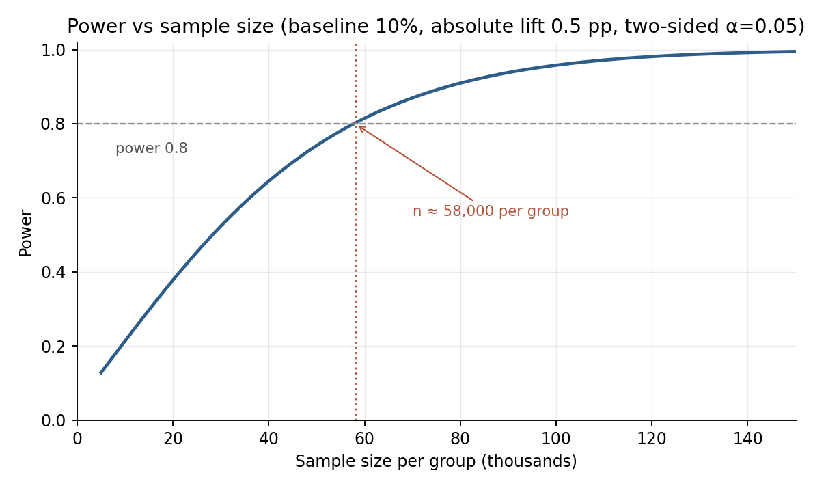

我们来看一个常见的“按钮颜色”例子：我们开发了一个购物 App，想知道“加入购物车”按钮应该用灰色还是橙色。于是，我们将用户分为两组，让一组看到原来的灰色按钮，另一组看到橙色按钮，并在两周后比较两组的转化率。

假设实验结束后，橙色按钮组的转化率是 10.5%，灰色按钮组是 10.0%。橙色按钮组高出 0.5 个百分点，但仅凭这个结果，我们还不能判断是否应该将橙色按钮推给所有用户：这 0.5 个百分点可能包含随机波动，也可能受到分组方式或其他因素的影响。

这里可以区分两个相互关联的问题。第一个是**统计问题**：假如两种按钮在目标用户群体中的转化率没有差异，实验中出现目前这样或更大的差异是否常见？第二个是**归因问题**：即使数据提供了组间存在差异的证据，这一差异能否归因于按钮颜色，而不是分组或同期其他因素？

本文主要讨论第一个问题，也就是如何用假设检验、置信区间和样本量计算理解实验结果。归因还需要考虑随机分流、指标定义和实验过程中的其他条件，将在下一篇讨论。文中的购物车实验和数值均为示例，用于说明方法，不代表真实线上实验。

## 从转化率差异到假设检验

为了描述两组差异，记橙色按钮组为处理组 $T$，灰色按钮组为对照组 $C$。令二元变量 $Y$ 表示用户是否转化：转化时取 1，否则取 0。两组的总体转化率分别记为 $p_T$ 和 $p_C$，我们关心的是

$$
\Delta=p_T-p_C.
$$

实验结束后，用两组的样本转化率估计它：

$$
\hat\Delta=\hat p_T-\hat p_C.
$$

在这个例子中，$\hat\Delta=10.5\%-10.0\%=0.5$ 个百分点。如果实验设计有效，这个差异可以作为按钮颜色效应的估计；如果分组并非随机，或者实验中还有其他差异，则它首先只是一个**观测到的组间差异**。

假设检验从原假设和备择假设出发。若我们关心橙色按钮是否会使转化率发生变化，而不预先限定变化方向，可以设定双侧检验：

$$
H_0:\Delta=0,\qquad H_a:\Delta\neq 0.
$$

设两组样本量分别为 $n_T$ 和 $n_C$，转化人数分别为 $x_T$ 和 $x_C$。在原假设下，两组共享同一个总体转化率，可以用合并后的样本比例估计它：

$$
\hat p=\frac{x_T+x_C}{n_T+n_C}.
$$

相应的两比例 $Z$ 统计量为

$$
Z=\frac{\hat p_T-\hat p_C}
{\sqrt{\hat p(1-\hat p)\left(\frac{1}{n_T}+\frac{1}{n_C}\right)}}.
$$

当两组观测相互独立、样本量足够大，且每组的成功与失败次数都足以支持正态近似时，原假设下的 $Z$ 统计量近似服从标准正态分布。这里的“样本量足够大”不能脱离转化率单独判断：如果转化事件很稀少，即使总样本量看起来不小，正态近似仍可能不合适。

统计公式也依赖观测单位的选择。假如随机分流的单位是用户，分析时却把同一用户的多次订单当成彼此独立的观测，标准误就可能估计错误。应先明确指标和随机化单位是否匹配；如果需要使用用户内的多条记录，可以考虑按用户汇总，或采用与相关结构相适应的方法，例如聚类稳健标准误。具体做法取决于指标定义，不能认为所有订单数据都能直接转换成相同的用户级指标。

## p 值能说明什么

计算出检验统计量后，我们可以得到 p 值。对于上述双侧检验，p 值是指：**在原假设及检验所依赖的模型条件成立时，观察到绝对值不小于当前统计量的概率。**

因此，p 值描述的是原假设下数据与假设的不相容程度，而不是“原假设为真的概率”，也不是“橙色按钮有效的概率”。它也不是恰好出现当前这组数据的概率：双侧检验还要把比当前结果更极端的情况计入。

假设实验前设定显著性水平 $\alpha=0.05$，得到 $p=0.049$ 时，我们按照这一规则拒绝原假设；得到 $p=0.051$ 时，则不拒绝原假设。但两个结果非常接近，不能据此把前者描述为“确定有效”，把后者描述为“确定无效”。显著性阈值提供了事先约定的判断规则，不会使阈值两侧的证据突然发生质变。

同样，未拒绝原假设不等于证明效应为零。可能存在的情况包括：真实差异较小、样本量不足、指标波动较大，或这些因素共同作用。要判断数据与哪些效应大小相容，还需要结合效应估计和置信区间。

统计显著也不等同于值得上线。样本量足够大时，即使转化率的差异很小，也可能得到较小的 p 值；但这个差异是否足以覆盖开发、维护或其他成本，仍是单独的业务判断。

## 两类错误、功效与实验前的选择

假设检验的规则需要在实验前确定。即便检验按计划执行，结论也可能出错：原假设为真时拒绝它，称为**第一类错误**；真实效应不为零时未能拒绝原假设，称为**第二类错误**。

显著性水平 $\alpha$ 控制的是原假设成立时发生第一类错误的概率上限。在按钮例子中，它对应的是：两种按钮在总体上的转化率没有差异，但检验错误地给出差异显著的结论。

第二类错误率通常记为 $\beta$，功效（power）则是

$$
\mathrm{power}=1-\beta.
$$

对于双侧备择假设，“真实效应不为零”包含许多不同的效应大小，功效也会随之变化。因此，更准确的说法是：**当真实效应等于某个指定值时，功效是检验拒绝原假设的概率。**例如，针对真实提升 0.5 个百分点这一设定，如果功效为 0.8，则在其他设计条件成立且重复进行同类实验时，约有 80% 的实验会拒绝原假设，约有 20% 不会。

$\alpha=0.05$ 和功效 0.8 是常见的设计选择，但它们不是所有场景的最优答案。误推无效改版与错过有效改版的代价可能不同，实验前应结合决策风险、可用流量和最小业务收益讨论。功效还受到目标效应、样本量、指标方差和显著性水平的影响：在其他条件不变时，目标效应越小，通常需要更多样本才能达到相同功效。

## 把置信区间放回案例中

p 值告诉我们，数据在原假设下有多不寻常；估计值和置信区间则有助于讨论差异的方向、大小和估计精度。对于两组独立样本，两比例之差的一个常用近似置信区间是

$$
\hat\Delta\pm z_{1-\alpha/2}
\sqrt{
\frac{\hat p_T(1-\hat p_T)}{n_T}
+
\frac{\hat p_C(1-\hat p_C)}{n_C}
}.
$$

这里使用的是两组各自的样本比例来估计标准误，与前面在原假设下合并比例的 $Z$ 检验有所不同，因此两者在临界位置的结论不一定完全一致。

继续看购物车例子。假设两组各有 60,000 名用户，橙色按钮组的转化率为 10.5%，灰色按钮组为 10.0%。两比例之差的估计值是 $0.005$，即 0.5 个百分点；按上式计算，未合并标准误约为

$$
\sqrt{\frac{0.105\times0.895}{60000}
+\frac{0.10\times0.90}{60000}}
\approx 0.00175.
$$

对应的 95% 置信区间约为

$$
0.005\pm 1.96\times0.00175
\approx (0.0016,\ 0.0084).
$$

换成更容易阅读的单位，估计提升为 **0.5 个百分点**，95% 置信区间约为 **0.16 至 0.84 个百分点**。该区间不包含零；对这个例子，前面的合并比例双侧 $Z$ 检验得到的 p 值也约为 0.0043，在 0.05 水平下拒绝原假设。

频率学派置信区间的解释是：如果在相同条件下重复抽样，并每次按相同方法构造区间，约 95% 的区间会覆盖真实参数。对于这次已经算出的区间，我们可以说它给出了与数据相容的一组参数值，但不应直接说“真实效应有 95% 的概率落在这个固定区间内”。

结果汇报时，还需要区分绝对提升和相对提升。这里的绝对提升是 0.5 个百分点，相对于对照组 10.0% 的转化率，估计的相对提升为 5%。只说“提升 5%”容易让人误以为转化率增加了 5 个百分点。

业务门槛也会改变我们对结果的解读。假设上线至少需要提升 0.3 个百分点，虽然点估计超过了门槛，但 95% 置信区间仍包含低于 0.3 个百分点的值，因此现有区间不能排除低于门槛的效应。是否上线还要结合成本、风险和决策规则，不能仅由“显著”二字决定。

## 要多少样本，才能检出关心的变化

实验前通常需要选择一个想要检出的效应大小。它常被称为**最小可检测效应**（minimum detectable effect，MDE）：在给定显著性水平、目标功效和其他设计条件下，希望实验能够以该功效检出的效应。它不是实验结束后观测到的效应，也不是“低于这个数就绝不可能显著”的硬边界。

对于两组样本量相等的双侧比例检验，可以用以下正态近似作样本量规划：

$$
n\approx
\frac{
\left(z_{1-\alpha/2}+z_{1-\beta}\right)^2
\left[p_T(1-p_T)+p_C(1-p_C)\right]
}{
(p_T-p_C)^2
}.
$$

其中 $n$ 是**每组**所需样本量，$p_C$ 是规划时设定的基线转化率，$p_T-p_C$ 是希望检出的绝对差异。不同的近似方法对原假设和备择假设下的方差处理可能不同，因而给出的样本量也会略有差异；实际实验宜使用与预定检验方法一致的样本量工具，并考虑数据损失等因素。

沿用前面的例子，假设基线转化率为 10%，希望以 80% 的功效检出从 10% 到 10.5% 的变化，设双侧 $\alpha=0.05$。代入 $z_{0.975}\approx1.96$ 和 $z_{0.8}\approx0.842$，得到每组约需 57,760 名用户。

如果希望检出的相对提升从 5% 降至 2.5%，即从 10% 到 10.25%，同一近似公式给出的样本量约为每组 228,552。由于目标绝对差异减半，而公式的分母包含差异的平方，所需样本量接近原来的四倍；两次计算中的方差略有变化，因此并非恰好四倍。

下面的代码可以复现第一个结果：

```python
from statistics import NormalDist

z = NormalDist().inv_cdf
variance = 0.105 * 0.895 + 0.10 * 0.90

n = (z(0.975) + z(0.8)) ** 2 * variance / 0.005**2
print(round(n))  # 57760
```



在上述参数和近似方法下，功效曲线展示了样本量与检出概率之间的关系。随着功效接近 1，继续提高功效通常需要更多样本。0.8 可以作为讨论设计方案的起点，但不能仅凭曲线形状断言它在所有业务场景下都是成本最优的选择。

如果实验在开始前就明确只检验“橙色按钮是否提高转化率”，可以考虑单侧检验。按照上面的近似公式，将双侧临界值 $z_{1-\alpha/2}$ 换成单侧的 $z_{1-\alpha}$，在 $\alpha=0.05$、其余参数不变时，每组所需样本量约为 45,497，比双侧设计少约 21%。代价是该单侧检验不能用同一拒绝规则宣称反方向的差异显著；因此，方向应在实验前确定，不能看到结果后再挑选有利的方向。

## 查看多个指标时，显著结果要怎么解释

假设除了“加入购物车”转化率，我们还同时检验购买率、平均订单金额和其他指标。如果每个指标都单独按 0.05 的显著性水平判断，再只挑选显著的结果展示，就可能高估数据所提供的证据。

当 $m$ 个检验**相互独立，且各个原假设均为真、每次第一类错误率均为 $\alpha$** 时，至少出现一次第一类错误的概率为

$$
1-(1-\alpha)^m.
$$

例如，$\alpha=0.05$、$m=10$ 时，这个概率约为 40.1%。各指标的检验往往相关，此时不能直接套用这个数值；但同时进行多个检验仍需要事先考虑如何控制错误率或解释探索性结果。

常用的多重检验方法控制的对象并不相同：

- **Bonferroni 方法**将每次检验的显著性阈值设为 $\alpha/m$，用于控制至少出现一次第一类错误的概率，即族错误率（family-wise error rate，FWER）。它适用范围广，但可能较保守。
- **Holm 方法**将 p 值从小到大排序，依次与调整后的阈值比较，也用于控制 FWER；在相同条件下，它通常比简单的 Bonferroni 方法更有检出力。
- **Benjamini–Hochberg 方法**，简称 BH，用于控制错误发现率（false discovery rate，FDR），即被拒绝的假设中错误拒绝所占比例的期望；其标准控制保证需要独立性或特定依赖条件，不能把它理解为对每一次假阳性都分别提供保证。

例如，四个检验排序后的 p 值为

$$
(0.001,\ 0.02,\ 0.03,\ 0.06),
$$

取 $\alpha=0.05$。Bonferroni 的单次阈值是 $0.05/4=0.0125$，因此只拒绝第一个假设。BH 方法则寻找满足 $p_{(i)}\leq i\alpha/4$ 的最大序号 $i$，然后拒绝从第一个到该序号的假设。在这组数值中，第三个 p 值 $0.03$ 小于对应阈值 $0.0375$，第四个 $0.06$ 大于 $0.05$，所以 BH 拒绝前三个假设。

两种方法得到不同结果，是因为它们控制的错误标准不同。汇报时应说明哪些指标是实验前确定的核心指标、哪些属于探索性分析，以及采用了什么多重比较方法。护栏指标的作用和判断规则也应提前定义；并非只有出现显著变化时才需要关注风险。

## 结语

回到开头的按钮实验：10.5% 与 10.0% 的差异是一个估计值。它是否足以排除原假设下的随机波动，需要结合样本量和检验方法；它的大小是否足以支持上线，需要结合置信区间和业务门槛；它是否能归因于按钮颜色，还取决于实验设计和执行。

假设检验、功效、样本量与置信区间分别回答不同问题，不能用一个 p 值替代。下一篇将继续讨论随机分流、指标设计和实验过程中的问题，看看这些条件如何影响我们对组间差异的解释。

---

系列导航：[00 系列导言](./causal-ab-00-series.html) · [02 一个可信的 A/B 测试如何设计](./causal-ab-02-design.html) · [03 当随机实验做不了：DID、IV、PSM 与 RD](./causal-ab-03-identification.html)
