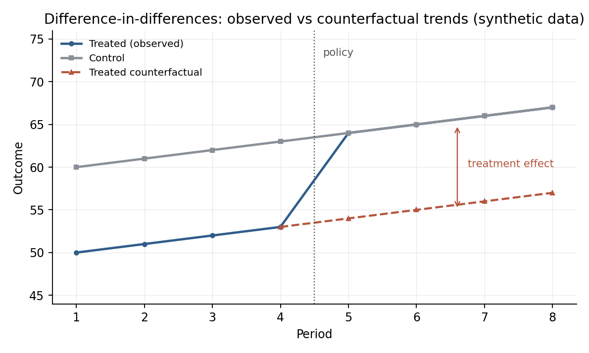

相关变成因果，靠的不是更复杂的模型，而是一条可以被论证的识别假设。随机实验用分配机制保证识别，准实验用平行趋势、排他性、可观测选择或断点连续性替代它。每一种方法的价值不在估计量公式，而在那条假设能否被数据与制度背景支撑。这篇按「假设从哪里来」梳理双重差分、工具变量、倾向得分匹配与断点回归，最后说明 A/B 回答不了的问题。

## 1. 潜在结果与根本问题

Rubin 因果模型给每个个体定义两个潜在结果：接受处理时的 $Y_i(1)$，不接受时的 $Y_i(0)$。观测到的结果是

$$
Y_i=D_i\,Y_i(1)+(1-D_i)\,Y_i(0),
$$

$D_i$ 是处理指示变量。个体的处理效应是 $Y_i(1)-Y_i(0)$，但同一个人只能处在一个状态，两个潜在结果必有一个观测不到。这是因果推断的根本问题：缺失的那一半不是随机缺失，而是由处理状态决定的。

既然个体效应不可识别，就把目标换成总体层面的平均：

$$
\mathrm{ATE}=\mathbb{E}[Y(1)-Y(0)],\qquad
\mathrm{ATT}=\mathbb{E}[Y(1)-Y(0)\mid D=1].
$$

ATT 是对已处理者的平均效应，政策评估通常关心它；ATE 是全体人的平均效应，是否推广要看它。两者只在同质处理效应下相等，存在异质性时不能混用。断点回归进一步把目标缩到断点附近的局部平均处理效应（LATE），这是外部效度受限的根源。

## 2. 选择偏差从哪里来

直接比较处理组与对照组的均值，得到的差可以分解为

$$
\mathbb{E}[Y\mid D=1]-\mathbb{E}[Y\mid D=0]
=\underbrace{\mathbb{E}[Y(1)-Y(0)\mid D=1]}_{\mathrm{ATT}}
+\underbrace{\mathbb{E}[Y(0)\mid D=1]-\mathbb{E}[Y(0)\mid D=0]}_{\text{选择偏差}} .
$$

第二项是反事实：处理组如果不受处理，本来会怎样。只要处理与否与潜在结果相关，这一项就不为零。选择偏差的来源可以粗分为三类：可观测变量的选择，例如高线城市用户既更可能用新功能、本来转化也更高；不可观测但随时间不变的因素，例如个人能力；不可观测且随时间变化的因素，例如同时发生的促销活动。

识别方法的分工就建立在这三类来源上。可观测混杂用匹配或加权；不随时间变化的不可观测混杂用差分；随个体变化的不可观测混杂需要工具变量或断点。选方法之前先问「混杂来自哪里」，比先问「我会哪个方法」更重要。

## 3. 随机实验的基准与边界

随机分配让处理状态与潜在结果独立，选择偏差项为零，直接相减就是无偏的 ATE。A/B 测试的可信度来自这里，不是来自样本量。随机化检验提供了对应的推断方式：分配机制已知，零分布由重新分配生成，不依赖分布假设。

随机实验也有清楚的边界。稳定性假定要求一个人的结果不受他人处理状态影响，社交产品、双边市场与供给受限的场景最容易违反。依从性不完美时，意向处理效应与依从者平均效应不同。样本流失若与处理相关，会重新引入选择偏差。实验规模一大，价格与竞争会变化，局部实验的结论未必能推到全局。这些限制不是放弃实验的理由，而是转向准实验的理由。

## 4. 双重差分

2×2 双重差分的回归形式是

$$
y_{it}=\beta_0+\beta_1\mathrm{Treat}_i+\beta_2\mathrm{Post}_t+\beta_3(\mathrm{Treat}_i\times\mathrm{Post}_t)+\epsilon_{it},
$$

交互项系数 $\beta_3$ 就是 DID 估计量。$\mathrm{Treat}_i$ 吸收组间不随时间变化的差异，$\mathrm{Post}_t$ 吸收共同的时间冲击，剩下的交互项对应「处理组在政策后相对对照组多出来的变化」。

识别的核心假设是平行趋势：没有政策时，两组的潜在结果会以相同趋势变化。这个反事实无法直接检验。实践上用事件研究提供间接证据：把政策前后各期拆成相对时间虚拟变量，以政策前一期为基准回归，事前系数联合不显著支持平行趋势，事后系数刻画动态效应。事前系数显著，或者趋势在政策前已经分化，DID 的结论就要打折扣。

图中政策发生在中间时点。处理组在政策后跳升，对照组保持原趋势；如果处理组在政策前就与对照组走势不同，虚线所示的反事实就不成立，DID 估计的差值里会混入趋势差异。

把一个 2×2 的数值例子写出来，四格分别是政策前后的组均值：

| | 政策前 | 政策后 | 变化 |
|---|---|---|---|
| 处理组 | 50 | 62 | +12 |
| 对照组 | 60 | 64 | +4 |

处理组变化 12，对照组变化 4，DID 估计为 $12-4=8$。如果只比较政策后的两组，会得到 $62-64=-2$，方向完全相反，因为两组在政策前本来就不在同一水平。DID 用组内变化扣掉了这个初始差异，代价是要求两组在政策前的趋势一致。

DID 还有一个常被忽略的问题：处理时点交错时，双向固定效应的估计量会用到已经处理过的单位作对照，产生负权重与偏误，需要异质性稳健的估计量。这一点超出课程范围，本文只作提示。

## 5. 工具变量

当遗漏变量不可观测且随时间变化，工具变量（IV）提供一个外部变异源。工具 $Z$ 要满足两个条件：相关性，$Z$ 与内生解释变量 $D$ 相关；排他性，$Z$ 只通过 $D$ 影响 $Y$，不直接影响 $Y$。

两阶段最小二乘（2SLS）的第一阶段把 $D$ 对 $Z$ 及外生控制变量回归，得到拟合值 $\hat D$；第二阶段把 $Y$ 对 $\hat D$ 回归。估计量的一致性依赖排他性，而排他性通常无法用数据检验，只能靠制度与理论论证。弱工具会让 2SLS 偏向 OLS 并放大方差，所以第一阶段要报告 $F$ 统计量，经验上低于 10 需要警惕。工具个数多于内生变量个数时可以做过识别检验，但它只能否证，不能证明排他性。

IV 识别的是依从者的局部平均处理效应，不是全体 ATE。汇报时必须说清楚，否则会把「对某类人的效果」讲成「对所有人的效果」。

## 6. 倾向得分匹配与逆概率加权

可观测选择下，匹配的思路是给每个处理组个体找特征相近的对照组个体。协变量一多就遇到维度诅咒，Rosenbaum–Rubin 的倾向得分定理把问题降为一维：定义

$$
e(X)=P(D=1\mid X),
$$

在给定倾向得分的条件下，处理分配与协变量独立，因此按 $e(X)$ 匹配即可平衡协变量。匹配之前先看重叠：处理组与对照组的倾向得分分布如果没有共同区间，落在区间外的个体无法找到可比对象，只能剔除，这会改变估计的目标人群。匹配之后要做平衡性检验，比较匹配前后各协变量的标准化差异，而不是只看匹配后的 t 检验显著性。

倾向得分也可以用作权重。逆概率加权（IPW）用 $1/e(X)$ 与 $1/(1-e(X))$ 给样本加权，构造伪总体，使加权后的处理组与对照组在协变量上可比。

匹配的实操顺序可以固定成五步：用 logit 或 probit 估计倾向得分；检查两组的得分分布是否有共同支撑，删掉落在对方区间之外的个体；按最近邻、卡尺或核匹配把处理组与对照组配对，或直接用权重；比较匹配前后各协变量的标准化差异，确认平衡；在匹配样本上估计 ATT，并报告匹配前后样本量的变化。每一步都要留记录，否则无法判断结果的偏差来自匹配本身还是样本筛选。

匹配与加权都只能控制可观测混杂。把 PSM 的结果说成「控制了所有混杂」，是把可观测选择假设当成了事实。PSM 与 DID 可以叠加：先匹配再在匹配样本上做差分，同时利用可观测变量的平衡与不随时间变化的不可观测因素，但这仍然处理不了「不可观测且随时间变化」的混杂。

## 7. 断点回归

断点回归利用一条规则：驱动变量越过截断点就获得处理，截断点两侧的个体在其他特征上应当连续。识别假设是结果变量与驱动变量在截断点处连续，除了处理状态本身。若个体能操纵驱动变量，例如把分数刚好改到录取线以上，连续性被破坏，需要做操纵检验。

断点附近的比较可以解释为局部随机实验，识别的是断点处的 LATE。带宽选择是偏差与方差的权衡：带宽越窄，线性近似越可信但样本越少；带宽越宽，样本多但函数形式假设更强。实践上报告多个带宽下的结果，看结论是否稳健。外部效度受限于断点邻域，把断点附近的效果推到全体人群，需要额外论证。

RD 的可信度来自制度规则的刚性：录取线、年龄门槛、政策覆盖线。规则可以被规避时，RD 的前提就不成立。

## 8. 固定效应与方法选择

面板数据里，个体固定效应吸收不随时间变化的个体特征，组内估计量先对每个个体去均值再回归：

$$
y_{it}-\bar y_i=(x_{it}-\bar x_i)'\beta+(\epsilon_{it}-\bar\epsilon_i).
$$

不随时间变化的个体特征在相减时被消掉，所以估计不受它们影响。它控制的是个体层面不随时间变化的混杂，控制不了随时间变化的遗漏变量，也控制不了处理与时间冲击的交互。

把上面的方法按混杂来源排一张表：

| 混杂来源 | 可用方法 | 关键假设 | 主要失效情形 |
|---|---|---|---|
| 随机分配已知 | A/B 测试、随机化检验 | 分配机制已知、无干扰 | 样本污染、SRM、依从性差 |
| 可观测变量 | PSM、IPW | 可观测选择、共同支撑 | 遗漏不可观测混杂、重叠不足 |
| 不随时间变化 | DID、固定效应 | 平行趋势 / 个体效应可加 | 趋势不同、交错处理 |
| 有不随时间变化的工具 | IV、2SLS | 相关性、排他性 | 弱工具、排他性不成立 |
| 有断点规则 | RD | 截断点处连续 | 驱动变量被操纵、带宽过宽 |

## 9. A/B 回答不了的问题

即使能随机化，仍有一些问题无法用实验回答：长期效应与新奇效应，实验期太短会高估短期效果；市场均衡效应，实验规模一大价格与竞争会变化；溢出与网络效应，违反稳定性假定；公平性与分配效应，平均效应掩盖了谁受益谁受损；涉及伤害或隐私的干预，伦理上不能随机化。这些问题需要的不是更强的统计，而是准实验设计与制度证据。

## 10. 小结

四种准实验方法的共同点，是用一条可论证的假设替代随机分配：DID 用平行趋势，IV 用排他性，PSM 用可观测选择，RD 用断点连续性。每一条假设都有对应的失效情形，识别的工作就是把假设与失效情形一起讲清楚，而不是只报一个估计值。

A/B 是基准，不是全部。能实验时把实验做干净，不能实验时把假设讲明白，这两句话概括了这个系列的全部结论。

---

系列导航：[00 系列导言](./causal-ab-00-series.html) · [01 假设检验、p 值与实验该看什么](./causal-ab-01-foundations.html) · [02 一个可信的 A/B 测试如何设计](./causal-ab-02-design.html)
