项目完成于 2026 年 3 月，本文为整理版。

## 项目速览

<div class="table-wrap">
<table class="overview">
<thead><tr><th>项目要素</th><th>内容</th></tr></thead>
<tbody>
<tr><td>问题</td><td>根据花萼、花瓣四项尺寸，把鸢尾花分为 Setosa、Versicolor、Virginica 三类</td></tr>
<tr><td>数据</td><td>scikit-learn 内置 Iris，150 条样本、4 个数值特征、3 个类别</td></tr>
<tr><td>方法</td><td>探索性分析 → 面积与比例特征构造 → ColumnTransformer + RandomForest → 网格搜索 → 序列化部署</td></tr>
<tr><td>结果</td><td>端到端 Pipeline 留出集准确率 93.3%；网格搜索后 100%（30 条留出样本，样本量小，仅用于验证流程完整性）</td></tr>
</tbody>
</table>
</div>

**分析流程**

- 了解问题的背景；
- 获取数据；
- 探索数据和可视化；
- 为机器学习算法准备数据；
- 选择模型并进行训练；
- 模型调优；
- 提出解决方案。

技术栈：Python 3.11、pandas、scikit-learn、Matplotlib。

## 1. 问题的背景

当前，公司（智慧农业科技公司）业务正处于自动化产线升级阶段，现有的切花分拣流水线急需智能化改造。

项目：利用历史上采集的鸢尾花（Iris）生长尺寸数据，建立一个花卉品种的自动分类预估模型。

*   **样本点（Sample）**：代表流水线上单株鸢尾花个体的检测记录；
*   **预测变量（Predictor / Feature）**：由上游光学传感器测量的花卉物理尺寸特征，具体包括花萼长度（Sepal Length）、花萼宽度（Sepal Width）、花瓣长度（Petal Length）和花瓣宽度（Petal Width）四个Feature；
*   **响应变量（Response / Target）**：鸢尾花的具体品种类别（山鸢尾 Setosa、变色鸢尾 Versicolor、维吉尼亚鸢尾 Virginica，共3种）。

目标：利用历史留存的专家鉴定标签及物理测量数据训练一个机器学习分类器，该模型需要能够根据机器视觉采集到的尺寸变量，**准确且迅速地预测出任何流入生产线上的新花卉所属的品种。**

在项目立项阶段，需要在了解问题背景时完成以下几件事：
1. 确定这个问题的业务目标；
2. 选择合理的指标来衡量模型性能；
3. 检查这个项目上下游的假设条件。

---

### 1.1 确定问题的目标

**1. 训练一个分类模型本身并不是最终目标。这个环节在公司整体业务线中的最终目标：**

**Answer.** 模型的输出结果（对特定鸢尾花的品种预测信号）将直接输入到下游的“**自动化分拣与动态定价系统**”。不同品种的鸢尾花在市场定位、商品单价、花托包装耗材以及最佳冷链储藏温度上存在显著差异。下游的机械臂调度系统将依据该分类信号，实时完成产线上的物理拨接与分发，同时商务报货系统将根据分类数据向客户进行自动化预售和估值。

**Remark.** 上游业务线（机器视觉硬件）提供尺寸测算数据，下游业务线（机械化分拣）需要高并发的品种识别结果。此时，模型必须结合下游产线的迟延容忍度来进行架构设计。

**2. 公司内目前的解决方案是（业务Baseline）：**

**Answer.** 现阶段，产线上的品种鉴定完全依赖于资深植物学家或受过专门训练的农业质检员进行流水线上的“人工肉眼核验”。遇到物理特征相似的品种时（例如 Versicolor 与 Virginica 之间存在形态重合区），甚至需要人工抽样进行游标卡尺测量，这导致流水线的运转低效。

**Remark.** 现有人工 Baseline 清晰地暴露了业务痛点，也正是本次构建机器学习模型需要达到的业务优化指标：
*   **人力成本高昂**：专业质检员培训周期长、雇佣且维持此类专家的成本极高；
*   **产能瓶颈（效率低）**：流水线分发速度受限于人类视觉反应与动作极限，在采收旺季成为最大的产能堵点；
*   **质量方差大**：人工操作不可避免地受制于疲劳曲线，高强度工作下的错分率以及次品流出率无法得到收敛控制。

---

### 1.2 衡量模型性能的指标与假设约束

**技术衡量指标：**
针对此次多分类任务（Multiclass Classification），单纯地使用准确率（Accuracy）作为指标可能掩盖某些容易混淆类别（如Versicolor和Virginica）的错分情况。基于企业的质损容忍度，我们需要引入**Confusion Matrix**观测具体的错分流向，并采用 **F1-Score（微观或宏观平均）** 综合评估分类器的精确率（Precision）和召回率（Recall），避免高净值花卉被错误降级为低净值品种而造成直接财务损失。

**主要评价分类指标计算公式（以二分类为例，其中TP/TN/FP/FN分别代表真阳性/真阴性/假阳性/假阴性）：**
- **准确率 (Accuracy)**: 样本中整体预测正确的比例。
  $$ \text{Accuracy} = \frac{TP + TN}{TP + TN + FP + FN} $$
- **精确率 (Precision)**: 预测为正的样本中，实际也为正的比例。
  $$ \text{Precision} = \frac{TP}{TP + FP} $$
- **召回率 (Recall)**: 实际为正的样本中，被成功预测为正的比例。
  $$ \text{Recall} = \frac{TP}{TP + FN} $$
- **F1-Score**: 精确率和召回率的调和平均数，兼顾了两者的表现。
  $$ F1 = 2 \times \frac{\text{Precision} \times \text{Recall}}{\text{Precision} + \text{Recall}} $$


**针对本次鸢尾花多分类任务的验证推广（Macro / Micro Average）：**
对于多分类问题，**准确率（Accuracy）**可直接计算所有类别中被正确分类的样本比例。而对于**精确率（Precision）、召回率（Recall）和 F1-Score**，通常将任务转化为多个“一对其余（One-vs-Rest）”的二分类子问题，通过以下两种方式进行汇总平均：
- **宏平均（Macro-Average）**: 先独立计算每个类别 $i$ 的评估指标（如 $Precision_i, Recall_i$），再对所有类别的指标求简单的算术平均值。这种方式对每一个类别“一视同仁”，不受类别样本数差异的影响。
  $$ \text{Macro-}Metric = \frac{1}{C}\sum_{i=1}^{C} Metric_i \quad (C为总类别数，Metric代表 Precision, Recall 或 F1) $$
- **微平均（Micro-Average）**: 全局累加所有类别的 $TP_i,\ FP_i,\ FN_i$，求出整体的 $TP, FP, FN$ 后，再代入标准公式计算全局统一的评价指标。例如：
  $$ \text{Micro-Precision} = \frac{\sum_{i=1}^{C} TP_i}{\sum_{i=1}^{C} (TP_i + FP_i)} $$
  *注：在常规的单标签多分类任务（如鸢尾花分类）中，由于每个样本必定只属于唯一一个预测类别和真实类别，因此微平均下的精确率、召回率和 F1-Score 在数学推导上是**完全相等**的，并且它们均等价于模型的**全局准确率（Overall Accuracy）**。*

**业务假设条件：**
* 假设上游传感器捕获的 `[花萼, 花瓣]` 长宽数据具备高可靠度且不存在过大的仪器系统误差；
* 假设流水线边缘端（Edge）的算力能够支撑拟选定模型（如逻辑回归、SVM或随机森林）迅速完成 **Inference**，确保物理分拣动作及时响应。

## 2. 获取数据

在本环节中，利用 `scikit-learn` 库内置的 `load_iris()` 接口直接获取鸢尾花数据集。

为了数据分析的workflow，并方便后续进行探索性数据分析和特征工程，将默认返回的 NumPy 数组格式转换为结构化的表格 `pandas.DataFrame` 格式。同时，将数值型标签（0, 1, 2）显式映射为其对应的真实生物学品种名称（Setosa, Versicolor, Virginica），以增加数据的可读性。

```python
import pandas as pd
from sklearn.datasets import load_iris

# 1. 加载Scikit-Learn内置的鸢尾花数据集
iris_bunch = load_iris()

# 2. 将特征数据(X)转化为 DataFrame，使用官方提供的特征名称作为列名
iris_df = pd.DataFrame(data=iris_bunch.data, columns=iris_bunch.feature_names)

# 3. 拼接目标响应变量(y)
iris_df['target'] = iris_bunch.target

# 4. 创建目标分类字典，将 0、1、2 映射为具体的字符串类别名称，方便业务理解
target_mapping = {i: name for i, name in enumerate(iris_bunch.target_names)}
iris_df['target_name'] = iris_df['target'].map(target_mapping)

# 5. 查看数据集规模
print(f"数据集的整体维度 (样本数, 字段数): {iris_df.shape}\n")
```

```text
数据集的整体维度 (样本数, 字段数): (150, 6)
```

## 3. 快速浏览数据结构

加载了数据后，可以快速浏览数据，进行一些基础的描述性统计分析。这一步主要是为了初步了解数据，比如有多少样本、有哪些变量、特征类型的分布以及是否有缺失值。

```python
# 展示前5条数据进行初步核验
iris_df.head()
```

<style scoped>
    .dataframe tbody tr th:only-of-type {
        vertical-align: middle;
    }

    .dataframe tbody tr th {
        vertical-align: top;
    }

    .dataframe thead th {
        text-align: right;
    }
</style><div>

<div class="table-wrap"><table border="1" class="dataframe">
  <thead>
    <tr style="text-align: right;">
      <th></th>
      <th>sepal length (cm)</th>
      <th>sepal width (cm)</th>
      <th>petal length (cm)</th>
      <th>petal width (cm)</th>
      <th>target</th>
      <th>target_name</th>
    </tr>
  </thead>
  <tbody>
    <tr>
      <th>0</th>
      <td>5.1</td>
      <td>3.5</td>
      <td>1.4</td>
      <td>0.2</td>
      <td>0</td>
      <td>setosa</td>
    </tr>
    <tr>
      <th>1</th>
      <td>4.9</td>
      <td>3.0</td>
      <td>1.4</td>
      <td>0.2</td>
      <td>0</td>
      <td>setosa</td>
    </tr>
    <tr>
      <th>2</th>
      <td>4.7</td>
      <td>3.2</td>
      <td>1.3</td>
      <td>0.2</td>
      <td>0</td>
      <td>setosa</td>
    </tr>
    <tr>
      <th>3</th>
      <td>4.6</td>
      <td>3.1</td>
      <td>1.5</td>
      <td>0.2</td>
      <td>0</td>
      <td>setosa</td>
    </tr>
    <tr>
      <th>4</th>
      <td>5.0</td>
      <td>3.6</td>
      <td>1.4</td>
      <td>0.2</td>
      <td>0</td>
      <td>setosa</td>
    </tr>
  </tbody>
</table></div>
</div>

```python
iris_df.info()
```

```text
<class 'pandas.DataFrame'>
RangeIndex: 150 entries, 0 to 149
Data columns (total 6 columns):
 #   Column             Non-Null Count  Dtype  
---  ------             --------------  -----  
 0   sepal length (cm)  150 non-null    float64
 1   sepal width (cm)   150 non-null    float64
 2   petal length (cm)  150 non-null    float64
 3   petal width (cm)   150 non-null    float64
 4   target             150 non-null    int32  
 5   target_name        150 non-null    str    
dtypes: float64(4), int32(1), str(1)
memory usage: 7.8 KB
```

```python
iris_df.describe()
```

<style scoped>
    .dataframe tbody tr th:only-of-type {
        vertical-align: middle;
    }

    .dataframe tbody tr th {
        vertical-align: top;
    }

    .dataframe thead th {
        text-align: right;
    }
</style><div>

<div class="table-wrap"><table border="1" class="dataframe">
  <thead>
    <tr style="text-align: right;">
      <th></th>
      <th>sepal length (cm)</th>
      <th>sepal width (cm)</th>
      <th>petal length (cm)</th>
      <th>petal width (cm)</th>
      <th>target</th>
    </tr>
  </thead>
  <tbody>
    <tr>
      <th>count</th>
      <td>150.000000</td>
      <td>150.000000</td>
      <td>150.000000</td>
      <td>150.000000</td>
      <td>150.000000</td>
    </tr>
    <tr>
      <th>mean</th>
      <td>5.843333</td>
      <td>3.057333</td>
      <td>3.758000</td>
      <td>1.199333</td>
      <td>1.000000</td>
    </tr>
    <tr>
      <th>std</th>
      <td>0.828066</td>
      <td>0.435866</td>
      <td>1.765298</td>
      <td>0.762238</td>
      <td>0.819232</td>
    </tr>
    <tr>
      <th>min</th>
      <td>4.300000</td>
      <td>2.000000</td>
      <td>1.000000</td>
      <td>0.100000</td>
      <td>0.000000</td>
    </tr>
    <tr>
      <th>25%</th>
      <td>5.100000</td>
      <td>2.800000</td>
      <td>1.600000</td>
      <td>0.300000</td>
      <td>0.000000</td>
    </tr>
    <tr>
      <th>50%</th>
      <td>5.800000</td>
      <td>3.000000</td>
      <td>4.350000</td>
      <td>1.300000</td>
      <td>1.000000</td>
    </tr>
    <tr>
      <th>75%</th>
      <td>6.400000</td>
      <td>3.300000</td>
      <td>5.100000</td>
      <td>1.800000</td>
      <td>2.000000</td>
    </tr>
    <tr>
      <th>max</th>
      <td>7.900000</td>
      <td>4.400000</td>
      <td>6.900000</td>
      <td>2.500000</td>
      <td>2.000000</td>
    </tr>
  </tbody>
</table></div>
</div>

**初步观察结论：**
*   **4个输入特征**：`sepal length (cm)`, `sepal width (cm)`, `petal length (cm)`, `petal width (cm)`。皆为纯数值型连续变量（`float64`）。
*   **1个目标变量**：`target`（以及我们映射生成的 `target_name`）。记录了3种独立的鸢尾花类别。
*   **数据完整度**：从 `iris_df.info()` 结果中可以观察到所有列均含有 150 个非空（Non-Null）项，说明这批**数据非常干净，没有任何缺失值（Missing Values）**，省去了我们填补或删除样本的数据清洗工作。
*   **数据特征的范围（Scale）**：各特征的量纲相差不大（最大值 7.9，最小值 0.1），但在后续向模型（如逻辑回归、SVM或神经网络）输入数据时，依然可能需要考虑进行特征缩放（Standardization/Normalization）。

进一步，我们通过查看各个品种的具体样本量，验证数据集是否存在类别不平衡（Class Imbalance）的问题。因为在分类任务中如果存在严重的样本不平衡，常规的抽样方式和仅仅看总体 Accuracy 会使得模型偏向占多数的类别：

```python
# 观察不同鲜花品种的样本分布
iris_df["target_name"].value_counts()
```

```text
target_name
setosa        50
versicolor    50
virginica     50
Name: count, dtype: int64
```

**观察结果：**
* 鸢尾花的3个品种（Setosa、Versicolor、Virginica）各自均有 50 个样本点。
* 这表明我们的数据集是 **完全均衡（Perfectly Balanced）** 的。在后续划分训练集和测试集时，虽然分层抽样（Stratified Sampling）仍是一个严密的工程习惯，但即便使用纯随机抽样，因样本极度平衡，通常也不会带来显著的分层误差。
* 此外，后续使用 Accuracy 作为主要的评估指标也是合理且具有代表性的。

另一种快速了解您当前所处理的数据类型的方法，是绘制每个数值型属性的直方图（Histogram）。直方图显示的是具有指定值范围（横轴区间）的实例的数量（纵轴频数）。

您可以逐个绘制变量，也可以在整个数据集上调用 `hist()` 方法，它将一次性将数据集下所有数值型变量的直方图都描绘出来。

`pandas.DataFrame.hist` Make a histogram of the DataFrame's columns. (https://pandas.pydata.org/pandas-docs/stable/reference/api/pandas.DataFrame.hist.html)

```python
import matplotlib.pyplot as plt

# 设置一下常用的显示风格
plt.rc('font', size=12)
plt.rc('axes', labelsize=12, titlesize=12)
plt.rc('legend', fontsize=12)
plt.rc('xtick', labelsize=10)
plt.rc('ytick', labelsize=10)

# hist() 方法会依赖于 Matplotlib 并自动描绘所有数值类型的列
# 为了避免将分类标签也画出直方图，我们只选择特征列进行绘制
iris_df.drop(columns=['target', 'target_name']).hist(bins=20, figsize=(10, 8), color='steelblue', edgecolor='black')
plt.suptitle("Histogram of Numerical Features", fontsize=16)
plt.show()
```

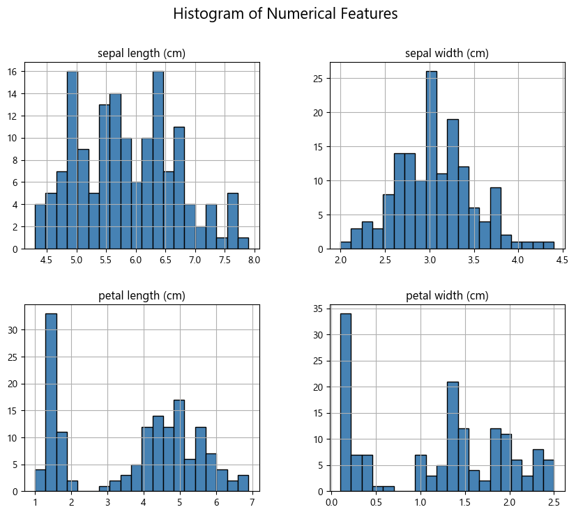

**观察直方图，我们能发现这批数据存在的一些特征及潜在“问题”：**

1. **不同特征的尺度（Scale / 量纲）差异问题**：
   * 虽然单位均为厘米（cm），且最大值不超过8.0，但仔细观察横轴可以发现：`sepal length (cm)` 大体分布在 4.5~8.0 之间，而 `petal width (cm)` 多数集中在 0.1~2.5 之间。
   * **潜在隐患**：这两个特征在绝对数值上相差甚远。在接下来的机器学习环节，如果我们使用**对距离极其敏感的算法**（例如 SVM 支持向量机、KNN K近邻算法、甚至基于梯度下降的神经网络），数值大的 `sepal` 特征将完全主导距离计算的权重。这就要求我们必须在后续准备数据时进行**特征缩放（Feature Scaling 如标准化/归一化）**。

2. **多峰分布（Multi-modal）与断层问题**：
   * `petal length (cm)` 与 `petal width (cm)` 并未呈现标准的单峰钟形（正态）分布，而是表现出明显的“双峰甚至多峰”现象，中间存在明显的**断层（Gap）**（例如 petal length 在 2cm~3cm 之间几乎是真空的）。
   * **业务洞察**：这种断层并非脏数据的截断，反而强烈暗示了存在一个与其他类群在生物学表征上“彻底隔离”的品种（通常是极易区分的山鸢尾 Setosa）。不过，严重偏离正态分布的特征，意味着如果不做正态化转化，直接丢给某些强制假定“数据服从高斯分布”的模型（如高斯朴素贝叶斯或纯线性模型）时，可能无法达到理论上的最佳性能。

3. **数据截断（Capping）的排查**：
   * 回顾类似《加州房价》等项目中（房价往往在 50 万美元处被人工截断，直方图最右侧会出现异常的高耸柱子），再看本次的鸢尾花直方图：**最右侧及边缘都是自然衰减的平滑尾部，不存在明显的数据封顶（Cap）或人为设定的截断硬阈值。**
   * **结论**：这是一个好消息。说明上游仪器没有对尺寸设置虚假的最高录入上限，模型对未来输入的大尺寸花卉同样具备连续的预测能力。

### 异常值检测

除了直方图直观展示分布的形状，**箱线图（Boxplot）** 是检验各个特征内部是否存在极端异常值的首选统计学工具。

针对于目前的分类任务，通过**按目标类别（品种）进行分组绘制箱线图**，不仅能够识别潜在的传感器录入异常，同时能从可视化层面印证不同种类的鸢尾花在某一特征（如花瓣长度）上是否存在明显的数值差距。

```python
import seaborn as sns

# 设置画布大小
plt.figure(figsize=(12, 8))

# 遍历四个特征，绘制分组箱线图
features = iris_bunch.feature_names
for i, feature in enumerate(features, 1):
    plt.subplot(2, 2, i)
    sns.boxplot(x='target_name', y=feature, data=iris_df, hue='target_name', legend=False)
    plt.title(f"{feature} by Species")
    plt.xlabel("")
    plt.ylabel("cm")

plt.tight_layout()
plt.show()
```

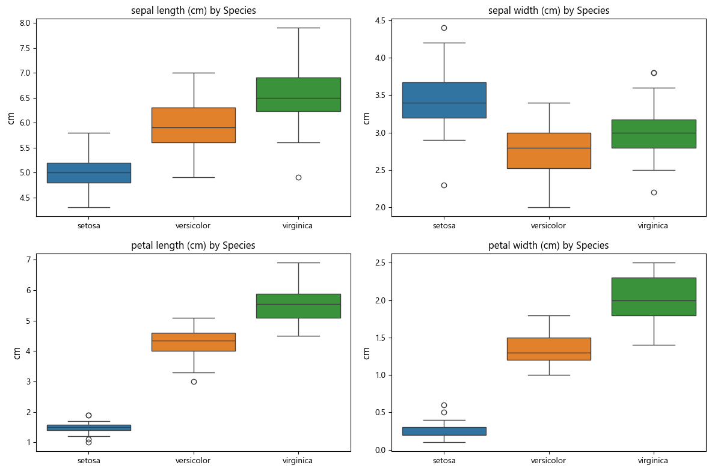

**异常值（Outliers）的数据分析与审查：**

1. **观察异常值（Boxplot结果）**：
   * 在 `sepal width (cm)` 维度上，Virginica 类和少量 Setosa 类中出现了个别离群点（图中上下须之外的黑色菱形/圆点）。
   * `petal length/width` 在特定品种内也偶有极端的偏差值存在。这些样本的尺寸游离于同类植物的正常 IQR（四分位距）之外。

2. **企业项目考量异常值**：
   * **甄别诱因**：首先需排查这些游离点是纯粹的业务脏数据（例如上游光学传感器异常跳变、尺寸为负数等常识性错误数据）还是客观存在的自然极值。鸢尾花数据集的异常点均为自然范畴内的生物多样性体现（并没有违反物理常识的数据）。
   * **保留 vs 剔除**：由于这是自然的极大/极小值，而非设备噪音，并且整体数据样本（150条）非常稀缺，简单粗暴地剔除会丢失宝贵的边缘形态特征。因此，**在业务上不建议将它们清洗掉**。

3. **在 Pipeline 中的处理时机**：
   * **什么时候处理？**：如果我们确实需要对设备脏数据采取截断（Clipping）或剔除，**这步操作必须在划分好“训练集”和“测试集”之后进行处理**（即后续的数据准备 Pipeline 阶段）。
   * **严防数据泄露**：绝不能在当前全量数据集的阶段计算均值/IQR并据此删除异常点，这意味着“测试集或未来验证集的统计信息”提前暴露给了模型干预者。正确的规范是：仅基于**纯训练集**建立异常值截断阈值，并将同样的阈值标准应用到未知的测试样本上。

**“真实极端值”与“无用脏数据”的辨析：**

在实际业务（如自动分拣流水线）中，区分“纯纯错误的脏数据”与“有价值的极端数据”是极其关键的一环，这直接影响了模型的稳健泛化性能。

1. **“有价值的极端数据**
   * **特征表现**：数值虽然偏离均值，但完全符合物理规律和生物学常识。
   * **例子**：某株 Virginica 鸢尾花因为土壤特别肥沃，其花瓣长度长到了 7.5cm（大于一般的 6.5cm）。
   * **处理原则**：**必须保留。** 这代表了数据的自然长尾（Long-tail）分布。如果把这些真值删掉，当分拣流水线上真正遇到巨型花朵时，模型会因为没见过类似模式而给出错误的判断（泛化能力下降）。

2. **Dirty Data**
   * **特征表现**：打破物理常识、逻辑矛盾、常识性错误等。
   * **例子**：
      * **故障**：花萼长度为`-1.5cm`（不可能是负数）；或花瓣宽度为`999cm`（可能是某种Error默认输出）。
      * **数据格式漂移**：因为单位换算错误，把 `5.5cm` 记录成了 `55mm`，导致数据直接扩大了十倍。
      * **逻辑冲突**：花瓣的宽度大于了花瓣的长度（生物学上极度罕见），这往往意味着人工录入看串行了。
   * **处理原则**：**必须删除或插补（Imputation）。** 这种数据送到模型里，轻则拉偏梯度下降的方向（如线性回归），重则导致基于划分的模型（如决策树）切分出毫无意义的阈值。

```python
%pip install matplotlib seaborn
```

```text
Requirement already satisfied: matplotlib in d:\anaconda\lib\site-packages (3.10.8)
Requirement already satisfied: seaborn in d:\anaconda\lib\site-packages (0.13.2)
Requirement already satisfied: contourpy>=1.0.1 in d:\anaconda\lib\site-packages (from matplotlib) (1.2.0)
Requirement already satisfied: cycler>=0.10 in d:\anaconda\lib\site-packages (from matplotlib) (0.11.0)
Requirement already satisfied: fonttools>=4.22.0 in d:\anaconda\lib\site-packages (from matplotlib) (4.25.0)
Requirement already satisfied: kiwisolver>=1.3.1 in d:\anaconda\lib\site-packages (from matplotlib) (1.4.4)
Requirement already satisfied: numpy>=1.23 in d:\anaconda\lib\site-packages (from matplotlib) (1.26.4)
Requirement already satisfied: packaging>=20.0 in d:\anaconda\lib\site-packages (from matplotlib) (23.1)
Requirement already satisfied: pillow>=8 in d:\anaconda\lib\site-packages (from matplotlib) (10.2.0)
Requirement already satisfied: pyparsing>=3 in d:\anaconda\lib\site-packages (from matplotlib) (3.0.9)
Requirement already satisfied: python-dateutil>=2.7 in d:\anaconda\lib\site-packages (from matplotlib) (2.8.2)
Requirement already satisfied: pandas>=1.2 in d:\anaconda\lib\site-packages (from seaborn) (3.0.1)
Requirement already satisfied: tzdata in d:\anaconda\lib\site-packages (from pandas>=1.2->seaborn) (2023.3)
Requirement already satisfied: six>=1.5 in d:\anaconda\lib\site-packages (from python-dateutil>=2.7->matplotlib) (1.16.0)
Note: you may need to restart the kernel to use updated packages.
```

#### 3.1 进阶可视化
把不同的物理尺寸赋给图表的不同视觉通道（位置、亮度、大小），将4个特征与1个标签全部压缩到一张图里：

*   **X 轴**：`sepal length` (花萼长度，花朵底盘的宽广度)
*   **Y 轴**：`sepal width` (花萼宽度，花朵底盘的厚度)
*   **圆圈大小 (Size)**：代表 `petal length` (花瓣的长度，即这朵花“真正的显眼程度”)
*   **颜色 (Color)**：代表鸢尾花的真实种类 (Target)

这样，图上的每一个圆圈就代表了**一朵“虚拟的鸢尾花”**。圆圈所处的二维坐标是其底盘花萼的尺寸，而圆圈的膨胀程度则直观呈现了它的花瓣有多大。

```python
import matplotlib.pyplot as plt
import seaborn as sns

plt.figure(figsize=(10, 7))

# 这是一张包含 4 个维度的信息增强散点图 (Bubble Chart)
# 参数 size 负责映射第三个数值变量，hue 负责映射目标分类变量
sns.scatterplot(
    data=iris_df,
    x='sepal length (cm)',
    y='sepal width (cm)',
    size='petal length (cm)',    # 圆圈大小代表花瓣长度
    sizes=(20, 300),             # 放大气泡的尺寸池，以增强视觉对比
    hue='target_name',           # 颜色代表不同品种
    alpha=0.7,                   # 增加透明度防止圆圈叠加遮挡
    palette='Set2'               # 企业级图表建议使用柔和色系
)

# 调整图例位置，使其不遮挡图像
plt.legend(bbox_to_anchor=(1.05, 1), loc='upper left', borderaxespad=0.)
plt.title('Bubble Chart: Flower Visualization', fontsize=15)
plt.tight_layout()
plt.show()
```

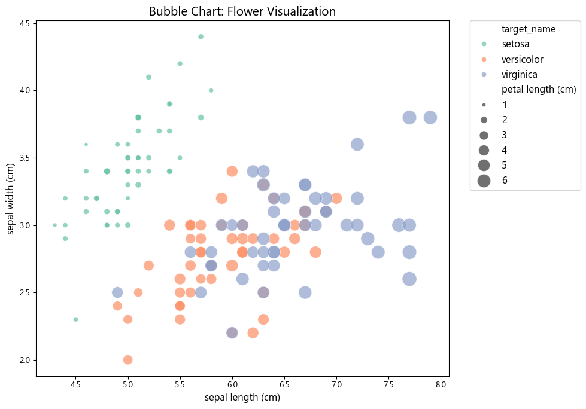

**初步结论：**

1. **“花瓣”（圆圈大小）的主导作用**：从图中可以清晰地看到，最左下角的“Setosa 山鸢尾”代表的圆圈极小（花瓣极短），而向右上角移动时，“Virginica 维吉尼亚鸢尾”的圆圈明显巨大。这说明仅仅凭借“圆圈大小（花瓣长度）”这一项指标，就能极其有效地大面积筛出目标品种，这是建立分类模型时的**高优权重特征**。
2. **“花萼坐标”（位置）的聚类现象**：观察每个品种的空间分布——
   * Setosa 集中分布在“短而宽”的花萼区间（左上象限）；
   * Versicolor 处于中等尺寸过渡区；
   * Virginica 则盘踞在“既长又宽”的物理极限区（右下方乃至全局上方）。
3. **决策边界的难度与方向**：
   * Setosa 与另外两种花几乎是完全线性可分的，这意味着使用一个极简单的模型（比如perceptron或者线性SVM等）都能达到 100% 鉴别 Setosa；
   * 而 Versicolor 与 Virginica 之间存在少量的**尺寸重叠带**（绿色与深橙色的泡泡交织区）。这是未来我们训练的模型需要真正集中算力去优化的“困难样本区”（Decision Boundary）。针对这部分样本，可能需要借助非线性模型（比如Kernel SVM、或更深层的决策树、随机森林、提升算法等）来拉开两者的距离。

```python
import matplotlib.pyplot as plt
import numpy as np

# 创建画布
plt.figure(figsize=(12, 8))
ax = plt.gca()

# 铺设“草地”背景 (使用护眼的浅绿色)
ax.set_facecolor('#E8F5E9')

plt.rcParams['font.sans-serif'] = ['Segoe UI Emoji', 'SimHei'] 
plt.rcParams['axes.unicode_minus'] = False

# Windows
font_opts = {'fontname': 'Segoe UI Emoji'}
species_emoji = {
    'setosa': '🌸',     # 山鸢尾由于花瓣小，用粉色樱花代替
    'versicolor': '🌺', # 变色鸢尾用红色芙蓉花代替
    'virginica': '🌻'   # 维吉尼亚鸢尾因为特别大，用向日葵代替
}

species_colors = {
    'setosa': '#FF69B4',       # 亮粉色 (🌸)
    'versicolor': '#E62020',   # 大红色 (🌺)
    'virginica': "#D1FF04"     # 鲜橘色 (🌻)
}

np.random.seed(42)  # 固定随机种子，保证每次刷新图表长得一样

for _, row in iris_df.iterrows():
    x = row['sepal length (cm)']
    y = row['sepal width (cm)'] 
    # 稍稍缩小整体膨胀系数，也能配合缓解右下角的重叠
    size = row['petal length (cm)'] * 4.5 + 8 
    species = row['target_name']
    
    # 在该坐标点种下一朵带大小属性、透明度、以及自定义颜色的花
    plt.text(x, y, species_emoji.get(species, '🌸'), fontsize=size, 
             color=species_colors.get(species, 'black'),
             ha='center', va='center', alpha=0.75, **font_opts)

# 设置美观的草地白栅栏网格
plt.grid(color='white', linestyle='--', linewidth=1.5)
plt.xlim(4.0, 8.5)
plt.ylim(1.8, 4.8)

# 补充图例说明
for s, emoji in species_emoji.items():
    plt.scatter([], [], s=120, label=f"{s} ({emoji})", color=species_colors[s], alpha=0.8)

plt.title('Virtual Garden: Cartoon Floral Visualization (with Jitter & Colors)', fontsize=16, fontweight='bold')
plt.xlabel('Sepal Length (cm) Location', fontsize=12)
plt.ylabel('Sepal Width (cm) Location', fontsize=12)
plt.legend(title='Floral Species', loc='upper right', framealpha=0.9)

plt.tight_layout()
plt.show()
```

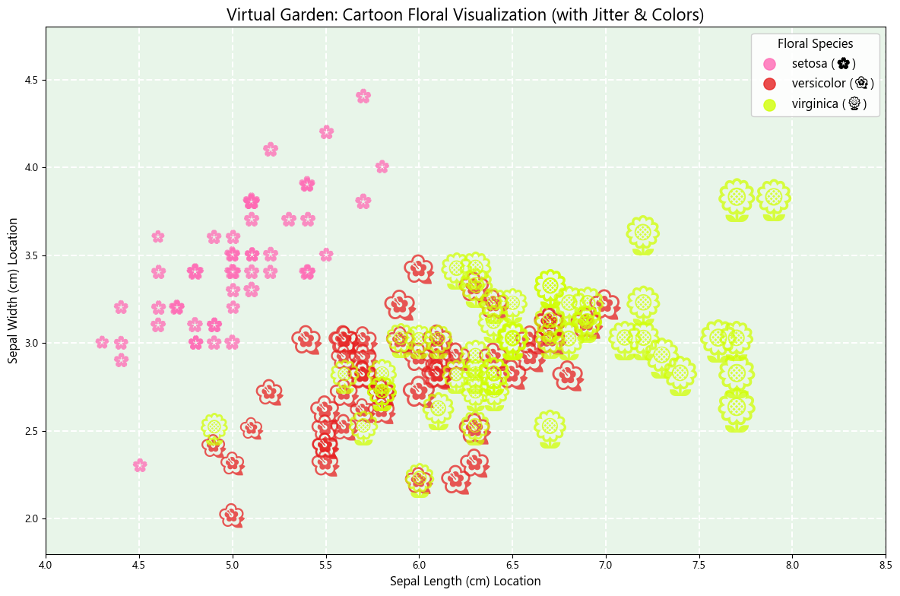

**总结**：

Setosa 具有花瓣短，花萼短而宽的特点；

Versicolor 和 Virginica 重叠较多，需要进一步分析，训练模型应重点针对这两类。

## 4. 模型数据制备与特征工程

### 4.1 划分训练集与验证集 (Train/Test Split)

**数据隔离与防泄露机制（Data Snooping Bias）**
遵循业界严谨的模型开发规范，数据集的交叉切分必须先置于所有的特征缩放、异常清洗与缺失处理之前。通过建立数据“沙盒”彻底隔离测试集群，可有效防止未来验证样本的统计信息或底层分布在训练阶段泄露，从而保证最终模型测试评估的客观参考价值。

**抽样决策：分层抽样 (Stratified Sampling)**
探索性数据分析显示，目标分类变量（Response）处于绝对均衡的分布状态（1:1:1）。尽管在此平衡状态下单凭随机抽样也能维持整体方差，为贯彻工业级全流程范式，模型数据切分依然采用基于类别标签（Target）约束的分层抽样。
- **配置策略**：以 8:2 的典型比率抽取样本，80% 数据建立为训练与交叉验证集（Training Set），20% 予以一次性冻结作为最终独立的测试集（Test Set）。

```python
from sklearn.model_selection import train_test_split

# 1. 剥离特征矩阵 (X) 和 目标向量 (y)
# 注意这里依然保留原始特征和数值型的 target
X = iris_df.drop(columns=['target', 'target_name'])
y = iris_df['target']

# 2. 调用 train_test_split 进行切分
# 参数 stratify=y 意味着要求切分后的数据集严格按照 y 的原始比例（1:1:1）进行分配
# 参数 random_state=42 用于固定随机种子，保证其他分析师拿到这份代码能复现一模一样的切分结果
X_train, X_test, y_train, y_test = train_test_split(
    X, y, 
    test_size=0.2, 
    random_state=42, 
    stratify=y
)

print(f"训练集特征维度 (X_train): {X_train.shape}")
print(f"测试集特征维度 (X_test):  {X_test.shape}")

# 3. 验证分层抽样 (Stratified Sampling) 的效果
print("\n--- 训练集中的类别占比 (y_train) ---")
print(y_train.value_counts(normalize=True))

print("\n--- 测试集中的类别占比 (y_test) ---")
print(y_test.value_counts(normalize=True))
```

```text
训练集特征维度 (X_train): (120, 4)
测试集特征维度 (X_test):  (30, 4)

--- 训练集中的类别占比 (y_train) ---
target
0    0.333333
2    0.333333
1    0.333333
Name: proportion, dtype: float64

--- 测试集中的类别占比 (y_test) ---
target
0    0.333333
2    0.333333
1    0.333333
Name: proportion, dtype: float64
```

### 4. 检查变量间的相关性 (Correlation Matrix & Heatmap)

除了单变量分布，了解**不同特征之间的线性相关程度**是特征工程的基础。皮尔逊相关系数（Pearson Correlation Coefficient）的取值范围在 $[-1, 1]$ 之间。
*   值越接近 $1$，意味着强正相关；
*   值越接近 $-1$，意味着强负相关；
*   值接近 $0$，说明两者之间无明显的线性关联。

在此数据集中，由于最终要做的是多分类任务（非连续数值回归），我们将计算特征与特征之间的相关性，看是否存在极其强烈的内部多重共线性（Multicollinearity）。

```python
# 1. 计算所有数值特征的皮尔逊相关系数矩阵
# 由于 target 和 target_name 不是我们要对比的特征输入，先将其剔除
corr_matrix = iris_df.drop(columns=['target', 'target_name']).corr()

# 2. 绘制相关性热力图 (Heatmap)
plt.figure(figsize=(8, 6))
# 参数 annot=True 表示在色块上打印出具体的系数；cmap 选用红蓝冷暖色调，0为白色中心
sns.heatmap(corr_matrix, annot=True, fmt=".2f", cmap='coolwarm', vmin=-1, vmax=1, 
            square=True, linewidths=1.5, cbar_kws={"shrink": .8})
plt.title("Correlation Matrix Heatmap of Iris Features", fontsize=15, pad=15)
plt.yticks(rotation=0)
plt.tight_layout()
plt.show()
```

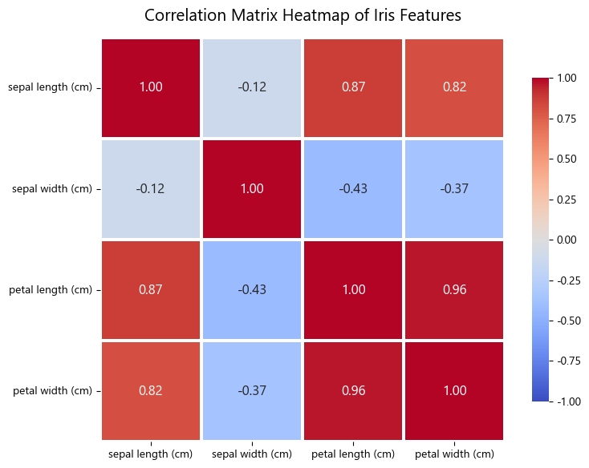

注：Pearson相关系数只能刻画线性相关关系，而复杂的非线性相关无法捕捉。下面进一步采用Spearman相关系数绘制相关热力矩阵图：

```python
# 1. 计算所有数值特征的斯皮尔曼(Spearman)秩相关系数矩阵
# 由于 target 和 target_name 不是我们要对比的特征输入，先将其剔除
spearman_corr_matrix = iris_df.drop(columns=['target', 'target_name']).corr(method='spearman')

# 2. 绘制斯皮尔曼相关性热力图 (Heatmap)
plt.figure(figsize=(8, 6))
# 保持与Pearson相同的色调，便于直观比对变化
sns.heatmap(spearman_corr_matrix, annot=True, fmt=".2f", cmap='coolwarm', vmin=-1, vmax=1, 
            square=True, linewidths=1.5, cbar_kws={"shrink": .8})
plt.title("Spearman Correlation Matrix Heatmap of Iris Features", fontsize=15, pad=15)
plt.yticks(rotation=0)
plt.tight_layout()
plt.show()
```

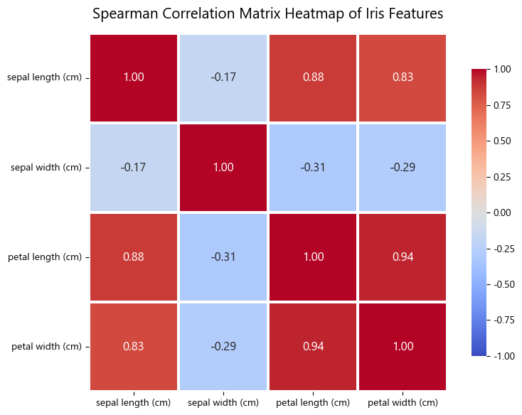

**散点图矩阵 (Scatter Matrix)**

散点图矩阵不仅会在网格的非对角线位置把**每个数值型变量对其他所有数值型变量的散点图**全部绘制出来，同时为了提供最大的信息密度，它的**主对角线位置通常会展示该单变量自身的直方图或核密度分布（KDE）**。

下面对角线采用对不同特征分布进行KDE后绘图.

```python
# 运行 pairplot 绘制散点图矩阵
# hue='target_name' 将会自动用不同颜色标记出各类品种，diag_kind='kde' 把对角线改为平滑的密度曲线
scatter_matrix_fig = sns.pairplot(
    data=iris_df.drop(columns=['target']), 
    hue='target_name',
    palette='Set2', 
    height=2.5, 
    diag_kind='kde',
    plot_kws={'alpha': 0.7, 's': 40, 'edgecolor': 'k'}
)

scatter_matrix_fig.fig.suptitle("Scatter Matrix of Iris Features", y=1.02, fontsize=18)
plt.show()
```

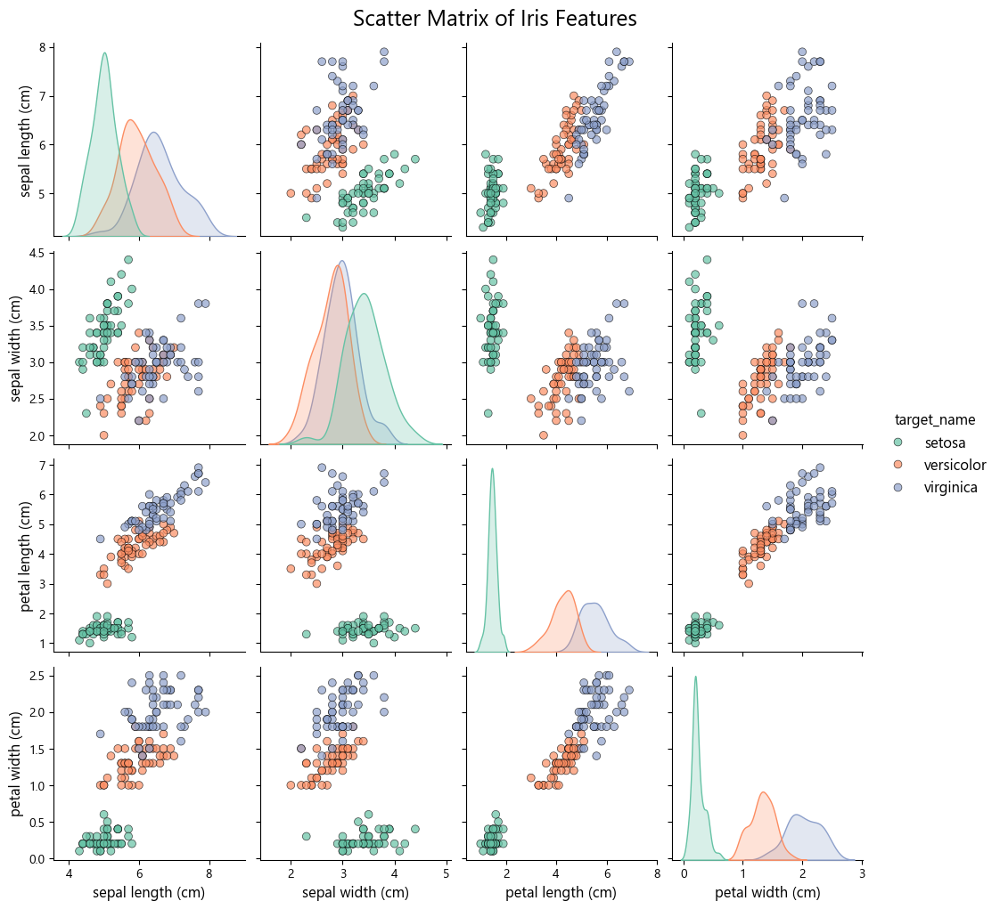

**相关性结果洞察 & 特征工程前瞻：**

1. **高度的正相关特征对**：
   * 观察热力图：`petal length` 与 `petal width` 之间的皮尔逊相关系数高达 **0.96**。
   * 观察散点矩阵：这两者的散点图（第三行第四列）几乎呈现出一条挺拔向上的直线。这说明“花瓣越长，花瓣就必然越宽”，它们在物理表达上高度同质化，存在极强的共线性 Multi-collinearity。
2. **多重共线性的冗余与降维（构造新变量）：**
   * 如果同时将 `petal length` 和 `petal width` 喂给线性回归模型，由于它们几乎等价，会导致模型对这两个特征的权重变得不稳定，造成方差放大。

## 5. 数据预处理与特征工程 (Data Preprocessing & Feature Engineering)

### 5.1 特征归一化和标准化 (Feature Scaling)

在送入机器学习模型之前，通常需要对数据进行特征缩放（Feature Scaling）。有两种常见的方法将所有输入变量变换成具有相同规模的规模：归一化（Min-Max Scaling）和标准化（Standardization）。
* **归一化 (Normalization)**：通过平移和缩放，将变量的范围控制在 0-1 之间。由于有些特征（如花瓣长度和萼片宽度）的量纲存在差异，归一化消除了量纲影响。在 Scikit-Learn 中通过 `MinMaxScaler` 实现。
* **标准化 (Standardization)**：减去平均值使得结果的平均值为0，然后除以方差，让结果的方差为1。与归一化不同，标准化不限制数据到特定范围，面对具有异常值（Outliers）的数据或者较长尾部的分布时表现更稳定。在 Scikit-Learn 中通过 `StandardScaler` 实现。

在这里，考虑到我们的模型（如 SVM 和逻辑回归）对数据的方差较敏感，我们将采用 **标准化 (Standardization)** 作为特征缩放策略。

### 5.2 定制变换函数 (Custom Transformers)

在特征工程阶段，通过相关性分析我们发现存在较高的多重共线性（如 `petal length` 和 `petal width` 之间强烈的线性相关）。若直接作为输入，不仅冗余，还会干扰后续线性模型的权重分配。

定制转换器对于组合不同变量也非常有用，能够派生出具有物理或生物学意义的新输入变量，并可以设置超参数在 Pipeline 中进行选择或剔除冗余变量：
1. **结构横截面积 (Area)**：长和宽的乘积，代表萼片或花瓣的面积。
2. **同源长宽比 (Intra-Ratio)**：器官自身的长与宽之商，刻画物种器官的“狭长”或“宽大”程度。
3. **跨域长宽比 (Cross-Ratio)**：不同器官（花瓣与花萼）相同维度的比率，旨在抵消整体植株大小带来的绝对值干扰，提取基因特异性比例。
4. **原始特征剔除 (Drop Originals)**：在生成由原始特征派生的综合特征后，动态控制是否剔除原始特征，从而避免严重的多重共线性。

以下通过继承 `scikit-learn` 中的 `BaseEstimator` 和 `TransformerMixin` 基类来定制 `IrisFeatureCombiner`。

```python
import numpy as np
import pandas as pd
from sklearn.base import BaseEstimator, TransformerMixin

class IrisFeatureCombiner(BaseEstimator, TransformerMixin):
    """
    鸢尾花特征自动生成与选择器 (Custom Transformer)
    支持构造型特征的动态开关，并支持消除多重共线性的冗余原始特征。
    """
    def __init__(self, add_area=True, add_ratio=True, add_cross_ratio=True, drop_originals=False):
        self.add_area = add_area
        self.add_ratio = add_ratio
        self.add_cross_ratio = add_cross_ratio 
        self.drop_originals = drop_originals
        self.feature_names_out_ = None
        
    def fit(self, X, y=None):
        return self
        
    def transform(self, X, y=None):
        # 兼容 Pandas 与 Numpy 输入，确保字段对齐
        if isinstance(X, pd.DataFrame):
            X_df = X.copy()
        else:
            X_df = pd.DataFrame(X, columns=['sepal length (cm)', 'sepal width (cm)', 'petal length (cm)', 'petal width (cm)'])
        
        # 1. 结构横截面积特征
        if self.add_area:
            X_df['sepal_area'] = X_df['sepal length (cm)'] * X_df['sepal width (cm)']
            X_df['petal_area'] = X_df['petal length (cm)'] * X_df['petal width (cm)']
        
        # 2. 同源长宽比特征
        if self.add_ratio:
            X_df['sepal_ratio'] = X_df['sepal length (cm)'] / (X_df['sepal width (cm)'] + 1e-8)
            X_df['petal_ratio'] = X_df['petal length (cm)'] / (X_df['petal width (cm)'] + 1e-8)
            
        # 3. 跨域长宽比例特征 (特征结构校准)
        if self.add_cross_ratio:
            X_df['cross_length_ratio'] = X_df['petal length (cm)'] / (X_df['sepal length (cm)'] + 1e-8)
            X_df['cross_width_ratio']  = X_df['petal width (cm)'] / (X_df['sepal width (cm)'] + 1e-8)
            
        # 4. 原始冗余特征剥离
        if self.drop_originals:
            X_df = X_df.drop(columns=['sepal length (cm)', 'sepal width (cm)', 'petal length (cm)', 'petal width (cm)'])
            
        # 极端分支防御：若所有参数均导致特征列置空，返回原特征集保障Pipeline正常执行
        if X_df.shape[1] == 0:
            self.feature_names_out_ = ['sepal length (cm)', 'sepal width (cm)', 'petal length (cm)', 'petal width (cm)']
            return X
            
        self.feature_names_out_ = list(X_df.columns)
        
        # 在这里我们融在一起组成了一团进行计算，完成后统一输出 numpy array
        # 交给后面的 Pipeline 和 ColumnTransformer 完成标准化与切分
        return X_df.values

    def get_feature_names_out(self):
        return np.array(self.feature_names_out_)

# =====================================================================
# Pipeline 数据增强单元测试
# =====================================================================

attr_adder = IrisFeatureCombiner(add_area=True, add_ratio=True, add_cross_ratio=True, drop_originals=True)
# 为了避免游离运行时 X_train 缺失报错，我们加入防御性判定
if 'X_train' in globals():
    X_train_enhanced = attr_adder.transform(X_train)
    X_train_eng_df = pd.DataFrame(X_train_enhanced, columns=attr_adder.get_feature_names_out(), index=X_train.index)
    print(f"数据增强并剔除原始冗余后特征维度: {X_train_eng_df.shape}")
    print("-" * 50)
    display(X_train_eng_df.head())
```

```text
数据增强并剔除原始冗余后特征维度: (120, 6)
--------------------------------------------------
```

<style scoped>
    .dataframe tbody tr th:only-of-type {
        vertical-align: middle;
    }

    .dataframe tbody tr th {
        vertical-align: top;
    }

    .dataframe thead th {
        text-align: right;
    }
</style><div>

<div class="table-wrap"><table border="1" class="dataframe">
  <thead>
    <tr style="text-align: right;">
      <th></th>
      <th>sepal_area</th>
      <th>petal_area</th>
      <th>sepal_ratio</th>
      <th>petal_ratio</th>
      <th>cross_length_ratio</th>
      <th>cross_width_ratio</th>
    </tr>
  </thead>
  <tbody>
    <tr>
      <th>8</th>
      <td>12.76</td>
      <td>0.28</td>
      <td>1.517241</td>
      <td>7.000000</td>
      <td>0.318182</td>
      <td>0.068966</td>
    </tr>
    <tr>
      <th>106</th>
      <td>12.25</td>
      <td>7.65</td>
      <td>1.960000</td>
      <td>2.647059</td>
      <td>0.918367</td>
      <td>0.680000</td>
    </tr>
    <tr>
      <th>76</th>
      <td>19.04</td>
      <td>6.72</td>
      <td>2.428571</td>
      <td>3.428571</td>
      <td>0.705882</td>
      <td>0.500000</td>
    </tr>
    <tr>
      <th>9</th>
      <td>15.19</td>
      <td>0.15</td>
      <td>1.580645</td>
      <td>14.999999</td>
      <td>0.306122</td>
      <td>0.032258</td>
    </tr>
    <tr>
      <th>89</th>
      <td>13.75</td>
      <td>5.20</td>
      <td>2.200000</td>
      <td>3.076923</td>
      <td>0.727273</td>
      <td>0.520000</td>
    </tr>
  </tbody>
</table></div>
</div>

### 5.3 建立变换流程 (Building Pipelines)

在特征级别预处理之后，接下来的步骤是建立变换流程。数据需要经历处理缺失值、定制特征提取和特征标准化的过程。

把特征抽取封装成一个整体，再拆成两组通道交给最终的 `ColumnTransformer`（列处理器）：
1. **常规数值变换流程 (Numerical Pipeline)**：包含填补缺失值的 `SimpleImputer`、定制的全局特征组装函数 `IrisFeatureCombiner`（在这里进行花萼和花瓣相互融合的交叉衍生计算），以及 `StandardScaler`。
2. **分类变换流程 (Categorical Pipeline)**：使用 `OneHotEncoder` 将可能的分类文本转化为独热编码矩阵。
3. 把两个流程融合进 `ColumnTransformer` (列处理器) 中，完成干净利落的基础流。

```python
from sklearn.pipeline import Pipeline
from sklearn.compose import ColumnTransformer
from sklearn.impute import SimpleImputer
from sklearn.preprocessing import StandardScaler, OneHotEncoder

# =========================================================================
# 构建模块化的数据预处理流水线
# =========================================================================

# A. 常规数值型数据处理管线：包含缺失值插补、我们自定义组合成一团的特征引擎、以及标准化
default_num_pipeline = Pipeline([
    ('imputer', SimpleImputer(strategy='median')), 
    # 把 sepal 和 petal 融合在一起组成一团，在这个 transformer 里去变换它们
    ('attribs_adder', IrisFeatureCombiner()), 
    ('std_scaler', StandardScaler()), 
])

# B. (备用)分类型文本数据处理管线：适用于复杂非数值标签
cat_pipeline = Pipeline([
    ('imputer', SimpleImputer(strategy='most_frequent')), 
    ('one_hot', OneHotEncoder(handle_unknown='ignore'))
])

# 最终在这里分出来两大通道进入列转换器
full_pipeline = ColumnTransformer([
    # 'num' 为所有数值特征转换通道
    ("num", default_num_pipeline, list(X_train.columns)),
    # 'cat' 通道预留
    ("cat", cat_pipeline, []) 
])

print("经典且完整的 Pipeline 架构已重新挂载！能同时支持联合搜索且架构清晰！")
```

```text
经典且完整的 Pipeline 架构已重新挂载！能同时支持联合搜索且架构清晰！
```

```python
default_num_pipeline
```

<style>#sk-container-id-19 {
  /* Definition of color scheme common for light and dark mode */
  --sklearn-color-text: #000;
  --sklearn-color-text-muted: #666;
  --sklearn-color-line: gray;
  /* Definition of color scheme for unfitted estimators */
  --sklearn-color-unfitted-level-0: #fff5e6;
  --sklearn-color-unfitted-level-1: #f6e4d2;
  --sklearn-color-unfitted-level-2: #ffe0b3;
  --sklearn-color-unfitted-level-3: chocolate;
  /* Definition of color scheme for fitted estimators */
  --sklearn-color-fitted-level-0: #f0f8ff;
  --sklearn-color-fitted-level-1: #d4ebff;
  --sklearn-color-fitted-level-2: #b3dbfd;
  --sklearn-color-fitted-level-3: cornflowerblue;
}

#sk-container-id-19.light {
  /* Specific color for light theme */
  --sklearn-color-text-on-default-background: black;
  --sklearn-color-background: white;
  --sklearn-color-border-box: black;
  --sklearn-color-icon: #696969;
}

#sk-container-id-19.dark {
  --sklearn-color-text-on-default-background: white;
  --sklearn-color-background: #111;
  --sklearn-color-border-box: white;
  --sklearn-color-icon: #878787;
}

#sk-container-id-19 {
  color: var(--sklearn-color-text);
}

#sk-container-id-19 pre {
  padding: 0;
}

#sk-container-id-19 input.sk-hidden--visually {
  border: 0;
  clip: rect(1px 1px 1px 1px);
  clip: rect(1px, 1px, 1px, 1px);
  height: 1px;
  margin: -1px;
  overflow: hidden;
  padding: 0;
  position: absolute;
  width: 1px;
}

#sk-container-id-19 div.sk-dashed-wrapped {
  border: 1px dashed var(--sklearn-color-line);
  margin: 0 0.4em 0.5em 0.4em;
  box-sizing: border-box;
  padding-bottom: 0.4em;
  background-color: var(--sklearn-color-background);
}

#sk-container-id-19 div.sk-container {
  /* jupyter's `normalize.less` sets `[hidden] { display: none; }`
     but bootstrap.min.css set `[hidden] { display: none !important; }`
     so we also need the `!important` here to be able to override the
     default hidden behavior on the sphinx rendered scikit-learn.org.
     See: https://github.com/scikit-learn/scikit-learn/issues/21755 */
  display: inline-block !important;
  position: relative;
}

#sk-container-id-19 div.sk-text-repr-fallback {
  display: none;
}

div.sk-parallel-item,
div.sk-serial,
div.sk-item {
  /* draw centered vertical line to link estimators */
  background-image: linear-gradient(var(--sklearn-color-text-on-default-background), var(--sklearn-color-text-on-default-background));
  background-size: 2px 100%;
  background-repeat: no-repeat;
  background-position: center center;
}

/* Parallel-specific style estimator block */

#sk-container-id-19 div.sk-parallel-item::after {
  content: "";
  width: 100%;
  border-bottom: 2px solid var(--sklearn-color-text-on-default-background);
  flex-grow: 1;
}

#sk-container-id-19 div.sk-parallel {
  display: flex;
  align-items: stretch;
  justify-content: center;
  background-color: var(--sklearn-color-background);
  position: relative;
}

#sk-container-id-19 div.sk-parallel-item {
  display: flex;
  flex-direction: column;
}

#sk-container-id-19 div.sk-parallel-item:first-child::after {
  align-self: flex-end;
  width: 50%;
}

#sk-container-id-19 div.sk-parallel-item:last-child::after {
  align-self: flex-start;
  width: 50%;
}

#sk-container-id-19 div.sk-parallel-item:only-child::after {
  width: 0;
}

/* Serial-specific style estimator block */

#sk-container-id-19 div.sk-serial {
  display: flex;
  flex-direction: column;
  align-items: center;
  background-color: var(--sklearn-color-background);
  padding-right: 1em;
  padding-left: 1em;
}


/* Toggleable style: style used for estimator/Pipeline/ColumnTransformer box that is
clickable and can be expanded/collapsed.
- Pipeline and ColumnTransformer use this feature and define the default style
- Estimators will overwrite some part of the style using the `sk-estimator` class
*/

/* Pipeline and ColumnTransformer style (default) */

#sk-container-id-19 div.sk-toggleable {
  /* Default theme specific background. It is overwritten whether we have a
  specific estimator or a Pipeline/ColumnTransformer */
  background-color: var(--sklearn-color-background);
}

/* Toggleable label */
#sk-container-id-19 label.sk-toggleable__label {
  cursor: pointer;
  display: flex;
  width: 100%;
  margin-bottom: 0;
  padding: 0.5em;
  box-sizing: border-box;
  text-align: center;
  align-items: center;
  justify-content: center;
  gap: 0.5em;
}

#sk-container-id-19 label.sk-toggleable__label .caption {
  font-size: 0.6rem;
  font-weight: lighter;
  color: var(--sklearn-color-text-muted);
}

#sk-container-id-19 label.sk-toggleable__label-arrow:before {
  /* Arrow on the left of the label */
  content: "▸";
  float: left;
  margin-right: 0.25em;
  color: var(--sklearn-color-icon);
}

#sk-container-id-19 label.sk-toggleable__label-arrow:hover:before {
  color: var(--sklearn-color-text);
}

/* Toggleable content - dropdown */

#sk-container-id-19 div.sk-toggleable__content {
  display: none;
  text-align: left;
  /* unfitted */
  background-color: var(--sklearn-color-unfitted-level-0);
}

#sk-container-id-19 div.sk-toggleable__content.fitted {
  /* fitted */
  background-color: var(--sklearn-color-fitted-level-0);
}

#sk-container-id-19 div.sk-toggleable__content pre {
  margin: 0.2em;
  border-radius: 0.25em;
  color: var(--sklearn-color-text);
  /* unfitted */
  background-color: var(--sklearn-color-unfitted-level-0);
}

#sk-container-id-19 div.sk-toggleable__content.fitted pre {
  /* unfitted */
  background-color: var(--sklearn-color-fitted-level-0);
}

#sk-container-id-19 input.sk-toggleable__control:checked~div.sk-toggleable__content {
  /* Expand drop-down */
  display: block;
  width: 100%;
  overflow: visible;
}

#sk-container-id-19 input.sk-toggleable__control:checked~label.sk-toggleable__label-arrow:before {
  content: "▾";
}

/* Pipeline/ColumnTransformer-specific style */

#sk-container-id-19 div.sk-label input.sk-toggleable__control:checked~label.sk-toggleable__label {
  color: var(--sklearn-color-text);
  background-color: var(--sklearn-color-unfitted-level-2);
}

#sk-container-id-19 div.sk-label.fitted input.sk-toggleable__control:checked~label.sk-toggleable__label {
  background-color: var(--sklearn-color-fitted-level-2);
}

/* Estimator-specific style */

/* Colorize estimator box */
#sk-container-id-19 div.sk-estimator input.sk-toggleable__control:checked~label.sk-toggleable__label {
  /* unfitted */
  background-color: var(--sklearn-color-unfitted-level-2);
}

#sk-container-id-19 div.sk-estimator.fitted input.sk-toggleable__control:checked~label.sk-toggleable__label {
  /* fitted */
  background-color: var(--sklearn-color-fitted-level-2);
}

#sk-container-id-19 div.sk-label label.sk-toggleable__label,
#sk-container-id-19 div.sk-label label {
  /* The background is the default theme color */
  color: var(--sklearn-color-text-on-default-background);
}

/* On hover, darken the color of the background */
#sk-container-id-19 div.sk-label:hover label.sk-toggleable__label {
  color: var(--sklearn-color-text);
  background-color: var(--sklearn-color-unfitted-level-2);
}

/* Label box, darken color on hover, fitted */
#sk-container-id-19 div.sk-label.fitted:hover label.sk-toggleable__label.fitted {
  color: var(--sklearn-color-text);
  background-color: var(--sklearn-color-fitted-level-2);
}

/* Estimator label */

#sk-container-id-19 div.sk-label label {
  font-family: monospace;
  font-weight: bold;
  line-height: 1.2em;
}

#sk-container-id-19 div.sk-label-container {
  text-align: center;
}

/* Estimator-specific */
#sk-container-id-19 div.sk-estimator {
  font-family: monospace;
  border: 1px dotted var(--sklearn-color-border-box);
  border-radius: 0.25em;
  box-sizing: border-box;
  margin-bottom: 0.5em;
  /* unfitted */
  background-color: var(--sklearn-color-unfitted-level-0);
}

#sk-container-id-19 div.sk-estimator.fitted {
  /* fitted */
  background-color: var(--sklearn-color-fitted-level-0);
}

/* on hover */
#sk-container-id-19 div.sk-estimator:hover {
  /* unfitted */
  background-color: var(--sklearn-color-unfitted-level-2);
}

#sk-container-id-19 div.sk-estimator.fitted:hover {
  /* fitted */
  background-color: var(--sklearn-color-fitted-level-2);
}

/* Specification for estimator info (e.g. "i" and "?") */

/* Common style for "i" and "?" */

.sk-estimator-doc-link,
a:link.sk-estimator-doc-link,
a:visited.sk-estimator-doc-link {
  float: right;
  font-size: smaller;
  line-height: 1em;
  font-family: monospace;
  background-color: var(--sklearn-color-unfitted-level-0);
  border-radius: 1em;
  height: 1em;
  width: 1em;
  text-decoration: none !important;
  margin-left: 0.5em;
  text-align: center;
  /* unfitted */
  border: var(--sklearn-color-unfitted-level-3) 1pt solid;
  color: var(--sklearn-color-unfitted-level-3);
}

.sk-estimator-doc-link.fitted,
a:link.sk-estimator-doc-link.fitted,
a:visited.sk-estimator-doc-link.fitted {
  /* fitted */
  background-color: var(--sklearn-color-fitted-level-0);
  border: var(--sklearn-color-fitted-level-3) 1pt solid;
  color: var(--sklearn-color-fitted-level-3);
}

/* On hover */
div.sk-estimator:hover .sk-estimator-doc-link:hover,
.sk-estimator-doc-link:hover,
div.sk-label-container:hover .sk-estimator-doc-link:hover,
.sk-estimator-doc-link:hover {
  /* unfitted */
  background-color: var(--sklearn-color-unfitted-level-3);
  border: var(--sklearn-color-fitted-level-0) 1pt solid;
  color: var(--sklearn-color-unfitted-level-0);
  text-decoration: none;
}

div.sk-estimator.fitted:hover .sk-estimator-doc-link.fitted:hover,
.sk-estimator-doc-link.fitted:hover,
div.sk-label-container:hover .sk-estimator-doc-link.fitted:hover,
.sk-estimator-doc-link.fitted:hover {
  /* fitted */
  background-color: var(--sklearn-color-fitted-level-3);
  border: var(--sklearn-color-fitted-level-0) 1pt solid;
  color: var(--sklearn-color-fitted-level-0);
  text-decoration: none;
}

/* Span, style for the box shown on hovering the info icon */
.sk-estimator-doc-link span {
  display: none;
  z-index: 9999;
  position: relative;
  font-weight: normal;
  right: .2ex;
  padding: .5ex;
  margin: .5ex;
  width: min-content;
  min-width: 20ex;
  max-width: 50ex;
  color: var(--sklearn-color-text);
  box-shadow: 2pt 2pt 4pt #999;
  /* unfitted */
  background: var(--sklearn-color-unfitted-level-0);
  border: .5pt solid var(--sklearn-color-unfitted-level-3);
}

.sk-estimator-doc-link.fitted span {
  /* fitted */
  background: var(--sklearn-color-fitted-level-0);
  border: var(--sklearn-color-fitted-level-3);
}

.sk-estimator-doc-link:hover span {
  display: block;
}

/* "?"-specific style due to the `<a>` HTML tag */

#sk-container-id-19 a.estimator_doc_link {
  float: right;
  font-size: 1rem;
  line-height: 1em;
  font-family: monospace;
  background-color: var(--sklearn-color-unfitted-level-0);
  border-radius: 1rem;
  height: 1rem;
  width: 1rem;
  text-decoration: none;
  /* unfitted */
  color: var(--sklearn-color-unfitted-level-1);
  border: var(--sklearn-color-unfitted-level-1) 1pt solid;
}

#sk-container-id-19 a.estimator_doc_link.fitted {
  /* fitted */
  background-color: var(--sklearn-color-fitted-level-0);
  border: var(--sklearn-color-fitted-level-1) 1pt solid;
  color: var(--sklearn-color-fitted-level-1);
}

/* On hover */
#sk-container-id-19 a.estimator_doc_link:hover {
  /* unfitted */
  background-color: var(--sklearn-color-unfitted-level-3);
  color: var(--sklearn-color-background);
  text-decoration: none;
}

#sk-container-id-19 a.estimator_doc_link.fitted:hover {
  /* fitted */
  background-color: var(--sklearn-color-fitted-level-3);
}

.estimator-table {
    font-family: monospace;
}

.estimator-table summary {
    padding: .5rem;
    cursor: pointer;
}

.estimator-table summary::marker {
    font-size: 0.7rem;
}

.estimator-table details[open] {
    padding-left: 0.1rem;
    padding-right: 0.1rem;
    padding-bottom: 0.3rem;
}

.estimator-table .parameters-table {
    margin-left: auto !important;
    margin-right: auto !important;
    margin-top: 0;
}

.estimator-table .parameters-table tr:nth-child(odd) {
    background-color: #fff;
}

.estimator-table .parameters-table tr:nth-child(even) {
    background-color: #f6f6f6;
}

.estimator-table .parameters-table tr:hover {
    background-color: #e0e0e0;
}

.estimator-table table td {
    border: 1px solid rgba(106, 105, 104, 0.232);
}

/*
    `table td`is set in notebook with right text-align.
    We need to overwrite it.
*/
.estimator-table table td.param {
    text-align: left;
    position: relative;
    padding: 0;
}

.user-set td {
    color:rgb(255, 94, 0);
    text-align: left !important;
}

.user-set td.value {
    color:rgb(255, 94, 0);
    background-color: transparent;
}

.default td {
    color: black;
    text-align: left !important;
}

.user-set td i,
.default td i {
    color: black;
}

/*
    Styles for parameter documentation links
    We need styling for visited so jupyter doesn't overwrite it
*/
a.param-doc-link,
a.param-doc-link:link,
a.param-doc-link:visited {
    text-decoration: underline dashed;
    text-underline-offset: .3em;
    color: inherit;
    display: block;
    padding: .5em;
}

/* "hack" to make the entire area of the cell containing the link clickable */
a.param-doc-link::before {
    position: absolute;
    content: "";
    inset: 0;
}

.param-doc-description {
    display: none;
    position: absolute;
    z-index: 9999;
    left: 0;
    padding: .5ex;
    margin-left: 1.5em;
    color: var(--sklearn-color-text);
    box-shadow: .3em .3em .4em #999;
    width: max-content;
    text-align: left;
    max-height: 10em;
    overflow-y: auto;

    /* unfitted */
    background: var(--sklearn-color-unfitted-level-0);
    border: thin solid var(--sklearn-color-unfitted-level-3);
}

/* Fitted state for parameter tooltips */
.fitted .param-doc-description {
    /* fitted */
    background: var(--sklearn-color-fitted-level-0);
    border: thin solid var(--sklearn-color-fitted-level-3);
}

.param-doc-link:hover .param-doc-description {
    display: block;
}

.copy-paste-icon {
    background-image: url();
    background-repeat: no-repeat;
    background-size: 14px 14px;
    background-position: 0;
    display: inline-block;
    width: 14px;
    height: 14px;
    cursor: pointer;
}
</style><body><div id="sk-container-id-19" class="sk-top-container"><div class="sk-text-repr-fallback"><pre>Pipeline(steps=[(&#x27;imputer&#x27;, SimpleImputer(strategy=&#x27;median&#x27;)),
                (&#x27;attribs_adder&#x27;, IrisFeatureCombiner()),
                (&#x27;std_scaler&#x27;, StandardScaler())])</pre><b>In a Jupyter environment, please rerun this cell to show the HTML representation or trust the notebook. <br />On GitHub, the HTML representation is unable to render, please try loading this page with nbviewer.org.</b></div><div class="sk-container" hidden><div class="sk-item sk-dashed-wrapped"><div class="sk-label-container"><div class="sk-label  sk-toggleable"><input class="sk-toggleable__control sk-hidden--visually" id="sk-estimator-id-135" type="checkbox" ><label for="sk-estimator-id-135" class="sk-toggleable__label  sk-toggleable__label-arrow"><div><div>Pipeline</div></div><div><a class="sk-estimator-doc-link " rel="noreferrer" target="_blank" href="https://scikit-learn.org/1.8/modules/generated/sklearn.pipeline.Pipeline.html">?<span>Documentation for Pipeline</span></a><span class="sk-estimator-doc-link ">i<span>Not fitted</span></span></div></label><div class="sk-toggleable__content " data-param-prefix="">
        <div class="estimator-table">
            <details>
                <summary>Parameters</summary>
                <div class="table-wrap"><table class="parameters-table">
                  <tbody>
                    
        <tr class="user-set">
            <td><i class="copy-paste-icon"
            ></i></td>
            <td class="param">
        <a class="param-doc-link"
            rel="noreferrer" target="_blank" href="https://scikit-learn.org/1.8/modules/generated/sklearn.pipeline.Pipeline.html#:~:text=steps,-list%20of%20tuples">
            steps
            <span class="param-doc-description">steps: list of tuples<br><br>List of (name of step, estimator) tuples that are to be chained in<br>sequential order. To be compatible with the scikit-learn API, all steps<br>must define `fit`. All non-last steps must also define `transform`. See<br>:ref:`Combining Estimators <combining_estimators>` for more details.</span>
        </a>
    </td>
            <td class="value">[(&#x27;imputer&#x27;, ...), (&#x27;attribs_adder&#x27;, ...), ...]</td>
        </tr>
    

        <tr class="default">
            <td><i class="copy-paste-icon"
            ></i></td>
            <td class="param">
        <a class="param-doc-link"
            rel="noreferrer" target="_blank" href="https://scikit-learn.org/1.8/modules/generated/sklearn.pipeline.Pipeline.html#:~:text=transform_input,-list%20of%20str%2C%20default%3DNone">
            transform_input
            <span class="param-doc-description">transform_input: list of str, default=None<br><br>The names of the :term:`metadata` parameters that should be transformed by the<br>pipeline before passing it to the step consuming it.<br><br>This enables transforming some input arguments to ``fit`` (other than ``X``)<br>to be transformed by the steps of the pipeline up to the step which requires<br>them. Requirement is defined via :ref:`metadata routing <metadata_routing>`.<br>For instance, this can be used to pass a validation set through the pipeline.<br><br>You can only set this if metadata routing is enabled, which you<br>can enable using ``sklearn.set_config(enable_metadata_routing=True)``.<br><br>.. versionadded:: 1.6</span>
        </a>
    </td>
            <td class="value">None</td>
        </tr>
    

        <tr class="default">
            <td><i class="copy-paste-icon"
            ></i></td>
            <td class="param">
        <a class="param-doc-link"
            rel="noreferrer" target="_blank" href="https://scikit-learn.org/1.8/modules/generated/sklearn.pipeline.Pipeline.html#:~:text=memory,-str%20or%20object%20with%20the%20joblib.Memory%20interface%2C%20default%3DNone">
            memory
            <span class="param-doc-description">memory: str or object with the joblib.Memory interface, default=None<br><br>Used to cache the fitted transformers of the pipeline. The last step<br>will never be cached, even if it is a transformer. By default, no<br>caching is performed. If a string is given, it is the path to the<br>caching directory. Enabling caching triggers a clone of the transformers<br>before fitting. Therefore, the transformer instance given to the<br>pipeline cannot be inspected directly. Use the attribute ``named_steps``<br>or ``steps`` to inspect estimators within the pipeline. Caching the<br>transformers is advantageous when fitting is time consuming. See<br>:ref:`sphx_glr_auto_examples_neighbors_plot_caching_nearest_neighbors.py`<br>for an example on how to enable caching.</span>
        </a>
    </td>
            <td class="value">None</td>
        </tr>
    

        <tr class="default">
            <td><i class="copy-paste-icon"
            ></i></td>
            <td class="param">
        <a class="param-doc-link"
            rel="noreferrer" target="_blank" href="https://scikit-learn.org/1.8/modules/generated/sklearn.pipeline.Pipeline.html#:~:text=verbose,-bool%2C%20default%3DFalse">
            verbose
            <span class="param-doc-description">verbose: bool, default=False<br><br>If True, the time elapsed while fitting each step will be printed as it<br>is completed.</span>
        </a>
    </td>
            <td class="value">False</td>
        </tr>
    
                  </tbody>
                </table></div>
            </details>
        </div>
    </div></div></div><div class="sk-serial"><div class="sk-item"><div class="sk-estimator  sk-toggleable"><input class="sk-toggleable__control sk-hidden--visually" id="sk-estimator-id-136" type="checkbox" ><label for="sk-estimator-id-136" class="sk-toggleable__label  sk-toggleable__label-arrow"><div><div>SimpleImputer</div></div><div><a class="sk-estimator-doc-link " rel="noreferrer" target="_blank" href="https://scikit-learn.org/1.8/modules/generated/sklearn.impute.SimpleImputer.html">?<span>Documentation for SimpleImputer</span></a></div></label><div class="sk-toggleable__content " data-param-prefix="imputer__">
        <div class="estimator-table">
            <details>
                <summary>Parameters</summary>
                <div class="table-wrap"><table class="parameters-table">
                  <tbody>
                    
        <tr class="default">
            <td><i class="copy-paste-icon"
            ></i></td>
            <td class="param">
        <a class="param-doc-link"
            rel="noreferrer" target="_blank" href="https://scikit-learn.org/1.8/modules/generated/sklearn.impute.SimpleImputer.html#:~:text=missing_values,-int%2C%20float%2C%20str%2C%20np.nan%2C%20None%20or%20pandas.NA%2C%20default%3Dnp.nan">
            missing_values
            <span class="param-doc-description">missing_values: int, float, str, np.nan, None or pandas.NA, default=np.nan<br><br>The placeholder for the missing values. All occurrences of<br>`missing_values` will be imputed. For pandas' dataframes with<br>nullable integer dtypes with missing values, `missing_values`<br>can be set to either `np.nan` or `pd.NA`.</span>
        </a>
    </td>
            <td class="value">nan</td>
        </tr>
    

        <tr class="user-set">
            <td><i class="copy-paste-icon"
            ></i></td>
            <td class="param">
        <a class="param-doc-link"
            rel="noreferrer" target="_blank" href="https://scikit-learn.org/1.8/modules/generated/sklearn.impute.SimpleImputer.html#:~:text=strategy,-str%20or%20Callable%2C%20default%3D%27mean%27">
            strategy
            <span class="param-doc-description">strategy: str or Callable, default='mean'<br><br>The imputation strategy.<br><br>- If "mean", then replace missing values using the mean along<br>  each column. Can only be used with numeric data.<br>- If "median", then replace missing values using the median along<br>  each column. Can only be used with numeric data.<br>- If "most_frequent", then replace missing using the most frequent<br>  value along each column. Can be used with strings or numeric data.<br>  If there is more than one such value, only the smallest is returned.<br>- If "constant", then replace missing values with fill_value. Can be<br>  used with strings or numeric data.<br>- If an instance of Callable, then replace missing values using the<br>  scalar statistic returned by running the callable over a dense 1d<br>  array containing non-missing values of each column.<br><br>.. versionadded:: 0.20<br>   strategy="constant" for fixed value imputation.<br><br>.. versionadded:: 1.5<br>   strategy=callable for custom value imputation.</span>
        </a>
    </td>
            <td class="value">&#x27;median&#x27;</td>
        </tr>
    

        <tr class="default">
            <td><i class="copy-paste-icon"
            ></i></td>
            <td class="param">
        <a class="param-doc-link"
            rel="noreferrer" target="_blank" href="https://scikit-learn.org/1.8/modules/generated/sklearn.impute.SimpleImputer.html#:~:text=fill_value,-str%20or%20numerical%20value%2C%20default%3DNone">
            fill_value
            <span class="param-doc-description">fill_value: str or numerical value, default=None<br><br>When strategy == "constant", `fill_value` is used to replace all<br>occurrences of missing_values. For string or object data types,<br>`fill_value` must be a string.<br>If `None`, `fill_value` will be 0 when imputing numerical<br>data and "missing_value" for strings or object data types.</span>
        </a>
    </td>
            <td class="value">None</td>
        </tr>
    

        <tr class="default">
            <td><i class="copy-paste-icon"
            ></i></td>
            <td class="param">
        <a class="param-doc-link"
            rel="noreferrer" target="_blank" href="https://scikit-learn.org/1.8/modules/generated/sklearn.impute.SimpleImputer.html#:~:text=copy,-bool%2C%20default%3DTrue">
            copy
            <span class="param-doc-description">copy: bool, default=True<br><br>If True, a copy of X will be created. If False, imputation will<br>be done in-place whenever possible. Note that, in the following cases,<br>a new copy will always be made, even if `copy=False`:<br><br>- If `X` is not an array of floating values;<br>- If `X` is encoded as a CSR matrix;<br>- If `add_indicator=True`.</span>
        </a>
    </td>
            <td class="value">True</td>
        </tr>
    

        <tr class="default">
            <td><i class="copy-paste-icon"
            ></i></td>
            <td class="param">
        <a class="param-doc-link"
            rel="noreferrer" target="_blank" href="https://scikit-learn.org/1.8/modules/generated/sklearn.impute.SimpleImputer.html#:~:text=add_indicator,-bool%2C%20default%3DFalse">
            add_indicator
            <span class="param-doc-description">add_indicator: bool, default=False<br><br>If True, a :class:`MissingIndicator` transform will stack onto output<br>of the imputer's transform. This allows a predictive estimator<br>to account for missingness despite imputation. If a feature has no<br>missing values at fit/train time, the feature won't appear on<br>the missing indicator even if there are missing values at<br>transform/test time.</span>
        </a>
    </td>
            <td class="value">False</td>
        </tr>
    

        <tr class="default">
            <td><i class="copy-paste-icon"
            ></i></td>
            <td class="param">
        <a class="param-doc-link"
            rel="noreferrer" target="_blank" href="https://scikit-learn.org/1.8/modules/generated/sklearn.impute.SimpleImputer.html#:~:text=keep_empty_features,-bool%2C%20default%3DFalse">
            keep_empty_features
            <span class="param-doc-description">keep_empty_features: bool, default=False<br><br>If True, features that consist exclusively of missing values when<br>`fit` is called are returned in results when `transform` is called.<br>The imputed value is always `0` except when `strategy="constant"`<br>in which case `fill_value` will be used instead.<br><br>.. versionadded:: 1.2</span>
        </a>
    </td>
            <td class="value">False</td>
        </tr>
    
                  </tbody>
                </table></div>
            </details>
        </div>
    </div></div></div><div class="sk-item"><div class="sk-estimator  sk-toggleable"><input class="sk-toggleable__control sk-hidden--visually" id="sk-estimator-id-137" type="checkbox" ><label for="sk-estimator-id-137" class="sk-toggleable__label  sk-toggleable__label-arrow"><div><div>IrisFeatureCombiner</div></div></label><div class="sk-toggleable__content " data-param-prefix="attribs_adder__">
        <div class="estimator-table">
            <details>
                <summary>Parameters</summary>
                <div class="table-wrap"><table class="parameters-table">
                  <tbody>
                    
        <tr class="default">
            <td><i class="copy-paste-icon"
            ></i></td>
            <td class="param">add_area</td>
            <td class="value">True</td>
        </tr>
    

        <tr class="default">
            <td><i class="copy-paste-icon"
            ></i></td>
            <td class="param">add_ratio</td>
            <td class="value">True</td>
        </tr>
    

        <tr class="default">
            <td><i class="copy-paste-icon"
            ></i></td>
            <td class="param">add_cross_ratio</td>
            <td class="value">True</td>
        </tr>
    

        <tr class="default">
            <td><i class="copy-paste-icon"
            ></i></td>
            <td class="param">drop_originals</td>
            <td class="value">False</td>
        </tr>
    
                  </tbody>
                </table></div>
            </details>
        </div>
    </div></div></div><div class="sk-item"><div class="sk-estimator  sk-toggleable"><input class="sk-toggleable__control sk-hidden--visually" id="sk-estimator-id-138" type="checkbox" ><label for="sk-estimator-id-138" class="sk-toggleable__label  sk-toggleable__label-arrow"><div><div>StandardScaler</div></div><div><a class="sk-estimator-doc-link " rel="noreferrer" target="_blank" href="https://scikit-learn.org/1.8/modules/generated/sklearn.preprocessing.StandardScaler.html">?<span>Documentation for StandardScaler</span></a></div></label><div class="sk-toggleable__content " data-param-prefix="std_scaler__">
        <div class="estimator-table">
            <details>
                <summary>Parameters</summary>
                <div class="table-wrap"><table class="parameters-table">
                  <tbody>
                    
        <tr class="default">
            <td><i class="copy-paste-icon"
            ></i></td>
            <td class="param">
        <a class="param-doc-link"
            rel="noreferrer" target="_blank" href="https://scikit-learn.org/1.8/modules/generated/sklearn.preprocessing.StandardScaler.html#:~:text=copy,-bool%2C%20default%3DTrue">
            copy
            <span class="param-doc-description">copy: bool, default=True<br><br>If False, try to avoid a copy and do inplace scaling instead.<br>This is not guaranteed to always work inplace; e.g. if the data is<br>not a NumPy array or scipy.sparse CSR matrix, a copy may still be<br>returned.</span>
        </a>
    </td>
            <td class="value">True</td>
        </tr>
    

        <tr class="default">
            <td><i class="copy-paste-icon"
            ></i></td>
            <td class="param">
        <a class="param-doc-link"
            rel="noreferrer" target="_blank" href="https://scikit-learn.org/1.8/modules/generated/sklearn.preprocessing.StandardScaler.html#:~:text=with_mean,-bool%2C%20default%3DTrue">
            with_mean
            <span class="param-doc-description">with_mean: bool, default=True<br><br>If True, center the data before scaling.<br>This does not work (and will raise an exception) when attempted on<br>sparse matrices, because centering them entails building a dense<br>matrix which in common use cases is likely to be too large to fit in<br>memory.</span>
        </a>
    </td>
            <td class="value">True</td>
        </tr>
    

        <tr class="default">
            <td><i class="copy-paste-icon"
            ></i></td>
            <td class="param">
        <a class="param-doc-link"
            rel="noreferrer" target="_blank" href="https://scikit-learn.org/1.8/modules/generated/sklearn.preprocessing.StandardScaler.html#:~:text=with_std,-bool%2C%20default%3DTrue">
            with_std
            <span class="param-doc-description">with_std: bool, default=True<br><br>If True, scale the data to unit variance (or equivalently,<br>unit standard deviation).</span>
        </a>
    </td>
            <td class="value">True</td>
        </tr>
    
                  </tbody>
                </table></div>
            </details>
        </div>
    </div></div></div></div></div></div></div></body>

```python
cat_pipeline
```

<style>#sk-container-id-20 {
  /* Definition of color scheme common for light and dark mode */
  --sklearn-color-text: #000;
  --sklearn-color-text-muted: #666;
  --sklearn-color-line: gray;
  /* Definition of color scheme for unfitted estimators */
  --sklearn-color-unfitted-level-0: #fff5e6;
  --sklearn-color-unfitted-level-1: #f6e4d2;
  --sklearn-color-unfitted-level-2: #ffe0b3;
  --sklearn-color-unfitted-level-3: chocolate;
  /* Definition of color scheme for fitted estimators */
  --sklearn-color-fitted-level-0: #f0f8ff;
  --sklearn-color-fitted-level-1: #d4ebff;
  --sklearn-color-fitted-level-2: #b3dbfd;
  --sklearn-color-fitted-level-3: cornflowerblue;
}

#sk-container-id-20.light {
  /* Specific color for light theme */
  --sklearn-color-text-on-default-background: black;
  --sklearn-color-background: white;
  --sklearn-color-border-box: black;
  --sklearn-color-icon: #696969;
}

#sk-container-id-20.dark {
  --sklearn-color-text-on-default-background: white;
  --sklearn-color-background: #111;
  --sklearn-color-border-box: white;
  --sklearn-color-icon: #878787;
}

#sk-container-id-20 {
  color: var(--sklearn-color-text);
}

#sk-container-id-20 pre {
  padding: 0;
}

#sk-container-id-20 input.sk-hidden--visually {
  border: 0;
  clip: rect(1px 1px 1px 1px);
  clip: rect(1px, 1px, 1px, 1px);
  height: 1px;
  margin: -1px;
  overflow: hidden;
  padding: 0;
  position: absolute;
  width: 1px;
}

#sk-container-id-20 div.sk-dashed-wrapped {
  border: 1px dashed var(--sklearn-color-line);
  margin: 0 0.4em 0.5em 0.4em;
  box-sizing: border-box;
  padding-bottom: 0.4em;
  background-color: var(--sklearn-color-background);
}

#sk-container-id-20 div.sk-container {
  /* jupyter's `normalize.less` sets `[hidden] { display: none; }`
     but bootstrap.min.css set `[hidden] { display: none !important; }`
     so we also need the `!important` here to be able to override the
     default hidden behavior on the sphinx rendered scikit-learn.org.
     See: https://github.com/scikit-learn/scikit-learn/issues/21755 */
  display: inline-block !important;
  position: relative;
}

#sk-container-id-20 div.sk-text-repr-fallback {
  display: none;
}

div.sk-parallel-item,
div.sk-serial,
div.sk-item {
  /* draw centered vertical line to link estimators */
  background-image: linear-gradient(var(--sklearn-color-text-on-default-background), var(--sklearn-color-text-on-default-background));
  background-size: 2px 100%;
  background-repeat: no-repeat;
  background-position: center center;
}

/* Parallel-specific style estimator block */

#sk-container-id-20 div.sk-parallel-item::after {
  content: "";
  width: 100%;
  border-bottom: 2px solid var(--sklearn-color-text-on-default-background);
  flex-grow: 1;
}

#sk-container-id-20 div.sk-parallel {
  display: flex;
  align-items: stretch;
  justify-content: center;
  background-color: var(--sklearn-color-background);
  position: relative;
}

#sk-container-id-20 div.sk-parallel-item {
  display: flex;
  flex-direction: column;
}

#sk-container-id-20 div.sk-parallel-item:first-child::after {
  align-self: flex-end;
  width: 50%;
}

#sk-container-id-20 div.sk-parallel-item:last-child::after {
  align-self: flex-start;
  width: 50%;
}

#sk-container-id-20 div.sk-parallel-item:only-child::after {
  width: 0;
}

/* Serial-specific style estimator block */

#sk-container-id-20 div.sk-serial {
  display: flex;
  flex-direction: column;
  align-items: center;
  background-color: var(--sklearn-color-background);
  padding-right: 1em;
  padding-left: 1em;
}


/* Toggleable style: style used for estimator/Pipeline/ColumnTransformer box that is
clickable and can be expanded/collapsed.
- Pipeline and ColumnTransformer use this feature and define the default style
- Estimators will overwrite some part of the style using the `sk-estimator` class
*/

/* Pipeline and ColumnTransformer style (default) */

#sk-container-id-20 div.sk-toggleable {
  /* Default theme specific background. It is overwritten whether we have a
  specific estimator or a Pipeline/ColumnTransformer */
  background-color: var(--sklearn-color-background);
}

/* Toggleable label */
#sk-container-id-20 label.sk-toggleable__label {
  cursor: pointer;
  display: flex;
  width: 100%;
  margin-bottom: 0;
  padding: 0.5em;
  box-sizing: border-box;
  text-align: center;
  align-items: center;
  justify-content: center;
  gap: 0.5em;
}

#sk-container-id-20 label.sk-toggleable__label .caption {
  font-size: 0.6rem;
  font-weight: lighter;
  color: var(--sklearn-color-text-muted);
}

#sk-container-id-20 label.sk-toggleable__label-arrow:before {
  /* Arrow on the left of the label */
  content: "▸";
  float: left;
  margin-right: 0.25em;
  color: var(--sklearn-color-icon);
}

#sk-container-id-20 label.sk-toggleable__label-arrow:hover:before {
  color: var(--sklearn-color-text);
}

/* Toggleable content - dropdown */

#sk-container-id-20 div.sk-toggleable__content {
  display: none;
  text-align: left;
  /* unfitted */
  background-color: var(--sklearn-color-unfitted-level-0);
}

#sk-container-id-20 div.sk-toggleable__content.fitted {
  /* fitted */
  background-color: var(--sklearn-color-fitted-level-0);
}

#sk-container-id-20 div.sk-toggleable__content pre {
  margin: 0.2em;
  border-radius: 0.25em;
  color: var(--sklearn-color-text);
  /* unfitted */
  background-color: var(--sklearn-color-unfitted-level-0);
}

#sk-container-id-20 div.sk-toggleable__content.fitted pre {
  /* unfitted */
  background-color: var(--sklearn-color-fitted-level-0);
}

#sk-container-id-20 input.sk-toggleable__control:checked~div.sk-toggleable__content {
  /* Expand drop-down */
  display: block;
  width: 100%;
  overflow: visible;
}

#sk-container-id-20 input.sk-toggleable__control:checked~label.sk-toggleable__label-arrow:before {
  content: "▾";
}

/* Pipeline/ColumnTransformer-specific style */

#sk-container-id-20 div.sk-label input.sk-toggleable__control:checked~label.sk-toggleable__label {
  color: var(--sklearn-color-text);
  background-color: var(--sklearn-color-unfitted-level-2);
}

#sk-container-id-20 div.sk-label.fitted input.sk-toggleable__control:checked~label.sk-toggleable__label {
  background-color: var(--sklearn-color-fitted-level-2);
}

/* Estimator-specific style */

/* Colorize estimator box */
#sk-container-id-20 div.sk-estimator input.sk-toggleable__control:checked~label.sk-toggleable__label {
  /* unfitted */
  background-color: var(--sklearn-color-unfitted-level-2);
}

#sk-container-id-20 div.sk-estimator.fitted input.sk-toggleable__control:checked~label.sk-toggleable__label {
  /* fitted */
  background-color: var(--sklearn-color-fitted-level-2);
}

#sk-container-id-20 div.sk-label label.sk-toggleable__label,
#sk-container-id-20 div.sk-label label {
  /* The background is the default theme color */
  color: var(--sklearn-color-text-on-default-background);
}

/* On hover, darken the color of the background */
#sk-container-id-20 div.sk-label:hover label.sk-toggleable__label {
  color: var(--sklearn-color-text);
  background-color: var(--sklearn-color-unfitted-level-2);
}

/* Label box, darken color on hover, fitted */
#sk-container-id-20 div.sk-label.fitted:hover label.sk-toggleable__label.fitted {
  color: var(--sklearn-color-text);
  background-color: var(--sklearn-color-fitted-level-2);
}

/* Estimator label */

#sk-container-id-20 div.sk-label label {
  font-family: monospace;
  font-weight: bold;
  line-height: 1.2em;
}

#sk-container-id-20 div.sk-label-container {
  text-align: center;
}

/* Estimator-specific */
#sk-container-id-20 div.sk-estimator {
  font-family: monospace;
  border: 1px dotted var(--sklearn-color-border-box);
  border-radius: 0.25em;
  box-sizing: border-box;
  margin-bottom: 0.5em;
  /* unfitted */
  background-color: var(--sklearn-color-unfitted-level-0);
}

#sk-container-id-20 div.sk-estimator.fitted {
  /* fitted */
  background-color: var(--sklearn-color-fitted-level-0);
}

/* on hover */
#sk-container-id-20 div.sk-estimator:hover {
  /* unfitted */
  background-color: var(--sklearn-color-unfitted-level-2);
}

#sk-container-id-20 div.sk-estimator.fitted:hover {
  /* fitted */
  background-color: var(--sklearn-color-fitted-level-2);
}

/* Specification for estimator info (e.g. "i" and "?") */

/* Common style for "i" and "?" */

.sk-estimator-doc-link,
a:link.sk-estimator-doc-link,
a:visited.sk-estimator-doc-link {
  float: right;
  font-size: smaller;
  line-height: 1em;
  font-family: monospace;
  background-color: var(--sklearn-color-unfitted-level-0);
  border-radius: 1em;
  height: 1em;
  width: 1em;
  text-decoration: none !important;
  margin-left: 0.5em;
  text-align: center;
  /* unfitted */
  border: var(--sklearn-color-unfitted-level-3) 1pt solid;
  color: var(--sklearn-color-unfitted-level-3);
}

.sk-estimator-doc-link.fitted,
a:link.sk-estimator-doc-link.fitted,
a:visited.sk-estimator-doc-link.fitted {
  /* fitted */
  background-color: var(--sklearn-color-fitted-level-0);
  border: var(--sklearn-color-fitted-level-3) 1pt solid;
  color: var(--sklearn-color-fitted-level-3);
}

/* On hover */
div.sk-estimator:hover .sk-estimator-doc-link:hover,
.sk-estimator-doc-link:hover,
div.sk-label-container:hover .sk-estimator-doc-link:hover,
.sk-estimator-doc-link:hover {
  /* unfitted */
  background-color: var(--sklearn-color-unfitted-level-3);
  border: var(--sklearn-color-fitted-level-0) 1pt solid;
  color: var(--sklearn-color-unfitted-level-0);
  text-decoration: none;
}

div.sk-estimator.fitted:hover .sk-estimator-doc-link.fitted:hover,
.sk-estimator-doc-link.fitted:hover,
div.sk-label-container:hover .sk-estimator-doc-link.fitted:hover,
.sk-estimator-doc-link.fitted:hover {
  /* fitted */
  background-color: var(--sklearn-color-fitted-level-3);
  border: var(--sklearn-color-fitted-level-0) 1pt solid;
  color: var(--sklearn-color-fitted-level-0);
  text-decoration: none;
}

/* Span, style for the box shown on hovering the info icon */
.sk-estimator-doc-link span {
  display: none;
  z-index: 9999;
  position: relative;
  font-weight: normal;
  right: .2ex;
  padding: .5ex;
  margin: .5ex;
  width: min-content;
  min-width: 20ex;
  max-width: 50ex;
  color: var(--sklearn-color-text);
  box-shadow: 2pt 2pt 4pt #999;
  /* unfitted */
  background: var(--sklearn-color-unfitted-level-0);
  border: .5pt solid var(--sklearn-color-unfitted-level-3);
}

.sk-estimator-doc-link.fitted span {
  /* fitted */
  background: var(--sklearn-color-fitted-level-0);
  border: var(--sklearn-color-fitted-level-3);
}

.sk-estimator-doc-link:hover span {
  display: block;
}

/* "?"-specific style due to the `<a>` HTML tag */

#sk-container-id-20 a.estimator_doc_link {
  float: right;
  font-size: 1rem;
  line-height: 1em;
  font-family: monospace;
  background-color: var(--sklearn-color-unfitted-level-0);
  border-radius: 1rem;
  height: 1rem;
  width: 1rem;
  text-decoration: none;
  /* unfitted */
  color: var(--sklearn-color-unfitted-level-1);
  border: var(--sklearn-color-unfitted-level-1) 1pt solid;
}

#sk-container-id-20 a.estimator_doc_link.fitted {
  /* fitted */
  background-color: var(--sklearn-color-fitted-level-0);
  border: var(--sklearn-color-fitted-level-1) 1pt solid;
  color: var(--sklearn-color-fitted-level-1);
}

/* On hover */
#sk-container-id-20 a.estimator_doc_link:hover {
  /* unfitted */
  background-color: var(--sklearn-color-unfitted-level-3);
  color: var(--sklearn-color-background);
  text-decoration: none;
}

#sk-container-id-20 a.estimator_doc_link.fitted:hover {
  /* fitted */
  background-color: var(--sklearn-color-fitted-level-3);
}

.estimator-table {
    font-family: monospace;
}

.estimator-table summary {
    padding: .5rem;
    cursor: pointer;
}

.estimator-table summary::marker {
    font-size: 0.7rem;
}

.estimator-table details[open] {
    padding-left: 0.1rem;
    padding-right: 0.1rem;
    padding-bottom: 0.3rem;
}

.estimator-table .parameters-table {
    margin-left: auto !important;
    margin-right: auto !important;
    margin-top: 0;
}

.estimator-table .parameters-table tr:nth-child(odd) {
    background-color: #fff;
}

.estimator-table .parameters-table tr:nth-child(even) {
    background-color: #f6f6f6;
}

.estimator-table .parameters-table tr:hover {
    background-color: #e0e0e0;
}

.estimator-table table td {
    border: 1px solid rgba(106, 105, 104, 0.232);
}

/*
    `table td`is set in notebook with right text-align.
    We need to overwrite it.
*/
.estimator-table table td.param {
    text-align: left;
    position: relative;
    padding: 0;
}

.user-set td {
    color:rgb(255, 94, 0);
    text-align: left !important;
}

.user-set td.value {
    color:rgb(255, 94, 0);
    background-color: transparent;
}

.default td {
    color: black;
    text-align: left !important;
}

.user-set td i,
.default td i {
    color: black;
}

/*
    Styles for parameter documentation links
    We need styling for visited so jupyter doesn't overwrite it
*/
a.param-doc-link,
a.param-doc-link:link,
a.param-doc-link:visited {
    text-decoration: underline dashed;
    text-underline-offset: .3em;
    color: inherit;
    display: block;
    padding: .5em;
}

/* "hack" to make the entire area of the cell containing the link clickable */
a.param-doc-link::before {
    position: absolute;
    content: "";
    inset: 0;
}

.param-doc-description {
    display: none;
    position: absolute;
    z-index: 9999;
    left: 0;
    padding: .5ex;
    margin-left: 1.5em;
    color: var(--sklearn-color-text);
    box-shadow: .3em .3em .4em #999;
    width: max-content;
    text-align: left;
    max-height: 10em;
    overflow-y: auto;

    /* unfitted */
    background: var(--sklearn-color-unfitted-level-0);
    border: thin solid var(--sklearn-color-unfitted-level-3);
}

/* Fitted state for parameter tooltips */
.fitted .param-doc-description {
    /* fitted */
    background: var(--sklearn-color-fitted-level-0);
    border: thin solid var(--sklearn-color-fitted-level-3);
}

.param-doc-link:hover .param-doc-description {
    display: block;
}

.copy-paste-icon {
    background-image: url();
    background-repeat: no-repeat;
    background-size: 14px 14px;
    background-position: 0;
    display: inline-block;
    width: 14px;
    height: 14px;
    cursor: pointer;
}
</style><body><div id="sk-container-id-20" class="sk-top-container"><div class="sk-text-repr-fallback"><pre>Pipeline(steps=[(&#x27;imputer&#x27;, SimpleImputer(strategy=&#x27;most_frequent&#x27;)),
                (&#x27;one_hot&#x27;, OneHotEncoder(handle_unknown=&#x27;ignore&#x27;))])</pre><b>In a Jupyter environment, please rerun this cell to show the HTML representation or trust the notebook. <br />On GitHub, the HTML representation is unable to render, please try loading this page with nbviewer.org.</b></div><div class="sk-container" hidden><div class="sk-item sk-dashed-wrapped"><div class="sk-label-container"><div class="sk-label  sk-toggleable"><input class="sk-toggleable__control sk-hidden--visually" id="sk-estimator-id-139" type="checkbox" ><label for="sk-estimator-id-139" class="sk-toggleable__label  sk-toggleable__label-arrow"><div><div>Pipeline</div></div><div><a class="sk-estimator-doc-link " rel="noreferrer" target="_blank" href="https://scikit-learn.org/1.8/modules/generated/sklearn.pipeline.Pipeline.html">?<span>Documentation for Pipeline</span></a><span class="sk-estimator-doc-link ">i<span>Not fitted</span></span></div></label><div class="sk-toggleable__content " data-param-prefix="">
        <div class="estimator-table">
            <details>
                <summary>Parameters</summary>
                <div class="table-wrap"><table class="parameters-table">
                  <tbody>
                    
        <tr class="user-set">
            <td><i class="copy-paste-icon"
            ></i></td>
            <td class="param">
        <a class="param-doc-link"
            rel="noreferrer" target="_blank" href="https://scikit-learn.org/1.8/modules/generated/sklearn.pipeline.Pipeline.html#:~:text=steps,-list%20of%20tuples">
            steps
            <span class="param-doc-description">steps: list of tuples<br><br>List of (name of step, estimator) tuples that are to be chained in<br>sequential order. To be compatible with the scikit-learn API, all steps<br>must define `fit`. All non-last steps must also define `transform`. See<br>:ref:`Combining Estimators <combining_estimators>` for more details.</span>
        </a>
    </td>
            <td class="value">[(&#x27;imputer&#x27;, ...), (&#x27;one_hot&#x27;, ...)]</td>
        </tr>
    

        <tr class="default">
            <td><i class="copy-paste-icon"
            ></i></td>
            <td class="param">
        <a class="param-doc-link"
            rel="noreferrer" target="_blank" href="https://scikit-learn.org/1.8/modules/generated/sklearn.pipeline.Pipeline.html#:~:text=transform_input,-list%20of%20str%2C%20default%3DNone">
            transform_input
            <span class="param-doc-description">transform_input: list of str, default=None<br><br>The names of the :term:`metadata` parameters that should be transformed by the<br>pipeline before passing it to the step consuming it.<br><br>This enables transforming some input arguments to ``fit`` (other than ``X``)<br>to be transformed by the steps of the pipeline up to the step which requires<br>them. Requirement is defined via :ref:`metadata routing <metadata_routing>`.<br>For instance, this can be used to pass a validation set through the pipeline.<br><br>You can only set this if metadata routing is enabled, which you<br>can enable using ``sklearn.set_config(enable_metadata_routing=True)``.<br><br>.. versionadded:: 1.6</span>
        </a>
    </td>
            <td class="value">None</td>
        </tr>
    

        <tr class="default">
            <td><i class="copy-paste-icon"
            ></i></td>
            <td class="param">
        <a class="param-doc-link"
            rel="noreferrer" target="_blank" href="https://scikit-learn.org/1.8/modules/generated/sklearn.pipeline.Pipeline.html#:~:text=memory,-str%20or%20object%20with%20the%20joblib.Memory%20interface%2C%20default%3DNone">
            memory
            <span class="param-doc-description">memory: str or object with the joblib.Memory interface, default=None<br><br>Used to cache the fitted transformers of the pipeline. The last step<br>will never be cached, even if it is a transformer. By default, no<br>caching is performed. If a string is given, it is the path to the<br>caching directory. Enabling caching triggers a clone of the transformers<br>before fitting. Therefore, the transformer instance given to the<br>pipeline cannot be inspected directly. Use the attribute ``named_steps``<br>or ``steps`` to inspect estimators within the pipeline. Caching the<br>transformers is advantageous when fitting is time consuming. See<br>:ref:`sphx_glr_auto_examples_neighbors_plot_caching_nearest_neighbors.py`<br>for an example on how to enable caching.</span>
        </a>
    </td>
            <td class="value">None</td>
        </tr>
    

        <tr class="default">
            <td><i class="copy-paste-icon"
            ></i></td>
            <td class="param">
        <a class="param-doc-link"
            rel="noreferrer" target="_blank" href="https://scikit-learn.org/1.8/modules/generated/sklearn.pipeline.Pipeline.html#:~:text=verbose,-bool%2C%20default%3DFalse">
            verbose
            <span class="param-doc-description">verbose: bool, default=False<br><br>If True, the time elapsed while fitting each step will be printed as it<br>is completed.</span>
        </a>
    </td>
            <td class="value">False</td>
        </tr>
    
                  </tbody>
                </table></div>
            </details>
        </div>
    </div></div></div><div class="sk-serial"><div class="sk-item"><div class="sk-estimator  sk-toggleable"><input class="sk-toggleable__control sk-hidden--visually" id="sk-estimator-id-140" type="checkbox" ><label for="sk-estimator-id-140" class="sk-toggleable__label  sk-toggleable__label-arrow"><div><div>SimpleImputer</div></div><div><a class="sk-estimator-doc-link " rel="noreferrer" target="_blank" href="https://scikit-learn.org/1.8/modules/generated/sklearn.impute.SimpleImputer.html">?<span>Documentation for SimpleImputer</span></a></div></label><div class="sk-toggleable__content " data-param-prefix="imputer__">
        <div class="estimator-table">
            <details>
                <summary>Parameters</summary>
                <div class="table-wrap"><table class="parameters-table">
                  <tbody>
                    
        <tr class="default">
            <td><i class="copy-paste-icon"
            ></i></td>
            <td class="param">
        <a class="param-doc-link"
            rel="noreferrer" target="_blank" href="https://scikit-learn.org/1.8/modules/generated/sklearn.impute.SimpleImputer.html#:~:text=missing_values,-int%2C%20float%2C%20str%2C%20np.nan%2C%20None%20or%20pandas.NA%2C%20default%3Dnp.nan">
            missing_values
            <span class="param-doc-description">missing_values: int, float, str, np.nan, None or pandas.NA, default=np.nan<br><br>The placeholder for the missing values. All occurrences of<br>`missing_values` will be imputed. For pandas' dataframes with<br>nullable integer dtypes with missing values, `missing_values`<br>can be set to either `np.nan` or `pd.NA`.</span>
        </a>
    </td>
            <td class="value">nan</td>
        </tr>
    

        <tr class="user-set">
            <td><i class="copy-paste-icon"
            ></i></td>
            <td class="param">
        <a class="param-doc-link"
            rel="noreferrer" target="_blank" href="https://scikit-learn.org/1.8/modules/generated/sklearn.impute.SimpleImputer.html#:~:text=strategy,-str%20or%20Callable%2C%20default%3D%27mean%27">
            strategy
            <span class="param-doc-description">strategy: str or Callable, default='mean'<br><br>The imputation strategy.<br><br>- If "mean", then replace missing values using the mean along<br>  each column. Can only be used with numeric data.<br>- If "median", then replace missing values using the median along<br>  each column. Can only be used with numeric data.<br>- If "most_frequent", then replace missing using the most frequent<br>  value along each column. Can be used with strings or numeric data.<br>  If there is more than one such value, only the smallest is returned.<br>- If "constant", then replace missing values with fill_value. Can be<br>  used with strings or numeric data.<br>- If an instance of Callable, then replace missing values using the<br>  scalar statistic returned by running the callable over a dense 1d<br>  array containing non-missing values of each column.<br><br>.. versionadded:: 0.20<br>   strategy="constant" for fixed value imputation.<br><br>.. versionadded:: 1.5<br>   strategy=callable for custom value imputation.</span>
        </a>
    </td>
            <td class="value">&#x27;most_frequent&#x27;</td>
        </tr>
    

        <tr class="default">
            <td><i class="copy-paste-icon"
            ></i></td>
            <td class="param">
        <a class="param-doc-link"
            rel="noreferrer" target="_blank" href="https://scikit-learn.org/1.8/modules/generated/sklearn.impute.SimpleImputer.html#:~:text=fill_value,-str%20or%20numerical%20value%2C%20default%3DNone">
            fill_value
            <span class="param-doc-description">fill_value: str or numerical value, default=None<br><br>When strategy == "constant", `fill_value` is used to replace all<br>occurrences of missing_values. For string or object data types,<br>`fill_value` must be a string.<br>If `None`, `fill_value` will be 0 when imputing numerical<br>data and "missing_value" for strings or object data types.</span>
        </a>
    </td>
            <td class="value">None</td>
        </tr>
    

        <tr class="default">
            <td><i class="copy-paste-icon"
            ></i></td>
            <td class="param">
        <a class="param-doc-link"
            rel="noreferrer" target="_blank" href="https://scikit-learn.org/1.8/modules/generated/sklearn.impute.SimpleImputer.html#:~:text=copy,-bool%2C%20default%3DTrue">
            copy
            <span class="param-doc-description">copy: bool, default=True<br><br>If True, a copy of X will be created. If False, imputation will<br>be done in-place whenever possible. Note that, in the following cases,<br>a new copy will always be made, even if `copy=False`:<br><br>- If `X` is not an array of floating values;<br>- If `X` is encoded as a CSR matrix;<br>- If `add_indicator=True`.</span>
        </a>
    </td>
            <td class="value">True</td>
        </tr>
    

        <tr class="default">
            <td><i class="copy-paste-icon"
            ></i></td>
            <td class="param">
        <a class="param-doc-link"
            rel="noreferrer" target="_blank" href="https://scikit-learn.org/1.8/modules/generated/sklearn.impute.SimpleImputer.html#:~:text=add_indicator,-bool%2C%20default%3DFalse">
            add_indicator
            <span class="param-doc-description">add_indicator: bool, default=False<br><br>If True, a :class:`MissingIndicator` transform will stack onto output<br>of the imputer's transform. This allows a predictive estimator<br>to account for missingness despite imputation. If a feature has no<br>missing values at fit/train time, the feature won't appear on<br>the missing indicator even if there are missing values at<br>transform/test time.</span>
        </a>
    </td>
            <td class="value">False</td>
        </tr>
    

        <tr class="default">
            <td><i class="copy-paste-icon"
            ></i></td>
            <td class="param">
        <a class="param-doc-link"
            rel="noreferrer" target="_blank" href="https://scikit-learn.org/1.8/modules/generated/sklearn.impute.SimpleImputer.html#:~:text=keep_empty_features,-bool%2C%20default%3DFalse">
            keep_empty_features
            <span class="param-doc-description">keep_empty_features: bool, default=False<br><br>If True, features that consist exclusively of missing values when<br>`fit` is called are returned in results when `transform` is called.<br>The imputed value is always `0` except when `strategy="constant"`<br>in which case `fill_value` will be used instead.<br><br>.. versionadded:: 1.2</span>
        </a>
    </td>
            <td class="value">False</td>
        </tr>
    
                  </tbody>
                </table></div>
            </details>
        </div>
    </div></div></div><div class="sk-item"><div class="sk-estimator  sk-toggleable"><input class="sk-toggleable__control sk-hidden--visually" id="sk-estimator-id-141" type="checkbox" ><label for="sk-estimator-id-141" class="sk-toggleable__label  sk-toggleable__label-arrow"><div><div>OneHotEncoder</div></div><div><a class="sk-estimator-doc-link " rel="noreferrer" target="_blank" href="https://scikit-learn.org/1.8/modules/generated/sklearn.preprocessing.OneHotEncoder.html">?<span>Documentation for OneHotEncoder</span></a></div></label><div class="sk-toggleable__content " data-param-prefix="one_hot__">
        <div class="estimator-table">
            <details>
                <summary>Parameters</summary>
                <div class="table-wrap"><table class="parameters-table">
                  <tbody>
                    
        <tr class="default">
            <td><i class="copy-paste-icon"
            ></i></td>
            <td class="param">
        <a class="param-doc-link"
            rel="noreferrer" target="_blank" href="https://scikit-learn.org/1.8/modules/generated/sklearn.preprocessing.OneHotEncoder.html#:~:text=categories,-%27auto%27%20or%20a%20list%20of%20array-like%2C%20default%3D%27auto%27">
            categories
            <span class="param-doc-description">categories: 'auto' or a list of array-like, default='auto'<br><br>Categories (unique values) per feature:<br><br>- 'auto' : Determine categories automatically from the training data.<br>- list : ``categories[i]`` holds the categories expected in the ith<br>  column. The passed categories should not mix strings and numeric<br>  values within a single feature, and should be sorted in case of<br>  numeric values.<br><br>The used categories can be found in the ``categories_`` attribute.<br><br>.. versionadded:: 0.20</span>
        </a>
    </td>
            <td class="value">&#x27;auto&#x27;</td>
        </tr>
    

        <tr class="default">
            <td><i class="copy-paste-icon"
            ></i></td>
            <td class="param">
        <a class="param-doc-link"
            rel="noreferrer" target="_blank" href="https://scikit-learn.org/1.8/modules/generated/sklearn.preprocessing.OneHotEncoder.html#:~:text=drop,-%7B%27first%27%2C%20%27if_binary%27%7D%20or%20an%20array-like%20of%20shape%20%28n_features%2C%29%2C%20%20%20%20%20%20%20%20%20%20%20%20%20default%3DNone">
            drop
            <span class="param-doc-description">drop: {'first', 'if_binary'} or an array-like of shape (n_features,),             default=None<br><br>Specifies a methodology to use to drop one of the categories per<br>feature. This is useful in situations where perfectly collinear<br>features cause problems, such as when feeding the resulting data<br>into an unregularized linear regression model.<br><br>However, dropping one category breaks the symmetry of the original<br>representation and can therefore induce a bias in downstream models,<br>for instance for penalized linear classification or regression models.<br><br>- None : retain all features (the default).<br>- 'first' : drop the first category in each feature. If only one<br>  category is present, the feature will be dropped entirely.<br>- 'if_binary' : drop the first category in each feature with two<br>  categories. Features with 1 or more than 2 categories are<br>  left intact.<br>- array : ``drop[i]`` is the category in feature ``X[:, i]`` that<br>  should be dropped.<br><br>When `max_categories` or `min_frequency` is configured to group<br>infrequent categories, the dropping behavior is handled after the<br>grouping.<br><br>.. versionadded:: 0.21<br>   The parameter `drop` was added in 0.21.<br><br>.. versionchanged:: 0.23<br>   The option `drop='if_binary'` was added in 0.23.<br><br>.. versionchanged:: 1.1<br>    Support for dropping infrequent categories.</span>
        </a>
    </td>
            <td class="value">None</td>
        </tr>
    

        <tr class="default">
            <td><i class="copy-paste-icon"
            ></i></td>
            <td class="param">
        <a class="param-doc-link"
            rel="noreferrer" target="_blank" href="https://scikit-learn.org/1.8/modules/generated/sklearn.preprocessing.OneHotEncoder.html#:~:text=sparse_output,-bool%2C%20default%3DTrue">
            sparse_output
            <span class="param-doc-description">sparse_output: bool, default=True<br><br>When ``True``, it returns a :class:`scipy.sparse.csr_matrix`,<br>i.e. a sparse matrix in "Compressed Sparse Row" (CSR) format.<br><br>.. versionadded:: 1.2<br>   `sparse` was renamed to `sparse_output`</span>
        </a>
    </td>
            <td class="value">True</td>
        </tr>
    

        <tr class="default">
            <td><i class="copy-paste-icon"
            ></i></td>
            <td class="param">
        <a class="param-doc-link"
            rel="noreferrer" target="_blank" href="https://scikit-learn.org/1.8/modules/generated/sklearn.preprocessing.OneHotEncoder.html#:~:text=dtype,-number%20type%2C%20default%3Dnp.float64">
            dtype
            <span class="param-doc-description">dtype: number type, default=np.float64<br><br>Desired dtype of output.</span>
        </a>
    </td>
            <td class="value">&lt;class &#x27;numpy.float64&#x27;&gt;</td>
        </tr>
    

        <tr class="user-set">
            <td><i class="copy-paste-icon"
            ></i></td>
            <td class="param">
        <a class="param-doc-link"
            rel="noreferrer" target="_blank" href="https://scikit-learn.org/1.8/modules/generated/sklearn.preprocessing.OneHotEncoder.html#:~:text=handle_unknown,-%7B%27error%27%2C%20%27ignore%27%2C%20%27infrequent_if_exist%27%2C%20%27warn%27%7D%2C%20%20%20%20%20%20%20%20%20%20%20%20%20%20%20%20%20%20%20%20%20%20default%3D%27error%27">
            handle_unknown
            <span class="param-doc-description">handle_unknown: {'error', 'ignore', 'infrequent_if_exist', 'warn'},                      default='error'<br><br>Specifies the way unknown categories are handled during :meth:`transform`.<br><br>- 'error' : Raise an error if an unknown category is present during transform.<br>- 'ignore' : When an unknown category is encountered during<br>  transform, the resulting one-hot encoded columns for this feature<br>  will be all zeros. In the inverse transform, an unknown category<br>  will be denoted as None.<br>- 'infrequent_if_exist' : When an unknown category is encountered<br>  during transform, the resulting one-hot encoded columns for this<br>  feature will map to the infrequent category if it exists. The<br>  infrequent category will be mapped to the last position in the<br>  encoding. During inverse transform, an unknown category will be<br>  mapped to the category denoted `'infrequent'` if it exists. If the<br>  `'infrequent'` category does not exist, then :meth:`transform` and<br>  :meth:`inverse_transform` will handle an unknown category as with<br>  `handle_unknown='ignore'`. Infrequent categories exist based on<br>  `min_frequency` and `max_categories`. Read more in the<br>  :ref:`User Guide <encoder_infrequent_categories>`.<br>- 'warn' : When an unknown category is encountered during transform<br>  a warning is issued, and the encoding then proceeds as described for<br>  `handle_unknown="infrequent_if_exist"`.<br><br>.. versionchanged:: 1.1<br>    `'infrequent_if_exist'` was added to automatically handle unknown<br>    categories and infrequent categories.<br><br>.. versionadded:: 1.6<br>   The option `"warn"` was added in 1.6.</span>
        </a>
    </td>
            <td class="value">&#x27;ignore&#x27;</td>
        </tr>
    

        <tr class="default">
            <td><i class="copy-paste-icon"
            ></i></td>
            <td class="param">
        <a class="param-doc-link"
            rel="noreferrer" target="_blank" href="https://scikit-learn.org/1.8/modules/generated/sklearn.preprocessing.OneHotEncoder.html#:~:text=min_frequency,-int%20or%20float%2C%20default%3DNone">
            min_frequency
            <span class="param-doc-description">min_frequency: int or float, default=None<br><br>Specifies the minimum frequency below which a category will be<br>considered infrequent.<br><br>- If `int`, categories with a smaller cardinality will be considered<br>  infrequent.<br><br>- If `float`, categories with a smaller cardinality than<br>  `min_frequency * n_samples`  will be considered infrequent.<br><br>.. versionadded:: 1.1<br>    Read more in the :ref:`User Guide <encoder_infrequent_categories>`.</span>
        </a>
    </td>
            <td class="value">None</td>
        </tr>
    

        <tr class="default">
            <td><i class="copy-paste-icon"
            ></i></td>
            <td class="param">
        <a class="param-doc-link"
            rel="noreferrer" target="_blank" href="https://scikit-learn.org/1.8/modules/generated/sklearn.preprocessing.OneHotEncoder.html#:~:text=max_categories,-int%2C%20default%3DNone">
            max_categories
            <span class="param-doc-description">max_categories: int, default=None<br><br>Specifies an upper limit to the number of output features for each input<br>feature when considering infrequent categories. If there are infrequent<br>categories, `max_categories` includes the category representing the<br>infrequent categories along with the frequent categories. If `None`,<br>there is no limit to the number of output features.<br><br>.. versionadded:: 1.1<br>    Read more in the :ref:`User Guide <encoder_infrequent_categories>`.</span>
        </a>
    </td>
            <td class="value">None</td>
        </tr>
    

        <tr class="default">
            <td><i class="copy-paste-icon"
            ></i></td>
            <td class="param">
        <a class="param-doc-link"
            rel="noreferrer" target="_blank" href="https://scikit-learn.org/1.8/modules/generated/sklearn.preprocessing.OneHotEncoder.html#:~:text=feature_name_combiner,-%22concat%22%20or%20callable%2C%20default%3D%22concat%22">
            feature_name_combiner
            <span class="param-doc-description">feature_name_combiner: "concat" or callable, default="concat"<br><br>Callable with signature `def callable(input_feature, category)` that returns a<br>string. This is used to create feature names to be returned by<br>:meth:`get_feature_names_out`.<br><br>`"concat"` concatenates encoded feature name and category with<br>`feature + "_" + str(category)`.E.g. feature X with values 1, 6, 7 create<br>feature names `X_1, X_6, X_7`.<br><br>.. versionadded:: 1.3</span>
        </a>
    </td>
            <td class="value">&#x27;concat&#x27;</td>
        </tr>
    
                  </tbody>
                </table></div>
            </details>
        </div>
    </div></div></div></div></div></div></div></body>

```python
full_pipeline
```

<style>#sk-container-id-21 {
  /* Definition of color scheme common for light and dark mode */
  --sklearn-color-text: #000;
  --sklearn-color-text-muted: #666;
  --sklearn-color-line: gray;
  /* Definition of color scheme for unfitted estimators */
  --sklearn-color-unfitted-level-0: #fff5e6;
  --sklearn-color-unfitted-level-1: #f6e4d2;
  --sklearn-color-unfitted-level-2: #ffe0b3;
  --sklearn-color-unfitted-level-3: chocolate;
  /* Definition of color scheme for fitted estimators */
  --sklearn-color-fitted-level-0: #f0f8ff;
  --sklearn-color-fitted-level-1: #d4ebff;
  --sklearn-color-fitted-level-2: #b3dbfd;
  --sklearn-color-fitted-level-3: cornflowerblue;
}

#sk-container-id-21.light {
  /* Specific color for light theme */
  --sklearn-color-text-on-default-background: black;
  --sklearn-color-background: white;
  --sklearn-color-border-box: black;
  --sklearn-color-icon: #696969;
}

#sk-container-id-21.dark {
  --sklearn-color-text-on-default-background: white;
  --sklearn-color-background: #111;
  --sklearn-color-border-box: white;
  --sklearn-color-icon: #878787;
}

#sk-container-id-21 {
  color: var(--sklearn-color-text);
}

#sk-container-id-21 pre {
  padding: 0;
}

#sk-container-id-21 input.sk-hidden--visually {
  border: 0;
  clip: rect(1px 1px 1px 1px);
  clip: rect(1px, 1px, 1px, 1px);
  height: 1px;
  margin: -1px;
  overflow: hidden;
  padding: 0;
  position: absolute;
  width: 1px;
}

#sk-container-id-21 div.sk-dashed-wrapped {
  border: 1px dashed var(--sklearn-color-line);
  margin: 0 0.4em 0.5em 0.4em;
  box-sizing: border-box;
  padding-bottom: 0.4em;
  background-color: var(--sklearn-color-background);
}

#sk-container-id-21 div.sk-container {
  /* jupyter's `normalize.less` sets `[hidden] { display: none; }`
     but bootstrap.min.css set `[hidden] { display: none !important; }`
     so we also need the `!important` here to be able to override the
     default hidden behavior on the sphinx rendered scikit-learn.org.
     See: https://github.com/scikit-learn/scikit-learn/issues/21755 */
  display: inline-block !important;
  position: relative;
}

#sk-container-id-21 div.sk-text-repr-fallback {
  display: none;
}

div.sk-parallel-item,
div.sk-serial,
div.sk-item {
  /* draw centered vertical line to link estimators */
  background-image: linear-gradient(var(--sklearn-color-text-on-default-background), var(--sklearn-color-text-on-default-background));
  background-size: 2px 100%;
  background-repeat: no-repeat;
  background-position: center center;
}

/* Parallel-specific style estimator block */

#sk-container-id-21 div.sk-parallel-item::after {
  content: "";
  width: 100%;
  border-bottom: 2px solid var(--sklearn-color-text-on-default-background);
  flex-grow: 1;
}

#sk-container-id-21 div.sk-parallel {
  display: flex;
  align-items: stretch;
  justify-content: center;
  background-color: var(--sklearn-color-background);
  position: relative;
}

#sk-container-id-21 div.sk-parallel-item {
  display: flex;
  flex-direction: column;
}

#sk-container-id-21 div.sk-parallel-item:first-child::after {
  align-self: flex-end;
  width: 50%;
}

#sk-container-id-21 div.sk-parallel-item:last-child::after {
  align-self: flex-start;
  width: 50%;
}

#sk-container-id-21 div.sk-parallel-item:only-child::after {
  width: 0;
}

/* Serial-specific style estimator block */

#sk-container-id-21 div.sk-serial {
  display: flex;
  flex-direction: column;
  align-items: center;
  background-color: var(--sklearn-color-background);
  padding-right: 1em;
  padding-left: 1em;
}


/* Toggleable style: style used for estimator/Pipeline/ColumnTransformer box that is
clickable and can be expanded/collapsed.
- Pipeline and ColumnTransformer use this feature and define the default style
- Estimators will overwrite some part of the style using the `sk-estimator` class
*/

/* Pipeline and ColumnTransformer style (default) */

#sk-container-id-21 div.sk-toggleable {
  /* Default theme specific background. It is overwritten whether we have a
  specific estimator or a Pipeline/ColumnTransformer */
  background-color: var(--sklearn-color-background);
}

/* Toggleable label */
#sk-container-id-21 label.sk-toggleable__label {
  cursor: pointer;
  display: flex;
  width: 100%;
  margin-bottom: 0;
  padding: 0.5em;
  box-sizing: border-box;
  text-align: center;
  align-items: center;
  justify-content: center;
  gap: 0.5em;
}

#sk-container-id-21 label.sk-toggleable__label .caption {
  font-size: 0.6rem;
  font-weight: lighter;
  color: var(--sklearn-color-text-muted);
}

#sk-container-id-21 label.sk-toggleable__label-arrow:before {
  /* Arrow on the left of the label */
  content: "▸";
  float: left;
  margin-right: 0.25em;
  color: var(--sklearn-color-icon);
}

#sk-container-id-21 label.sk-toggleable__label-arrow:hover:before {
  color: var(--sklearn-color-text);
}

/* Toggleable content - dropdown */

#sk-container-id-21 div.sk-toggleable__content {
  display: none;
  text-align: left;
  /* unfitted */
  background-color: var(--sklearn-color-unfitted-level-0);
}

#sk-container-id-21 div.sk-toggleable__content.fitted {
  /* fitted */
  background-color: var(--sklearn-color-fitted-level-0);
}

#sk-container-id-21 div.sk-toggleable__content pre {
  margin: 0.2em;
  border-radius: 0.25em;
  color: var(--sklearn-color-text);
  /* unfitted */
  background-color: var(--sklearn-color-unfitted-level-0);
}

#sk-container-id-21 div.sk-toggleable__content.fitted pre {
  /* unfitted */
  background-color: var(--sklearn-color-fitted-level-0);
}

#sk-container-id-21 input.sk-toggleable__control:checked~div.sk-toggleable__content {
  /* Expand drop-down */
  display: block;
  width: 100%;
  overflow: visible;
}

#sk-container-id-21 input.sk-toggleable__control:checked~label.sk-toggleable__label-arrow:before {
  content: "▾";
}

/* Pipeline/ColumnTransformer-specific style */

#sk-container-id-21 div.sk-label input.sk-toggleable__control:checked~label.sk-toggleable__label {
  color: var(--sklearn-color-text);
  background-color: var(--sklearn-color-unfitted-level-2);
}

#sk-container-id-21 div.sk-label.fitted input.sk-toggleable__control:checked~label.sk-toggleable__label {
  background-color: var(--sklearn-color-fitted-level-2);
}

/* Estimator-specific style */

/* Colorize estimator box */
#sk-container-id-21 div.sk-estimator input.sk-toggleable__control:checked~label.sk-toggleable__label {
  /* unfitted */
  background-color: var(--sklearn-color-unfitted-level-2);
}

#sk-container-id-21 div.sk-estimator.fitted input.sk-toggleable__control:checked~label.sk-toggleable__label {
  /* fitted */
  background-color: var(--sklearn-color-fitted-level-2);
}

#sk-container-id-21 div.sk-label label.sk-toggleable__label,
#sk-container-id-21 div.sk-label label {
  /* The background is the default theme color */
  color: var(--sklearn-color-text-on-default-background);
}

/* On hover, darken the color of the background */
#sk-container-id-21 div.sk-label:hover label.sk-toggleable__label {
  color: var(--sklearn-color-text);
  background-color: var(--sklearn-color-unfitted-level-2);
}

/* Label box, darken color on hover, fitted */
#sk-container-id-21 div.sk-label.fitted:hover label.sk-toggleable__label.fitted {
  color: var(--sklearn-color-text);
  background-color: var(--sklearn-color-fitted-level-2);
}

/* Estimator label */

#sk-container-id-21 div.sk-label label {
  font-family: monospace;
  font-weight: bold;
  line-height: 1.2em;
}

#sk-container-id-21 div.sk-label-container {
  text-align: center;
}

/* Estimator-specific */
#sk-container-id-21 div.sk-estimator {
  font-family: monospace;
  border: 1px dotted var(--sklearn-color-border-box);
  border-radius: 0.25em;
  box-sizing: border-box;
  margin-bottom: 0.5em;
  /* unfitted */
  background-color: var(--sklearn-color-unfitted-level-0);
}

#sk-container-id-21 div.sk-estimator.fitted {
  /* fitted */
  background-color: var(--sklearn-color-fitted-level-0);
}

/* on hover */
#sk-container-id-21 div.sk-estimator:hover {
  /* unfitted */
  background-color: var(--sklearn-color-unfitted-level-2);
}

#sk-container-id-21 div.sk-estimator.fitted:hover {
  /* fitted */
  background-color: var(--sklearn-color-fitted-level-2);
}

/* Specification for estimator info (e.g. "i" and "?") */

/* Common style for "i" and "?" */

.sk-estimator-doc-link,
a:link.sk-estimator-doc-link,
a:visited.sk-estimator-doc-link {
  float: right;
  font-size: smaller;
  line-height: 1em;
  font-family: monospace;
  background-color: var(--sklearn-color-unfitted-level-0);
  border-radius: 1em;
  height: 1em;
  width: 1em;
  text-decoration: none !important;
  margin-left: 0.5em;
  text-align: center;
  /* unfitted */
  border: var(--sklearn-color-unfitted-level-3) 1pt solid;
  color: var(--sklearn-color-unfitted-level-3);
}

.sk-estimator-doc-link.fitted,
a:link.sk-estimator-doc-link.fitted,
a:visited.sk-estimator-doc-link.fitted {
  /* fitted */
  background-color: var(--sklearn-color-fitted-level-0);
  border: var(--sklearn-color-fitted-level-3) 1pt solid;
  color: var(--sklearn-color-fitted-level-3);
}

/* On hover */
div.sk-estimator:hover .sk-estimator-doc-link:hover,
.sk-estimator-doc-link:hover,
div.sk-label-container:hover .sk-estimator-doc-link:hover,
.sk-estimator-doc-link:hover {
  /* unfitted */
  background-color: var(--sklearn-color-unfitted-level-3);
  border: var(--sklearn-color-fitted-level-0) 1pt solid;
  color: var(--sklearn-color-unfitted-level-0);
  text-decoration: none;
}

div.sk-estimator.fitted:hover .sk-estimator-doc-link.fitted:hover,
.sk-estimator-doc-link.fitted:hover,
div.sk-label-container:hover .sk-estimator-doc-link.fitted:hover,
.sk-estimator-doc-link.fitted:hover {
  /* fitted */
  background-color: var(--sklearn-color-fitted-level-3);
  border: var(--sklearn-color-fitted-level-0) 1pt solid;
  color: var(--sklearn-color-fitted-level-0);
  text-decoration: none;
}

/* Span, style for the box shown on hovering the info icon */
.sk-estimator-doc-link span {
  display: none;
  z-index: 9999;
  position: relative;
  font-weight: normal;
  right: .2ex;
  padding: .5ex;
  margin: .5ex;
  width: min-content;
  min-width: 20ex;
  max-width: 50ex;
  color: var(--sklearn-color-text);
  box-shadow: 2pt 2pt 4pt #999;
  /* unfitted */
  background: var(--sklearn-color-unfitted-level-0);
  border: .5pt solid var(--sklearn-color-unfitted-level-3);
}

.sk-estimator-doc-link.fitted span {
  /* fitted */
  background: var(--sklearn-color-fitted-level-0);
  border: var(--sklearn-color-fitted-level-3);
}

.sk-estimator-doc-link:hover span {
  display: block;
}

/* "?"-specific style due to the `<a>` HTML tag */

#sk-container-id-21 a.estimator_doc_link {
  float: right;
  font-size: 1rem;
  line-height: 1em;
  font-family: monospace;
  background-color: var(--sklearn-color-unfitted-level-0);
  border-radius: 1rem;
  height: 1rem;
  width: 1rem;
  text-decoration: none;
  /* unfitted */
  color: var(--sklearn-color-unfitted-level-1);
  border: var(--sklearn-color-unfitted-level-1) 1pt solid;
}

#sk-container-id-21 a.estimator_doc_link.fitted {
  /* fitted */
  background-color: var(--sklearn-color-fitted-level-0);
  border: var(--sklearn-color-fitted-level-1) 1pt solid;
  color: var(--sklearn-color-fitted-level-1);
}

/* On hover */
#sk-container-id-21 a.estimator_doc_link:hover {
  /* unfitted */
  background-color: var(--sklearn-color-unfitted-level-3);
  color: var(--sklearn-color-background);
  text-decoration: none;
}

#sk-container-id-21 a.estimator_doc_link.fitted:hover {
  /* fitted */
  background-color: var(--sklearn-color-fitted-level-3);
}

.estimator-table {
    font-family: monospace;
}

.estimator-table summary {
    padding: .5rem;
    cursor: pointer;
}

.estimator-table summary::marker {
    font-size: 0.7rem;
}

.estimator-table details[open] {
    padding-left: 0.1rem;
    padding-right: 0.1rem;
    padding-bottom: 0.3rem;
}

.estimator-table .parameters-table {
    margin-left: auto !important;
    margin-right: auto !important;
    margin-top: 0;
}

.estimator-table .parameters-table tr:nth-child(odd) {
    background-color: #fff;
}

.estimator-table .parameters-table tr:nth-child(even) {
    background-color: #f6f6f6;
}

.estimator-table .parameters-table tr:hover {
    background-color: #e0e0e0;
}

.estimator-table table td {
    border: 1px solid rgba(106, 105, 104, 0.232);
}

/*
    `table td`is set in notebook with right text-align.
    We need to overwrite it.
*/
.estimator-table table td.param {
    text-align: left;
    position: relative;
    padding: 0;
}

.user-set td {
    color:rgb(255, 94, 0);
    text-align: left !important;
}

.user-set td.value {
    color:rgb(255, 94, 0);
    background-color: transparent;
}

.default td {
    color: black;
    text-align: left !important;
}

.user-set td i,
.default td i {
    color: black;
}

/*
    Styles for parameter documentation links
    We need styling for visited so jupyter doesn't overwrite it
*/
a.param-doc-link,
a.param-doc-link:link,
a.param-doc-link:visited {
    text-decoration: underline dashed;
    text-underline-offset: .3em;
    color: inherit;
    display: block;
    padding: .5em;
}

/* "hack" to make the entire area of the cell containing the link clickable */
a.param-doc-link::before {
    position: absolute;
    content: "";
    inset: 0;
}

.param-doc-description {
    display: none;
    position: absolute;
    z-index: 9999;
    left: 0;
    padding: .5ex;
    margin-left: 1.5em;
    color: var(--sklearn-color-text);
    box-shadow: .3em .3em .4em #999;
    width: max-content;
    text-align: left;
    max-height: 10em;
    overflow-y: auto;

    /* unfitted */
    background: var(--sklearn-color-unfitted-level-0);
    border: thin solid var(--sklearn-color-unfitted-level-3);
}

/* Fitted state for parameter tooltips */
.fitted .param-doc-description {
    /* fitted */
    background: var(--sklearn-color-fitted-level-0);
    border: thin solid var(--sklearn-color-fitted-level-3);
}

.param-doc-link:hover .param-doc-description {
    display: block;
}

.copy-paste-icon {
    background-image: url();
    background-repeat: no-repeat;
    background-size: 14px 14px;
    background-position: 0;
    display: inline-block;
    width: 14px;
    height: 14px;
    cursor: pointer;
}
</style><body><div id="sk-container-id-21" class="sk-top-container"><div class="sk-text-repr-fallback"><pre>ColumnTransformer(transformers=[(&#x27;num&#x27;,
                                 Pipeline(steps=[(&#x27;imputer&#x27;,
                                                  SimpleImputer(strategy=&#x27;median&#x27;)),
                                                 (&#x27;attribs_adder&#x27;,
                                                  IrisFeatureCombiner()),
                                                 (&#x27;std_scaler&#x27;,
                                                  StandardScaler())]),
                                 [&#x27;sepal length (cm)&#x27;, &#x27;sepal width (cm)&#x27;,
                                  &#x27;petal length (cm)&#x27;, &#x27;petal width (cm)&#x27;]),
                                (&#x27;cat&#x27;,
                                 Pipeline(steps=[(&#x27;imputer&#x27;,
                                                  SimpleImputer(strategy=&#x27;most_frequent&#x27;)),
                                                 (&#x27;one_hot&#x27;,
                                                  OneHotEncoder(handle_unknown=&#x27;ignore&#x27;))]),
                                 [])])</pre><b>In a Jupyter environment, please rerun this cell to show the HTML representation or trust the notebook. <br />On GitHub, the HTML representation is unable to render, please try loading this page with nbviewer.org.</b></div><div class="sk-container" hidden><div class="sk-item sk-dashed-wrapped"><div class="sk-label-container"><div class="sk-label  sk-toggleable"><input class="sk-toggleable__control sk-hidden--visually" id="sk-estimator-id-142" type="checkbox" ><label for="sk-estimator-id-142" class="sk-toggleable__label  sk-toggleable__label-arrow"><div><div>ColumnTransformer</div></div><div><a class="sk-estimator-doc-link " rel="noreferrer" target="_blank" href="https://scikit-learn.org/1.8/modules/generated/sklearn.compose.ColumnTransformer.html">?<span>Documentation for ColumnTransformer</span></a><span class="sk-estimator-doc-link ">i<span>Not fitted</span></span></div></label><div class="sk-toggleable__content " data-param-prefix="">
        <div class="estimator-table">
            <details>
                <summary>Parameters</summary>
                <div class="table-wrap"><table class="parameters-table">
                  <tbody>
                    
        <tr class="user-set">
            <td><i class="copy-paste-icon"
            ></i></td>
            <td class="param">
        <a class="param-doc-link"
            rel="noreferrer" target="_blank" href="https://scikit-learn.org/1.8/modules/generated/sklearn.compose.ColumnTransformer.html#:~:text=transformers,-list%20of%20tuples">
            transformers
            <span class="param-doc-description">transformers: list of tuples<br><br>List of (name, transformer, columns) tuples specifying the<br>transformer objects to be applied to subsets of the data.<br><br>name : str<br>    Like in Pipeline and FeatureUnion, this allows the transformer and<br>    its parameters to be set using ``set_params`` and searched in grid<br>    search.<br>transformer : {'drop', 'passthrough'} or estimator<br>    Estimator must support :term:`fit` and :term:`transform`.<br>    Special-cased strings 'drop' and 'passthrough' are accepted as<br>    well, to indicate to drop the columns or to pass them through<br>    untransformed, respectively.<br>columns :  str, array-like of str, int, array-like of int,                 array-like of bool, slice or callable<br>    Indexes the data on its second axis. Integers are interpreted as<br>    positional columns, while strings can reference DataFrame columns<br>    by name.  A scalar string or int should be used where<br>    ``transformer`` expects X to be a 1d array-like (vector),<br>    otherwise a 2d array will be passed to the transformer.<br>    A callable is passed the input data `X` and can return any of the<br>    above. To select multiple columns by name or dtype, you can use<br>    :obj:`make_column_selector`.</span>
        </a>
    </td>
            <td class="value">[(&#x27;num&#x27;, ...), (&#x27;cat&#x27;, ...)]</td>
        </tr>
    

        <tr class="default">
            <td><i class="copy-paste-icon"
            ></i></td>
            <td class="param">
        <a class="param-doc-link"
            rel="noreferrer" target="_blank" href="https://scikit-learn.org/1.8/modules/generated/sklearn.compose.ColumnTransformer.html#:~:text=remainder,-%7B%27drop%27%2C%20%27passthrough%27%7D%20or%20estimator%2C%20default%3D%27drop%27">
            remainder
            <span class="param-doc-description">remainder: {'drop', 'passthrough'} or estimator, default='drop'<br><br>By default, only the specified columns in `transformers` are<br>transformed and combined in the output, and the non-specified<br>columns are dropped. (default of ``'drop'``).<br>By specifying ``remainder='passthrough'``, all remaining columns that<br>were not specified in `transformers`, but present in the data passed<br>to `fit` will be automatically passed through. This subset of columns<br>is concatenated with the output of the transformers. For dataframes,<br>extra columns not seen during `fit` will be excluded from the output<br>of `transform`.<br>By setting ``remainder`` to be an estimator, the remaining<br>non-specified columns will use the ``remainder`` estimator. The<br>estimator must support :term:`fit` and :term:`transform`.<br>Note that using this feature requires that the DataFrame columns<br>input at :term:`fit` and :term:`transform` have identical order.</span>
        </a>
    </td>
            <td class="value">&#x27;drop&#x27;</td>
        </tr>
    

        <tr class="default">
            <td><i class="copy-paste-icon"
            ></i></td>
            <td class="param">
        <a class="param-doc-link"
            rel="noreferrer" target="_blank" href="https://scikit-learn.org/1.8/modules/generated/sklearn.compose.ColumnTransformer.html#:~:text=sparse_threshold,-float%2C%20default%3D0.3">
            sparse_threshold
            <span class="param-doc-description">sparse_threshold: float, default=0.3<br><br>If the output of the different transformers contains sparse matrices,<br>these will be stacked as a sparse matrix if the overall density is<br>lower than this value. Use ``sparse_threshold=0`` to always return<br>dense.  When the transformed output consists of all dense data, the<br>stacked result will be dense, and this keyword will be ignored.</span>
        </a>
    </td>
            <td class="value">0.3</td>
        </tr>
    

        <tr class="default">
            <td><i class="copy-paste-icon"
            ></i></td>
            <td class="param">
        <a class="param-doc-link"
            rel="noreferrer" target="_blank" href="https://scikit-learn.org/1.8/modules/generated/sklearn.compose.ColumnTransformer.html#:~:text=n_jobs,-int%2C%20default%3DNone">
            n_jobs
            <span class="param-doc-description">n_jobs: int, default=None<br><br>Number of jobs to run in parallel.<br>``None`` means 1 unless in a :obj:`joblib.parallel_backend` context.<br>``-1`` means using all processors. See :term:`Glossary <n_jobs>`<br>for more details.</span>
        </a>
    </td>
            <td class="value">None</td>
        </tr>
    

        <tr class="default">
            <td><i class="copy-paste-icon"
            ></i></td>
            <td class="param">
        <a class="param-doc-link"
            rel="noreferrer" target="_blank" href="https://scikit-learn.org/1.8/modules/generated/sklearn.compose.ColumnTransformer.html#:~:text=transformer_weights,-dict%2C%20default%3DNone">
            transformer_weights
            <span class="param-doc-description">transformer_weights: dict, default=None<br><br>Multiplicative weights for features per transformer. The output of the<br>transformer is multiplied by these weights. Keys are transformer names,<br>values the weights.</span>
        </a>
    </td>
            <td class="value">None</td>
        </tr>
    

        <tr class="default">
            <td><i class="copy-paste-icon"
            ></i></td>
            <td class="param">
        <a class="param-doc-link"
            rel="noreferrer" target="_blank" href="https://scikit-learn.org/1.8/modules/generated/sklearn.compose.ColumnTransformer.html#:~:text=verbose,-bool%2C%20default%3DFalse">
            verbose
            <span class="param-doc-description">verbose: bool, default=False<br><br>If True, the time elapsed while fitting each transformer will be<br>printed as it is completed.</span>
        </a>
    </td>
            <td class="value">False</td>
        </tr>
    

        <tr class="default">
            <td><i class="copy-paste-icon"
            ></i></td>
            <td class="param">
        <a class="param-doc-link"
            rel="noreferrer" target="_blank" href="https://scikit-learn.org/1.8/modules/generated/sklearn.compose.ColumnTransformer.html#:~:text=verbose_feature_names_out,-bool%2C%20str%20or%20Callable%5B%5Bstr%2C%20str%5D%2C%20str%5D%2C%20default%3DTrue">
            verbose_feature_names_out
            <span class="param-doc-description">verbose_feature_names_out: bool, str or Callable[[str, str], str], default=True<br><br>- If True, :meth:`ColumnTransformer.get_feature_names_out` will prefix<br>  all feature names with the name of the transformer that generated that<br>  feature. It is equivalent to setting<br>  `verbose_feature_names_out="{transformer_name}__{feature_name}"`.<br>- If False, :meth:`ColumnTransformer.get_feature_names_out` will not<br>  prefix any feature names and will error if feature names are not<br>  unique.<br>- If ``Callable[[str, str], str]``,<br>  :meth:`ColumnTransformer.get_feature_names_out` will rename all the features<br>  using the name of the transformer. The first argument of the callable is the<br>  transformer name and the second argument is the feature name. The returned<br>  string will be the new feature name.<br>- If ``str``, it must be a string ready for formatting. The given string will<br>  be formatted using two field names: ``transformer_name`` and ``feature_name``.<br>  e.g. ``"{feature_name}__{transformer_name}"``. See :meth:`str.format` method<br>  from the standard library for more info.<br><br>.. versionadded:: 1.0<br><br>.. versionchanged:: 1.6<br>    `verbose_feature_names_out` can be a callable or a string to be formatted.</span>
        </a>
    </td>
            <td class="value">True</td>
        </tr>
    

        <tr class="default">
            <td><i class="copy-paste-icon"
            ></i></td>
            <td class="param">
        <a class="param-doc-link"
            rel="noreferrer" target="_blank" href="https://scikit-learn.org/1.8/modules/generated/sklearn.compose.ColumnTransformer.html#:~:text=force_int_remainder_cols,-bool%2C%20default%3DFalse">
            force_int_remainder_cols
            <span class="param-doc-description">force_int_remainder_cols: bool, default=False<br><br>This parameter has no effect.<br><br>.. note::<br>    If you do not access the list of columns for the remainder columns<br>    in the `transformers_` fitted attribute, you do not need to set<br>    this parameter.<br><br>.. versionadded:: 1.5<br><br>.. versionchanged:: 1.7<br>   The default value for `force_int_remainder_cols` will change from<br>   `True` to `False` in version 1.7.<br><br>.. deprecated:: 1.7<br>   `force_int_remainder_cols` is deprecated and will be removed in 1.9.</span>
        </a>
    </td>
            <td class="value">&#x27;deprecated&#x27;</td>
        </tr>
    
                  </tbody>
                </table></div>
            </details>
        </div>
    </div></div></div><div class="sk-parallel"><div class="sk-parallel-item"><div class="sk-item"><div class="sk-label-container"><div class="sk-label  sk-toggleable"><input class="sk-toggleable__control sk-hidden--visually" id="sk-estimator-id-143" type="checkbox" ><label for="sk-estimator-id-143" class="sk-toggleable__label  sk-toggleable__label-arrow"><div><div>num</div></div></label><div class="sk-toggleable__content " data-param-prefix="num__"><pre>[&#x27;sepal length (cm)&#x27;, &#x27;sepal width (cm)&#x27;, &#x27;petal length (cm)&#x27;, &#x27;petal width (cm)&#x27;]</pre></div></div></div><div class="sk-serial"><div class="sk-item"><div class="sk-serial"><div class="sk-item"><div class="sk-estimator  sk-toggleable"><input class="sk-toggleable__control sk-hidden--visually" id="sk-estimator-id-144" type="checkbox" ><label for="sk-estimator-id-144" class="sk-toggleable__label  sk-toggleable__label-arrow"><div><div>SimpleImputer</div></div><div><a class="sk-estimator-doc-link " rel="noreferrer" target="_blank" href="https://scikit-learn.org/1.8/modules/generated/sklearn.impute.SimpleImputer.html">?<span>Documentation for SimpleImputer</span></a></div></label><div class="sk-toggleable__content " data-param-prefix="num__imputer__">
        <div class="estimator-table">
            <details>
                <summary>Parameters</summary>
                <div class="table-wrap"><table class="parameters-table">
                  <tbody>
                    
        <tr class="default">
            <td><i class="copy-paste-icon"
            ></i></td>
            <td class="param">
        <a class="param-doc-link"
            rel="noreferrer" target="_blank" href="https://scikit-learn.org/1.8/modules/generated/sklearn.impute.SimpleImputer.html#:~:text=missing_values,-int%2C%20float%2C%20str%2C%20np.nan%2C%20None%20or%20pandas.NA%2C%20default%3Dnp.nan">
            missing_values
            <span class="param-doc-description">missing_values: int, float, str, np.nan, None or pandas.NA, default=np.nan<br><br>The placeholder for the missing values. All occurrences of<br>`missing_values` will be imputed. For pandas' dataframes with<br>nullable integer dtypes with missing values, `missing_values`<br>can be set to either `np.nan` or `pd.NA`.</span>
        </a>
    </td>
            <td class="value">nan</td>
        </tr>
    

        <tr class="user-set">
            <td><i class="copy-paste-icon"
            ></i></td>
            <td class="param">
        <a class="param-doc-link"
            rel="noreferrer" target="_blank" href="https://scikit-learn.org/1.8/modules/generated/sklearn.impute.SimpleImputer.html#:~:text=strategy,-str%20or%20Callable%2C%20default%3D%27mean%27">
            strategy
            <span class="param-doc-description">strategy: str or Callable, default='mean'<br><br>The imputation strategy.<br><br>- If "mean", then replace missing values using the mean along<br>  each column. Can only be used with numeric data.<br>- If "median", then replace missing values using the median along<br>  each column. Can only be used with numeric data.<br>- If "most_frequent", then replace missing using the most frequent<br>  value along each column. Can be used with strings or numeric data.<br>  If there is more than one such value, only the smallest is returned.<br>- If "constant", then replace missing values with fill_value. Can be<br>  used with strings or numeric data.<br>- If an instance of Callable, then replace missing values using the<br>  scalar statistic returned by running the callable over a dense 1d<br>  array containing non-missing values of each column.<br><br>.. versionadded:: 0.20<br>   strategy="constant" for fixed value imputation.<br><br>.. versionadded:: 1.5<br>   strategy=callable for custom value imputation.</span>
        </a>
    </td>
            <td class="value">&#x27;median&#x27;</td>
        </tr>
    

        <tr class="default">
            <td><i class="copy-paste-icon"
            ></i></td>
            <td class="param">
        <a class="param-doc-link"
            rel="noreferrer" target="_blank" href="https://scikit-learn.org/1.8/modules/generated/sklearn.impute.SimpleImputer.html#:~:text=fill_value,-str%20or%20numerical%20value%2C%20default%3DNone">
            fill_value
            <span class="param-doc-description">fill_value: str or numerical value, default=None<br><br>When strategy == "constant", `fill_value` is used to replace all<br>occurrences of missing_values. For string or object data types,<br>`fill_value` must be a string.<br>If `None`, `fill_value` will be 0 when imputing numerical<br>data and "missing_value" for strings or object data types.</span>
        </a>
    </td>
            <td class="value">None</td>
        </tr>
    

        <tr class="default">
            <td><i class="copy-paste-icon"
            ></i></td>
            <td class="param">
        <a class="param-doc-link"
            rel="noreferrer" target="_blank" href="https://scikit-learn.org/1.8/modules/generated/sklearn.impute.SimpleImputer.html#:~:text=copy,-bool%2C%20default%3DTrue">
            copy
            <span class="param-doc-description">copy: bool, default=True<br><br>If True, a copy of X will be created. If False, imputation will<br>be done in-place whenever possible. Note that, in the following cases,<br>a new copy will always be made, even if `copy=False`:<br><br>- If `X` is not an array of floating values;<br>- If `X` is encoded as a CSR matrix;<br>- If `add_indicator=True`.</span>
        </a>
    </td>
            <td class="value">True</td>
        </tr>
    

        <tr class="default">
            <td><i class="copy-paste-icon"
            ></i></td>
            <td class="param">
        <a class="param-doc-link"
            rel="noreferrer" target="_blank" href="https://scikit-learn.org/1.8/modules/generated/sklearn.impute.SimpleImputer.html#:~:text=add_indicator,-bool%2C%20default%3DFalse">
            add_indicator
            <span class="param-doc-description">add_indicator: bool, default=False<br><br>If True, a :class:`MissingIndicator` transform will stack onto output<br>of the imputer's transform. This allows a predictive estimator<br>to account for missingness despite imputation. If a feature has no<br>missing values at fit/train time, the feature won't appear on<br>the missing indicator even if there are missing values at<br>transform/test time.</span>
        </a>
    </td>
            <td class="value">False</td>
        </tr>
    

        <tr class="default">
            <td><i class="copy-paste-icon"
            ></i></td>
            <td class="param">
        <a class="param-doc-link"
            rel="noreferrer" target="_blank" href="https://scikit-learn.org/1.8/modules/generated/sklearn.impute.SimpleImputer.html#:~:text=keep_empty_features,-bool%2C%20default%3DFalse">
            keep_empty_features
            <span class="param-doc-description">keep_empty_features: bool, default=False<br><br>If True, features that consist exclusively of missing values when<br>`fit` is called are returned in results when `transform` is called.<br>The imputed value is always `0` except when `strategy="constant"`<br>in which case `fill_value` will be used instead.<br><br>.. versionadded:: 1.2</span>
        </a>
    </td>
            <td class="value">False</td>
        </tr>
    
                  </tbody>
                </table></div>
            </details>
        </div>
    </div></div></div><div class="sk-item"><div class="sk-estimator  sk-toggleable"><input class="sk-toggleable__control sk-hidden--visually" id="sk-estimator-id-145" type="checkbox" ><label for="sk-estimator-id-145" class="sk-toggleable__label  sk-toggleable__label-arrow"><div><div>IrisFeatureCombiner</div></div></label><div class="sk-toggleable__content " data-param-prefix="num__attribs_adder__">
        <div class="estimator-table">
            <details>
                <summary>Parameters</summary>
                <div class="table-wrap"><table class="parameters-table">
                  <tbody>
                    
        <tr class="default">
            <td><i class="copy-paste-icon"
            ></i></td>
            <td class="param">add_area</td>
            <td class="value">True</td>
        </tr>
    

        <tr class="default">
            <td><i class="copy-paste-icon"
            ></i></td>
            <td class="param">add_ratio</td>
            <td class="value">True</td>
        </tr>
    

        <tr class="default">
            <td><i class="copy-paste-icon"
            ></i></td>
            <td class="param">add_cross_ratio</td>
            <td class="value">True</td>
        </tr>
    

        <tr class="default">
            <td><i class="copy-paste-icon"
            ></i></td>
            <td class="param">drop_originals</td>
            <td class="value">False</td>
        </tr>
    
                  </tbody>
                </table></div>
            </details>
        </div>
    </div></div></div><div class="sk-item"><div class="sk-estimator  sk-toggleable"><input class="sk-toggleable__control sk-hidden--visually" id="sk-estimator-id-146" type="checkbox" ><label for="sk-estimator-id-146" class="sk-toggleable__label  sk-toggleable__label-arrow"><div><div>StandardScaler</div></div><div><a class="sk-estimator-doc-link " rel="noreferrer" target="_blank" href="https://scikit-learn.org/1.8/modules/generated/sklearn.preprocessing.StandardScaler.html">?<span>Documentation for StandardScaler</span></a></div></label><div class="sk-toggleable__content " data-param-prefix="num__std_scaler__">
        <div class="estimator-table">
            <details>
                <summary>Parameters</summary>
                <div class="table-wrap"><table class="parameters-table">
                  <tbody>
                    
        <tr class="default">
            <td><i class="copy-paste-icon"
            ></i></td>
            <td class="param">
        <a class="param-doc-link"
            rel="noreferrer" target="_blank" href="https://scikit-learn.org/1.8/modules/generated/sklearn.preprocessing.StandardScaler.html#:~:text=copy,-bool%2C%20default%3DTrue">
            copy
            <span class="param-doc-description">copy: bool, default=True<br><br>If False, try to avoid a copy and do inplace scaling instead.<br>This is not guaranteed to always work inplace; e.g. if the data is<br>not a NumPy array or scipy.sparse CSR matrix, a copy may still be<br>returned.</span>
        </a>
    </td>
            <td class="value">True</td>
        </tr>
    

        <tr class="default">
            <td><i class="copy-paste-icon"
            ></i></td>
            <td class="param">
        <a class="param-doc-link"
            rel="noreferrer" target="_blank" href="https://scikit-learn.org/1.8/modules/generated/sklearn.preprocessing.StandardScaler.html#:~:text=with_mean,-bool%2C%20default%3DTrue">
            with_mean
            <span class="param-doc-description">with_mean: bool, default=True<br><br>If True, center the data before scaling.<br>This does not work (and will raise an exception) when attempted on<br>sparse matrices, because centering them entails building a dense<br>matrix which in common use cases is likely to be too large to fit in<br>memory.</span>
        </a>
    </td>
            <td class="value">True</td>
        </tr>
    

        <tr class="default">
            <td><i class="copy-paste-icon"
            ></i></td>
            <td class="param">
        <a class="param-doc-link"
            rel="noreferrer" target="_blank" href="https://scikit-learn.org/1.8/modules/generated/sklearn.preprocessing.StandardScaler.html#:~:text=with_std,-bool%2C%20default%3DTrue">
            with_std
            <span class="param-doc-description">with_std: bool, default=True<br><br>If True, scale the data to unit variance (or equivalently,<br>unit standard deviation).</span>
        </a>
    </td>
            <td class="value">True</td>
        </tr>
    
                  </tbody>
                </table></div>
            </details>
        </div>
    </div></div></div></div></div></div></div></div><div class="sk-parallel-item"><div class="sk-item"><div class="sk-label-container"><div class="sk-label  sk-toggleable"><input class="sk-toggleable__control sk-hidden--visually" id="sk-estimator-id-147" type="checkbox" ><label for="sk-estimator-id-147" class="sk-toggleable__label  sk-toggleable__label-arrow"><div><div>cat</div></div></label><div class="sk-toggleable__content " data-param-prefix="cat__"><pre>[]</pre></div></div></div><div class="sk-serial"><div class="sk-item"><div class="sk-serial"><div class="sk-item"><div class="sk-estimator  sk-toggleable"><input class="sk-toggleable__control sk-hidden--visually" id="sk-estimator-id-148" type="checkbox" ><label for="sk-estimator-id-148" class="sk-toggleable__label  sk-toggleable__label-arrow"><div><div>SimpleImputer</div></div><div><a class="sk-estimator-doc-link " rel="noreferrer" target="_blank" href="https://scikit-learn.org/1.8/modules/generated/sklearn.impute.SimpleImputer.html">?<span>Documentation for SimpleImputer</span></a></div></label><div class="sk-toggleable__content " data-param-prefix="cat__imputer__">
        <div class="estimator-table">
            <details>
                <summary>Parameters</summary>
                <div class="table-wrap"><table class="parameters-table">
                  <tbody>
                    
        <tr class="default">
            <td><i class="copy-paste-icon"
            ></i></td>
            <td class="param">
        <a class="param-doc-link"
            rel="noreferrer" target="_blank" href="https://scikit-learn.org/1.8/modules/generated/sklearn.impute.SimpleImputer.html#:~:text=missing_values,-int%2C%20float%2C%20str%2C%20np.nan%2C%20None%20or%20pandas.NA%2C%20default%3Dnp.nan">
            missing_values
            <span class="param-doc-description">missing_values: int, float, str, np.nan, None or pandas.NA, default=np.nan<br><br>The placeholder for the missing values. All occurrences of<br>`missing_values` will be imputed. For pandas' dataframes with<br>nullable integer dtypes with missing values, `missing_values`<br>can be set to either `np.nan` or `pd.NA`.</span>
        </a>
    </td>
            <td class="value">nan</td>
        </tr>
    

        <tr class="user-set">
            <td><i class="copy-paste-icon"
            ></i></td>
            <td class="param">
        <a class="param-doc-link"
            rel="noreferrer" target="_blank" href="https://scikit-learn.org/1.8/modules/generated/sklearn.impute.SimpleImputer.html#:~:text=strategy,-str%20or%20Callable%2C%20default%3D%27mean%27">
            strategy
            <span class="param-doc-description">strategy: str or Callable, default='mean'<br><br>The imputation strategy.<br><br>- If "mean", then replace missing values using the mean along<br>  each column. Can only be used with numeric data.<br>- If "median", then replace missing values using the median along<br>  each column. Can only be used with numeric data.<br>- If "most_frequent", then replace missing using the most frequent<br>  value along each column. Can be used with strings or numeric data.<br>  If there is more than one such value, only the smallest is returned.<br>- If "constant", then replace missing values with fill_value. Can be<br>  used with strings or numeric data.<br>- If an instance of Callable, then replace missing values using the<br>  scalar statistic returned by running the callable over a dense 1d<br>  array containing non-missing values of each column.<br><br>.. versionadded:: 0.20<br>   strategy="constant" for fixed value imputation.<br><br>.. versionadded:: 1.5<br>   strategy=callable for custom value imputation.</span>
        </a>
    </td>
            <td class="value">&#x27;most_frequent&#x27;</td>
        </tr>
    

        <tr class="default">
            <td><i class="copy-paste-icon"
            ></i></td>
            <td class="param">
        <a class="param-doc-link"
            rel="noreferrer" target="_blank" href="https://scikit-learn.org/1.8/modules/generated/sklearn.impute.SimpleImputer.html#:~:text=fill_value,-str%20or%20numerical%20value%2C%20default%3DNone">
            fill_value
            <span class="param-doc-description">fill_value: str or numerical value, default=None<br><br>When strategy == "constant", `fill_value` is used to replace all<br>occurrences of missing_values. For string or object data types,<br>`fill_value` must be a string.<br>If `None`, `fill_value` will be 0 when imputing numerical<br>data and "missing_value" for strings or object data types.</span>
        </a>
    </td>
            <td class="value">None</td>
        </tr>
    

        <tr class="default">
            <td><i class="copy-paste-icon"
            ></i></td>
            <td class="param">
        <a class="param-doc-link"
            rel="noreferrer" target="_blank" href="https://scikit-learn.org/1.8/modules/generated/sklearn.impute.SimpleImputer.html#:~:text=copy,-bool%2C%20default%3DTrue">
            copy
            <span class="param-doc-description">copy: bool, default=True<br><br>If True, a copy of X will be created. If False, imputation will<br>be done in-place whenever possible. Note that, in the following cases,<br>a new copy will always be made, even if `copy=False`:<br><br>- If `X` is not an array of floating values;<br>- If `X` is encoded as a CSR matrix;<br>- If `add_indicator=True`.</span>
        </a>
    </td>
            <td class="value">True</td>
        </tr>
    

        <tr class="default">
            <td><i class="copy-paste-icon"
            ></i></td>
            <td class="param">
        <a class="param-doc-link"
            rel="noreferrer" target="_blank" href="https://scikit-learn.org/1.8/modules/generated/sklearn.impute.SimpleImputer.html#:~:text=add_indicator,-bool%2C%20default%3DFalse">
            add_indicator
            <span class="param-doc-description">add_indicator: bool, default=False<br><br>If True, a :class:`MissingIndicator` transform will stack onto output<br>of the imputer's transform. This allows a predictive estimator<br>to account for missingness despite imputation. If a feature has no<br>missing values at fit/train time, the feature won't appear on<br>the missing indicator even if there are missing values at<br>transform/test time.</span>
        </a>
    </td>
            <td class="value">False</td>
        </tr>
    

        <tr class="default">
            <td><i class="copy-paste-icon"
            ></i></td>
            <td class="param">
        <a class="param-doc-link"
            rel="noreferrer" target="_blank" href="https://scikit-learn.org/1.8/modules/generated/sklearn.impute.SimpleImputer.html#:~:text=keep_empty_features,-bool%2C%20default%3DFalse">
            keep_empty_features
            <span class="param-doc-description">keep_empty_features: bool, default=False<br><br>If True, features that consist exclusively of missing values when<br>`fit` is called are returned in results when `transform` is called.<br>The imputed value is always `0` except when `strategy="constant"`<br>in which case `fill_value` will be used instead.<br><br>.. versionadded:: 1.2</span>
        </a>
    </td>
            <td class="value">False</td>
        </tr>
    
                  </tbody>
                </table></div>
            </details>
        </div>
    </div></div></div><div class="sk-item"><div class="sk-estimator  sk-toggleable"><input class="sk-toggleable__control sk-hidden--visually" id="sk-estimator-id-149" type="checkbox" ><label for="sk-estimator-id-149" class="sk-toggleable__label  sk-toggleable__label-arrow"><div><div>OneHotEncoder</div></div><div><a class="sk-estimator-doc-link " rel="noreferrer" target="_blank" href="https://scikit-learn.org/1.8/modules/generated/sklearn.preprocessing.OneHotEncoder.html">?<span>Documentation for OneHotEncoder</span></a></div></label><div class="sk-toggleable__content " data-param-prefix="cat__one_hot__">
        <div class="estimator-table">
            <details>
                <summary>Parameters</summary>
                <div class="table-wrap"><table class="parameters-table">
                  <tbody>
                    
        <tr class="default">
            <td><i class="copy-paste-icon"
            ></i></td>
            <td class="param">
        <a class="param-doc-link"
            rel="noreferrer" target="_blank" href="https://scikit-learn.org/1.8/modules/generated/sklearn.preprocessing.OneHotEncoder.html#:~:text=categories,-%27auto%27%20or%20a%20list%20of%20array-like%2C%20default%3D%27auto%27">
            categories
            <span class="param-doc-description">categories: 'auto' or a list of array-like, default='auto'<br><br>Categories (unique values) per feature:<br><br>- 'auto' : Determine categories automatically from the training data.<br>- list : ``categories[i]`` holds the categories expected in the ith<br>  column. The passed categories should not mix strings and numeric<br>  values within a single feature, and should be sorted in case of<br>  numeric values.<br><br>The used categories can be found in the ``categories_`` attribute.<br><br>.. versionadded:: 0.20</span>
        </a>
    </td>
            <td class="value">&#x27;auto&#x27;</td>
        </tr>
    

        <tr class="default">
            <td><i class="copy-paste-icon"
            ></i></td>
            <td class="param">
        <a class="param-doc-link"
            rel="noreferrer" target="_blank" href="https://scikit-learn.org/1.8/modules/generated/sklearn.preprocessing.OneHotEncoder.html#:~:text=drop,-%7B%27first%27%2C%20%27if_binary%27%7D%20or%20an%20array-like%20of%20shape%20%28n_features%2C%29%2C%20%20%20%20%20%20%20%20%20%20%20%20%20default%3DNone">
            drop
            <span class="param-doc-description">drop: {'first', 'if_binary'} or an array-like of shape (n_features,),             default=None<br><br>Specifies a methodology to use to drop one of the categories per<br>feature. This is useful in situations where perfectly collinear<br>features cause problems, such as when feeding the resulting data<br>into an unregularized linear regression model.<br><br>However, dropping one category breaks the symmetry of the original<br>representation and can therefore induce a bias in downstream models,<br>for instance for penalized linear classification or regression models.<br><br>- None : retain all features (the default).<br>- 'first' : drop the first category in each feature. If only one<br>  category is present, the feature will be dropped entirely.<br>- 'if_binary' : drop the first category in each feature with two<br>  categories. Features with 1 or more than 2 categories are<br>  left intact.<br>- array : ``drop[i]`` is the category in feature ``X[:, i]`` that<br>  should be dropped.<br><br>When `max_categories` or `min_frequency` is configured to group<br>infrequent categories, the dropping behavior is handled after the<br>grouping.<br><br>.. versionadded:: 0.21<br>   The parameter `drop` was added in 0.21.<br><br>.. versionchanged:: 0.23<br>   The option `drop='if_binary'` was added in 0.23.<br><br>.. versionchanged:: 1.1<br>    Support for dropping infrequent categories.</span>
        </a>
    </td>
            <td class="value">None</td>
        </tr>
    

        <tr class="default">
            <td><i class="copy-paste-icon"
            ></i></td>
            <td class="param">
        <a class="param-doc-link"
            rel="noreferrer" target="_blank" href="https://scikit-learn.org/1.8/modules/generated/sklearn.preprocessing.OneHotEncoder.html#:~:text=sparse_output,-bool%2C%20default%3DTrue">
            sparse_output
            <span class="param-doc-description">sparse_output: bool, default=True<br><br>When ``True``, it returns a :class:`scipy.sparse.csr_matrix`,<br>i.e. a sparse matrix in "Compressed Sparse Row" (CSR) format.<br><br>.. versionadded:: 1.2<br>   `sparse` was renamed to `sparse_output`</span>
        </a>
    </td>
            <td class="value">True</td>
        </tr>
    

        <tr class="default">
            <td><i class="copy-paste-icon"
            ></i></td>
            <td class="param">
        <a class="param-doc-link"
            rel="noreferrer" target="_blank" href="https://scikit-learn.org/1.8/modules/generated/sklearn.preprocessing.OneHotEncoder.html#:~:text=dtype,-number%20type%2C%20default%3Dnp.float64">
            dtype
            <span class="param-doc-description">dtype: number type, default=np.float64<br><br>Desired dtype of output.</span>
        </a>
    </td>
            <td class="value">&lt;class &#x27;numpy.float64&#x27;&gt;</td>
        </tr>
    

        <tr class="user-set">
            <td><i class="copy-paste-icon"
            ></i></td>
            <td class="param">
        <a class="param-doc-link"
            rel="noreferrer" target="_blank" href="https://scikit-learn.org/1.8/modules/generated/sklearn.preprocessing.OneHotEncoder.html#:~:text=handle_unknown,-%7B%27error%27%2C%20%27ignore%27%2C%20%27infrequent_if_exist%27%2C%20%27warn%27%7D%2C%20%20%20%20%20%20%20%20%20%20%20%20%20%20%20%20%20%20%20%20%20%20default%3D%27error%27">
            handle_unknown
            <span class="param-doc-description">handle_unknown: {'error', 'ignore', 'infrequent_if_exist', 'warn'},                      default='error'<br><br>Specifies the way unknown categories are handled during :meth:`transform`.<br><br>- 'error' : Raise an error if an unknown category is present during transform.<br>- 'ignore' : When an unknown category is encountered during<br>  transform, the resulting one-hot encoded columns for this feature<br>  will be all zeros. In the inverse transform, an unknown category<br>  will be denoted as None.<br>- 'infrequent_if_exist' : When an unknown category is encountered<br>  during transform, the resulting one-hot encoded columns for this<br>  feature will map to the infrequent category if it exists. The<br>  infrequent category will be mapped to the last position in the<br>  encoding. During inverse transform, an unknown category will be<br>  mapped to the category denoted `'infrequent'` if it exists. If the<br>  `'infrequent'` category does not exist, then :meth:`transform` and<br>  :meth:`inverse_transform` will handle an unknown category as with<br>  `handle_unknown='ignore'`. Infrequent categories exist based on<br>  `min_frequency` and `max_categories`. Read more in the<br>  :ref:`User Guide <encoder_infrequent_categories>`.<br>- 'warn' : When an unknown category is encountered during transform<br>  a warning is issued, and the encoding then proceeds as described for<br>  `handle_unknown="infrequent_if_exist"`.<br><br>.. versionchanged:: 1.1<br>    `'infrequent_if_exist'` was added to automatically handle unknown<br>    categories and infrequent categories.<br><br>.. versionadded:: 1.6<br>   The option `"warn"` was added in 1.6.</span>
        </a>
    </td>
            <td class="value">&#x27;ignore&#x27;</td>
        </tr>
    

        <tr class="default">
            <td><i class="copy-paste-icon"
            ></i></td>
            <td class="param">
        <a class="param-doc-link"
            rel="noreferrer" target="_blank" href="https://scikit-learn.org/1.8/modules/generated/sklearn.preprocessing.OneHotEncoder.html#:~:text=min_frequency,-int%20or%20float%2C%20default%3DNone">
            min_frequency
            <span class="param-doc-description">min_frequency: int or float, default=None<br><br>Specifies the minimum frequency below which a category will be<br>considered infrequent.<br><br>- If `int`, categories with a smaller cardinality will be considered<br>  infrequent.<br><br>- If `float`, categories with a smaller cardinality than<br>  `min_frequency * n_samples`  will be considered infrequent.<br><br>.. versionadded:: 1.1<br>    Read more in the :ref:`User Guide <encoder_infrequent_categories>`.</span>
        </a>
    </td>
            <td class="value">None</td>
        </tr>
    

        <tr class="default">
            <td><i class="copy-paste-icon"
            ></i></td>
            <td class="param">
        <a class="param-doc-link"
            rel="noreferrer" target="_blank" href="https://scikit-learn.org/1.8/modules/generated/sklearn.preprocessing.OneHotEncoder.html#:~:text=max_categories,-int%2C%20default%3DNone">
            max_categories
            <span class="param-doc-description">max_categories: int, default=None<br><br>Specifies an upper limit to the number of output features for each input<br>feature when considering infrequent categories. If there are infrequent<br>categories, `max_categories` includes the category representing the<br>infrequent categories along with the frequent categories. If `None`,<br>there is no limit to the number of output features.<br><br>.. versionadded:: 1.1<br>    Read more in the :ref:`User Guide <encoder_infrequent_categories>`.</span>
        </a>
    </td>
            <td class="value">None</td>
        </tr>
    

        <tr class="default">
            <td><i class="copy-paste-icon"
            ></i></td>
            <td class="param">
        <a class="param-doc-link"
            rel="noreferrer" target="_blank" href="https://scikit-learn.org/1.8/modules/generated/sklearn.preprocessing.OneHotEncoder.html#:~:text=feature_name_combiner,-%22concat%22%20or%20callable%2C%20default%3D%22concat%22">
            feature_name_combiner
            <span class="param-doc-description">feature_name_combiner: "concat" or callable, default="concat"<br><br>Callable with signature `def callable(input_feature, category)` that returns a<br>string. This is used to create feature names to be returned by<br>:meth:`get_feature_names_out`.<br><br>`"concat"` concatenates encoded feature name and category with<br>`feature + "_" + str(category)`.E.g. feature X with values 1, 6, 7 create<br>feature names `X_1, X_6, X_7`.<br><br>.. versionadded:: 1.3</span>
        </a>
    </td>
            <td class="value">&#x27;concat&#x27;</td>
        </tr>
    
                  </tbody>
                </table></div>
            </details>
        </div>
    </div></div></div></div></div></div></div></div></div></div></div></div></body>

### 6. 模型训练与评估融入 Pipeline

接下来，我们将 **评估模型（Estimator）** 也整体串联进 Pipeline 中。
这样做的好处是：我们可以把“数据预处理”和“模型训练预测”封装。当传入全新的生数据时，Pipeline 会自动走完所有的清洗、特征工程和预测流程，极大降低了代码的耦合度和出错率。

Logistic Regression:

```python
from sklearn.pipeline import Pipeline
from sklearn.linear_model import LogisticRegression
from sklearn.metrics import accuracy_score, classification_report, confusion_matrix
import seaborn as sns
import matplotlib.pyplot as plt

# -------------------------------------------------------------
# 1. 构建包含模型的端到端 Pipeline
# -------------------------------------------------------------
# 在 preprocessing 处理层后，直接接上模型层（estimator）
# 注意：前一步输出的 full_pipeline 会将处理完毕的数据“喂”给 log_reg。
log_reg_pipeline = Pipeline([
    ("preprocessing", full_pipeline),
    ("log_reg", LogisticRegression(solver='lbfgs', random_state=42))
])

# -------------------------------------------------------------
# 2. 训练端到端模型
# -------------------------------------------------------------
# 直接以最原始的 X_train 进行拟合，不需要手动传入 X_train_prepared!
log_reg_pipeline.fit(X_train, y_train)

# -------------------------------------------------------------
# 3. 评估与可视化（使用测试集的原始数据 X_test）
# -------------------------------------------------------------
y_pred = log_reg_pipeline.predict(X_test)

print("========== Logistic Regression (in Pipeline) ==========")
print(f"Accuracy Score: {accuracy_score(y_test, y_pred):.4f}")
print("=======================================================")
print(classification_report(y_test, y_pred, target_names=iris_bunch.target_names))

# 画个混淆矩阵
cm = confusion_matrix(y_test, y_pred)
plt.figure(figsize=(5, 4))
sns.heatmap(cm, annot=True, fmt='d', cmap='Blues', cbar=False,
            xticklabels=iris_bunch.target_names, 
            yticklabels=iris_bunch.target_names)
plt.title("Logistic Regression Confusion Matrix")
plt.ylabel("Actual Label")
plt.xlabel("Predicted Label")
plt.tight_layout()
plt.show()
```

```text
========== Logistic Regression (in Pipeline) ==========
Accuracy Score: 0.9667
=======================================================
              precision    recall  f1-score   support

      setosa       1.00      1.00      1.00        10
  versicolor       1.00      0.90      0.95        10
   virginica       0.91      1.00      0.95        10

    accuracy                           0.97        30
   macro avg       0.97      0.97      0.97        30
weighted avg       0.97      0.97      0.97        30
```

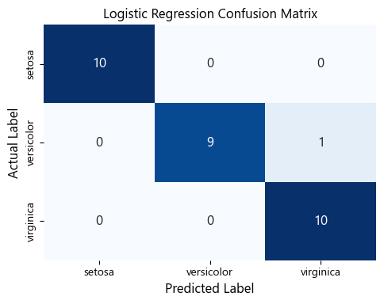

```python
log_reg_pipeline
```

<style>#sk-container-id-22 {
  /* Definition of color scheme common for light and dark mode */
  --sklearn-color-text: #000;
  --sklearn-color-text-muted: #666;
  --sklearn-color-line: gray;
  /* Definition of color scheme for unfitted estimators */
  --sklearn-color-unfitted-level-0: #fff5e6;
  --sklearn-color-unfitted-level-1: #f6e4d2;
  --sklearn-color-unfitted-level-2: #ffe0b3;
  --sklearn-color-unfitted-level-3: chocolate;
  /* Definition of color scheme for fitted estimators */
  --sklearn-color-fitted-level-0: #f0f8ff;
  --sklearn-color-fitted-level-1: #d4ebff;
  --sklearn-color-fitted-level-2: #b3dbfd;
  --sklearn-color-fitted-level-3: cornflowerblue;
}

#sk-container-id-22.light {
  /* Specific color for light theme */
  --sklearn-color-text-on-default-background: black;
  --sklearn-color-background: white;
  --sklearn-color-border-box: black;
  --sklearn-color-icon: #696969;
}

#sk-container-id-22.dark {
  --sklearn-color-text-on-default-background: white;
  --sklearn-color-background: #111;
  --sklearn-color-border-box: white;
  --sklearn-color-icon: #878787;
}

#sk-container-id-22 {
  color: var(--sklearn-color-text);
}

#sk-container-id-22 pre {
  padding: 0;
}

#sk-container-id-22 input.sk-hidden--visually {
  border: 0;
  clip: rect(1px 1px 1px 1px);
  clip: rect(1px, 1px, 1px, 1px);
  height: 1px;
  margin: -1px;
  overflow: hidden;
  padding: 0;
  position: absolute;
  width: 1px;
}

#sk-container-id-22 div.sk-dashed-wrapped {
  border: 1px dashed var(--sklearn-color-line);
  margin: 0 0.4em 0.5em 0.4em;
  box-sizing: border-box;
  padding-bottom: 0.4em;
  background-color: var(--sklearn-color-background);
}

#sk-container-id-22 div.sk-container {
  /* jupyter's `normalize.less` sets `[hidden] { display: none; }`
     but bootstrap.min.css set `[hidden] { display: none !important; }`
     so we also need the `!important` here to be able to override the
     default hidden behavior on the sphinx rendered scikit-learn.org.
     See: https://github.com/scikit-learn/scikit-learn/issues/21755 */
  display: inline-block !important;
  position: relative;
}

#sk-container-id-22 div.sk-text-repr-fallback {
  display: none;
}

div.sk-parallel-item,
div.sk-serial,
div.sk-item {
  /* draw centered vertical line to link estimators */
  background-image: linear-gradient(var(--sklearn-color-text-on-default-background), var(--sklearn-color-text-on-default-background));
  background-size: 2px 100%;
  background-repeat: no-repeat;
  background-position: center center;
}

/* Parallel-specific style estimator block */

#sk-container-id-22 div.sk-parallel-item::after {
  content: "";
  width: 100%;
  border-bottom: 2px solid var(--sklearn-color-text-on-default-background);
  flex-grow: 1;
}

#sk-container-id-22 div.sk-parallel {
  display: flex;
  align-items: stretch;
  justify-content: center;
  background-color: var(--sklearn-color-background);
  position: relative;
}

#sk-container-id-22 div.sk-parallel-item {
  display: flex;
  flex-direction: column;
}

#sk-container-id-22 div.sk-parallel-item:first-child::after {
  align-self: flex-end;
  width: 50%;
}

#sk-container-id-22 div.sk-parallel-item:last-child::after {
  align-self: flex-start;
  width: 50%;
}

#sk-container-id-22 div.sk-parallel-item:only-child::after {
  width: 0;
}

/* Serial-specific style estimator block */

#sk-container-id-22 div.sk-serial {
  display: flex;
  flex-direction: column;
  align-items: center;
  background-color: var(--sklearn-color-background);
  padding-right: 1em;
  padding-left: 1em;
}


/* Toggleable style: style used for estimator/Pipeline/ColumnTransformer box that is
clickable and can be expanded/collapsed.
- Pipeline and ColumnTransformer use this feature and define the default style
- Estimators will overwrite some part of the style using the `sk-estimator` class
*/

/* Pipeline and ColumnTransformer style (default) */

#sk-container-id-22 div.sk-toggleable {
  /* Default theme specific background. It is overwritten whether we have a
  specific estimator or a Pipeline/ColumnTransformer */
  background-color: var(--sklearn-color-background);
}

/* Toggleable label */
#sk-container-id-22 label.sk-toggleable__label {
  cursor: pointer;
  display: flex;
  width: 100%;
  margin-bottom: 0;
  padding: 0.5em;
  box-sizing: border-box;
  text-align: center;
  align-items: center;
  justify-content: center;
  gap: 0.5em;
}

#sk-container-id-22 label.sk-toggleable__label .caption {
  font-size: 0.6rem;
  font-weight: lighter;
  color: var(--sklearn-color-text-muted);
}

#sk-container-id-22 label.sk-toggleable__label-arrow:before {
  /* Arrow on the left of the label */
  content: "▸";
  float: left;
  margin-right: 0.25em;
  color: var(--sklearn-color-icon);
}

#sk-container-id-22 label.sk-toggleable__label-arrow:hover:before {
  color: var(--sklearn-color-text);
}

/* Toggleable content - dropdown */

#sk-container-id-22 div.sk-toggleable__content {
  display: none;
  text-align: left;
  /* unfitted */
  background-color: var(--sklearn-color-unfitted-level-0);
}

#sk-container-id-22 div.sk-toggleable__content.fitted {
  /* fitted */
  background-color: var(--sklearn-color-fitted-level-0);
}

#sk-container-id-22 div.sk-toggleable__content pre {
  margin: 0.2em;
  border-radius: 0.25em;
  color: var(--sklearn-color-text);
  /* unfitted */
  background-color: var(--sklearn-color-unfitted-level-0);
}

#sk-container-id-22 div.sk-toggleable__content.fitted pre {
  /* unfitted */
  background-color: var(--sklearn-color-fitted-level-0);
}

#sk-container-id-22 input.sk-toggleable__control:checked~div.sk-toggleable__content {
  /* Expand drop-down */
  display: block;
  width: 100%;
  overflow: visible;
}

#sk-container-id-22 input.sk-toggleable__control:checked~label.sk-toggleable__label-arrow:before {
  content: "▾";
}

/* Pipeline/ColumnTransformer-specific style */

#sk-container-id-22 div.sk-label input.sk-toggleable__control:checked~label.sk-toggleable__label {
  color: var(--sklearn-color-text);
  background-color: var(--sklearn-color-unfitted-level-2);
}

#sk-container-id-22 div.sk-label.fitted input.sk-toggleable__control:checked~label.sk-toggleable__label {
  background-color: var(--sklearn-color-fitted-level-2);
}

/* Estimator-specific style */

/* Colorize estimator box */
#sk-container-id-22 div.sk-estimator input.sk-toggleable__control:checked~label.sk-toggleable__label {
  /* unfitted */
  background-color: var(--sklearn-color-unfitted-level-2);
}

#sk-container-id-22 div.sk-estimator.fitted input.sk-toggleable__control:checked~label.sk-toggleable__label {
  /* fitted */
  background-color: var(--sklearn-color-fitted-level-2);
}

#sk-container-id-22 div.sk-label label.sk-toggleable__label,
#sk-container-id-22 div.sk-label label {
  /* The background is the default theme color */
  color: var(--sklearn-color-text-on-default-background);
}

/* On hover, darken the color of the background */
#sk-container-id-22 div.sk-label:hover label.sk-toggleable__label {
  color: var(--sklearn-color-text);
  background-color: var(--sklearn-color-unfitted-level-2);
}

/* Label box, darken color on hover, fitted */
#sk-container-id-22 div.sk-label.fitted:hover label.sk-toggleable__label.fitted {
  color: var(--sklearn-color-text);
  background-color: var(--sklearn-color-fitted-level-2);
}

/* Estimator label */

#sk-container-id-22 div.sk-label label {
  font-family: monospace;
  font-weight: bold;
  line-height: 1.2em;
}

#sk-container-id-22 div.sk-label-container {
  text-align: center;
}

/* Estimator-specific */
#sk-container-id-22 div.sk-estimator {
  font-family: monospace;
  border: 1px dotted var(--sklearn-color-border-box);
  border-radius: 0.25em;
  box-sizing: border-box;
  margin-bottom: 0.5em;
  /* unfitted */
  background-color: var(--sklearn-color-unfitted-level-0);
}

#sk-container-id-22 div.sk-estimator.fitted {
  /* fitted */
  background-color: var(--sklearn-color-fitted-level-0);
}

/* on hover */
#sk-container-id-22 div.sk-estimator:hover {
  /* unfitted */
  background-color: var(--sklearn-color-unfitted-level-2);
}

#sk-container-id-22 div.sk-estimator.fitted:hover {
  /* fitted */
  background-color: var(--sklearn-color-fitted-level-2);
}

/* Specification for estimator info (e.g. "i" and "?") */

/* Common style for "i" and "?" */

.sk-estimator-doc-link,
a:link.sk-estimator-doc-link,
a:visited.sk-estimator-doc-link {
  float: right;
  font-size: smaller;
  line-height: 1em;
  font-family: monospace;
  background-color: var(--sklearn-color-unfitted-level-0);
  border-radius: 1em;
  height: 1em;
  width: 1em;
  text-decoration: none !important;
  margin-left: 0.5em;
  text-align: center;
  /* unfitted */
  border: var(--sklearn-color-unfitted-level-3) 1pt solid;
  color: var(--sklearn-color-unfitted-level-3);
}

.sk-estimator-doc-link.fitted,
a:link.sk-estimator-doc-link.fitted,
a:visited.sk-estimator-doc-link.fitted {
  /* fitted */
  background-color: var(--sklearn-color-fitted-level-0);
  border: var(--sklearn-color-fitted-level-3) 1pt solid;
  color: var(--sklearn-color-fitted-level-3);
}

/* On hover */
div.sk-estimator:hover .sk-estimator-doc-link:hover,
.sk-estimator-doc-link:hover,
div.sk-label-container:hover .sk-estimator-doc-link:hover,
.sk-estimator-doc-link:hover {
  /* unfitted */
  background-color: var(--sklearn-color-unfitted-level-3);
  border: var(--sklearn-color-fitted-level-0) 1pt solid;
  color: var(--sklearn-color-unfitted-level-0);
  text-decoration: none;
}

div.sk-estimator.fitted:hover .sk-estimator-doc-link.fitted:hover,
.sk-estimator-doc-link.fitted:hover,
div.sk-label-container:hover .sk-estimator-doc-link.fitted:hover,
.sk-estimator-doc-link.fitted:hover {
  /* fitted */
  background-color: var(--sklearn-color-fitted-level-3);
  border: var(--sklearn-color-fitted-level-0) 1pt solid;
  color: var(--sklearn-color-fitted-level-0);
  text-decoration: none;
}

/* Span, style for the box shown on hovering the info icon */
.sk-estimator-doc-link span {
  display: none;
  z-index: 9999;
  position: relative;
  font-weight: normal;
  right: .2ex;
  padding: .5ex;
  margin: .5ex;
  width: min-content;
  min-width: 20ex;
  max-width: 50ex;
  color: var(--sklearn-color-text);
  box-shadow: 2pt 2pt 4pt #999;
  /* unfitted */
  background: var(--sklearn-color-unfitted-level-0);
  border: .5pt solid var(--sklearn-color-unfitted-level-3);
}

.sk-estimator-doc-link.fitted span {
  /* fitted */
  background: var(--sklearn-color-fitted-level-0);
  border: var(--sklearn-color-fitted-level-3);
}

.sk-estimator-doc-link:hover span {
  display: block;
}

/* "?"-specific style due to the `<a>` HTML tag */

#sk-container-id-22 a.estimator_doc_link {
  float: right;
  font-size: 1rem;
  line-height: 1em;
  font-family: monospace;
  background-color: var(--sklearn-color-unfitted-level-0);
  border-radius: 1rem;
  height: 1rem;
  width: 1rem;
  text-decoration: none;
  /* unfitted */
  color: var(--sklearn-color-unfitted-level-1);
  border: var(--sklearn-color-unfitted-level-1) 1pt solid;
}

#sk-container-id-22 a.estimator_doc_link.fitted {
  /* fitted */
  background-color: var(--sklearn-color-fitted-level-0);
  border: var(--sklearn-color-fitted-level-1) 1pt solid;
  color: var(--sklearn-color-fitted-level-1);
}

/* On hover */
#sk-container-id-22 a.estimator_doc_link:hover {
  /* unfitted */
  background-color: var(--sklearn-color-unfitted-level-3);
  color: var(--sklearn-color-background);
  text-decoration: none;
}

#sk-container-id-22 a.estimator_doc_link.fitted:hover {
  /* fitted */
  background-color: var(--sklearn-color-fitted-level-3);
}

.estimator-table {
    font-family: monospace;
}

.estimator-table summary {
    padding: .5rem;
    cursor: pointer;
}

.estimator-table summary::marker {
    font-size: 0.7rem;
}

.estimator-table details[open] {
    padding-left: 0.1rem;
    padding-right: 0.1rem;
    padding-bottom: 0.3rem;
}

.estimator-table .parameters-table {
    margin-left: auto !important;
    margin-right: auto !important;
    margin-top: 0;
}

.estimator-table .parameters-table tr:nth-child(odd) {
    background-color: #fff;
}

.estimator-table .parameters-table tr:nth-child(even) {
    background-color: #f6f6f6;
}

.estimator-table .parameters-table tr:hover {
    background-color: #e0e0e0;
}

.estimator-table table td {
    border: 1px solid rgba(106, 105, 104, 0.232);
}

/*
    `table td`is set in notebook with right text-align.
    We need to overwrite it.
*/
.estimator-table table td.param {
    text-align: left;
    position: relative;
    padding: 0;
}

.user-set td {
    color:rgb(255, 94, 0);
    text-align: left !important;
}

.user-set td.value {
    color:rgb(255, 94, 0);
    background-color: transparent;
}

.default td {
    color: black;
    text-align: left !important;
}

.user-set td i,
.default td i {
    color: black;
}

/*
    Styles for parameter documentation links
    We need styling for visited so jupyter doesn't overwrite it
*/
a.param-doc-link,
a.param-doc-link:link,
a.param-doc-link:visited {
    text-decoration: underline dashed;
    text-underline-offset: .3em;
    color: inherit;
    display: block;
    padding: .5em;
}

/* "hack" to make the entire area of the cell containing the link clickable */
a.param-doc-link::before {
    position: absolute;
    content: "";
    inset: 0;
}

.param-doc-description {
    display: none;
    position: absolute;
    z-index: 9999;
    left: 0;
    padding: .5ex;
    margin-left: 1.5em;
    color: var(--sklearn-color-text);
    box-shadow: .3em .3em .4em #999;
    width: max-content;
    text-align: left;
    max-height: 10em;
    overflow-y: auto;

    /* unfitted */
    background: var(--sklearn-color-unfitted-level-0);
    border: thin solid var(--sklearn-color-unfitted-level-3);
}

/* Fitted state for parameter tooltips */
.fitted .param-doc-description {
    /* fitted */
    background: var(--sklearn-color-fitted-level-0);
    border: thin solid var(--sklearn-color-fitted-level-3);
}

.param-doc-link:hover .param-doc-description {
    display: block;
}

.copy-paste-icon {
    background-image: url();
    background-repeat: no-repeat;
    background-size: 14px 14px;
    background-position: 0;
    display: inline-block;
    width: 14px;
    height: 14px;
    cursor: pointer;
}
</style><body><div id="sk-container-id-22" class="sk-top-container"><div class="sk-text-repr-fallback"><pre>Pipeline(steps=[(&#x27;preprocessing&#x27;,
                 ColumnTransformer(transformers=[(&#x27;num&#x27;,
                                                  Pipeline(steps=[(&#x27;imputer&#x27;,
                                                                   SimpleImputer(strategy=&#x27;median&#x27;)),
                                                                  (&#x27;attribs_adder&#x27;,
                                                                   IrisFeatureCombiner()),
                                                                  (&#x27;std_scaler&#x27;,
                                                                   StandardScaler())]),
                                                  [&#x27;sepal length (cm)&#x27;,
                                                   &#x27;sepal width (cm)&#x27;,
                                                   &#x27;petal length (cm)&#x27;,
                                                   &#x27;petal width (cm)&#x27;]),
                                                 (&#x27;cat&#x27;,
                                                  Pipeline(steps=[(&#x27;imputer&#x27;,
                                                                   SimpleImputer(strategy=&#x27;most_frequent&#x27;)),
                                                                  (&#x27;one_hot&#x27;,
                                                                   OneHotEncoder(handle_unknown=&#x27;ignore&#x27;))]),
                                                  [])])),
                (&#x27;log_reg&#x27;, LogisticRegression(random_state=42))])</pre><b>In a Jupyter environment, please rerun this cell to show the HTML representation or trust the notebook. <br />On GitHub, the HTML representation is unable to render, please try loading this page with nbviewer.org.</b></div><div class="sk-container" hidden><div class="sk-item sk-dashed-wrapped"><div class="sk-label-container"><div class="sk-label fitted sk-toggleable"><input class="sk-toggleable__control sk-hidden--visually" id="sk-estimator-id-150" type="checkbox" ><label for="sk-estimator-id-150" class="sk-toggleable__label fitted sk-toggleable__label-arrow"><div><div>Pipeline</div></div><div><a class="sk-estimator-doc-link fitted" rel="noreferrer" target="_blank" href="https://scikit-learn.org/1.8/modules/generated/sklearn.pipeline.Pipeline.html">?<span>Documentation for Pipeline</span></a><span class="sk-estimator-doc-link fitted">i<span>Fitted</span></span></div></label><div class="sk-toggleable__content fitted" data-param-prefix="">
        <div class="estimator-table">
            <details>
                <summary>Parameters</summary>
                <div class="table-wrap"><table class="parameters-table">
                  <tbody>
                    
        <tr class="user-set">
            <td><i class="copy-paste-icon"
            ></i></td>
            <td class="param">
        <a class="param-doc-link"
            rel="noreferrer" target="_blank" href="https://scikit-learn.org/1.8/modules/generated/sklearn.pipeline.Pipeline.html#:~:text=steps,-list%20of%20tuples">
            steps
            <span class="param-doc-description">steps: list of tuples<br><br>List of (name of step, estimator) tuples that are to be chained in<br>sequential order. To be compatible with the scikit-learn API, all steps<br>must define `fit`. All non-last steps must also define `transform`. See<br>:ref:`Combining Estimators <combining_estimators>` for more details.</span>
        </a>
    </td>
            <td class="value">[(&#x27;preprocessing&#x27;, ...), (&#x27;log_reg&#x27;, ...)]</td>
        </tr>
    

        <tr class="default">
            <td><i class="copy-paste-icon"
            ></i></td>
            <td class="param">
        <a class="param-doc-link"
            rel="noreferrer" target="_blank" href="https://scikit-learn.org/1.8/modules/generated/sklearn.pipeline.Pipeline.html#:~:text=transform_input,-list%20of%20str%2C%20default%3DNone">
            transform_input
            <span class="param-doc-description">transform_input: list of str, default=None<br><br>The names of the :term:`metadata` parameters that should be transformed by the<br>pipeline before passing it to the step consuming it.<br><br>This enables transforming some input arguments to ``fit`` (other than ``X``)<br>to be transformed by the steps of the pipeline up to the step which requires<br>them. Requirement is defined via :ref:`metadata routing <metadata_routing>`.<br>For instance, this can be used to pass a validation set through the pipeline.<br><br>You can only set this if metadata routing is enabled, which you<br>can enable using ``sklearn.set_config(enable_metadata_routing=True)``.<br><br>.. versionadded:: 1.6</span>
        </a>
    </td>
            <td class="value">None</td>
        </tr>
    

        <tr class="default">
            <td><i class="copy-paste-icon"
            ></i></td>
            <td class="param">
        <a class="param-doc-link"
            rel="noreferrer" target="_blank" href="https://scikit-learn.org/1.8/modules/generated/sklearn.pipeline.Pipeline.html#:~:text=memory,-str%20or%20object%20with%20the%20joblib.Memory%20interface%2C%20default%3DNone">
            memory
            <span class="param-doc-description">memory: str or object with the joblib.Memory interface, default=None<br><br>Used to cache the fitted transformers of the pipeline. The last step<br>will never be cached, even if it is a transformer. By default, no<br>caching is performed. If a string is given, it is the path to the<br>caching directory. Enabling caching triggers a clone of the transformers<br>before fitting. Therefore, the transformer instance given to the<br>pipeline cannot be inspected directly. Use the attribute ``named_steps``<br>or ``steps`` to inspect estimators within the pipeline. Caching the<br>transformers is advantageous when fitting is time consuming. See<br>:ref:`sphx_glr_auto_examples_neighbors_plot_caching_nearest_neighbors.py`<br>for an example on how to enable caching.</span>
        </a>
    </td>
            <td class="value">None</td>
        </tr>
    

        <tr class="default">
            <td><i class="copy-paste-icon"
            ></i></td>
            <td class="param">
        <a class="param-doc-link"
            rel="noreferrer" target="_blank" href="https://scikit-learn.org/1.8/modules/generated/sklearn.pipeline.Pipeline.html#:~:text=verbose,-bool%2C%20default%3DFalse">
            verbose
            <span class="param-doc-description">verbose: bool, default=False<br><br>If True, the time elapsed while fitting each step will be printed as it<br>is completed.</span>
        </a>
    </td>
            <td class="value">False</td>
        </tr>
    
                  </tbody>
                </table></div>
            </details>
        </div>
    </div></div></div><div class="sk-serial"><div class="sk-item sk-dashed-wrapped"><div class="sk-label-container"><div class="sk-label fitted sk-toggleable"><input class="sk-toggleable__control sk-hidden--visually" id="sk-estimator-id-151" type="checkbox" ><label for="sk-estimator-id-151" class="sk-toggleable__label fitted sk-toggleable__label-arrow"><div><div>preprocessing: ColumnTransformer</div></div><div><a class="sk-estimator-doc-link fitted" rel="noreferrer" target="_blank" href="https://scikit-learn.org/1.8/modules/generated/sklearn.compose.ColumnTransformer.html">?<span>Documentation for preprocessing: ColumnTransformer</span></a></div></label><div class="sk-toggleable__content fitted" data-param-prefix="preprocessing__">
        <div class="estimator-table">
            <details>
                <summary>Parameters</summary>
                <div class="table-wrap"><table class="parameters-table">
                  <tbody>
                    
        <tr class="user-set">
            <td><i class="copy-paste-icon"
            ></i></td>
            <td class="param">
        <a class="param-doc-link"
            rel="noreferrer" target="_blank" href="https://scikit-learn.org/1.8/modules/generated/sklearn.compose.ColumnTransformer.html#:~:text=transformers,-list%20of%20tuples">
            transformers
            <span class="param-doc-description">transformers: list of tuples<br><br>List of (name, transformer, columns) tuples specifying the<br>transformer objects to be applied to subsets of the data.<br><br>name : str<br>    Like in Pipeline and FeatureUnion, this allows the transformer and<br>    its parameters to be set using ``set_params`` and searched in grid<br>    search.<br>transformer : {'drop', 'passthrough'} or estimator<br>    Estimator must support :term:`fit` and :term:`transform`.<br>    Special-cased strings 'drop' and 'passthrough' are accepted as<br>    well, to indicate to drop the columns or to pass them through<br>    untransformed, respectively.<br>columns :  str, array-like of str, int, array-like of int,                 array-like of bool, slice or callable<br>    Indexes the data on its second axis. Integers are interpreted as<br>    positional columns, while strings can reference DataFrame columns<br>    by name.  A scalar string or int should be used where<br>    ``transformer`` expects X to be a 1d array-like (vector),<br>    otherwise a 2d array will be passed to the transformer.<br>    A callable is passed the input data `X` and can return any of the<br>    above. To select multiple columns by name or dtype, you can use<br>    :obj:`make_column_selector`.</span>
        </a>
    </td>
            <td class="value">[(&#x27;num&#x27;, ...), (&#x27;cat&#x27;, ...)]</td>
        </tr>
    

        <tr class="default">
            <td><i class="copy-paste-icon"
            ></i></td>
            <td class="param">
        <a class="param-doc-link"
            rel="noreferrer" target="_blank" href="https://scikit-learn.org/1.8/modules/generated/sklearn.compose.ColumnTransformer.html#:~:text=remainder,-%7B%27drop%27%2C%20%27passthrough%27%7D%20or%20estimator%2C%20default%3D%27drop%27">
            remainder
            <span class="param-doc-description">remainder: {'drop', 'passthrough'} or estimator, default='drop'<br><br>By default, only the specified columns in `transformers` are<br>transformed and combined in the output, and the non-specified<br>columns are dropped. (default of ``'drop'``).<br>By specifying ``remainder='passthrough'``, all remaining columns that<br>were not specified in `transformers`, but present in the data passed<br>to `fit` will be automatically passed through. This subset of columns<br>is concatenated with the output of the transformers. For dataframes,<br>extra columns not seen during `fit` will be excluded from the output<br>of `transform`.<br>By setting ``remainder`` to be an estimator, the remaining<br>non-specified columns will use the ``remainder`` estimator. The<br>estimator must support :term:`fit` and :term:`transform`.<br>Note that using this feature requires that the DataFrame columns<br>input at :term:`fit` and :term:`transform` have identical order.</span>
        </a>
    </td>
            <td class="value">&#x27;drop&#x27;</td>
        </tr>
    

        <tr class="default">
            <td><i class="copy-paste-icon"
            ></i></td>
            <td class="param">
        <a class="param-doc-link"
            rel="noreferrer" target="_blank" href="https://scikit-learn.org/1.8/modules/generated/sklearn.compose.ColumnTransformer.html#:~:text=sparse_threshold,-float%2C%20default%3D0.3">
            sparse_threshold
            <span class="param-doc-description">sparse_threshold: float, default=0.3<br><br>If the output of the different transformers contains sparse matrices,<br>these will be stacked as a sparse matrix if the overall density is<br>lower than this value. Use ``sparse_threshold=0`` to always return<br>dense.  When the transformed output consists of all dense data, the<br>stacked result will be dense, and this keyword will be ignored.</span>
        </a>
    </td>
            <td class="value">0.3</td>
        </tr>
    

        <tr class="default">
            <td><i class="copy-paste-icon"
            ></i></td>
            <td class="param">
        <a class="param-doc-link"
            rel="noreferrer" target="_blank" href="https://scikit-learn.org/1.8/modules/generated/sklearn.compose.ColumnTransformer.html#:~:text=n_jobs,-int%2C%20default%3DNone">
            n_jobs
            <span class="param-doc-description">n_jobs: int, default=None<br><br>Number of jobs to run in parallel.<br>``None`` means 1 unless in a :obj:`joblib.parallel_backend` context.<br>``-1`` means using all processors. See :term:`Glossary <n_jobs>`<br>for more details.</span>
        </a>
    </td>
            <td class="value">None</td>
        </tr>
    

        <tr class="default">
            <td><i class="copy-paste-icon"
            ></i></td>
            <td class="param">
        <a class="param-doc-link"
            rel="noreferrer" target="_blank" href="https://scikit-learn.org/1.8/modules/generated/sklearn.compose.ColumnTransformer.html#:~:text=transformer_weights,-dict%2C%20default%3DNone">
            transformer_weights
            <span class="param-doc-description">transformer_weights: dict, default=None<br><br>Multiplicative weights for features per transformer. The output of the<br>transformer is multiplied by these weights. Keys are transformer names,<br>values the weights.</span>
        </a>
    </td>
            <td class="value">None</td>
        </tr>
    

        <tr class="default">
            <td><i class="copy-paste-icon"
            ></i></td>
            <td class="param">
        <a class="param-doc-link"
            rel="noreferrer" target="_blank" href="https://scikit-learn.org/1.8/modules/generated/sklearn.compose.ColumnTransformer.html#:~:text=verbose,-bool%2C%20default%3DFalse">
            verbose
            <span class="param-doc-description">verbose: bool, default=False<br><br>If True, the time elapsed while fitting each transformer will be<br>printed as it is completed.</span>
        </a>
    </td>
            <td class="value">False</td>
        </tr>
    

        <tr class="default">
            <td><i class="copy-paste-icon"
            ></i></td>
            <td class="param">
        <a class="param-doc-link"
            rel="noreferrer" target="_blank" href="https://scikit-learn.org/1.8/modules/generated/sklearn.compose.ColumnTransformer.html#:~:text=verbose_feature_names_out,-bool%2C%20str%20or%20Callable%5B%5Bstr%2C%20str%5D%2C%20str%5D%2C%20default%3DTrue">
            verbose_feature_names_out
            <span class="param-doc-description">verbose_feature_names_out: bool, str or Callable[[str, str], str], default=True<br><br>- If True, :meth:`ColumnTransformer.get_feature_names_out` will prefix<br>  all feature names with the name of the transformer that generated that<br>  feature. It is equivalent to setting<br>  `verbose_feature_names_out="{transformer_name}__{feature_name}"`.<br>- If False, :meth:`ColumnTransformer.get_feature_names_out` will not<br>  prefix any feature names and will error if feature names are not<br>  unique.<br>- If ``Callable[[str, str], str]``,<br>  :meth:`ColumnTransformer.get_feature_names_out` will rename all the features<br>  using the name of the transformer. The first argument of the callable is the<br>  transformer name and the second argument is the feature name. The returned<br>  string will be the new feature name.<br>- If ``str``, it must be a string ready for formatting. The given string will<br>  be formatted using two field names: ``transformer_name`` and ``feature_name``.<br>  e.g. ``"{feature_name}__{transformer_name}"``. See :meth:`str.format` method<br>  from the standard library for more info.<br><br>.. versionadded:: 1.0<br><br>.. versionchanged:: 1.6<br>    `verbose_feature_names_out` can be a callable or a string to be formatted.</span>
        </a>
    </td>
            <td class="value">True</td>
        </tr>
    

        <tr class="default">
            <td><i class="copy-paste-icon"
            ></i></td>
            <td class="param">
        <a class="param-doc-link"
            rel="noreferrer" target="_blank" href="https://scikit-learn.org/1.8/modules/generated/sklearn.compose.ColumnTransformer.html#:~:text=force_int_remainder_cols,-bool%2C%20default%3DFalse">
            force_int_remainder_cols
            <span class="param-doc-description">force_int_remainder_cols: bool, default=False<br><br>This parameter has no effect.<br><br>.. note::<br>    If you do not access the list of columns for the remainder columns<br>    in the `transformers_` fitted attribute, you do not need to set<br>    this parameter.<br><br>.. versionadded:: 1.5<br><br>.. versionchanged:: 1.7<br>   The default value for `force_int_remainder_cols` will change from<br>   `True` to `False` in version 1.7.<br><br>.. deprecated:: 1.7<br>   `force_int_remainder_cols` is deprecated and will be removed in 1.9.</span>
        </a>
    </td>
            <td class="value">&#x27;deprecated&#x27;</td>
        </tr>
    
                  </tbody>
                </table></div>
            </details>
        </div>
    </div></div></div><div class="sk-parallel"><div class="sk-parallel-item"><div class="sk-item"><div class="sk-label-container"><div class="sk-label fitted sk-toggleable"><input class="sk-toggleable__control sk-hidden--visually" id="sk-estimator-id-152" type="checkbox" ><label for="sk-estimator-id-152" class="sk-toggleable__label fitted sk-toggleable__label-arrow"><div><div>num</div></div></label><div class="sk-toggleable__content fitted" data-param-prefix="preprocessing__num__"><pre>[&#x27;sepal length (cm)&#x27;, &#x27;sepal width (cm)&#x27;, &#x27;petal length (cm)&#x27;, &#x27;petal width (cm)&#x27;]</pre></div></div></div><div class="sk-serial"><div class="sk-item"><div class="sk-serial"><div class="sk-item"><div class="sk-estimator fitted sk-toggleable"><input class="sk-toggleable__control sk-hidden--visually" id="sk-estimator-id-153" type="checkbox" ><label for="sk-estimator-id-153" class="sk-toggleable__label fitted sk-toggleable__label-arrow"><div><div>SimpleImputer</div></div><div><a class="sk-estimator-doc-link fitted" rel="noreferrer" target="_blank" href="https://scikit-learn.org/1.8/modules/generated/sklearn.impute.SimpleImputer.html">?<span>Documentation for SimpleImputer</span></a></div></label><div class="sk-toggleable__content fitted" data-param-prefix="preprocessing__num__imputer__">
        <div class="estimator-table">
            <details>
                <summary>Parameters</summary>
                <div class="table-wrap"><table class="parameters-table">
                  <tbody>
                    
        <tr class="default">
            <td><i class="copy-paste-icon"
            ></i></td>
            <td class="param">
        <a class="param-doc-link"
            rel="noreferrer" target="_blank" href="https://scikit-learn.org/1.8/modules/generated/sklearn.impute.SimpleImputer.html#:~:text=missing_values,-int%2C%20float%2C%20str%2C%20np.nan%2C%20None%20or%20pandas.NA%2C%20default%3Dnp.nan">
            missing_values
            <span class="param-doc-description">missing_values: int, float, str, np.nan, None or pandas.NA, default=np.nan<br><br>The placeholder for the missing values. All occurrences of<br>`missing_values` will be imputed. For pandas' dataframes with<br>nullable integer dtypes with missing values, `missing_values`<br>can be set to either `np.nan` or `pd.NA`.</span>
        </a>
    </td>
            <td class="value">nan</td>
        </tr>
    

        <tr class="user-set">
            <td><i class="copy-paste-icon"
            ></i></td>
            <td class="param">
        <a class="param-doc-link"
            rel="noreferrer" target="_blank" href="https://scikit-learn.org/1.8/modules/generated/sklearn.impute.SimpleImputer.html#:~:text=strategy,-str%20or%20Callable%2C%20default%3D%27mean%27">
            strategy
            <span class="param-doc-description">strategy: str or Callable, default='mean'<br><br>The imputation strategy.<br><br>- If "mean", then replace missing values using the mean along<br>  each column. Can only be used with numeric data.<br>- If "median", then replace missing values using the median along<br>  each column. Can only be used with numeric data.<br>- If "most_frequent", then replace missing using the most frequent<br>  value along each column. Can be used with strings or numeric data.<br>  If there is more than one such value, only the smallest is returned.<br>- If "constant", then replace missing values with fill_value. Can be<br>  used with strings or numeric data.<br>- If an instance of Callable, then replace missing values using the<br>  scalar statistic returned by running the callable over a dense 1d<br>  array containing non-missing values of each column.<br><br>.. versionadded:: 0.20<br>   strategy="constant" for fixed value imputation.<br><br>.. versionadded:: 1.5<br>   strategy=callable for custom value imputation.</span>
        </a>
    </td>
            <td class="value">&#x27;median&#x27;</td>
        </tr>
    

        <tr class="default">
            <td><i class="copy-paste-icon"
            ></i></td>
            <td class="param">
        <a class="param-doc-link"
            rel="noreferrer" target="_blank" href="https://scikit-learn.org/1.8/modules/generated/sklearn.impute.SimpleImputer.html#:~:text=fill_value,-str%20or%20numerical%20value%2C%20default%3DNone">
            fill_value
            <span class="param-doc-description">fill_value: str or numerical value, default=None<br><br>When strategy == "constant", `fill_value` is used to replace all<br>occurrences of missing_values. For string or object data types,<br>`fill_value` must be a string.<br>If `None`, `fill_value` will be 0 when imputing numerical<br>data and "missing_value" for strings or object data types.</span>
        </a>
    </td>
            <td class="value">None</td>
        </tr>
    

        <tr class="default">
            <td><i class="copy-paste-icon"
            ></i></td>
            <td class="param">
        <a class="param-doc-link"
            rel="noreferrer" target="_blank" href="https://scikit-learn.org/1.8/modules/generated/sklearn.impute.SimpleImputer.html#:~:text=copy,-bool%2C%20default%3DTrue">
            copy
            <span class="param-doc-description">copy: bool, default=True<br><br>If True, a copy of X will be created. If False, imputation will<br>be done in-place whenever possible. Note that, in the following cases,<br>a new copy will always be made, even if `copy=False`:<br><br>- If `X` is not an array of floating values;<br>- If `X` is encoded as a CSR matrix;<br>- If `add_indicator=True`.</span>
        </a>
    </td>
            <td class="value">True</td>
        </tr>
    

        <tr class="default">
            <td><i class="copy-paste-icon"
            ></i></td>
            <td class="param">
        <a class="param-doc-link"
            rel="noreferrer" target="_blank" href="https://scikit-learn.org/1.8/modules/generated/sklearn.impute.SimpleImputer.html#:~:text=add_indicator,-bool%2C%20default%3DFalse">
            add_indicator
            <span class="param-doc-description">add_indicator: bool, default=False<br><br>If True, a :class:`MissingIndicator` transform will stack onto output<br>of the imputer's transform. This allows a predictive estimator<br>to account for missingness despite imputation. If a feature has no<br>missing values at fit/train time, the feature won't appear on<br>the missing indicator even if there are missing values at<br>transform/test time.</span>
        </a>
    </td>
            <td class="value">False</td>
        </tr>
    

        <tr class="default">
            <td><i class="copy-paste-icon"
            ></i></td>
            <td class="param">
        <a class="param-doc-link"
            rel="noreferrer" target="_blank" href="https://scikit-learn.org/1.8/modules/generated/sklearn.impute.SimpleImputer.html#:~:text=keep_empty_features,-bool%2C%20default%3DFalse">
            keep_empty_features
            <span class="param-doc-description">keep_empty_features: bool, default=False<br><br>If True, features that consist exclusively of missing values when<br>`fit` is called are returned in results when `transform` is called.<br>The imputed value is always `0` except when `strategy="constant"`<br>in which case `fill_value` will be used instead.<br><br>.. versionadded:: 1.2</span>
        </a>
    </td>
            <td class="value">False</td>
        </tr>
    
                  </tbody>
                </table></div>
            </details>
        </div>
    </div></div></div><div class="sk-item"><div class="sk-estimator fitted sk-toggleable"><input class="sk-toggleable__control sk-hidden--visually" id="sk-estimator-id-154" type="checkbox" ><label for="sk-estimator-id-154" class="sk-toggleable__label fitted sk-toggleable__label-arrow"><div><div>IrisFeatureCombiner</div></div></label><div class="sk-toggleable__content fitted" data-param-prefix="preprocessing__num__attribs_adder__">
        <div class="estimator-table">
            <details>
                <summary>Parameters</summary>
                <div class="table-wrap"><table class="parameters-table">
                  <tbody>
                    
        <tr class="default">
            <td><i class="copy-paste-icon"
            ></i></td>
            <td class="param">add_area</td>
            <td class="value">True</td>
        </tr>
    

        <tr class="default">
            <td><i class="copy-paste-icon"
            ></i></td>
            <td class="param">add_ratio</td>
            <td class="value">True</td>
        </tr>
    

        <tr class="default">
            <td><i class="copy-paste-icon"
            ></i></td>
            <td class="param">add_cross_ratio</td>
            <td class="value">True</td>
        </tr>
    

        <tr class="default">
            <td><i class="copy-paste-icon"
            ></i></td>
            <td class="param">drop_originals</td>
            <td class="value">False</td>
        </tr>
    
                  </tbody>
                </table></div>
            </details>
        </div>
    </div></div></div><div class="sk-item"><div class="sk-estimator fitted sk-toggleable"><input class="sk-toggleable__control sk-hidden--visually" id="sk-estimator-id-155" type="checkbox" ><label for="sk-estimator-id-155" class="sk-toggleable__label fitted sk-toggleable__label-arrow"><div><div>StandardScaler</div></div><div><a class="sk-estimator-doc-link fitted" rel="noreferrer" target="_blank" href="https://scikit-learn.org/1.8/modules/generated/sklearn.preprocessing.StandardScaler.html">?<span>Documentation for StandardScaler</span></a></div></label><div class="sk-toggleable__content fitted" data-param-prefix="preprocessing__num__std_scaler__">
        <div class="estimator-table">
            <details>
                <summary>Parameters</summary>
                <div class="table-wrap"><table class="parameters-table">
                  <tbody>
                    
        <tr class="default">
            <td><i class="copy-paste-icon"
            ></i></td>
            <td class="param">
        <a class="param-doc-link"
            rel="noreferrer" target="_blank" href="https://scikit-learn.org/1.8/modules/generated/sklearn.preprocessing.StandardScaler.html#:~:text=copy,-bool%2C%20default%3DTrue">
            copy
            <span class="param-doc-description">copy: bool, default=True<br><br>If False, try to avoid a copy and do inplace scaling instead.<br>This is not guaranteed to always work inplace; e.g. if the data is<br>not a NumPy array or scipy.sparse CSR matrix, a copy may still be<br>returned.</span>
        </a>
    </td>
            <td class="value">True</td>
        </tr>
    

        <tr class="default">
            <td><i class="copy-paste-icon"
            ></i></td>
            <td class="param">
        <a class="param-doc-link"
            rel="noreferrer" target="_blank" href="https://scikit-learn.org/1.8/modules/generated/sklearn.preprocessing.StandardScaler.html#:~:text=with_mean,-bool%2C%20default%3DTrue">
            with_mean
            <span class="param-doc-description">with_mean: bool, default=True<br><br>If True, center the data before scaling.<br>This does not work (and will raise an exception) when attempted on<br>sparse matrices, because centering them entails building a dense<br>matrix which in common use cases is likely to be too large to fit in<br>memory.</span>
        </a>
    </td>
            <td class="value">True</td>
        </tr>
    

        <tr class="default">
            <td><i class="copy-paste-icon"
            ></i></td>
            <td class="param">
        <a class="param-doc-link"
            rel="noreferrer" target="_blank" href="https://scikit-learn.org/1.8/modules/generated/sklearn.preprocessing.StandardScaler.html#:~:text=with_std,-bool%2C%20default%3DTrue">
            with_std
            <span class="param-doc-description">with_std: bool, default=True<br><br>If True, scale the data to unit variance (or equivalently,<br>unit standard deviation).</span>
        </a>
    </td>
            <td class="value">True</td>
        </tr>
    
                  </tbody>
                </table></div>
            </details>
        </div>
    </div></div></div></div></div></div></div></div><div class="sk-parallel-item"><div class="sk-item"><div class="sk-label-container"><div class="sk-label fitted sk-toggleable"><input class="sk-toggleable__control sk-hidden--visually" id="sk-estimator-id-156" type="checkbox" ><label for="sk-estimator-id-156" class="sk-toggleable__label fitted sk-toggleable__label-arrow"><div><div>cat</div></div></label><div class="sk-toggleable__content fitted" data-param-prefix="preprocessing__cat__"><pre>[]</pre></div></div></div><div class="sk-serial"><div class="sk-item"><div class="sk-serial"><div class="sk-item"><div class="sk-estimator fitted sk-toggleable"><input class="sk-toggleable__control sk-hidden--visually" id="sk-estimator-id-157" type="checkbox" ><label for="sk-estimator-id-157" class="sk-toggleable__label fitted sk-toggleable__label-arrow"><div><div>SimpleImputer</div></div><div><a class="sk-estimator-doc-link fitted" rel="noreferrer" target="_blank" href="https://scikit-learn.org/1.8/modules/generated/sklearn.impute.SimpleImputer.html">?<span>Documentation for SimpleImputer</span></a></div></label><div class="sk-toggleable__content fitted" data-param-prefix="preprocessing__cat__imputer__">
        <div class="estimator-table">
            <details>
                <summary>Parameters</summary>
                <div class="table-wrap"><table class="parameters-table">
                  <tbody>
                    
        <tr class="default">
            <td><i class="copy-paste-icon"
            ></i></td>
            <td class="param">
        <a class="param-doc-link"
            rel="noreferrer" target="_blank" href="https://scikit-learn.org/1.8/modules/generated/sklearn.impute.SimpleImputer.html#:~:text=missing_values,-int%2C%20float%2C%20str%2C%20np.nan%2C%20None%20or%20pandas.NA%2C%20default%3Dnp.nan">
            missing_values
            <span class="param-doc-description">missing_values: int, float, str, np.nan, None or pandas.NA, default=np.nan<br><br>The placeholder for the missing values. All occurrences of<br>`missing_values` will be imputed. For pandas' dataframes with<br>nullable integer dtypes with missing values, `missing_values`<br>can be set to either `np.nan` or `pd.NA`.</span>
        </a>
    </td>
            <td class="value">nan</td>
        </tr>
    

        <tr class="user-set">
            <td><i class="copy-paste-icon"
            ></i></td>
            <td class="param">
        <a class="param-doc-link"
            rel="noreferrer" target="_blank" href="https://scikit-learn.org/1.8/modules/generated/sklearn.impute.SimpleImputer.html#:~:text=strategy,-str%20or%20Callable%2C%20default%3D%27mean%27">
            strategy
            <span class="param-doc-description">strategy: str or Callable, default='mean'<br><br>The imputation strategy.<br><br>- If "mean", then replace missing values using the mean along<br>  each column. Can only be used with numeric data.<br>- If "median", then replace missing values using the median along<br>  each column. Can only be used with numeric data.<br>- If "most_frequent", then replace missing using the most frequent<br>  value along each column. Can be used with strings or numeric data.<br>  If there is more than one such value, only the smallest is returned.<br>- If "constant", then replace missing values with fill_value. Can be<br>  used with strings or numeric data.<br>- If an instance of Callable, then replace missing values using the<br>  scalar statistic returned by running the callable over a dense 1d<br>  array containing non-missing values of each column.<br><br>.. versionadded:: 0.20<br>   strategy="constant" for fixed value imputation.<br><br>.. versionadded:: 1.5<br>   strategy=callable for custom value imputation.</span>
        </a>
    </td>
            <td class="value">&#x27;most_frequent&#x27;</td>
        </tr>
    

        <tr class="default">
            <td><i class="copy-paste-icon"
            ></i></td>
            <td class="param">
        <a class="param-doc-link"
            rel="noreferrer" target="_blank" href="https://scikit-learn.org/1.8/modules/generated/sklearn.impute.SimpleImputer.html#:~:text=fill_value,-str%20or%20numerical%20value%2C%20default%3DNone">
            fill_value
            <span class="param-doc-description">fill_value: str or numerical value, default=None<br><br>When strategy == "constant", `fill_value` is used to replace all<br>occurrences of missing_values. For string or object data types,<br>`fill_value` must be a string.<br>If `None`, `fill_value` will be 0 when imputing numerical<br>data and "missing_value" for strings or object data types.</span>
        </a>
    </td>
            <td class="value">None</td>
        </tr>
    

        <tr class="default">
            <td><i class="copy-paste-icon"
            ></i></td>
            <td class="param">
        <a class="param-doc-link"
            rel="noreferrer" target="_blank" href="https://scikit-learn.org/1.8/modules/generated/sklearn.impute.SimpleImputer.html#:~:text=copy,-bool%2C%20default%3DTrue">
            copy
            <span class="param-doc-description">copy: bool, default=True<br><br>If True, a copy of X will be created. If False, imputation will<br>be done in-place whenever possible. Note that, in the following cases,<br>a new copy will always be made, even if `copy=False`:<br><br>- If `X` is not an array of floating values;<br>- If `X` is encoded as a CSR matrix;<br>- If `add_indicator=True`.</span>
        </a>
    </td>
            <td class="value">True</td>
        </tr>
    

        <tr class="default">
            <td><i class="copy-paste-icon"
            ></i></td>
            <td class="param">
        <a class="param-doc-link"
            rel="noreferrer" target="_blank" href="https://scikit-learn.org/1.8/modules/generated/sklearn.impute.SimpleImputer.html#:~:text=add_indicator,-bool%2C%20default%3DFalse">
            add_indicator
            <span class="param-doc-description">add_indicator: bool, default=False<br><br>If True, a :class:`MissingIndicator` transform will stack onto output<br>of the imputer's transform. This allows a predictive estimator<br>to account for missingness despite imputation. If a feature has no<br>missing values at fit/train time, the feature won't appear on<br>the missing indicator even if there are missing values at<br>transform/test time.</span>
        </a>
    </td>
            <td class="value">False</td>
        </tr>
    

        <tr class="default">
            <td><i class="copy-paste-icon"
            ></i></td>
            <td class="param">
        <a class="param-doc-link"
            rel="noreferrer" target="_blank" href="https://scikit-learn.org/1.8/modules/generated/sklearn.impute.SimpleImputer.html#:~:text=keep_empty_features,-bool%2C%20default%3DFalse">
            keep_empty_features
            <span class="param-doc-description">keep_empty_features: bool, default=False<br><br>If True, features that consist exclusively of missing values when<br>`fit` is called are returned in results when `transform` is called.<br>The imputed value is always `0` except when `strategy="constant"`<br>in which case `fill_value` will be used instead.<br><br>.. versionadded:: 1.2</span>
        </a>
    </td>
            <td class="value">False</td>
        </tr>
    
                  </tbody>
                </table></div>
            </details>
        </div>
    </div></div></div><div class="sk-item"><div class="sk-estimator fitted sk-toggleable"><input class="sk-toggleable__control sk-hidden--visually" id="sk-estimator-id-158" type="checkbox" ><label for="sk-estimator-id-158" class="sk-toggleable__label fitted sk-toggleable__label-arrow"><div><div>OneHotEncoder</div></div><div><a class="sk-estimator-doc-link fitted" rel="noreferrer" target="_blank" href="https://scikit-learn.org/1.8/modules/generated/sklearn.preprocessing.OneHotEncoder.html">?<span>Documentation for OneHotEncoder</span></a></div></label><div class="sk-toggleable__content fitted" data-param-prefix="preprocessing__cat__one_hot__">
        <div class="estimator-table">
            <details>
                <summary>Parameters</summary>
                <div class="table-wrap"><table class="parameters-table">
                  <tbody>
                    
        <tr class="default">
            <td><i class="copy-paste-icon"
            ></i></td>
            <td class="param">
        <a class="param-doc-link"
            rel="noreferrer" target="_blank" href="https://scikit-learn.org/1.8/modules/generated/sklearn.preprocessing.OneHotEncoder.html#:~:text=categories,-%27auto%27%20or%20a%20list%20of%20array-like%2C%20default%3D%27auto%27">
            categories
            <span class="param-doc-description">categories: 'auto' or a list of array-like, default='auto'<br><br>Categories (unique values) per feature:<br><br>- 'auto' : Determine categories automatically from the training data.<br>- list : ``categories[i]`` holds the categories expected in the ith<br>  column. The passed categories should not mix strings and numeric<br>  values within a single feature, and should be sorted in case of<br>  numeric values.<br><br>The used categories can be found in the ``categories_`` attribute.<br><br>.. versionadded:: 0.20</span>
        </a>
    </td>
            <td class="value">&#x27;auto&#x27;</td>
        </tr>
    

        <tr class="default">
            <td><i class="copy-paste-icon"
            ></i></td>
            <td class="param">
        <a class="param-doc-link"
            rel="noreferrer" target="_blank" href="https://scikit-learn.org/1.8/modules/generated/sklearn.preprocessing.OneHotEncoder.html#:~:text=drop,-%7B%27first%27%2C%20%27if_binary%27%7D%20or%20an%20array-like%20of%20shape%20%28n_features%2C%29%2C%20%20%20%20%20%20%20%20%20%20%20%20%20default%3DNone">
            drop
            <span class="param-doc-description">drop: {'first', 'if_binary'} or an array-like of shape (n_features,),             default=None<br><br>Specifies a methodology to use to drop one of the categories per<br>feature. This is useful in situations where perfectly collinear<br>features cause problems, such as when feeding the resulting data<br>into an unregularized linear regression model.<br><br>However, dropping one category breaks the symmetry of the original<br>representation and can therefore induce a bias in downstream models,<br>for instance for penalized linear classification or regression models.<br><br>- None : retain all features (the default).<br>- 'first' : drop the first category in each feature. If only one<br>  category is present, the feature will be dropped entirely.<br>- 'if_binary' : drop the first category in each feature with two<br>  categories. Features with 1 or more than 2 categories are<br>  left intact.<br>- array : ``drop[i]`` is the category in feature ``X[:, i]`` that<br>  should be dropped.<br><br>When `max_categories` or `min_frequency` is configured to group<br>infrequent categories, the dropping behavior is handled after the<br>grouping.<br><br>.. versionadded:: 0.21<br>   The parameter `drop` was added in 0.21.<br><br>.. versionchanged:: 0.23<br>   The option `drop='if_binary'` was added in 0.23.<br><br>.. versionchanged:: 1.1<br>    Support for dropping infrequent categories.</span>
        </a>
    </td>
            <td class="value">None</td>
        </tr>
    

        <tr class="default">
            <td><i class="copy-paste-icon"
            ></i></td>
            <td class="param">
        <a class="param-doc-link"
            rel="noreferrer" target="_blank" href="https://scikit-learn.org/1.8/modules/generated/sklearn.preprocessing.OneHotEncoder.html#:~:text=sparse_output,-bool%2C%20default%3DTrue">
            sparse_output
            <span class="param-doc-description">sparse_output: bool, default=True<br><br>When ``True``, it returns a :class:`scipy.sparse.csr_matrix`,<br>i.e. a sparse matrix in "Compressed Sparse Row" (CSR) format.<br><br>.. versionadded:: 1.2<br>   `sparse` was renamed to `sparse_output`</span>
        </a>
    </td>
            <td class="value">True</td>
        </tr>
    

        <tr class="default">
            <td><i class="copy-paste-icon"
            ></i></td>
            <td class="param">
        <a class="param-doc-link"
            rel="noreferrer" target="_blank" href="https://scikit-learn.org/1.8/modules/generated/sklearn.preprocessing.OneHotEncoder.html#:~:text=dtype,-number%20type%2C%20default%3Dnp.float64">
            dtype
            <span class="param-doc-description">dtype: number type, default=np.float64<br><br>Desired dtype of output.</span>
        </a>
    </td>
            <td class="value">&lt;class &#x27;numpy.float64&#x27;&gt;</td>
        </tr>
    

        <tr class="user-set">
            <td><i class="copy-paste-icon"
            ></i></td>
            <td class="param">
        <a class="param-doc-link"
            rel="noreferrer" target="_blank" href="https://scikit-learn.org/1.8/modules/generated/sklearn.preprocessing.OneHotEncoder.html#:~:text=handle_unknown,-%7B%27error%27%2C%20%27ignore%27%2C%20%27infrequent_if_exist%27%2C%20%27warn%27%7D%2C%20%20%20%20%20%20%20%20%20%20%20%20%20%20%20%20%20%20%20%20%20%20default%3D%27error%27">
            handle_unknown
            <span class="param-doc-description">handle_unknown: {'error', 'ignore', 'infrequent_if_exist', 'warn'},                      default='error'<br><br>Specifies the way unknown categories are handled during :meth:`transform`.<br><br>- 'error' : Raise an error if an unknown category is present during transform.<br>- 'ignore' : When an unknown category is encountered during<br>  transform, the resulting one-hot encoded columns for this feature<br>  will be all zeros. In the inverse transform, an unknown category<br>  will be denoted as None.<br>- 'infrequent_if_exist' : When an unknown category is encountered<br>  during transform, the resulting one-hot encoded columns for this<br>  feature will map to the infrequent category if it exists. The<br>  infrequent category will be mapped to the last position in the<br>  encoding. During inverse transform, an unknown category will be<br>  mapped to the category denoted `'infrequent'` if it exists. If the<br>  `'infrequent'` category does not exist, then :meth:`transform` and<br>  :meth:`inverse_transform` will handle an unknown category as with<br>  `handle_unknown='ignore'`. Infrequent categories exist based on<br>  `min_frequency` and `max_categories`. Read more in the<br>  :ref:`User Guide <encoder_infrequent_categories>`.<br>- 'warn' : When an unknown category is encountered during transform<br>  a warning is issued, and the encoding then proceeds as described for<br>  `handle_unknown="infrequent_if_exist"`.<br><br>.. versionchanged:: 1.1<br>    `'infrequent_if_exist'` was added to automatically handle unknown<br>    categories and infrequent categories.<br><br>.. versionadded:: 1.6<br>   The option `"warn"` was added in 1.6.</span>
        </a>
    </td>
            <td class="value">&#x27;ignore&#x27;</td>
        </tr>
    

        <tr class="default">
            <td><i class="copy-paste-icon"
            ></i></td>
            <td class="param">
        <a class="param-doc-link"
            rel="noreferrer" target="_blank" href="https://scikit-learn.org/1.8/modules/generated/sklearn.preprocessing.OneHotEncoder.html#:~:text=min_frequency,-int%20or%20float%2C%20default%3DNone">
            min_frequency
            <span class="param-doc-description">min_frequency: int or float, default=None<br><br>Specifies the minimum frequency below which a category will be<br>considered infrequent.<br><br>- If `int`, categories with a smaller cardinality will be considered<br>  infrequent.<br><br>- If `float`, categories with a smaller cardinality than<br>  `min_frequency * n_samples`  will be considered infrequent.<br><br>.. versionadded:: 1.1<br>    Read more in the :ref:`User Guide <encoder_infrequent_categories>`.</span>
        </a>
    </td>
            <td class="value">None</td>
        </tr>
    

        <tr class="default">
            <td><i class="copy-paste-icon"
            ></i></td>
            <td class="param">
        <a class="param-doc-link"
            rel="noreferrer" target="_blank" href="https://scikit-learn.org/1.8/modules/generated/sklearn.preprocessing.OneHotEncoder.html#:~:text=max_categories,-int%2C%20default%3DNone">
            max_categories
            <span class="param-doc-description">max_categories: int, default=None<br><br>Specifies an upper limit to the number of output features for each input<br>feature when considering infrequent categories. If there are infrequent<br>categories, `max_categories` includes the category representing the<br>infrequent categories along with the frequent categories. If `None`,<br>there is no limit to the number of output features.<br><br>.. versionadded:: 1.1<br>    Read more in the :ref:`User Guide <encoder_infrequent_categories>`.</span>
        </a>
    </td>
            <td class="value">None</td>
        </tr>
    

        <tr class="default">
            <td><i class="copy-paste-icon"
            ></i></td>
            <td class="param">
        <a class="param-doc-link"
            rel="noreferrer" target="_blank" href="https://scikit-learn.org/1.8/modules/generated/sklearn.preprocessing.OneHotEncoder.html#:~:text=feature_name_combiner,-%22concat%22%20or%20callable%2C%20default%3D%22concat%22">
            feature_name_combiner
            <span class="param-doc-description">feature_name_combiner: "concat" or callable, default="concat"<br><br>Callable with signature `def callable(input_feature, category)` that returns a<br>string. This is used to create feature names to be returned by<br>:meth:`get_feature_names_out`.<br><br>`"concat"` concatenates encoded feature name and category with<br>`feature + "_" + str(category)`.E.g. feature X with values 1, 6, 7 create<br>feature names `X_1, X_6, X_7`.<br><br>.. versionadded:: 1.3</span>
        </a>
    </td>
            <td class="value">&#x27;concat&#x27;</td>
        </tr>
    
                  </tbody>
                </table></div>
            </details>
        </div>
    </div></div></div></div></div></div></div></div></div></div><div class="sk-item"><div class="sk-estimator fitted sk-toggleable"><input class="sk-toggleable__control sk-hidden--visually" id="sk-estimator-id-159" type="checkbox" ><label for="sk-estimator-id-159" class="sk-toggleable__label fitted sk-toggleable__label-arrow"><div><div>LogisticRegression</div></div><div><a class="sk-estimator-doc-link fitted" rel="noreferrer" target="_blank" href="https://scikit-learn.org/1.8/modules/generated/sklearn.linear_model.LogisticRegression.html">?<span>Documentation for LogisticRegression</span></a></div></label><div class="sk-toggleable__content fitted" data-param-prefix="log_reg__">
        <div class="estimator-table">
            <details>
                <summary>Parameters</summary>
                <div class="table-wrap"><table class="parameters-table">
                  <tbody>
                    
        <tr class="default">
            <td><i class="copy-paste-icon"
            ></i></td>
            <td class="param">
        <a class="param-doc-link"
            rel="noreferrer" target="_blank" href="https://scikit-learn.org/1.8/modules/generated/sklearn.linear_model.LogisticRegression.html#:~:text=penalty,-%7B%27l1%27%2C%20%27l2%27%2C%20%27elasticnet%27%2C%20None%7D%2C%20default%3D%27l2%27">
            penalty
            <span class="param-doc-description">penalty: {'l1', 'l2', 'elasticnet', None}, default='l2'<br><br>Specify the norm of the penalty:<br><br>- `None`: no penalty is added;<br>- `'l2'`: add a L2 penalty term and it is the default choice;<br>- `'l1'`: add a L1 penalty term;<br>- `'elasticnet'`: both L1 and L2 penalty terms are added.<br><br>.. warning::<br>   Some penalties may not work with some solvers. See the parameter<br>   `solver` below, to know the compatibility between the penalty and<br>   solver.<br><br>.. versionadded:: 0.19<br>   l1 penalty with SAGA solver (allowing 'multinomial' + L1)<br><br>.. deprecated:: 1.8<br>   `penalty` was deprecated in version 1.8 and will be removed in 1.10.<br>   Use `l1_ratio` instead. `l1_ratio=0` for `penalty='l2'`, `l1_ratio=1` for<br>   `penalty='l1'` and `l1_ratio` set to any float between 0 and 1 for<br>   `'penalty='elasticnet'`.</span>
        </a>
    </td>
            <td class="value">&#x27;deprecated&#x27;</td>
        </tr>
    

        <tr class="default">
            <td><i class="copy-paste-icon"
            ></i></td>
            <td class="param">
        <a class="param-doc-link"
            rel="noreferrer" target="_blank" href="https://scikit-learn.org/1.8/modules/generated/sklearn.linear_model.LogisticRegression.html#:~:text=C,-float%2C%20default%3D1.0">
            C
            <span class="param-doc-description">C: float, default=1.0<br><br>Inverse of regularization strength; must be a positive float.<br>Like in support vector machines, smaller values specify stronger<br>regularization. `C=np.inf` results in unpenalized logistic regression.<br>For a visual example on the effect of tuning the `C` parameter<br>with an L1 penalty, see:<br>:ref:`sphx_glr_auto_examples_linear_model_plot_logistic_path.py`.</span>
        </a>
    </td>
            <td class="value">1.0</td>
        </tr>
    

        <tr class="default">
            <td><i class="copy-paste-icon"
            ></i></td>
            <td class="param">
        <a class="param-doc-link"
            rel="noreferrer" target="_blank" href="https://scikit-learn.org/1.8/modules/generated/sklearn.linear_model.LogisticRegression.html#:~:text=l1_ratio,-float%2C%20default%3D0.0">
            l1_ratio
            <span class="param-doc-description">l1_ratio: float, default=0.0<br><br>The Elastic-Net mixing parameter, with `0 <= l1_ratio <= 1`. Setting<br>`l1_ratio=1` gives a pure L1-penalty, setting `l1_ratio=0` a pure L2-penalty.<br>Any value between 0 and 1 gives an Elastic-Net penalty of the form<br>`l1_ratio * L1 + (1 - l1_ratio) * L2`.<br><br>.. warning::<br>   Certain values of `l1_ratio`, i.e. some penalties, may not work with some<br>   solvers. See the parameter `solver` below, to know the compatibility between<br>   the penalty and solver.<br><br>.. versionchanged:: 1.8<br>    Default value changed from None to 0.0.<br><br>.. deprecated:: 1.8<br>    `None` is deprecated and will be removed in version 1.10. Always use<br>    `l1_ratio` to specify the penalty type.</span>
        </a>
    </td>
            <td class="value">0.0</td>
        </tr>
    

        <tr class="default">
            <td><i class="copy-paste-icon"
            ></i></td>
            <td class="param">
        <a class="param-doc-link"
            rel="noreferrer" target="_blank" href="https://scikit-learn.org/1.8/modules/generated/sklearn.linear_model.LogisticRegression.html#:~:text=dual,-bool%2C%20default%3DFalse">
            dual
            <span class="param-doc-description">dual: bool, default=False<br><br>Dual (constrained) or primal (regularized, see also<br>:ref:`this equation <regularized-logistic-loss>`) formulation. Dual formulation<br>is only implemented for l2 penalty with liblinear solver. Prefer `dual=False`<br>when n_samples > n_features.</span>
        </a>
    </td>
            <td class="value">False</td>
        </tr>
    

        <tr class="default">
            <td><i class="copy-paste-icon"
            ></i></td>
            <td class="param">
        <a class="param-doc-link"
            rel="noreferrer" target="_blank" href="https://scikit-learn.org/1.8/modules/generated/sklearn.linear_model.LogisticRegression.html#:~:text=tol,-float%2C%20default%3D1e-4">
            tol
            <span class="param-doc-description">tol: float, default=1e-4<br><br>Tolerance for stopping criteria.</span>
        </a>
    </td>
            <td class="value">0.0001</td>
        </tr>
    

        <tr class="default">
            <td><i class="copy-paste-icon"
            ></i></td>
            <td class="param">
        <a class="param-doc-link"
            rel="noreferrer" target="_blank" href="https://scikit-learn.org/1.8/modules/generated/sklearn.linear_model.LogisticRegression.html#:~:text=fit_intercept,-bool%2C%20default%3DTrue">
            fit_intercept
            <span class="param-doc-description">fit_intercept: bool, default=True<br><br>Specifies if a constant (a.k.a. bias or intercept) should be<br>added to the decision function.</span>
        </a>
    </td>
            <td class="value">True</td>
        </tr>
    

        <tr class="default">
            <td><i class="copy-paste-icon"
            ></i></td>
            <td class="param">
        <a class="param-doc-link"
            rel="noreferrer" target="_blank" href="https://scikit-learn.org/1.8/modules/generated/sklearn.linear_model.LogisticRegression.html#:~:text=intercept_scaling,-float%2C%20default%3D1">
            intercept_scaling
            <span class="param-doc-description">intercept_scaling: float, default=1<br><br>Useful only when the solver `liblinear` is used<br>and `self.fit_intercept` is set to `True`. In this case, `x` becomes<br>`[x, self.intercept_scaling]`,<br>i.e. a "synthetic" feature with constant value equal to<br>`intercept_scaling` is appended to the instance vector.<br>The intercept becomes<br>``intercept_scaling * synthetic_feature_weight``.<br><br>.. note::<br>    The synthetic feature weight is subject to L1 or L2<br>    regularization as all other features.<br>    To lessen the effect of regularization on synthetic feature weight<br>    (and therefore on the intercept) `intercept_scaling` has to be increased.</span>
        </a>
    </td>
            <td class="value">1</td>
        </tr>
    

        <tr class="default">
            <td><i class="copy-paste-icon"
            ></i></td>
            <td class="param">
        <a class="param-doc-link"
            rel="noreferrer" target="_blank" href="https://scikit-learn.org/1.8/modules/generated/sklearn.linear_model.LogisticRegression.html#:~:text=class_weight,-dict%20or%20%27balanced%27%2C%20default%3DNone">
            class_weight
            <span class="param-doc-description">class_weight: dict or 'balanced', default=None<br><br>Weights associated with classes in the form ``{class_label: weight}``.<br>If not given, all classes are supposed to have weight one.<br><br>The "balanced" mode uses the values of y to automatically adjust<br>weights inversely proportional to class frequencies in the input data<br>as ``n_samples / (n_classes * np.bincount(y))``.<br><br>Note that these weights will be multiplied with sample_weight (passed<br>through the fit method) if sample_weight is specified.<br><br>.. versionadded:: 0.17<br>   *class_weight='balanced'*</span>
        </a>
    </td>
            <td class="value">None</td>
        </tr>
    

        <tr class="user-set">
            <td><i class="copy-paste-icon"
            ></i></td>
            <td class="param">
        <a class="param-doc-link"
            rel="noreferrer" target="_blank" href="https://scikit-learn.org/1.8/modules/generated/sklearn.linear_model.LogisticRegression.html#:~:text=random_state,-int%2C%20RandomState%20instance%2C%20default%3DNone">
            random_state
            <span class="param-doc-description">random_state: int, RandomState instance, default=None<br><br>Used when ``solver`` == 'sag', 'saga' or 'liblinear' to shuffle the<br>data. See :term:`Glossary <random_state>` for details.</span>
        </a>
    </td>
            <td class="value">42</td>
        </tr>
    

        <tr class="default">
            <td><i class="copy-paste-icon"
            ></i></td>
            <td class="param">
        <a class="param-doc-link"
            rel="noreferrer" target="_blank" href="https://scikit-learn.org/1.8/modules/generated/sklearn.linear_model.LogisticRegression.html#:~:text=solver,-%7B%27lbfgs%27%2C%20%27liblinear%27%2C%20%27newton-cg%27%2C%20%27newton-cholesky%27%2C%20%27sag%27%2C%20%27saga%27%7D%2C%20%20%20%20%20%20%20%20%20%20%20%20%20default%3D%27lbfgs%27">
            solver
            <span class="param-doc-description">solver: {'lbfgs', 'liblinear', 'newton-cg', 'newton-cholesky', 'sag', 'saga'},             default='lbfgs'<br><br>Algorithm to use in the optimization problem. Default is 'lbfgs'.<br>To choose a solver, you might want to consider the following aspects:<br><br>- 'lbfgs' is a good default solver because it works reasonably well for a wide<br>  class of problems.<br>- For :term:`multiclass` problems (`n_classes >= 3`), all solvers except<br>  'liblinear' minimize the full multinomial loss, 'liblinear' will raise an<br>  error.<br>- 'newton-cholesky' is a good choice for<br>  `n_samples` >> `n_features * n_classes`, especially with one-hot encoded<br>  categorical features with rare categories. Be aware that the memory usage<br>  of this solver has a quadratic dependency on `n_features * n_classes`<br>  because it explicitly computes the full Hessian matrix.<br>- For small datasets, 'liblinear' is a good choice, whereas 'sag'<br>  and 'saga' are faster for large ones;<br>- 'liblinear' can only handle binary classification by default. To apply a<br>  one-versus-rest scheme for the multiclass setting one can wrap it with the<br>  :class:`~sklearn.multiclass.OneVsRestClassifier`.<br><br>.. warning::<br>   The choice of the algorithm depends on the penalty chosen (`l1_ratio=0`<br>   for L2-penalty, `l1_ratio=1` for L1-penalty and `0 < l1_ratio < 1` for<br>   Elastic-Net) and on (multinomial) multiclass support:<br><br>   ================= ======================== ======================<br>   solver            l1_ratio                 multinomial multiclass<br>   ================= ======================== ======================<br>   'lbfgs'           l1_ratio=0               yes<br>   'liblinear'       l1_ratio=1 or l1_ratio=0 no<br>   'newton-cg'       l1_ratio=0               yes<br>   'newton-cholesky' l1_ratio=0               yes<br>   'sag'             l1_ratio=0               yes<br>   'saga'            0<=l1_ratio<=1           yes<br>   ================= ======================== ======================<br><br>.. note::<br>   'sag' and 'saga' fast convergence is only guaranteed on features<br>   with approximately the same scale. You can preprocess the data with<br>   a scaler from :mod:`sklearn.preprocessing`.<br><br>.. seealso::<br>   Refer to the :ref:`User Guide <Logistic_regression>` for more<br>   information regarding :class:`LogisticRegression` and more specifically the<br>   :ref:`Table <logistic_regression_solvers>`<br>   summarizing solver/penalty supports.<br><br>.. versionadded:: 0.17<br>   Stochastic Average Gradient (SAG) descent solver. Multinomial support in<br>   version 0.18.<br>.. versionadded:: 0.19<br>   SAGA solver.<br>.. versionchanged:: 0.22<br>   The default solver changed from 'liblinear' to 'lbfgs' in 0.22.<br>.. versionadded:: 1.2<br>   newton-cholesky solver. Multinomial support in version 1.6.</span>
        </a>
    </td>
            <td class="value">&#x27;lbfgs&#x27;</td>
        </tr>
    

        <tr class="default">
            <td><i class="copy-paste-icon"
            ></i></td>
            <td class="param">
        <a class="param-doc-link"
            rel="noreferrer" target="_blank" href="https://scikit-learn.org/1.8/modules/generated/sklearn.linear_model.LogisticRegression.html#:~:text=max_iter,-int%2C%20default%3D100">
            max_iter
            <span class="param-doc-description">max_iter: int, default=100<br><br>Maximum number of iterations taken for the solvers to converge.</span>
        </a>
    </td>
            <td class="value">100</td>
        </tr>
    

        <tr class="default">
            <td><i class="copy-paste-icon"
            ></i></td>
            <td class="param">
        <a class="param-doc-link"
            rel="noreferrer" target="_blank" href="https://scikit-learn.org/1.8/modules/generated/sklearn.linear_model.LogisticRegression.html#:~:text=verbose,-int%2C%20default%3D0">
            verbose
            <span class="param-doc-description">verbose: int, default=0<br><br>For the liblinear and lbfgs solvers set verbose to any positive<br>number for verbosity.</span>
        </a>
    </td>
            <td class="value">0</td>
        </tr>
    

        <tr class="default">
            <td><i class="copy-paste-icon"
            ></i></td>
            <td class="param">
        <a class="param-doc-link"
            rel="noreferrer" target="_blank" href="https://scikit-learn.org/1.8/modules/generated/sklearn.linear_model.LogisticRegression.html#:~:text=warm_start,-bool%2C%20default%3DFalse">
            warm_start
            <span class="param-doc-description">warm_start: bool, default=False<br><br>When set to True, reuse the solution of the previous call to fit as<br>initialization, otherwise, just erase the previous solution.<br>Useless for liblinear solver. See :term:`the Glossary <warm_start>`.<br><br>.. versionadded:: 0.17<br>   *warm_start* to support *lbfgs*, *newton-cg*, *sag*, *saga* solvers.</span>
        </a>
    </td>
            <td class="value">False</td>
        </tr>
    

        <tr class="default">
            <td><i class="copy-paste-icon"
            ></i></td>
            <td class="param">
        <a class="param-doc-link"
            rel="noreferrer" target="_blank" href="https://scikit-learn.org/1.8/modules/generated/sklearn.linear_model.LogisticRegression.html#:~:text=n_jobs,-int%2C%20default%3DNone">
            n_jobs
            <span class="param-doc-description">n_jobs: int, default=None<br><br>Does not have any effect.<br><br>.. deprecated:: 1.8<br>   `n_jobs` is deprecated in version 1.8 and will be removed in 1.10.</span>
        </a>
    </td>
            <td class="value">None</td>
        </tr>
    
                  </tbody>
                </table></div>
            </details>
        </div>
    </div></div></div></div></div></div></div></body>

Linear SVM +

```python
from sklearn.svm import LinearSVC

# -------------------------------------------------------------
# 1. 构建包含线性 SVM 模型的端到端 Pipeline
# -------------------------------------------------------------
# 使用 LinearSVC (Linear Support Vector Classification) 
# 它在处理线性可分/近似线性可分任务时，速度比原生 SVC(kernel='linear') 更快
linear_svm_pipeline = Pipeline([
    ("preprocessing", full_pipeline),
    ("linear_svm", LinearSVC(C=1.0, dual=False, random_state=42, max_iter=10000)) 
])

# -------------------------------------------------------------
# 2. 训练端到端线性 SVM 模型
# -------------------------------------------------------------
linear_svm_pipeline.fit(X_train, y_train)

# -------------------------------------------------------------
# 3. 评估与可视化
# -------------------------------------------------------------
y_pred_svm = linear_svm_pipeline.predict(X_test)

print("========== Linear SVM (in Pipeline) ==========")
print(f"Accuracy Score: {accuracy_score(y_test, y_pred_svm):.4f}")
print("==============================================")
print(classification_report(y_test, y_pred_svm, target_names=iris_bunch.target_names))

# 画混淆矩阵
cm_svm = confusion_matrix(y_test, y_pred_svm)
plt.figure(figsize=(5, 4))
sns.heatmap(cm_svm, annot=True, fmt='d', cmap='Oranges', cbar=False,
            xticklabels=iris_bunch.target_names, 
            yticklabels=iris_bunch.target_names)
plt.title("Linear SVM Confusion Matrix")
plt.ylabel("Actual Label")
plt.xlabel("Predicted Label")
plt.tight_layout()
plt.show()
```

```text
========== Linear SVM (in Pipeline) ==========
Accuracy Score: 0.9667
==============================================
              precision    recall  f1-score   support

      setosa       1.00      1.00      1.00        10
  versicolor       0.91      1.00      0.95        10
   virginica       1.00      0.90      0.95        10

    accuracy                           0.97        30
   macro avg       0.97      0.97      0.97        30
weighted avg       0.97      0.97      0.97        30
```

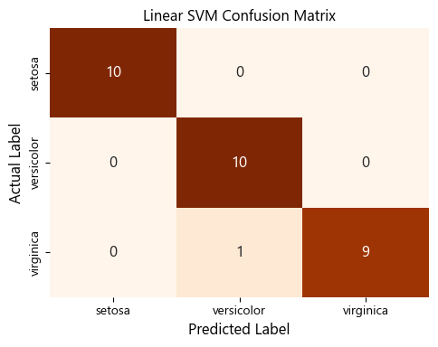

```python
linear_svm_pipeline
```

<style>#sk-container-id-23 {
  /* Definition of color scheme common for light and dark mode */
  --sklearn-color-text: #000;
  --sklearn-color-text-muted: #666;
  --sklearn-color-line: gray;
  /* Definition of color scheme for unfitted estimators */
  --sklearn-color-unfitted-level-0: #fff5e6;
  --sklearn-color-unfitted-level-1: #f6e4d2;
  --sklearn-color-unfitted-level-2: #ffe0b3;
  --sklearn-color-unfitted-level-3: chocolate;
  /* Definition of color scheme for fitted estimators */
  --sklearn-color-fitted-level-0: #f0f8ff;
  --sklearn-color-fitted-level-1: #d4ebff;
  --sklearn-color-fitted-level-2: #b3dbfd;
  --sklearn-color-fitted-level-3: cornflowerblue;
}

#sk-container-id-23.light {
  /* Specific color for light theme */
  --sklearn-color-text-on-default-background: black;
  --sklearn-color-background: white;
  --sklearn-color-border-box: black;
  --sklearn-color-icon: #696969;
}

#sk-container-id-23.dark {
  --sklearn-color-text-on-default-background: white;
  --sklearn-color-background: #111;
  --sklearn-color-border-box: white;
  --sklearn-color-icon: #878787;
}

#sk-container-id-23 {
  color: var(--sklearn-color-text);
}

#sk-container-id-23 pre {
  padding: 0;
}

#sk-container-id-23 input.sk-hidden--visually {
  border: 0;
  clip: rect(1px 1px 1px 1px);
  clip: rect(1px, 1px, 1px, 1px);
  height: 1px;
  margin: -1px;
  overflow: hidden;
  padding: 0;
  position: absolute;
  width: 1px;
}

#sk-container-id-23 div.sk-dashed-wrapped {
  border: 1px dashed var(--sklearn-color-line);
  margin: 0 0.4em 0.5em 0.4em;
  box-sizing: border-box;
  padding-bottom: 0.4em;
  background-color: var(--sklearn-color-background);
}

#sk-container-id-23 div.sk-container {
  /* jupyter's `normalize.less` sets `[hidden] { display: none; }`
     but bootstrap.min.css set `[hidden] { display: none !important; }`
     so we also need the `!important` here to be able to override the
     default hidden behavior on the sphinx rendered scikit-learn.org.
     See: https://github.com/scikit-learn/scikit-learn/issues/21755 */
  display: inline-block !important;
  position: relative;
}

#sk-container-id-23 div.sk-text-repr-fallback {
  display: none;
}

div.sk-parallel-item,
div.sk-serial,
div.sk-item {
  /* draw centered vertical line to link estimators */
  background-image: linear-gradient(var(--sklearn-color-text-on-default-background), var(--sklearn-color-text-on-default-background));
  background-size: 2px 100%;
  background-repeat: no-repeat;
  background-position: center center;
}

/* Parallel-specific style estimator block */

#sk-container-id-23 div.sk-parallel-item::after {
  content: "";
  width: 100%;
  border-bottom: 2px solid var(--sklearn-color-text-on-default-background);
  flex-grow: 1;
}

#sk-container-id-23 div.sk-parallel {
  display: flex;
  align-items: stretch;
  justify-content: center;
  background-color: var(--sklearn-color-background);
  position: relative;
}

#sk-container-id-23 div.sk-parallel-item {
  display: flex;
  flex-direction: column;
}

#sk-container-id-23 div.sk-parallel-item:first-child::after {
  align-self: flex-end;
  width: 50%;
}

#sk-container-id-23 div.sk-parallel-item:last-child::after {
  align-self: flex-start;
  width: 50%;
}

#sk-container-id-23 div.sk-parallel-item:only-child::after {
  width: 0;
}

/* Serial-specific style estimator block */

#sk-container-id-23 div.sk-serial {
  display: flex;
  flex-direction: column;
  align-items: center;
  background-color: var(--sklearn-color-background);
  padding-right: 1em;
  padding-left: 1em;
}


/* Toggleable style: style used for estimator/Pipeline/ColumnTransformer box that is
clickable and can be expanded/collapsed.
- Pipeline and ColumnTransformer use this feature and define the default style
- Estimators will overwrite some part of the style using the `sk-estimator` class
*/

/* Pipeline and ColumnTransformer style (default) */

#sk-container-id-23 div.sk-toggleable {
  /* Default theme specific background. It is overwritten whether we have a
  specific estimator or a Pipeline/ColumnTransformer */
  background-color: var(--sklearn-color-background);
}

/* Toggleable label */
#sk-container-id-23 label.sk-toggleable__label {
  cursor: pointer;
  display: flex;
  width: 100%;
  margin-bottom: 0;
  padding: 0.5em;
  box-sizing: border-box;
  text-align: center;
  align-items: center;
  justify-content: center;
  gap: 0.5em;
}

#sk-container-id-23 label.sk-toggleable__label .caption {
  font-size: 0.6rem;
  font-weight: lighter;
  color: var(--sklearn-color-text-muted);
}

#sk-container-id-23 label.sk-toggleable__label-arrow:before {
  /* Arrow on the left of the label */
  content: "▸";
  float: left;
  margin-right: 0.25em;
  color: var(--sklearn-color-icon);
}

#sk-container-id-23 label.sk-toggleable__label-arrow:hover:before {
  color: var(--sklearn-color-text);
}

/* Toggleable content - dropdown */

#sk-container-id-23 div.sk-toggleable__content {
  display: none;
  text-align: left;
  /* unfitted */
  background-color: var(--sklearn-color-unfitted-level-0);
}

#sk-container-id-23 div.sk-toggleable__content.fitted {
  /* fitted */
  background-color: var(--sklearn-color-fitted-level-0);
}

#sk-container-id-23 div.sk-toggleable__content pre {
  margin: 0.2em;
  border-radius: 0.25em;
  color: var(--sklearn-color-text);
  /* unfitted */
  background-color: var(--sklearn-color-unfitted-level-0);
}

#sk-container-id-23 div.sk-toggleable__content.fitted pre {
  /* unfitted */
  background-color: var(--sklearn-color-fitted-level-0);
}

#sk-container-id-23 input.sk-toggleable__control:checked~div.sk-toggleable__content {
  /* Expand drop-down */
  display: block;
  width: 100%;
  overflow: visible;
}

#sk-container-id-23 input.sk-toggleable__control:checked~label.sk-toggleable__label-arrow:before {
  content: "▾";
}

/* Pipeline/ColumnTransformer-specific style */

#sk-container-id-23 div.sk-label input.sk-toggleable__control:checked~label.sk-toggleable__label {
  color: var(--sklearn-color-text);
  background-color: var(--sklearn-color-unfitted-level-2);
}

#sk-container-id-23 div.sk-label.fitted input.sk-toggleable__control:checked~label.sk-toggleable__label {
  background-color: var(--sklearn-color-fitted-level-2);
}

/* Estimator-specific style */

/* Colorize estimator box */
#sk-container-id-23 div.sk-estimator input.sk-toggleable__control:checked~label.sk-toggleable__label {
  /* unfitted */
  background-color: var(--sklearn-color-unfitted-level-2);
}

#sk-container-id-23 div.sk-estimator.fitted input.sk-toggleable__control:checked~label.sk-toggleable__label {
  /* fitted */
  background-color: var(--sklearn-color-fitted-level-2);
}

#sk-container-id-23 div.sk-label label.sk-toggleable__label,
#sk-container-id-23 div.sk-label label {
  /* The background is the default theme color */
  color: var(--sklearn-color-text-on-default-background);
}

/* On hover, darken the color of the background */
#sk-container-id-23 div.sk-label:hover label.sk-toggleable__label {
  color: var(--sklearn-color-text);
  background-color: var(--sklearn-color-unfitted-level-2);
}

/* Label box, darken color on hover, fitted */
#sk-container-id-23 div.sk-label.fitted:hover label.sk-toggleable__label.fitted {
  color: var(--sklearn-color-text);
  background-color: var(--sklearn-color-fitted-level-2);
}

/* Estimator label */

#sk-container-id-23 div.sk-label label {
  font-family: monospace;
  font-weight: bold;
  line-height: 1.2em;
}

#sk-container-id-23 div.sk-label-container {
  text-align: center;
}

/* Estimator-specific */
#sk-container-id-23 div.sk-estimator {
  font-family: monospace;
  border: 1px dotted var(--sklearn-color-border-box);
  border-radius: 0.25em;
  box-sizing: border-box;
  margin-bottom: 0.5em;
  /* unfitted */
  background-color: var(--sklearn-color-unfitted-level-0);
}

#sk-container-id-23 div.sk-estimator.fitted {
  /* fitted */
  background-color: var(--sklearn-color-fitted-level-0);
}

/* on hover */
#sk-container-id-23 div.sk-estimator:hover {
  /* unfitted */
  background-color: var(--sklearn-color-unfitted-level-2);
}

#sk-container-id-23 div.sk-estimator.fitted:hover {
  /* fitted */
  background-color: var(--sklearn-color-fitted-level-2);
}

/* Specification for estimator info (e.g. "i" and "?") */

/* Common style for "i" and "?" */

.sk-estimator-doc-link,
a:link.sk-estimator-doc-link,
a:visited.sk-estimator-doc-link {
  float: right;
  font-size: smaller;
  line-height: 1em;
  font-family: monospace;
  background-color: var(--sklearn-color-unfitted-level-0);
  border-radius: 1em;
  height: 1em;
  width: 1em;
  text-decoration: none !important;
  margin-left: 0.5em;
  text-align: center;
  /* unfitted */
  border: var(--sklearn-color-unfitted-level-3) 1pt solid;
  color: var(--sklearn-color-unfitted-level-3);
}

.sk-estimator-doc-link.fitted,
a:link.sk-estimator-doc-link.fitted,
a:visited.sk-estimator-doc-link.fitted {
  /* fitted */
  background-color: var(--sklearn-color-fitted-level-0);
  border: var(--sklearn-color-fitted-level-3) 1pt solid;
  color: var(--sklearn-color-fitted-level-3);
}

/* On hover */
div.sk-estimator:hover .sk-estimator-doc-link:hover,
.sk-estimator-doc-link:hover,
div.sk-label-container:hover .sk-estimator-doc-link:hover,
.sk-estimator-doc-link:hover {
  /* unfitted */
  background-color: var(--sklearn-color-unfitted-level-3);
  border: var(--sklearn-color-fitted-level-0) 1pt solid;
  color: var(--sklearn-color-unfitted-level-0);
  text-decoration: none;
}

div.sk-estimator.fitted:hover .sk-estimator-doc-link.fitted:hover,
.sk-estimator-doc-link.fitted:hover,
div.sk-label-container:hover .sk-estimator-doc-link.fitted:hover,
.sk-estimator-doc-link.fitted:hover {
  /* fitted */
  background-color: var(--sklearn-color-fitted-level-3);
  border: var(--sklearn-color-fitted-level-0) 1pt solid;
  color: var(--sklearn-color-fitted-level-0);
  text-decoration: none;
}

/* Span, style for the box shown on hovering the info icon */
.sk-estimator-doc-link span {
  display: none;
  z-index: 9999;
  position: relative;
  font-weight: normal;
  right: .2ex;
  padding: .5ex;
  margin: .5ex;
  width: min-content;
  min-width: 20ex;
  max-width: 50ex;
  color: var(--sklearn-color-text);
  box-shadow: 2pt 2pt 4pt #999;
  /* unfitted */
  background: var(--sklearn-color-unfitted-level-0);
  border: .5pt solid var(--sklearn-color-unfitted-level-3);
}

.sk-estimator-doc-link.fitted span {
  /* fitted */
  background: var(--sklearn-color-fitted-level-0);
  border: var(--sklearn-color-fitted-level-3);
}

.sk-estimator-doc-link:hover span {
  display: block;
}

/* "?"-specific style due to the `<a>` HTML tag */

#sk-container-id-23 a.estimator_doc_link {
  float: right;
  font-size: 1rem;
  line-height: 1em;
  font-family: monospace;
  background-color: var(--sklearn-color-unfitted-level-0);
  border-radius: 1rem;
  height: 1rem;
  width: 1rem;
  text-decoration: none;
  /* unfitted */
  color: var(--sklearn-color-unfitted-level-1);
  border: var(--sklearn-color-unfitted-level-1) 1pt solid;
}

#sk-container-id-23 a.estimator_doc_link.fitted {
  /* fitted */
  background-color: var(--sklearn-color-fitted-level-0);
  border: var(--sklearn-color-fitted-level-1) 1pt solid;
  color: var(--sklearn-color-fitted-level-1);
}

/* On hover */
#sk-container-id-23 a.estimator_doc_link:hover {
  /* unfitted */
  background-color: var(--sklearn-color-unfitted-level-3);
  color: var(--sklearn-color-background);
  text-decoration: none;
}

#sk-container-id-23 a.estimator_doc_link.fitted:hover {
  /* fitted */
  background-color: var(--sklearn-color-fitted-level-3);
}

.estimator-table {
    font-family: monospace;
}

.estimator-table summary {
    padding: .5rem;
    cursor: pointer;
}

.estimator-table summary::marker {
    font-size: 0.7rem;
}

.estimator-table details[open] {
    padding-left: 0.1rem;
    padding-right: 0.1rem;
    padding-bottom: 0.3rem;
}

.estimator-table .parameters-table {
    margin-left: auto !important;
    margin-right: auto !important;
    margin-top: 0;
}

.estimator-table .parameters-table tr:nth-child(odd) {
    background-color: #fff;
}

.estimator-table .parameters-table tr:nth-child(even) {
    background-color: #f6f6f6;
}

.estimator-table .parameters-table tr:hover {
    background-color: #e0e0e0;
}

.estimator-table table td {
    border: 1px solid rgba(106, 105, 104, 0.232);
}

/*
    `table td`is set in notebook with right text-align.
    We need to overwrite it.
*/
.estimator-table table td.param {
    text-align: left;
    position: relative;
    padding: 0;
}

.user-set td {
    color:rgb(255, 94, 0);
    text-align: left !important;
}

.user-set td.value {
    color:rgb(255, 94, 0);
    background-color: transparent;
}

.default td {
    color: black;
    text-align: left !important;
}

.user-set td i,
.default td i {
    color: black;
}

/*
    Styles for parameter documentation links
    We need styling for visited so jupyter doesn't overwrite it
*/
a.param-doc-link,
a.param-doc-link:link,
a.param-doc-link:visited {
    text-decoration: underline dashed;
    text-underline-offset: .3em;
    color: inherit;
    display: block;
    padding: .5em;
}

/* "hack" to make the entire area of the cell containing the link clickable */
a.param-doc-link::before {
    position: absolute;
    content: "";
    inset: 0;
}

.param-doc-description {
    display: none;
    position: absolute;
    z-index: 9999;
    left: 0;
    padding: .5ex;
    margin-left: 1.5em;
    color: var(--sklearn-color-text);
    box-shadow: .3em .3em .4em #999;
    width: max-content;
    text-align: left;
    max-height: 10em;
    overflow-y: auto;

    /* unfitted */
    background: var(--sklearn-color-unfitted-level-0);
    border: thin solid var(--sklearn-color-unfitted-level-3);
}

/* Fitted state for parameter tooltips */
.fitted .param-doc-description {
    /* fitted */
    background: var(--sklearn-color-fitted-level-0);
    border: thin solid var(--sklearn-color-fitted-level-3);
}

.param-doc-link:hover .param-doc-description {
    display: block;
}

.copy-paste-icon {
    background-image: url();
    background-repeat: no-repeat;
    background-size: 14px 14px;
    background-position: 0;
    display: inline-block;
    width: 14px;
    height: 14px;
    cursor: pointer;
}
</style><body><div id="sk-container-id-23" class="sk-top-container"><div class="sk-text-repr-fallback"><pre>Pipeline(steps=[(&#x27;preprocessing&#x27;,
                 ColumnTransformer(transformers=[(&#x27;num&#x27;,
                                                  Pipeline(steps=[(&#x27;imputer&#x27;,
                                                                   SimpleImputer(strategy=&#x27;median&#x27;)),
                                                                  (&#x27;attribs_adder&#x27;,
                                                                   IrisFeatureCombiner()),
                                                                  (&#x27;std_scaler&#x27;,
                                                                   StandardScaler())]),
                                                  [&#x27;sepal length (cm)&#x27;,
                                                   &#x27;sepal width (cm)&#x27;,
                                                   &#x27;petal length (cm)&#x27;,
                                                   &#x27;petal width (cm)&#x27;]),
                                                 (&#x27;cat&#x27;,
                                                  Pipeline(steps=[(&#x27;imputer&#x27;,
                                                                   SimpleImputer(strategy=&#x27;most_frequent&#x27;)),
                                                                  (&#x27;one_hot&#x27;,
                                                                   OneHotEncoder(handle_unknown=&#x27;ignore&#x27;))]),
                                                  [])])),
                (&#x27;linear_svm&#x27;,
                 LinearSVC(dual=False, max_iter=10000, random_state=42))])</pre><b>In a Jupyter environment, please rerun this cell to show the HTML representation or trust the notebook. <br />On GitHub, the HTML representation is unable to render, please try loading this page with nbviewer.org.</b></div><div class="sk-container" hidden><div class="sk-item sk-dashed-wrapped"><div class="sk-label-container"><div class="sk-label fitted sk-toggleable"><input class="sk-toggleable__control sk-hidden--visually" id="sk-estimator-id-160" type="checkbox" ><label for="sk-estimator-id-160" class="sk-toggleable__label fitted sk-toggleable__label-arrow"><div><div>Pipeline</div></div><div><a class="sk-estimator-doc-link fitted" rel="noreferrer" target="_blank" href="https://scikit-learn.org/1.8/modules/generated/sklearn.pipeline.Pipeline.html">?<span>Documentation for Pipeline</span></a><span class="sk-estimator-doc-link fitted">i<span>Fitted</span></span></div></label><div class="sk-toggleable__content fitted" data-param-prefix="">
        <div class="estimator-table">
            <details>
                <summary>Parameters</summary>
                <div class="table-wrap"><table class="parameters-table">
                  <tbody>
                    
        <tr class="user-set">
            <td><i class="copy-paste-icon"
            ></i></td>
            <td class="param">
        <a class="param-doc-link"
            rel="noreferrer" target="_blank" href="https://scikit-learn.org/1.8/modules/generated/sklearn.pipeline.Pipeline.html#:~:text=steps,-list%20of%20tuples">
            steps
            <span class="param-doc-description">steps: list of tuples<br><br>List of (name of step, estimator) tuples that are to be chained in<br>sequential order. To be compatible with the scikit-learn API, all steps<br>must define `fit`. All non-last steps must also define `transform`. See<br>:ref:`Combining Estimators <combining_estimators>` for more details.</span>
        </a>
    </td>
            <td class="value">[(&#x27;preprocessing&#x27;, ...), (&#x27;linear_svm&#x27;, ...)]</td>
        </tr>
    

        <tr class="default">
            <td><i class="copy-paste-icon"
            ></i></td>
            <td class="param">
        <a class="param-doc-link"
            rel="noreferrer" target="_blank" href="https://scikit-learn.org/1.8/modules/generated/sklearn.pipeline.Pipeline.html#:~:text=transform_input,-list%20of%20str%2C%20default%3DNone">
            transform_input
            <span class="param-doc-description">transform_input: list of str, default=None<br><br>The names of the :term:`metadata` parameters that should be transformed by the<br>pipeline before passing it to the step consuming it.<br><br>This enables transforming some input arguments to ``fit`` (other than ``X``)<br>to be transformed by the steps of the pipeline up to the step which requires<br>them. Requirement is defined via :ref:`metadata routing <metadata_routing>`.<br>For instance, this can be used to pass a validation set through the pipeline.<br><br>You can only set this if metadata routing is enabled, which you<br>can enable using ``sklearn.set_config(enable_metadata_routing=True)``.<br><br>.. versionadded:: 1.6</span>
        </a>
    </td>
            <td class="value">None</td>
        </tr>
    

        <tr class="default">
            <td><i class="copy-paste-icon"
            ></i></td>
            <td class="param">
        <a class="param-doc-link"
            rel="noreferrer" target="_blank" href="https://scikit-learn.org/1.8/modules/generated/sklearn.pipeline.Pipeline.html#:~:text=memory,-str%20or%20object%20with%20the%20joblib.Memory%20interface%2C%20default%3DNone">
            memory
            <span class="param-doc-description">memory: str or object with the joblib.Memory interface, default=None<br><br>Used to cache the fitted transformers of the pipeline. The last step<br>will never be cached, even if it is a transformer. By default, no<br>caching is performed. If a string is given, it is the path to the<br>caching directory. Enabling caching triggers a clone of the transformers<br>before fitting. Therefore, the transformer instance given to the<br>pipeline cannot be inspected directly. Use the attribute ``named_steps``<br>or ``steps`` to inspect estimators within the pipeline. Caching the<br>transformers is advantageous when fitting is time consuming. See<br>:ref:`sphx_glr_auto_examples_neighbors_plot_caching_nearest_neighbors.py`<br>for an example on how to enable caching.</span>
        </a>
    </td>
            <td class="value">None</td>
        </tr>
    

        <tr class="default">
            <td><i class="copy-paste-icon"
            ></i></td>
            <td class="param">
        <a class="param-doc-link"
            rel="noreferrer" target="_blank" href="https://scikit-learn.org/1.8/modules/generated/sklearn.pipeline.Pipeline.html#:~:text=verbose,-bool%2C%20default%3DFalse">
            verbose
            <span class="param-doc-description">verbose: bool, default=False<br><br>If True, the time elapsed while fitting each step will be printed as it<br>is completed.</span>
        </a>
    </td>
            <td class="value">False</td>
        </tr>
    
                  </tbody>
                </table></div>
            </details>
        </div>
    </div></div></div><div class="sk-serial"><div class="sk-item sk-dashed-wrapped"><div class="sk-label-container"><div class="sk-label fitted sk-toggleable"><input class="sk-toggleable__control sk-hidden--visually" id="sk-estimator-id-161" type="checkbox" ><label for="sk-estimator-id-161" class="sk-toggleable__label fitted sk-toggleable__label-arrow"><div><div>preprocessing: ColumnTransformer</div></div><div><a class="sk-estimator-doc-link fitted" rel="noreferrer" target="_blank" href="https://scikit-learn.org/1.8/modules/generated/sklearn.compose.ColumnTransformer.html">?<span>Documentation for preprocessing: ColumnTransformer</span></a></div></label><div class="sk-toggleable__content fitted" data-param-prefix="preprocessing__">
        <div class="estimator-table">
            <details>
                <summary>Parameters</summary>
                <div class="table-wrap"><table class="parameters-table">
                  <tbody>
                    
        <tr class="user-set">
            <td><i class="copy-paste-icon"
            ></i></td>
            <td class="param">
        <a class="param-doc-link"
            rel="noreferrer" target="_blank" href="https://scikit-learn.org/1.8/modules/generated/sklearn.compose.ColumnTransformer.html#:~:text=transformers,-list%20of%20tuples">
            transformers
            <span class="param-doc-description">transformers: list of tuples<br><br>List of (name, transformer, columns) tuples specifying the<br>transformer objects to be applied to subsets of the data.<br><br>name : str<br>    Like in Pipeline and FeatureUnion, this allows the transformer and<br>    its parameters to be set using ``set_params`` and searched in grid<br>    search.<br>transformer : {'drop', 'passthrough'} or estimator<br>    Estimator must support :term:`fit` and :term:`transform`.<br>    Special-cased strings 'drop' and 'passthrough' are accepted as<br>    well, to indicate to drop the columns or to pass them through<br>    untransformed, respectively.<br>columns :  str, array-like of str, int, array-like of int,                 array-like of bool, slice or callable<br>    Indexes the data on its second axis. Integers are interpreted as<br>    positional columns, while strings can reference DataFrame columns<br>    by name.  A scalar string or int should be used where<br>    ``transformer`` expects X to be a 1d array-like (vector),<br>    otherwise a 2d array will be passed to the transformer.<br>    A callable is passed the input data `X` and can return any of the<br>    above. To select multiple columns by name or dtype, you can use<br>    :obj:`make_column_selector`.</span>
        </a>
    </td>
            <td class="value">[(&#x27;num&#x27;, ...), (&#x27;cat&#x27;, ...)]</td>
        </tr>
    

        <tr class="default">
            <td><i class="copy-paste-icon"
            ></i></td>
            <td class="param">
        <a class="param-doc-link"
            rel="noreferrer" target="_blank" href="https://scikit-learn.org/1.8/modules/generated/sklearn.compose.ColumnTransformer.html#:~:text=remainder,-%7B%27drop%27%2C%20%27passthrough%27%7D%20or%20estimator%2C%20default%3D%27drop%27">
            remainder
            <span class="param-doc-description">remainder: {'drop', 'passthrough'} or estimator, default='drop'<br><br>By default, only the specified columns in `transformers` are<br>transformed and combined in the output, and the non-specified<br>columns are dropped. (default of ``'drop'``).<br>By specifying ``remainder='passthrough'``, all remaining columns that<br>were not specified in `transformers`, but present in the data passed<br>to `fit` will be automatically passed through. This subset of columns<br>is concatenated with the output of the transformers. For dataframes,<br>extra columns not seen during `fit` will be excluded from the output<br>of `transform`.<br>By setting ``remainder`` to be an estimator, the remaining<br>non-specified columns will use the ``remainder`` estimator. The<br>estimator must support :term:`fit` and :term:`transform`.<br>Note that using this feature requires that the DataFrame columns<br>input at :term:`fit` and :term:`transform` have identical order.</span>
        </a>
    </td>
            <td class="value">&#x27;drop&#x27;</td>
        </tr>
    

        <tr class="default">
            <td><i class="copy-paste-icon"
            ></i></td>
            <td class="param">
        <a class="param-doc-link"
            rel="noreferrer" target="_blank" href="https://scikit-learn.org/1.8/modules/generated/sklearn.compose.ColumnTransformer.html#:~:text=sparse_threshold,-float%2C%20default%3D0.3">
            sparse_threshold
            <span class="param-doc-description">sparse_threshold: float, default=0.3<br><br>If the output of the different transformers contains sparse matrices,<br>these will be stacked as a sparse matrix if the overall density is<br>lower than this value. Use ``sparse_threshold=0`` to always return<br>dense.  When the transformed output consists of all dense data, the<br>stacked result will be dense, and this keyword will be ignored.</span>
        </a>
    </td>
            <td class="value">0.3</td>
        </tr>
    

        <tr class="default">
            <td><i class="copy-paste-icon"
            ></i></td>
            <td class="param">
        <a class="param-doc-link"
            rel="noreferrer" target="_blank" href="https://scikit-learn.org/1.8/modules/generated/sklearn.compose.ColumnTransformer.html#:~:text=n_jobs,-int%2C%20default%3DNone">
            n_jobs
            <span class="param-doc-description">n_jobs: int, default=None<br><br>Number of jobs to run in parallel.<br>``None`` means 1 unless in a :obj:`joblib.parallel_backend` context.<br>``-1`` means using all processors. See :term:`Glossary <n_jobs>`<br>for more details.</span>
        </a>
    </td>
            <td class="value">None</td>
        </tr>
    

        <tr class="default">
            <td><i class="copy-paste-icon"
            ></i></td>
            <td class="param">
        <a class="param-doc-link"
            rel="noreferrer" target="_blank" href="https://scikit-learn.org/1.8/modules/generated/sklearn.compose.ColumnTransformer.html#:~:text=transformer_weights,-dict%2C%20default%3DNone">
            transformer_weights
            <span class="param-doc-description">transformer_weights: dict, default=None<br><br>Multiplicative weights for features per transformer. The output of the<br>transformer is multiplied by these weights. Keys are transformer names,<br>values the weights.</span>
        </a>
    </td>
            <td class="value">None</td>
        </tr>
    

        <tr class="default">
            <td><i class="copy-paste-icon"
            ></i></td>
            <td class="param">
        <a class="param-doc-link"
            rel="noreferrer" target="_blank" href="https://scikit-learn.org/1.8/modules/generated/sklearn.compose.ColumnTransformer.html#:~:text=verbose,-bool%2C%20default%3DFalse">
            verbose
            <span class="param-doc-description">verbose: bool, default=False<br><br>If True, the time elapsed while fitting each transformer will be<br>printed as it is completed.</span>
        </a>
    </td>
            <td class="value">False</td>
        </tr>
    

        <tr class="default">
            <td><i class="copy-paste-icon"
            ></i></td>
            <td class="param">
        <a class="param-doc-link"
            rel="noreferrer" target="_blank" href="https://scikit-learn.org/1.8/modules/generated/sklearn.compose.ColumnTransformer.html#:~:text=verbose_feature_names_out,-bool%2C%20str%20or%20Callable%5B%5Bstr%2C%20str%5D%2C%20str%5D%2C%20default%3DTrue">
            verbose_feature_names_out
            <span class="param-doc-description">verbose_feature_names_out: bool, str or Callable[[str, str], str], default=True<br><br>- If True, :meth:`ColumnTransformer.get_feature_names_out` will prefix<br>  all feature names with the name of the transformer that generated that<br>  feature. It is equivalent to setting<br>  `verbose_feature_names_out="{transformer_name}__{feature_name}"`.<br>- If False, :meth:`ColumnTransformer.get_feature_names_out` will not<br>  prefix any feature names and will error if feature names are not<br>  unique.<br>- If ``Callable[[str, str], str]``,<br>  :meth:`ColumnTransformer.get_feature_names_out` will rename all the features<br>  using the name of the transformer. The first argument of the callable is the<br>  transformer name and the second argument is the feature name. The returned<br>  string will be the new feature name.<br>- If ``str``, it must be a string ready for formatting. The given string will<br>  be formatted using two field names: ``transformer_name`` and ``feature_name``.<br>  e.g. ``"{feature_name}__{transformer_name}"``. See :meth:`str.format` method<br>  from the standard library for more info.<br><br>.. versionadded:: 1.0<br><br>.. versionchanged:: 1.6<br>    `verbose_feature_names_out` can be a callable or a string to be formatted.</span>
        </a>
    </td>
            <td class="value">True</td>
        </tr>
    

        <tr class="default">
            <td><i class="copy-paste-icon"
            ></i></td>
            <td class="param">
        <a class="param-doc-link"
            rel="noreferrer" target="_blank" href="https://scikit-learn.org/1.8/modules/generated/sklearn.compose.ColumnTransformer.html#:~:text=force_int_remainder_cols,-bool%2C%20default%3DFalse">
            force_int_remainder_cols
            <span class="param-doc-description">force_int_remainder_cols: bool, default=False<br><br>This parameter has no effect.<br><br>.. note::<br>    If you do not access the list of columns for the remainder columns<br>    in the `transformers_` fitted attribute, you do not need to set<br>    this parameter.<br><br>.. versionadded:: 1.5<br><br>.. versionchanged:: 1.7<br>   The default value for `force_int_remainder_cols` will change from<br>   `True` to `False` in version 1.7.<br><br>.. deprecated:: 1.7<br>   `force_int_remainder_cols` is deprecated and will be removed in 1.9.</span>
        </a>
    </td>
            <td class="value">&#x27;deprecated&#x27;</td>
        </tr>
    
                  </tbody>
                </table></div>
            </details>
        </div>
    </div></div></div><div class="sk-parallel"><div class="sk-parallel-item"><div class="sk-item"><div class="sk-label-container"><div class="sk-label fitted sk-toggleable"><input class="sk-toggleable__control sk-hidden--visually" id="sk-estimator-id-162" type="checkbox" ><label for="sk-estimator-id-162" class="sk-toggleable__label fitted sk-toggleable__label-arrow"><div><div>num</div></div></label><div class="sk-toggleable__content fitted" data-param-prefix="preprocessing__num__"><pre>[&#x27;sepal length (cm)&#x27;, &#x27;sepal width (cm)&#x27;, &#x27;petal length (cm)&#x27;, &#x27;petal width (cm)&#x27;]</pre></div></div></div><div class="sk-serial"><div class="sk-item"><div class="sk-serial"><div class="sk-item"><div class="sk-estimator fitted sk-toggleable"><input class="sk-toggleable__control sk-hidden--visually" id="sk-estimator-id-163" type="checkbox" ><label for="sk-estimator-id-163" class="sk-toggleable__label fitted sk-toggleable__label-arrow"><div><div>SimpleImputer</div></div><div><a class="sk-estimator-doc-link fitted" rel="noreferrer" target="_blank" href="https://scikit-learn.org/1.8/modules/generated/sklearn.impute.SimpleImputer.html">?<span>Documentation for SimpleImputer</span></a></div></label><div class="sk-toggleable__content fitted" data-param-prefix="preprocessing__num__imputer__">
        <div class="estimator-table">
            <details>
                <summary>Parameters</summary>
                <div class="table-wrap"><table class="parameters-table">
                  <tbody>
                    
        <tr class="default">
            <td><i class="copy-paste-icon"
            ></i></td>
            <td class="param">
        <a class="param-doc-link"
            rel="noreferrer" target="_blank" href="https://scikit-learn.org/1.8/modules/generated/sklearn.impute.SimpleImputer.html#:~:text=missing_values,-int%2C%20float%2C%20str%2C%20np.nan%2C%20None%20or%20pandas.NA%2C%20default%3Dnp.nan">
            missing_values
            <span class="param-doc-description">missing_values: int, float, str, np.nan, None or pandas.NA, default=np.nan<br><br>The placeholder for the missing values. All occurrences of<br>`missing_values` will be imputed. For pandas' dataframes with<br>nullable integer dtypes with missing values, `missing_values`<br>can be set to either `np.nan` or `pd.NA`.</span>
        </a>
    </td>
            <td class="value">nan</td>
        </tr>
    

        <tr class="user-set">
            <td><i class="copy-paste-icon"
            ></i></td>
            <td class="param">
        <a class="param-doc-link"
            rel="noreferrer" target="_blank" href="https://scikit-learn.org/1.8/modules/generated/sklearn.impute.SimpleImputer.html#:~:text=strategy,-str%20or%20Callable%2C%20default%3D%27mean%27">
            strategy
            <span class="param-doc-description">strategy: str or Callable, default='mean'<br><br>The imputation strategy.<br><br>- If "mean", then replace missing values using the mean along<br>  each column. Can only be used with numeric data.<br>- If "median", then replace missing values using the median along<br>  each column. Can only be used with numeric data.<br>- If "most_frequent", then replace missing using the most frequent<br>  value along each column. Can be used with strings or numeric data.<br>  If there is more than one such value, only the smallest is returned.<br>- If "constant", then replace missing values with fill_value. Can be<br>  used with strings or numeric data.<br>- If an instance of Callable, then replace missing values using the<br>  scalar statistic returned by running the callable over a dense 1d<br>  array containing non-missing values of each column.<br><br>.. versionadded:: 0.20<br>   strategy="constant" for fixed value imputation.<br><br>.. versionadded:: 1.5<br>   strategy=callable for custom value imputation.</span>
        </a>
    </td>
            <td class="value">&#x27;median&#x27;</td>
        </tr>
    

        <tr class="default">
            <td><i class="copy-paste-icon"
            ></i></td>
            <td class="param">
        <a class="param-doc-link"
            rel="noreferrer" target="_blank" href="https://scikit-learn.org/1.8/modules/generated/sklearn.impute.SimpleImputer.html#:~:text=fill_value,-str%20or%20numerical%20value%2C%20default%3DNone">
            fill_value
            <span class="param-doc-description">fill_value: str or numerical value, default=None<br><br>When strategy == "constant", `fill_value` is used to replace all<br>occurrences of missing_values. For string or object data types,<br>`fill_value` must be a string.<br>If `None`, `fill_value` will be 0 when imputing numerical<br>data and "missing_value" for strings or object data types.</span>
        </a>
    </td>
            <td class="value">None</td>
        </tr>
    

        <tr class="default">
            <td><i class="copy-paste-icon"
            ></i></td>
            <td class="param">
        <a class="param-doc-link"
            rel="noreferrer" target="_blank" href="https://scikit-learn.org/1.8/modules/generated/sklearn.impute.SimpleImputer.html#:~:text=copy,-bool%2C%20default%3DTrue">
            copy
            <span class="param-doc-description">copy: bool, default=True<br><br>If True, a copy of X will be created. If False, imputation will<br>be done in-place whenever possible. Note that, in the following cases,<br>a new copy will always be made, even if `copy=False`:<br><br>- If `X` is not an array of floating values;<br>- If `X` is encoded as a CSR matrix;<br>- If `add_indicator=True`.</span>
        </a>
    </td>
            <td class="value">True</td>
        </tr>
    

        <tr class="default">
            <td><i class="copy-paste-icon"
            ></i></td>
            <td class="param">
        <a class="param-doc-link"
            rel="noreferrer" target="_blank" href="https://scikit-learn.org/1.8/modules/generated/sklearn.impute.SimpleImputer.html#:~:text=add_indicator,-bool%2C%20default%3DFalse">
            add_indicator
            <span class="param-doc-description">add_indicator: bool, default=False<br><br>If True, a :class:`MissingIndicator` transform will stack onto output<br>of the imputer's transform. This allows a predictive estimator<br>to account for missingness despite imputation. If a feature has no<br>missing values at fit/train time, the feature won't appear on<br>the missing indicator even if there are missing values at<br>transform/test time.</span>
        </a>
    </td>
            <td class="value">False</td>
        </tr>
    

        <tr class="default">
            <td><i class="copy-paste-icon"
            ></i></td>
            <td class="param">
        <a class="param-doc-link"
            rel="noreferrer" target="_blank" href="https://scikit-learn.org/1.8/modules/generated/sklearn.impute.SimpleImputer.html#:~:text=keep_empty_features,-bool%2C%20default%3DFalse">
            keep_empty_features
            <span class="param-doc-description">keep_empty_features: bool, default=False<br><br>If True, features that consist exclusively of missing values when<br>`fit` is called are returned in results when `transform` is called.<br>The imputed value is always `0` except when `strategy="constant"`<br>in which case `fill_value` will be used instead.<br><br>.. versionadded:: 1.2</span>
        </a>
    </td>
            <td class="value">False</td>
        </tr>
    
                  </tbody>
                </table></div>
            </details>
        </div>
    </div></div></div><div class="sk-item"><div class="sk-estimator fitted sk-toggleable"><input class="sk-toggleable__control sk-hidden--visually" id="sk-estimator-id-164" type="checkbox" ><label for="sk-estimator-id-164" class="sk-toggleable__label fitted sk-toggleable__label-arrow"><div><div>IrisFeatureCombiner</div></div></label><div class="sk-toggleable__content fitted" data-param-prefix="preprocessing__num__attribs_adder__">
        <div class="estimator-table">
            <details>
                <summary>Parameters</summary>
                <div class="table-wrap"><table class="parameters-table">
                  <tbody>
                    
        <tr class="default">
            <td><i class="copy-paste-icon"
            ></i></td>
            <td class="param">add_area</td>
            <td class="value">True</td>
        </tr>
    

        <tr class="default">
            <td><i class="copy-paste-icon"
            ></i></td>
            <td class="param">add_ratio</td>
            <td class="value">True</td>
        </tr>
    

        <tr class="default">
            <td><i class="copy-paste-icon"
            ></i></td>
            <td class="param">add_cross_ratio</td>
            <td class="value">True</td>
        </tr>
    

        <tr class="default">
            <td><i class="copy-paste-icon"
            ></i></td>
            <td class="param">drop_originals</td>
            <td class="value">False</td>
        </tr>
    
                  </tbody>
                </table></div>
            </details>
        </div>
    </div></div></div><div class="sk-item"><div class="sk-estimator fitted sk-toggleable"><input class="sk-toggleable__control sk-hidden--visually" id="sk-estimator-id-165" type="checkbox" ><label for="sk-estimator-id-165" class="sk-toggleable__label fitted sk-toggleable__label-arrow"><div><div>StandardScaler</div></div><div><a class="sk-estimator-doc-link fitted" rel="noreferrer" target="_blank" href="https://scikit-learn.org/1.8/modules/generated/sklearn.preprocessing.StandardScaler.html">?<span>Documentation for StandardScaler</span></a></div></label><div class="sk-toggleable__content fitted" data-param-prefix="preprocessing__num__std_scaler__">
        <div class="estimator-table">
            <details>
                <summary>Parameters</summary>
                <div class="table-wrap"><table class="parameters-table">
                  <tbody>
                    
        <tr class="default">
            <td><i class="copy-paste-icon"
            ></i></td>
            <td class="param">
        <a class="param-doc-link"
            rel="noreferrer" target="_blank" href="https://scikit-learn.org/1.8/modules/generated/sklearn.preprocessing.StandardScaler.html#:~:text=copy,-bool%2C%20default%3DTrue">
            copy
            <span class="param-doc-description">copy: bool, default=True<br><br>If False, try to avoid a copy and do inplace scaling instead.<br>This is not guaranteed to always work inplace; e.g. if the data is<br>not a NumPy array or scipy.sparse CSR matrix, a copy may still be<br>returned.</span>
        </a>
    </td>
            <td class="value">True</td>
        </tr>
    

        <tr class="default">
            <td><i class="copy-paste-icon"
            ></i></td>
            <td class="param">
        <a class="param-doc-link"
            rel="noreferrer" target="_blank" href="https://scikit-learn.org/1.8/modules/generated/sklearn.preprocessing.StandardScaler.html#:~:text=with_mean,-bool%2C%20default%3DTrue">
            with_mean
            <span class="param-doc-description">with_mean: bool, default=True<br><br>If True, center the data before scaling.<br>This does not work (and will raise an exception) when attempted on<br>sparse matrices, because centering them entails building a dense<br>matrix which in common use cases is likely to be too large to fit in<br>memory.</span>
        </a>
    </td>
            <td class="value">True</td>
        </tr>
    

        <tr class="default">
            <td><i class="copy-paste-icon"
            ></i></td>
            <td class="param">
        <a class="param-doc-link"
            rel="noreferrer" target="_blank" href="https://scikit-learn.org/1.8/modules/generated/sklearn.preprocessing.StandardScaler.html#:~:text=with_std,-bool%2C%20default%3DTrue">
            with_std
            <span class="param-doc-description">with_std: bool, default=True<br><br>If True, scale the data to unit variance (or equivalently,<br>unit standard deviation).</span>
        </a>
    </td>
            <td class="value">True</td>
        </tr>
    
                  </tbody>
                </table></div>
            </details>
        </div>
    </div></div></div></div></div></div></div></div><div class="sk-parallel-item"><div class="sk-item"><div class="sk-label-container"><div class="sk-label fitted sk-toggleable"><input class="sk-toggleable__control sk-hidden--visually" id="sk-estimator-id-166" type="checkbox" ><label for="sk-estimator-id-166" class="sk-toggleable__label fitted sk-toggleable__label-arrow"><div><div>cat</div></div></label><div class="sk-toggleable__content fitted" data-param-prefix="preprocessing__cat__"><pre>[]</pre></div></div></div><div class="sk-serial"><div class="sk-item"><div class="sk-serial"><div class="sk-item"><div class="sk-estimator fitted sk-toggleable"><input class="sk-toggleable__control sk-hidden--visually" id="sk-estimator-id-167" type="checkbox" ><label for="sk-estimator-id-167" class="sk-toggleable__label fitted sk-toggleable__label-arrow"><div><div>SimpleImputer</div></div><div><a class="sk-estimator-doc-link fitted" rel="noreferrer" target="_blank" href="https://scikit-learn.org/1.8/modules/generated/sklearn.impute.SimpleImputer.html">?<span>Documentation for SimpleImputer</span></a></div></label><div class="sk-toggleable__content fitted" data-param-prefix="preprocessing__cat__imputer__">
        <div class="estimator-table">
            <details>
                <summary>Parameters</summary>
                <div class="table-wrap"><table class="parameters-table">
                  <tbody>
                    
        <tr class="default">
            <td><i class="copy-paste-icon"
            ></i></td>
            <td class="param">
        <a class="param-doc-link"
            rel="noreferrer" target="_blank" href="https://scikit-learn.org/1.8/modules/generated/sklearn.impute.SimpleImputer.html#:~:text=missing_values,-int%2C%20float%2C%20str%2C%20np.nan%2C%20None%20or%20pandas.NA%2C%20default%3Dnp.nan">
            missing_values
            <span class="param-doc-description">missing_values: int, float, str, np.nan, None or pandas.NA, default=np.nan<br><br>The placeholder for the missing values. All occurrences of<br>`missing_values` will be imputed. For pandas' dataframes with<br>nullable integer dtypes with missing values, `missing_values`<br>can be set to either `np.nan` or `pd.NA`.</span>
        </a>
    </td>
            <td class="value">nan</td>
        </tr>
    

        <tr class="user-set">
            <td><i class="copy-paste-icon"
            ></i></td>
            <td class="param">
        <a class="param-doc-link"
            rel="noreferrer" target="_blank" href="https://scikit-learn.org/1.8/modules/generated/sklearn.impute.SimpleImputer.html#:~:text=strategy,-str%20or%20Callable%2C%20default%3D%27mean%27">
            strategy
            <span class="param-doc-description">strategy: str or Callable, default='mean'<br><br>The imputation strategy.<br><br>- If "mean", then replace missing values using the mean along<br>  each column. Can only be used with numeric data.<br>- If "median", then replace missing values using the median along<br>  each column. Can only be used with numeric data.<br>- If "most_frequent", then replace missing using the most frequent<br>  value along each column. Can be used with strings or numeric data.<br>  If there is more than one such value, only the smallest is returned.<br>- If "constant", then replace missing values with fill_value. Can be<br>  used with strings or numeric data.<br>- If an instance of Callable, then replace missing values using the<br>  scalar statistic returned by running the callable over a dense 1d<br>  array containing non-missing values of each column.<br><br>.. versionadded:: 0.20<br>   strategy="constant" for fixed value imputation.<br><br>.. versionadded:: 1.5<br>   strategy=callable for custom value imputation.</span>
        </a>
    </td>
            <td class="value">&#x27;most_frequent&#x27;</td>
        </tr>
    

        <tr class="default">
            <td><i class="copy-paste-icon"
            ></i></td>
            <td class="param">
        <a class="param-doc-link"
            rel="noreferrer" target="_blank" href="https://scikit-learn.org/1.8/modules/generated/sklearn.impute.SimpleImputer.html#:~:text=fill_value,-str%20or%20numerical%20value%2C%20default%3DNone">
            fill_value
            <span class="param-doc-description">fill_value: str or numerical value, default=None<br><br>When strategy == "constant", `fill_value` is used to replace all<br>occurrences of missing_values. For string or object data types,<br>`fill_value` must be a string.<br>If `None`, `fill_value` will be 0 when imputing numerical<br>data and "missing_value" for strings or object data types.</span>
        </a>
    </td>
            <td class="value">None</td>
        </tr>
    

        <tr class="default">
            <td><i class="copy-paste-icon"
            ></i></td>
            <td class="param">
        <a class="param-doc-link"
            rel="noreferrer" target="_blank" href="https://scikit-learn.org/1.8/modules/generated/sklearn.impute.SimpleImputer.html#:~:text=copy,-bool%2C%20default%3DTrue">
            copy
            <span class="param-doc-description">copy: bool, default=True<br><br>If True, a copy of X will be created. If False, imputation will<br>be done in-place whenever possible. Note that, in the following cases,<br>a new copy will always be made, even if `copy=False`:<br><br>- If `X` is not an array of floating values;<br>- If `X` is encoded as a CSR matrix;<br>- If `add_indicator=True`.</span>
        </a>
    </td>
            <td class="value">True</td>
        </tr>
    

        <tr class="default">
            <td><i class="copy-paste-icon"
            ></i></td>
            <td class="param">
        <a class="param-doc-link"
            rel="noreferrer" target="_blank" href="https://scikit-learn.org/1.8/modules/generated/sklearn.impute.SimpleImputer.html#:~:text=add_indicator,-bool%2C%20default%3DFalse">
            add_indicator
            <span class="param-doc-description">add_indicator: bool, default=False<br><br>If True, a :class:`MissingIndicator` transform will stack onto output<br>of the imputer's transform. This allows a predictive estimator<br>to account for missingness despite imputation. If a feature has no<br>missing values at fit/train time, the feature won't appear on<br>the missing indicator even if there are missing values at<br>transform/test time.</span>
        </a>
    </td>
            <td class="value">False</td>
        </tr>
    

        <tr class="default">
            <td><i class="copy-paste-icon"
            ></i></td>
            <td class="param">
        <a class="param-doc-link"
            rel="noreferrer" target="_blank" href="https://scikit-learn.org/1.8/modules/generated/sklearn.impute.SimpleImputer.html#:~:text=keep_empty_features,-bool%2C%20default%3DFalse">
            keep_empty_features
            <span class="param-doc-description">keep_empty_features: bool, default=False<br><br>If True, features that consist exclusively of missing values when<br>`fit` is called are returned in results when `transform` is called.<br>The imputed value is always `0` except when `strategy="constant"`<br>in which case `fill_value` will be used instead.<br><br>.. versionadded:: 1.2</span>
        </a>
    </td>
            <td class="value">False</td>
        </tr>
    
                  </tbody>
                </table></div>
            </details>
        </div>
    </div></div></div><div class="sk-item"><div class="sk-estimator fitted sk-toggleable"><input class="sk-toggleable__control sk-hidden--visually" id="sk-estimator-id-168" type="checkbox" ><label for="sk-estimator-id-168" class="sk-toggleable__label fitted sk-toggleable__label-arrow"><div><div>OneHotEncoder</div></div><div><a class="sk-estimator-doc-link fitted" rel="noreferrer" target="_blank" href="https://scikit-learn.org/1.8/modules/generated/sklearn.preprocessing.OneHotEncoder.html">?<span>Documentation for OneHotEncoder</span></a></div></label><div class="sk-toggleable__content fitted" data-param-prefix="preprocessing__cat__one_hot__">
        <div class="estimator-table">
            <details>
                <summary>Parameters</summary>
                <div class="table-wrap"><table class="parameters-table">
                  <tbody>
                    
        <tr class="default">
            <td><i class="copy-paste-icon"
            ></i></td>
            <td class="param">
        <a class="param-doc-link"
            rel="noreferrer" target="_blank" href="https://scikit-learn.org/1.8/modules/generated/sklearn.preprocessing.OneHotEncoder.html#:~:text=categories,-%27auto%27%20or%20a%20list%20of%20array-like%2C%20default%3D%27auto%27">
            categories
            <span class="param-doc-description">categories: 'auto' or a list of array-like, default='auto'<br><br>Categories (unique values) per feature:<br><br>- 'auto' : Determine categories automatically from the training data.<br>- list : ``categories[i]`` holds the categories expected in the ith<br>  column. The passed categories should not mix strings and numeric<br>  values within a single feature, and should be sorted in case of<br>  numeric values.<br><br>The used categories can be found in the ``categories_`` attribute.<br><br>.. versionadded:: 0.20</span>
        </a>
    </td>
            <td class="value">&#x27;auto&#x27;</td>
        </tr>
    

        <tr class="default">
            <td><i class="copy-paste-icon"
            ></i></td>
            <td class="param">
        <a class="param-doc-link"
            rel="noreferrer" target="_blank" href="https://scikit-learn.org/1.8/modules/generated/sklearn.preprocessing.OneHotEncoder.html#:~:text=drop,-%7B%27first%27%2C%20%27if_binary%27%7D%20or%20an%20array-like%20of%20shape%20%28n_features%2C%29%2C%20%20%20%20%20%20%20%20%20%20%20%20%20default%3DNone">
            drop
            <span class="param-doc-description">drop: {'first', 'if_binary'} or an array-like of shape (n_features,),             default=None<br><br>Specifies a methodology to use to drop one of the categories per<br>feature. This is useful in situations where perfectly collinear<br>features cause problems, such as when feeding the resulting data<br>into an unregularized linear regression model.<br><br>However, dropping one category breaks the symmetry of the original<br>representation and can therefore induce a bias in downstream models,<br>for instance for penalized linear classification or regression models.<br><br>- None : retain all features (the default).<br>- 'first' : drop the first category in each feature. If only one<br>  category is present, the feature will be dropped entirely.<br>- 'if_binary' : drop the first category in each feature with two<br>  categories. Features with 1 or more than 2 categories are<br>  left intact.<br>- array : ``drop[i]`` is the category in feature ``X[:, i]`` that<br>  should be dropped.<br><br>When `max_categories` or `min_frequency` is configured to group<br>infrequent categories, the dropping behavior is handled after the<br>grouping.<br><br>.. versionadded:: 0.21<br>   The parameter `drop` was added in 0.21.<br><br>.. versionchanged:: 0.23<br>   The option `drop='if_binary'` was added in 0.23.<br><br>.. versionchanged:: 1.1<br>    Support for dropping infrequent categories.</span>
        </a>
    </td>
            <td class="value">None</td>
        </tr>
    

        <tr class="default">
            <td><i class="copy-paste-icon"
            ></i></td>
            <td class="param">
        <a class="param-doc-link"
            rel="noreferrer" target="_blank" href="https://scikit-learn.org/1.8/modules/generated/sklearn.preprocessing.OneHotEncoder.html#:~:text=sparse_output,-bool%2C%20default%3DTrue">
            sparse_output
            <span class="param-doc-description">sparse_output: bool, default=True<br><br>When ``True``, it returns a :class:`scipy.sparse.csr_matrix`,<br>i.e. a sparse matrix in "Compressed Sparse Row" (CSR) format.<br><br>.. versionadded:: 1.2<br>   `sparse` was renamed to `sparse_output`</span>
        </a>
    </td>
            <td class="value">True</td>
        </tr>
    

        <tr class="default">
            <td><i class="copy-paste-icon"
            ></i></td>
            <td class="param">
        <a class="param-doc-link"
            rel="noreferrer" target="_blank" href="https://scikit-learn.org/1.8/modules/generated/sklearn.preprocessing.OneHotEncoder.html#:~:text=dtype,-number%20type%2C%20default%3Dnp.float64">
            dtype
            <span class="param-doc-description">dtype: number type, default=np.float64<br><br>Desired dtype of output.</span>
        </a>
    </td>
            <td class="value">&lt;class &#x27;numpy.float64&#x27;&gt;</td>
        </tr>
    

        <tr class="user-set">
            <td><i class="copy-paste-icon"
            ></i></td>
            <td class="param">
        <a class="param-doc-link"
            rel="noreferrer" target="_blank" href="https://scikit-learn.org/1.8/modules/generated/sklearn.preprocessing.OneHotEncoder.html#:~:text=handle_unknown,-%7B%27error%27%2C%20%27ignore%27%2C%20%27infrequent_if_exist%27%2C%20%27warn%27%7D%2C%20%20%20%20%20%20%20%20%20%20%20%20%20%20%20%20%20%20%20%20%20%20default%3D%27error%27">
            handle_unknown
            <span class="param-doc-description">handle_unknown: {'error', 'ignore', 'infrequent_if_exist', 'warn'},                      default='error'<br><br>Specifies the way unknown categories are handled during :meth:`transform`.<br><br>- 'error' : Raise an error if an unknown category is present during transform.<br>- 'ignore' : When an unknown category is encountered during<br>  transform, the resulting one-hot encoded columns for this feature<br>  will be all zeros. In the inverse transform, an unknown category<br>  will be denoted as None.<br>- 'infrequent_if_exist' : When an unknown category is encountered<br>  during transform, the resulting one-hot encoded columns for this<br>  feature will map to the infrequent category if it exists. The<br>  infrequent category will be mapped to the last position in the<br>  encoding. During inverse transform, an unknown category will be<br>  mapped to the category denoted `'infrequent'` if it exists. If the<br>  `'infrequent'` category does not exist, then :meth:`transform` and<br>  :meth:`inverse_transform` will handle an unknown category as with<br>  `handle_unknown='ignore'`. Infrequent categories exist based on<br>  `min_frequency` and `max_categories`. Read more in the<br>  :ref:`User Guide <encoder_infrequent_categories>`.<br>- 'warn' : When an unknown category is encountered during transform<br>  a warning is issued, and the encoding then proceeds as described for<br>  `handle_unknown="infrequent_if_exist"`.<br><br>.. versionchanged:: 1.1<br>    `'infrequent_if_exist'` was added to automatically handle unknown<br>    categories and infrequent categories.<br><br>.. versionadded:: 1.6<br>   The option `"warn"` was added in 1.6.</span>
        </a>
    </td>
            <td class="value">&#x27;ignore&#x27;</td>
        </tr>
    

        <tr class="default">
            <td><i class="copy-paste-icon"
            ></i></td>
            <td class="param">
        <a class="param-doc-link"
            rel="noreferrer" target="_blank" href="https://scikit-learn.org/1.8/modules/generated/sklearn.preprocessing.OneHotEncoder.html#:~:text=min_frequency,-int%20or%20float%2C%20default%3DNone">
            min_frequency
            <span class="param-doc-description">min_frequency: int or float, default=None<br><br>Specifies the minimum frequency below which a category will be<br>considered infrequent.<br><br>- If `int`, categories with a smaller cardinality will be considered<br>  infrequent.<br><br>- If `float`, categories with a smaller cardinality than<br>  `min_frequency * n_samples`  will be considered infrequent.<br><br>.. versionadded:: 1.1<br>    Read more in the :ref:`User Guide <encoder_infrequent_categories>`.</span>
        </a>
    </td>
            <td class="value">None</td>
        </tr>
    

        <tr class="default">
            <td><i class="copy-paste-icon"
            ></i></td>
            <td class="param">
        <a class="param-doc-link"
            rel="noreferrer" target="_blank" href="https://scikit-learn.org/1.8/modules/generated/sklearn.preprocessing.OneHotEncoder.html#:~:text=max_categories,-int%2C%20default%3DNone">
            max_categories
            <span class="param-doc-description">max_categories: int, default=None<br><br>Specifies an upper limit to the number of output features for each input<br>feature when considering infrequent categories. If there are infrequent<br>categories, `max_categories` includes the category representing the<br>infrequent categories along with the frequent categories. If `None`,<br>there is no limit to the number of output features.<br><br>.. versionadded:: 1.1<br>    Read more in the :ref:`User Guide <encoder_infrequent_categories>`.</span>
        </a>
    </td>
            <td class="value">None</td>
        </tr>
    

        <tr class="default">
            <td><i class="copy-paste-icon"
            ></i></td>
            <td class="param">
        <a class="param-doc-link"
            rel="noreferrer" target="_blank" href="https://scikit-learn.org/1.8/modules/generated/sklearn.preprocessing.OneHotEncoder.html#:~:text=feature_name_combiner,-%22concat%22%20or%20callable%2C%20default%3D%22concat%22">
            feature_name_combiner
            <span class="param-doc-description">feature_name_combiner: "concat" or callable, default="concat"<br><br>Callable with signature `def callable(input_feature, category)` that returns a<br>string. This is used to create feature names to be returned by<br>:meth:`get_feature_names_out`.<br><br>`"concat"` concatenates encoded feature name and category with<br>`feature + "_" + str(category)`.E.g. feature X with values 1, 6, 7 create<br>feature names `X_1, X_6, X_7`.<br><br>.. versionadded:: 1.3</span>
        </a>
    </td>
            <td class="value">&#x27;concat&#x27;</td>
        </tr>
    
                  </tbody>
                </table></div>
            </details>
        </div>
    </div></div></div></div></div></div></div></div></div></div><div class="sk-item"><div class="sk-estimator fitted sk-toggleable"><input class="sk-toggleable__control sk-hidden--visually" id="sk-estimator-id-169" type="checkbox" ><label for="sk-estimator-id-169" class="sk-toggleable__label fitted sk-toggleable__label-arrow"><div><div>LinearSVC</div></div><div><a class="sk-estimator-doc-link fitted" rel="noreferrer" target="_blank" href="https://scikit-learn.org/1.8/modules/generated/sklearn.svm.LinearSVC.html">?<span>Documentation for LinearSVC</span></a></div></label><div class="sk-toggleable__content fitted" data-param-prefix="linear_svm__">
        <div class="estimator-table">
            <details>
                <summary>Parameters</summary>
                <div class="table-wrap"><table class="parameters-table">
                  <tbody>
                    
        <tr class="default">
            <td><i class="copy-paste-icon"
            ></i></td>
            <td class="param">
        <a class="param-doc-link"
            rel="noreferrer" target="_blank" href="https://scikit-learn.org/1.8/modules/generated/sklearn.svm.LinearSVC.html#:~:text=penalty,-%7B%27l1%27%2C%20%27l2%27%7D%2C%20default%3D%27l2%27">
            penalty
            <span class="param-doc-description">penalty: {'l1', 'l2'}, default='l2'<br><br>Specifies the norm used in the penalization. The 'l2'<br>penalty is the standard used in SVC. The 'l1' leads to ``coef_``<br>vectors that are sparse.</span>
        </a>
    </td>
            <td class="value">&#x27;l2&#x27;</td>
        </tr>
    

        <tr class="default">
            <td><i class="copy-paste-icon"
            ></i></td>
            <td class="param">
        <a class="param-doc-link"
            rel="noreferrer" target="_blank" href="https://scikit-learn.org/1.8/modules/generated/sklearn.svm.LinearSVC.html#:~:text=loss,-%7B%27hinge%27%2C%20%27squared_hinge%27%7D%2C%20default%3D%27squared_hinge%27">
            loss
            <span class="param-doc-description">loss: {'hinge', 'squared_hinge'}, default='squared_hinge'<br><br>Specifies the loss function. 'hinge' is the standard SVM loss<br>(used e.g. by the SVC class) while 'squared_hinge' is the<br>square of the hinge loss. The combination of ``penalty='l1'``<br>and ``loss='hinge'`` is not supported.</span>
        </a>
    </td>
            <td class="value">&#x27;squared_hinge&#x27;</td>
        </tr>
    

        <tr class="user-set">
            <td><i class="copy-paste-icon"
            ></i></td>
            <td class="param">
        <a class="param-doc-link"
            rel="noreferrer" target="_blank" href="https://scikit-learn.org/1.8/modules/generated/sklearn.svm.LinearSVC.html#:~:text=dual,-%22auto%22%20or%20bool%2C%20default%3D%22auto%22">
            dual
            <span class="param-doc-description">dual: "auto" or bool, default="auto"<br><br>Select the algorithm to either solve the dual or primal<br>optimization problem. Prefer dual=False when n_samples > n_features.<br>`dual="auto"` will choose the value of the parameter automatically,<br>based on the values of `n_samples`, `n_features`, `loss`, `multi_class`<br>and `penalty`. If `n_samples` < `n_features` and optimizer supports<br>chosen `loss`, `multi_class` and `penalty`, then dual will be set to True,<br>otherwise it will be set to False.<br><br>.. versionchanged:: 1.3<br>   The `"auto"` option is added in version 1.3 and will be the default<br>   in version 1.5.</span>
        </a>
    </td>
            <td class="value">False</td>
        </tr>
    

        <tr class="default">
            <td><i class="copy-paste-icon"
            ></i></td>
            <td class="param">
        <a class="param-doc-link"
            rel="noreferrer" target="_blank" href="https://scikit-learn.org/1.8/modules/generated/sklearn.svm.LinearSVC.html#:~:text=tol,-float%2C%20default%3D1e-4">
            tol
            <span class="param-doc-description">tol: float, default=1e-4<br><br>Tolerance for stopping criteria.</span>
        </a>
    </td>
            <td class="value">0.0001</td>
        </tr>
    

        <tr class="default">
            <td><i class="copy-paste-icon"
            ></i></td>
            <td class="param">
        <a class="param-doc-link"
            rel="noreferrer" target="_blank" href="https://scikit-learn.org/1.8/modules/generated/sklearn.svm.LinearSVC.html#:~:text=C,-float%2C%20default%3D1.0">
            C
            <span class="param-doc-description">C: float, default=1.0<br><br>Regularization parameter. The strength of the regularization is<br>inversely proportional to C. Must be strictly positive.<br>For an intuitive visualization of the effects of scaling<br>the regularization parameter C, see<br>:ref:`sphx_glr_auto_examples_svm_plot_svm_scale_c.py`.</span>
        </a>
    </td>
            <td class="value">1.0</td>
        </tr>
    

        <tr class="default">
            <td><i class="copy-paste-icon"
            ></i></td>
            <td class="param">
        <a class="param-doc-link"
            rel="noreferrer" target="_blank" href="https://scikit-learn.org/1.8/modules/generated/sklearn.svm.LinearSVC.html#:~:text=multi_class,-%7B%27ovr%27%2C%20%27crammer_singer%27%7D%2C%20default%3D%27ovr%27">
            multi_class
            <span class="param-doc-description">multi_class: {'ovr', 'crammer_singer'}, default='ovr'<br><br>Determines the multi-class strategy if `y` contains more than<br>two classes.<br>``"ovr"`` trains n_classes one-vs-rest classifiers, while<br>``"crammer_singer"`` optimizes a joint objective over all classes.<br>While `crammer_singer` is interesting from a theoretical perspective<br>as it is consistent, it is seldom used in practice as it rarely leads<br>to better accuracy and is more expensive to compute.<br>If ``"crammer_singer"`` is chosen, the options loss, penalty and dual<br>will be ignored.</span>
        </a>
    </td>
            <td class="value">&#x27;ovr&#x27;</td>
        </tr>
    

        <tr class="default">
            <td><i class="copy-paste-icon"
            ></i></td>
            <td class="param">
        <a class="param-doc-link"
            rel="noreferrer" target="_blank" href="https://scikit-learn.org/1.8/modules/generated/sklearn.svm.LinearSVC.html#:~:text=fit_intercept,-bool%2C%20default%3DTrue">
            fit_intercept
            <span class="param-doc-description">fit_intercept: bool, default=True<br><br>Whether or not to fit an intercept. If set to True, the feature vector<br>is extended to include an intercept term: `[x_1, ..., x_n, 1]`, where<br>1 corresponds to the intercept. If set to False, no intercept will be<br>used in calculations (i.e. data is expected to be already centered).</span>
        </a>
    </td>
            <td class="value">True</td>
        </tr>
    

        <tr class="default">
            <td><i class="copy-paste-icon"
            ></i></td>
            <td class="param">
        <a class="param-doc-link"
            rel="noreferrer" target="_blank" href="https://scikit-learn.org/1.8/modules/generated/sklearn.svm.LinearSVC.html#:~:text=intercept_scaling,-float%2C%20default%3D1.0">
            intercept_scaling
            <span class="param-doc-description">intercept_scaling: float, default=1.0<br><br>When `fit_intercept` is True, the instance vector x becomes ``[x_1,<br>..., x_n, intercept_scaling]``, i.e. a "synthetic" feature with a<br>constant value equal to `intercept_scaling` is appended to the instance<br>vector. The intercept becomes intercept_scaling * synthetic feature<br>weight. Note that liblinear internally penalizes the intercept,<br>treating it like any other term in the feature vector. To reduce the<br>impact of the regularization on the intercept, the `intercept_scaling`<br>parameter can be set to a value greater than 1; the higher the value of<br>`intercept_scaling`, the lower the impact of regularization on it.<br>Then, the weights become `[w_x_1, ..., w_x_n,<br>w_intercept*intercept_scaling]`, where `w_x_1, ..., w_x_n` represent<br>the feature weights and the intercept weight is scaled by<br>`intercept_scaling`. This scaling allows the intercept term to have a<br>different regularization behavior compared to the other features.</span>
        </a>
    </td>
            <td class="value">1</td>
        </tr>
    

        <tr class="default">
            <td><i class="copy-paste-icon"
            ></i></td>
            <td class="param">
        <a class="param-doc-link"
            rel="noreferrer" target="_blank" href="https://scikit-learn.org/1.8/modules/generated/sklearn.svm.LinearSVC.html#:~:text=class_weight,-dict%20or%20%27balanced%27%2C%20default%3DNone">
            class_weight
            <span class="param-doc-description">class_weight: dict or 'balanced', default=None<br><br>Set the parameter C of class i to ``class_weight[i]*C`` for<br>SVC. If not given, all classes are supposed to have<br>weight one.<br>The "balanced" mode uses the values of y to automatically adjust<br>weights inversely proportional to class frequencies in the input data<br>as ``n_samples / (n_classes * np.bincount(y))``.</span>
        </a>
    </td>
            <td class="value">None</td>
        </tr>
    

        <tr class="default">
            <td><i class="copy-paste-icon"
            ></i></td>
            <td class="param">
        <a class="param-doc-link"
            rel="noreferrer" target="_blank" href="https://scikit-learn.org/1.8/modules/generated/sklearn.svm.LinearSVC.html#:~:text=verbose,-int%2C%20default%3D0">
            verbose
            <span class="param-doc-description">verbose: int, default=0<br><br>Enable verbose output. Note that this setting takes advantage of a<br>per-process runtime setting in liblinear that, if enabled, may not work<br>properly in a multithreaded context.</span>
        </a>
    </td>
            <td class="value">0</td>
        </tr>
    

        <tr class="user-set">
            <td><i class="copy-paste-icon"
            ></i></td>
            <td class="param">
        <a class="param-doc-link"
            rel="noreferrer" target="_blank" href="https://scikit-learn.org/1.8/modules/generated/sklearn.svm.LinearSVC.html#:~:text=random_state,-int%2C%20RandomState%20instance%20or%20None%2C%20default%3DNone">
            random_state
            <span class="param-doc-description">random_state: int, RandomState instance or None, default=None<br><br>Controls the pseudo random number generation for shuffling the data for<br>the dual coordinate descent (if ``dual=True``). When ``dual=False`` the<br>underlying implementation of :class:`LinearSVC` is not random and<br>``random_state`` has no effect on the results.<br>Pass an int for reproducible output across multiple function calls.<br>See :term:`Glossary <random_state>`.</span>
        </a>
    </td>
            <td class="value">42</td>
        </tr>
    

        <tr class="user-set">
            <td><i class="copy-paste-icon"
            ></i></td>
            <td class="param">
        <a class="param-doc-link"
            rel="noreferrer" target="_blank" href="https://scikit-learn.org/1.8/modules/generated/sklearn.svm.LinearSVC.html#:~:text=max_iter,-int%2C%20default%3D1000">
            max_iter
            <span class="param-doc-description">max_iter: int, default=1000<br><br>The maximum number of iterations to be run.</span>
        </a>
    </td>
            <td class="value">10000</td>
        </tr>
    
                  </tbody>
                </table></div>
            </details>
        </div>
    </div></div></div></div></div></div></div></body>

#### 决策树模型 (Decision Tree) 融入 Pipeline
决策树的特殊之处在于：它在底层是用一系列“if-else”的阈值划分边界的，所以它天生对输入数据的“量纲/Scale”和异常值不敏感。
即便如此，我们仍将其放入我们刚刚建好的 `full_pipeline` 框架中，以保证不同模型接受相同的数据快照，同时也极大方便日后对模型进行一键切换和集中调优。

```python
from sklearn.tree import DecisionTreeClassifier

# -------------------------------------------------------------
# 1. 构建包含决策树的端到端 Pipeline
# -------------------------------------------------------------
tree_pipeline = Pipeline([
    ("preprocessing", full_pipeline),
    # 设置一个适当的 max_depth 防止模型过拟合，并固定 random_state
    ("decision_tree", DecisionTreeClassifier(max_depth=4, random_state=42)) 
])

# -------------------------------------------------------------
# 2. 训练模型
# -------------------------------------------------------------
tree_pipeline.fit(X_train, y_train)

# -------------------------------------------------------------
# 3. 评估与可视化
# -------------------------------------------------------------
y_pred_tree = tree_pipeline.predict(X_test)

print("========== Decision Tree (in Pipeline) ==========")
print(f"Accuracy Score: {accuracy_score(y_test, y_pred_tree):.4f}")
print("=================================================")
print(classification_report(y_test, y_pred_tree, target_names=iris_bunch.target_names))

# 画混淆矩阵
cm_tree = confusion_matrix(y_test, y_pred_tree)
plt.figure(figsize=(5, 4))
sns.heatmap(cm_tree, annot=True, fmt='d', cmap='Greens', cbar=False,
            xticklabels=iris_bunch.target_names, 
            yticklabels=iris_bunch.target_names)
plt.title("Decision Tree Confusion Matrix")
plt.ylabel("Actual Label")
plt.xlabel("Predicted Label")
plt.tight_layout()
plt.show()
```

```text
========== Decision Tree (in Pipeline) ==========
Accuracy Score: 0.9333
=================================================
              precision    recall  f1-score   support

      setosa       1.00      1.00      1.00        10
  versicolor       0.90      0.90      0.90        10
   virginica       0.90      0.90      0.90        10

    accuracy                           0.93        30
   macro avg       0.93      0.93      0.93        30
weighted avg       0.93      0.93      0.93        30
```

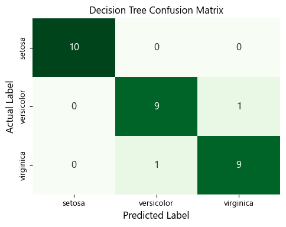

#### 随机森林模型 (Random Forest) 融入 Pipeline
随机森林是基于多棵决策树的集成算法（Ensemble Learning），它通常能带来比单棵决策树高得多的稳定性和准确率。在进行后续的 `GridSearch` 调优时，包含多棵树和众多可调超参数的随机森林往往是最佳候选者。

```python
from sklearn.ensemble import RandomForestClassifier

# -------------------------------------------------------------
# 1. 组装随机森林的 Pipeline
# -------------------------------------------------------------
rf_pipeline = Pipeline([
    ("preprocessing", full_pipeline),
    ("random_forest", RandomForestClassifier(n_estimators=100, random_state=42))
])

# -------------------------------------------------------------
# 2. 拟合与评估
# -------------------------------------------------------------
rf_pipeline.fit(X_train, y_train)

y_pred_rf = rf_pipeline.predict(X_test)

print("========== Random Forest (in Pipeline) ==========")
print(f"Accuracy Score: {accuracy_score(y_test, y_pred_rf):.4f}")
print("=================================================")
print(classification_report(y_test, y_pred_rf, target_names=iris_bunch.target_names))

cm_rf = confusion_matrix(y_test, y_pred_rf)
plt.figure(figsize=(5, 4))
sns.heatmap(cm_rf, annot=True, fmt='d', cmap='Purples', cbar=False,
            xticklabels=iris_bunch.target_names, 
            yticklabels=iris_bunch.target_names)
plt.title("Random Forest Confusion Matrix")
plt.ylabel("Actual Label")
plt.xlabel("Predicted Label")
plt.tight_layout()
plt.show()
```

```text
========== Random Forest (in Pipeline) ==========
Accuracy Score: 0.9667
=================================================
              precision    recall  f1-score   support

      setosa       1.00      1.00      1.00        10
  versicolor       1.00      0.90      0.95        10
   virginica       0.91      1.00      0.95        10

    accuracy                           0.97        30
   macro avg       0.97      0.97      0.97        30
weighted avg       0.97      0.97      0.97        30
```

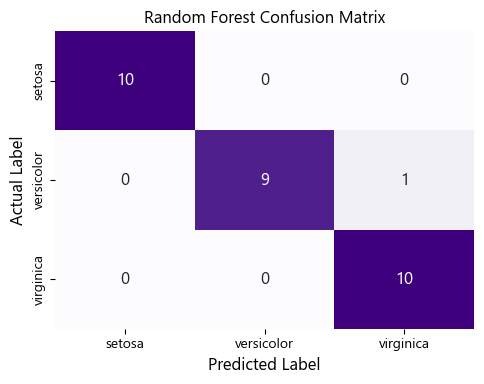

### 6. 模型调优：特征工程与模型联合网格搜索 (Global Grid Search)

工业界实践中，模型性能往往取决于“数据表征（Feature Engineering）”与“算法容量（Model Hyperparameters）”的系统性适配。使用 `GridSearchCV` 配合 `Pipeline` 可以完美避免数据穿越，并在同一个网格中执行特征消融（Ablation Study）与结构调优。

以下采用 **RandomForestClassifier** 为核心引擎，使用网格搜索同步寻找最优特征组合与最优树结构。通过 `__` (双下划线) 进行 Pipeline 层级穿透：

```python
from sklearn.model_selection import GridSearchCV

# =========================================================================
# 定义联合搜索参数网格 (Parameter Grid)
# =========================================================================
param_grid = {
    # 模块一：特征工程拓扑层 (预处理 -> num管道 -> 属性组合网络)
    'preprocessing__num__attribs_adder__add_area': [True, False],
    'preprocessing__num__attribs_adder__add_ratio': [True, False],
    'preprocessing__num__attribs_adder__add_cross_ratio': [True, False],
    'preprocessing__num__attribs_adder__drop_originals': [True, False],

    # 模块二：算法超参数层 (随机森林)
    'random_forest__n_estimators': [50, 100, 200],   
    'random_forest__max_depth': [None, 3, 5],        
    'random_forest__min_samples_split': [2, 5]
}

# =========================================================================
# 启动交叉验证全局网格搜索
# =========================================================================
print("Initializing Global Grid Search (Features & Model Architecture) ...")
# n_jobs=None 控制进程规避 Windows 编码问题，cv=5 指定5折交叉验证
grid_search = GridSearchCV(
    rf_pipeline, param_grid, cv=5, scoring='accuracy', n_jobs=None
)

# 传入原始数据集，GridSearchCV 在切片验证前自动触发 pipeline 各级 fit_transform，完全免疫数据泄漏
grid_search.fit(X_train, y_train)

# =========================================================================
# 结果产出与分析
# =========================================================================
print("-" * 50)
print(f"Optimal Configuration Parameters:")
for param_name in sorted(param_grid.keys()):
    print(f"  {param_name.split('__')[-1]}: {grid_search.best_params_[param_name]}")
print(f"\nBest Cross-Validation Score (Accuracy): {grid_search.best_score_:.4f}")

# 提取最佳 Estimator
final_best_rf_model = grid_search.best_estimator_
```

```text
Initializing Global Grid Search (Features & Model Architecture) ...
--------------------------------------------------
Optimal Configuration Parameters:
  add_area: True
  add_cross_ratio: True
  add_ratio: True
  drop_originals: True
  max_depth: 3
  min_samples_split: 2
  n_estimators: 100

Best Cross-Validation Score (Accuracy): 0.9750
```

```python
grid_search
```

<style>#sk-container-id-24 {
  /* Definition of color scheme common for light and dark mode */
  --sklearn-color-text: #000;
  --sklearn-color-text-muted: #666;
  --sklearn-color-line: gray;
  /* Definition of color scheme for unfitted estimators */
  --sklearn-color-unfitted-level-0: #fff5e6;
  --sklearn-color-unfitted-level-1: #f6e4d2;
  --sklearn-color-unfitted-level-2: #ffe0b3;
  --sklearn-color-unfitted-level-3: chocolate;
  /* Definition of color scheme for fitted estimators */
  --sklearn-color-fitted-level-0: #f0f8ff;
  --sklearn-color-fitted-level-1: #d4ebff;
  --sklearn-color-fitted-level-2: #b3dbfd;
  --sklearn-color-fitted-level-3: cornflowerblue;
}

#sk-container-id-24.light {
  /* Specific color for light theme */
  --sklearn-color-text-on-default-background: black;
  --sklearn-color-background: white;
  --sklearn-color-border-box: black;
  --sklearn-color-icon: #696969;
}

#sk-container-id-24.dark {
  --sklearn-color-text-on-default-background: white;
  --sklearn-color-background: #111;
  --sklearn-color-border-box: white;
  --sklearn-color-icon: #878787;
}

#sk-container-id-24 {
  color: var(--sklearn-color-text);
}

#sk-container-id-24 pre {
  padding: 0;
}

#sk-container-id-24 input.sk-hidden--visually {
  border: 0;
  clip: rect(1px 1px 1px 1px);
  clip: rect(1px, 1px, 1px, 1px);
  height: 1px;
  margin: -1px;
  overflow: hidden;
  padding: 0;
  position: absolute;
  width: 1px;
}

#sk-container-id-24 div.sk-dashed-wrapped {
  border: 1px dashed var(--sklearn-color-line);
  margin: 0 0.4em 0.5em 0.4em;
  box-sizing: border-box;
  padding-bottom: 0.4em;
  background-color: var(--sklearn-color-background);
}

#sk-container-id-24 div.sk-container {
  /* jupyter's `normalize.less` sets `[hidden] { display: none; }`
     but bootstrap.min.css set `[hidden] { display: none !important; }`
     so we also need the `!important` here to be able to override the
     default hidden behavior on the sphinx rendered scikit-learn.org.
     See: https://github.com/scikit-learn/scikit-learn/issues/21755 */
  display: inline-block !important;
  position: relative;
}

#sk-container-id-24 div.sk-text-repr-fallback {
  display: none;
}

div.sk-parallel-item,
div.sk-serial,
div.sk-item {
  /* draw centered vertical line to link estimators */
  background-image: linear-gradient(var(--sklearn-color-text-on-default-background), var(--sklearn-color-text-on-default-background));
  background-size: 2px 100%;
  background-repeat: no-repeat;
  background-position: center center;
}

/* Parallel-specific style estimator block */

#sk-container-id-24 div.sk-parallel-item::after {
  content: "";
  width: 100%;
  border-bottom: 2px solid var(--sklearn-color-text-on-default-background);
  flex-grow: 1;
}

#sk-container-id-24 div.sk-parallel {
  display: flex;
  align-items: stretch;
  justify-content: center;
  background-color: var(--sklearn-color-background);
  position: relative;
}

#sk-container-id-24 div.sk-parallel-item {
  display: flex;
  flex-direction: column;
}

#sk-container-id-24 div.sk-parallel-item:first-child::after {
  align-self: flex-end;
  width: 50%;
}

#sk-container-id-24 div.sk-parallel-item:last-child::after {
  align-self: flex-start;
  width: 50%;
}

#sk-container-id-24 div.sk-parallel-item:only-child::after {
  width: 0;
}

/* Serial-specific style estimator block */

#sk-container-id-24 div.sk-serial {
  display: flex;
  flex-direction: column;
  align-items: center;
  background-color: var(--sklearn-color-background);
  padding-right: 1em;
  padding-left: 1em;
}


/* Toggleable style: style used for estimator/Pipeline/ColumnTransformer box that is
clickable and can be expanded/collapsed.
- Pipeline and ColumnTransformer use this feature and define the default style
- Estimators will overwrite some part of the style using the `sk-estimator` class
*/

/* Pipeline and ColumnTransformer style (default) */

#sk-container-id-24 div.sk-toggleable {
  /* Default theme specific background. It is overwritten whether we have a
  specific estimator or a Pipeline/ColumnTransformer */
  background-color: var(--sklearn-color-background);
}

/* Toggleable label */
#sk-container-id-24 label.sk-toggleable__label {
  cursor: pointer;
  display: flex;
  width: 100%;
  margin-bottom: 0;
  padding: 0.5em;
  box-sizing: border-box;
  text-align: center;
  align-items: center;
  justify-content: center;
  gap: 0.5em;
}

#sk-container-id-24 label.sk-toggleable__label .caption {
  font-size: 0.6rem;
  font-weight: lighter;
  color: var(--sklearn-color-text-muted);
}

#sk-container-id-24 label.sk-toggleable__label-arrow:before {
  /* Arrow on the left of the label */
  content: "▸";
  float: left;
  margin-right: 0.25em;
  color: var(--sklearn-color-icon);
}

#sk-container-id-24 label.sk-toggleable__label-arrow:hover:before {
  color: var(--sklearn-color-text);
}

/* Toggleable content - dropdown */

#sk-container-id-24 div.sk-toggleable__content {
  display: none;
  text-align: left;
  /* unfitted */
  background-color: var(--sklearn-color-unfitted-level-0);
}

#sk-container-id-24 div.sk-toggleable__content.fitted {
  /* fitted */
  background-color: var(--sklearn-color-fitted-level-0);
}

#sk-container-id-24 div.sk-toggleable__content pre {
  margin: 0.2em;
  border-radius: 0.25em;
  color: var(--sklearn-color-text);
  /* unfitted */
  background-color: var(--sklearn-color-unfitted-level-0);
}

#sk-container-id-24 div.sk-toggleable__content.fitted pre {
  /* unfitted */
  background-color: var(--sklearn-color-fitted-level-0);
}

#sk-container-id-24 input.sk-toggleable__control:checked~div.sk-toggleable__content {
  /* Expand drop-down */
  display: block;
  width: 100%;
  overflow: visible;
}

#sk-container-id-24 input.sk-toggleable__control:checked~label.sk-toggleable__label-arrow:before {
  content: "▾";
}

/* Pipeline/ColumnTransformer-specific style */

#sk-container-id-24 div.sk-label input.sk-toggleable__control:checked~label.sk-toggleable__label {
  color: var(--sklearn-color-text);
  background-color: var(--sklearn-color-unfitted-level-2);
}

#sk-container-id-24 div.sk-label.fitted input.sk-toggleable__control:checked~label.sk-toggleable__label {
  background-color: var(--sklearn-color-fitted-level-2);
}

/* Estimator-specific style */

/* Colorize estimator box */
#sk-container-id-24 div.sk-estimator input.sk-toggleable__control:checked~label.sk-toggleable__label {
  /* unfitted */
  background-color: var(--sklearn-color-unfitted-level-2);
}

#sk-container-id-24 div.sk-estimator.fitted input.sk-toggleable__control:checked~label.sk-toggleable__label {
  /* fitted */
  background-color: var(--sklearn-color-fitted-level-2);
}

#sk-container-id-24 div.sk-label label.sk-toggleable__label,
#sk-container-id-24 div.sk-label label {
  /* The background is the default theme color */
  color: var(--sklearn-color-text-on-default-background);
}

/* On hover, darken the color of the background */
#sk-container-id-24 div.sk-label:hover label.sk-toggleable__label {
  color: var(--sklearn-color-text);
  background-color: var(--sklearn-color-unfitted-level-2);
}

/* Label box, darken color on hover, fitted */
#sk-container-id-24 div.sk-label.fitted:hover label.sk-toggleable__label.fitted {
  color: var(--sklearn-color-text);
  background-color: var(--sklearn-color-fitted-level-2);
}

/* Estimator label */

#sk-container-id-24 div.sk-label label {
  font-family: monospace;
  font-weight: bold;
  line-height: 1.2em;
}

#sk-container-id-24 div.sk-label-container {
  text-align: center;
}

/* Estimator-specific */
#sk-container-id-24 div.sk-estimator {
  font-family: monospace;
  border: 1px dotted var(--sklearn-color-border-box);
  border-radius: 0.25em;
  box-sizing: border-box;
  margin-bottom: 0.5em;
  /* unfitted */
  background-color: var(--sklearn-color-unfitted-level-0);
}

#sk-container-id-24 div.sk-estimator.fitted {
  /* fitted */
  background-color: var(--sklearn-color-fitted-level-0);
}

/* on hover */
#sk-container-id-24 div.sk-estimator:hover {
  /* unfitted */
  background-color: var(--sklearn-color-unfitted-level-2);
}

#sk-container-id-24 div.sk-estimator.fitted:hover {
  /* fitted */
  background-color: var(--sklearn-color-fitted-level-2);
}

/* Specification for estimator info (e.g. "i" and "?") */

/* Common style for "i" and "?" */

.sk-estimator-doc-link,
a:link.sk-estimator-doc-link,
a:visited.sk-estimator-doc-link {
  float: right;
  font-size: smaller;
  line-height: 1em;
  font-family: monospace;
  background-color: var(--sklearn-color-unfitted-level-0);
  border-radius: 1em;
  height: 1em;
  width: 1em;
  text-decoration: none !important;
  margin-left: 0.5em;
  text-align: center;
  /* unfitted */
  border: var(--sklearn-color-unfitted-level-3) 1pt solid;
  color: var(--sklearn-color-unfitted-level-3);
}

.sk-estimator-doc-link.fitted,
a:link.sk-estimator-doc-link.fitted,
a:visited.sk-estimator-doc-link.fitted {
  /* fitted */
  background-color: var(--sklearn-color-fitted-level-0);
  border: var(--sklearn-color-fitted-level-3) 1pt solid;
  color: var(--sklearn-color-fitted-level-3);
}

/* On hover */
div.sk-estimator:hover .sk-estimator-doc-link:hover,
.sk-estimator-doc-link:hover,
div.sk-label-container:hover .sk-estimator-doc-link:hover,
.sk-estimator-doc-link:hover {
  /* unfitted */
  background-color: var(--sklearn-color-unfitted-level-3);
  border: var(--sklearn-color-fitted-level-0) 1pt solid;
  color: var(--sklearn-color-unfitted-level-0);
  text-decoration: none;
}

div.sk-estimator.fitted:hover .sk-estimator-doc-link.fitted:hover,
.sk-estimator-doc-link.fitted:hover,
div.sk-label-container:hover .sk-estimator-doc-link.fitted:hover,
.sk-estimator-doc-link.fitted:hover {
  /* fitted */
  background-color: var(--sklearn-color-fitted-level-3);
  border: var(--sklearn-color-fitted-level-0) 1pt solid;
  color: var(--sklearn-color-fitted-level-0);
  text-decoration: none;
}

/* Span, style for the box shown on hovering the info icon */
.sk-estimator-doc-link span {
  display: none;
  z-index: 9999;
  position: relative;
  font-weight: normal;
  right: .2ex;
  padding: .5ex;
  margin: .5ex;
  width: min-content;
  min-width: 20ex;
  max-width: 50ex;
  color: var(--sklearn-color-text);
  box-shadow: 2pt 2pt 4pt #999;
  /* unfitted */
  background: var(--sklearn-color-unfitted-level-0);
  border: .5pt solid var(--sklearn-color-unfitted-level-3);
}

.sk-estimator-doc-link.fitted span {
  /* fitted */
  background: var(--sklearn-color-fitted-level-0);
  border: var(--sklearn-color-fitted-level-3);
}

.sk-estimator-doc-link:hover span {
  display: block;
}

/* "?"-specific style due to the `<a>` HTML tag */

#sk-container-id-24 a.estimator_doc_link {
  float: right;
  font-size: 1rem;
  line-height: 1em;
  font-family: monospace;
  background-color: var(--sklearn-color-unfitted-level-0);
  border-radius: 1rem;
  height: 1rem;
  width: 1rem;
  text-decoration: none;
  /* unfitted */
  color: var(--sklearn-color-unfitted-level-1);
  border: var(--sklearn-color-unfitted-level-1) 1pt solid;
}

#sk-container-id-24 a.estimator_doc_link.fitted {
  /* fitted */
  background-color: var(--sklearn-color-fitted-level-0);
  border: var(--sklearn-color-fitted-level-1) 1pt solid;
  color: var(--sklearn-color-fitted-level-1);
}

/* On hover */
#sk-container-id-24 a.estimator_doc_link:hover {
  /* unfitted */
  background-color: var(--sklearn-color-unfitted-level-3);
  color: var(--sklearn-color-background);
  text-decoration: none;
}

#sk-container-id-24 a.estimator_doc_link.fitted:hover {
  /* fitted */
  background-color: var(--sklearn-color-fitted-level-3);
}

.estimator-table {
    font-family: monospace;
}

.estimator-table summary {
    padding: .5rem;
    cursor: pointer;
}

.estimator-table summary::marker {
    font-size: 0.7rem;
}

.estimator-table details[open] {
    padding-left: 0.1rem;
    padding-right: 0.1rem;
    padding-bottom: 0.3rem;
}

.estimator-table .parameters-table {
    margin-left: auto !important;
    margin-right: auto !important;
    margin-top: 0;
}

.estimator-table .parameters-table tr:nth-child(odd) {
    background-color: #fff;
}

.estimator-table .parameters-table tr:nth-child(even) {
    background-color: #f6f6f6;
}

.estimator-table .parameters-table tr:hover {
    background-color: #e0e0e0;
}

.estimator-table table td {
    border: 1px solid rgba(106, 105, 104, 0.232);
}

/*
    `table td`is set in notebook with right text-align.
    We need to overwrite it.
*/
.estimator-table table td.param {
    text-align: left;
    position: relative;
    padding: 0;
}

.user-set td {
    color:rgb(255, 94, 0);
    text-align: left !important;
}

.user-set td.value {
    color:rgb(255, 94, 0);
    background-color: transparent;
}

.default td {
    color: black;
    text-align: left !important;
}

.user-set td i,
.default td i {
    color: black;
}

/*
    Styles for parameter documentation links
    We need styling for visited so jupyter doesn't overwrite it
*/
a.param-doc-link,
a.param-doc-link:link,
a.param-doc-link:visited {
    text-decoration: underline dashed;
    text-underline-offset: .3em;
    color: inherit;
    display: block;
    padding: .5em;
}

/* "hack" to make the entire area of the cell containing the link clickable */
a.param-doc-link::before {
    position: absolute;
    content: "";
    inset: 0;
}

.param-doc-description {
    display: none;
    position: absolute;
    z-index: 9999;
    left: 0;
    padding: .5ex;
    margin-left: 1.5em;
    color: var(--sklearn-color-text);
    box-shadow: .3em .3em .4em #999;
    width: max-content;
    text-align: left;
    max-height: 10em;
    overflow-y: auto;

    /* unfitted */
    background: var(--sklearn-color-unfitted-level-0);
    border: thin solid var(--sklearn-color-unfitted-level-3);
}

/* Fitted state for parameter tooltips */
.fitted .param-doc-description {
    /* fitted */
    background: var(--sklearn-color-fitted-level-0);
    border: thin solid var(--sklearn-color-fitted-level-3);
}

.param-doc-link:hover .param-doc-description {
    display: block;
}

.copy-paste-icon {
    background-image: url();
    background-repeat: no-repeat;
    background-size: 14px 14px;
    background-position: 0;
    display: inline-block;
    width: 14px;
    height: 14px;
    cursor: pointer;
}
</style><body><div id="sk-container-id-24" class="sk-top-container"><div class="sk-text-repr-fallback"><pre>GridSearchCV(cv=5,
             estimator=Pipeline(steps=[(&#x27;preprocessing&#x27;,
                                        ColumnTransformer(transformers=[(&#x27;num&#x27;,
                                                                         Pipeline(steps=[(&#x27;imputer&#x27;,
                                                                                          SimpleImputer(strategy=&#x27;median&#x27;)),
                                                                                         (&#x27;attribs_adder&#x27;,
                                                                                          IrisFeatureCombiner()),
                                                                                         (&#x27;std_scaler&#x27;,
                                                                                          StandardScaler())]),
                                                                         [&#x27;sepal &#x27;
                                                                          &#x27;length &#x27;
                                                                          &#x27;(cm)&#x27;,
                                                                          &#x27;sepal &#x27;
                                                                          &#x27;width &#x27;
                                                                          &#x27;(cm)&#x27;,
                                                                          &#x27;petal &#x27;
                                                                          &#x27;length &#x27;
                                                                          &#x27;(cm)&#x27;,
                                                                          &#x27;petal &#x27;
                                                                          &#x27;width &#x27;
                                                                          &#x27;(cm)&#x27;]),
                                                                        (&#x27;cat&#x27;,
                                                                         Pipeline(steps=[(&#x27;i...
             param_grid={&#x27;preprocessing__num__attribs_adder__add_area&#x27;: [True,
                                                                         False],
                         &#x27;preprocessing__num__attribs_adder__add_cross_ratio&#x27;: [True,
                                                                                False],
                         &#x27;preprocessing__num__attribs_adder__add_ratio&#x27;: [True,
                                                                          False],
                         &#x27;preprocessing__num__attribs_adder__drop_originals&#x27;: [True,
                                                                               False],
                         &#x27;random_forest__max_depth&#x27;: [None, 3, 5],
                         &#x27;random_forest__min_samples_split&#x27;: [2, 5],
                         &#x27;random_forest__n_estimators&#x27;: [50, 100, 200]},
             scoring=&#x27;accuracy&#x27;)</pre><b>In a Jupyter environment, please rerun this cell to show the HTML representation or trust the notebook. <br />On GitHub, the HTML representation is unable to render, please try loading this page with nbviewer.org.</b></div><div class="sk-container" hidden><div class="sk-item sk-dashed-wrapped"><div class="sk-label-container"><div class="sk-label fitted sk-toggleable"><input class="sk-toggleable__control sk-hidden--visually" id="sk-estimator-id-170" type="checkbox" ><label for="sk-estimator-id-170" class="sk-toggleable__label fitted sk-toggleable__label-arrow"><div><div>GridSearchCV</div></div><div><a class="sk-estimator-doc-link fitted" rel="noreferrer" target="_blank" href="https://scikit-learn.org/1.8/modules/generated/sklearn.model_selection.GridSearchCV.html">?<span>Documentation for GridSearchCV</span></a><span class="sk-estimator-doc-link fitted">i<span>Fitted</span></span></div></label><div class="sk-toggleable__content fitted" data-param-prefix="">
        <div class="estimator-table">
            <details>
                <summary>Parameters</summary>
                <div class="table-wrap"><table class="parameters-table">
                  <tbody>
                    
        <tr class="user-set">
            <td><i class="copy-paste-icon"
            ></i></td>
            <td class="param">
        <a class="param-doc-link"
            rel="noreferrer" target="_blank" href="https://scikit-learn.org/1.8/modules/generated/sklearn.model_selection.GridSearchCV.html#:~:text=estimator,-estimator%20object">
            estimator
            <span class="param-doc-description">estimator: estimator object<br><br>This is assumed to implement the scikit-learn estimator interface.<br>Either estimator needs to provide a ``score`` function,<br>or ``scoring`` must be passed.</span>
        </a>
    </td>
            <td class="value">Pipeline(step...m_state=42))])</td>
        </tr>
    

        <tr class="user-set">
            <td><i class="copy-paste-icon"
            ></i></td>
            <td class="param">
        <a class="param-doc-link"
            rel="noreferrer" target="_blank" href="https://scikit-learn.org/1.8/modules/generated/sklearn.model_selection.GridSearchCV.html#:~:text=param_grid,-dict%20or%20list%20of%20dictionaries">
            param_grid
            <span class="param-doc-description">param_grid: dict or list of dictionaries<br><br>Dictionary with parameters names (`str`) as keys and lists of<br>parameter settings to try as values, or a list of such<br>dictionaries, in which case the grids spanned by each dictionary<br>in the list are explored. This enables searching over any sequence<br>of parameter settings.</span>
        </a>
    </td>
            <td class="value">{&#x27;preprocessing__num__attribs_adder__add_area&#x27;: [True, False], &#x27;preprocessing__num__at..._adder__add_cross_ratio&#x27;: [True, False], &#x27;preprocessing__num__attribs_adder__add_ratio&#x27;: [True, False], &#x27;preprocessing__num__at...s_adder__drop_originals&#x27;: [True, False], ...}</td>
        </tr>
    

        <tr class="user-set">
            <td><i class="copy-paste-icon"
            ></i></td>
            <td class="param">
        <a class="param-doc-link"
            rel="noreferrer" target="_blank" href="https://scikit-learn.org/1.8/modules/generated/sklearn.model_selection.GridSearchCV.html#:~:text=scoring,-str%2C%20callable%2C%20list%2C%20tuple%20or%20dict%2C%20default%3DNone">
            scoring
            <span class="param-doc-description">scoring: str, callable, list, tuple or dict, default=None<br><br>Strategy to evaluate the performance of the cross-validated model on<br>the test set.<br><br>If `scoring` represents a single score, one can use:<br><br>- a single string (see :ref:`scoring_string_names`);<br>- a callable (see :ref:`scoring_callable`) that returns a single value;<br>- `None`, the `estimator`'s<br>  :ref:`default evaluation criterion <scoring_api_overview>` is used.<br><br>If `scoring` represents multiple scores, one can use:<br><br>- a list or tuple of unique strings;<br>- a callable returning a dictionary where the keys are the metric<br>  names and the values are the metric scores;<br>- a dictionary with metric names as keys and callables as values.<br><br>See :ref:`multimetric_grid_search` for an example.</span>
        </a>
    </td>
            <td class="value">&#x27;accuracy&#x27;</td>
        </tr>
    

        <tr class="default">
            <td><i class="copy-paste-icon"
            ></i></td>
            <td class="param">
        <a class="param-doc-link"
            rel="noreferrer" target="_blank" href="https://scikit-learn.org/1.8/modules/generated/sklearn.model_selection.GridSearchCV.html#:~:text=n_jobs,-int%2C%20default%3DNone">
            n_jobs
            <span class="param-doc-description">n_jobs: int, default=None<br><br>Number of jobs to run in parallel.<br>``None`` means 1 unless in a :obj:`joblib.parallel_backend` context.<br>``-1`` means using all processors. See :term:`Glossary <n_jobs>`<br>for more details.<br><br>.. versionchanged:: v0.20<br>   `n_jobs` default changed from 1 to None</span>
        </a>
    </td>
            <td class="value">None</td>
        </tr>
    

        <tr class="default">
            <td><i class="copy-paste-icon"
            ></i></td>
            <td class="param">
        <a class="param-doc-link"
            rel="noreferrer" target="_blank" href="https://scikit-learn.org/1.8/modules/generated/sklearn.model_selection.GridSearchCV.html#:~:text=refit,-bool%2C%20str%2C%20or%20callable%2C%20default%3DTrue">
            refit
            <span class="param-doc-description">refit: bool, str, or callable, default=True<br><br>Refit an estimator using the best found parameters on the whole<br>dataset.<br><br>For multiple metric evaluation, this needs to be a `str` denoting the<br>scorer that would be used to find the best parameters for refitting<br>the estimator at the end.<br><br>Where there are considerations other than maximum score in<br>choosing a best estimator, ``refit`` can be set to a function which<br>returns the selected ``best_index_`` given ``cv_results_``. In that<br>case, the ``best_estimator_`` and ``best_params_`` will be set<br>according to the returned ``best_index_`` while the ``best_score_``<br>attribute will not be available.<br><br>The refitted estimator is made available at the ``best_estimator_``<br>attribute and permits using ``predict`` directly on this<br>``GridSearchCV`` instance.<br><br>Also for multiple metric evaluation, the attributes ``best_index_``,<br>``best_score_`` and ``best_params_`` will only be available if<br>``refit`` is set and all of them will be determined w.r.t this specific<br>scorer.<br><br>See ``scoring`` parameter to know more about multiple metric<br>evaluation.<br><br>See :ref:`sphx_glr_auto_examples_model_selection_plot_grid_search_digits.py`<br>to see how to design a custom selection strategy using a callable<br>via `refit`.<br><br>See :ref:`this example<br><sphx_glr_auto_examples_model_selection_plot_grid_search_refit_callable.py>`<br>for an example of how to use ``refit=callable`` to balance model<br>complexity and cross-validated score.<br><br>.. versionchanged:: 0.20<br>    Support for callable added.</span>
        </a>
    </td>
            <td class="value">True</td>
        </tr>
    

        <tr class="user-set">
            <td><i class="copy-paste-icon"
            ></i></td>
            <td class="param">
        <a class="param-doc-link"
            rel="noreferrer" target="_blank" href="https://scikit-learn.org/1.8/modules/generated/sklearn.model_selection.GridSearchCV.html#:~:text=cv,-int%2C%20cross-validation%20generator%20or%20an%20iterable%2C%20default%3DNone">
            cv
            <span class="param-doc-description">cv: int, cross-validation generator or an iterable, default=None<br><br>Determines the cross-validation splitting strategy.<br>Possible inputs for cv are:<br><br>- None, to use the default 5-fold cross validation,<br>- integer, to specify the number of folds in a `(Stratified)KFold`,<br>- :term:`CV splitter`,<br>- An iterable yielding (train, test) splits as arrays of indices.<br><br>For integer/None inputs, if the estimator is a classifier and ``y`` is<br>either binary or multiclass, :class:`StratifiedKFold` is used. In all<br>other cases, :class:`KFold` is used. These splitters are instantiated<br>with `shuffle=False` so the splits will be the same across calls.<br><br>Refer :ref:`User Guide <cross_validation>` for the various<br>cross-validation strategies that can be used here.<br><br>.. versionchanged:: 0.22<br>    ``cv`` default value if None changed from 3-fold to 5-fold.</span>
        </a>
    </td>
            <td class="value">5</td>
        </tr>
    

        <tr class="default">
            <td><i class="copy-paste-icon"
            ></i></td>
            <td class="param">
        <a class="param-doc-link"
            rel="noreferrer" target="_blank" href="https://scikit-learn.org/1.8/modules/generated/sklearn.model_selection.GridSearchCV.html#:~:text=verbose,-int">
            verbose
            <span class="param-doc-description">verbose: int<br><br>Controls the verbosity: the higher, the more messages.<br><br>- >1 : the computation time for each fold and parameter candidate is<br>  displayed;<br>- >2 : the score is also displayed;<br>- >3 : the fold and candidate parameter indexes are also displayed<br>  together with the starting time of the computation.</span>
        </a>
    </td>
            <td class="value">0</td>
        </tr>
    

        <tr class="default">
            <td><i class="copy-paste-icon"
            ></i></td>
            <td class="param">
        <a class="param-doc-link"
            rel="noreferrer" target="_blank" href="https://scikit-learn.org/1.8/modules/generated/sklearn.model_selection.GridSearchCV.html#:~:text=pre_dispatch,-int%2C%20or%20str%2C%20default%3D%272%2An_jobs%27">
            pre_dispatch
            <span class="param-doc-description">pre_dispatch: int, or str, default='2*n_jobs'<br><br>Controls the number of jobs that get dispatched during parallel<br>execution. Reducing this number can be useful to avoid an<br>explosion of memory consumption when more jobs get dispatched<br>than CPUs can process. This parameter can be:<br><br>- None, in which case all the jobs are immediately created and spawned. Use<br>  this for lightweight and fast-running jobs, to avoid delays due to on-demand<br>  spawning of the jobs<br>- An int, giving the exact number of total jobs that are spawned<br>- A str, giving an expression as a function of n_jobs, as in '2*n_jobs'</span>
        </a>
    </td>
            <td class="value">&#x27;2*n_jobs&#x27;</td>
        </tr>
    

        <tr class="default">
            <td><i class="copy-paste-icon"
            ></i></td>
            <td class="param">
        <a class="param-doc-link"
            rel="noreferrer" target="_blank" href="https://scikit-learn.org/1.8/modules/generated/sklearn.model_selection.GridSearchCV.html#:~:text=error_score,-%27raise%27%20or%20numeric%2C%20default%3Dnp.nan">
            error_score
            <span class="param-doc-description">error_score: 'raise' or numeric, default=np.nan<br><br>Value to assign to the score if an error occurs in estimator fitting.<br>If set to 'raise', the error is raised. If a numeric value is given,<br>FitFailedWarning is raised. This parameter does not affect the refit<br>step, which will always raise the error.</span>
        </a>
    </td>
            <td class="value">nan</td>
        </tr>
    

        <tr class="default">
            <td><i class="copy-paste-icon"
            ></i></td>
            <td class="param">
        <a class="param-doc-link"
            rel="noreferrer" target="_blank" href="https://scikit-learn.org/1.8/modules/generated/sklearn.model_selection.GridSearchCV.html#:~:text=return_train_score,-bool%2C%20default%3DFalse">
            return_train_score
            <span class="param-doc-description">return_train_score: bool, default=False<br><br>If ``False``, the ``cv_results_`` attribute will not include training<br>scores.<br>Computing training scores is used to get insights on how different<br>parameter settings impact the overfitting/underfitting trade-off.<br>However computing the scores on the training set can be computationally<br>expensive and is not strictly required to select the parameters that<br>yield the best generalization performance.<br><br>.. versionadded:: 0.19<br><br>.. versionchanged:: 0.21<br>    Default value was changed from ``True`` to ``False``</span>
        </a>
    </td>
            <td class="value">False</td>
        </tr>
    
                  </tbody>
                </table></div>
            </details>
        </div>
    </div></div></div><div class="sk-parallel"><div class="sk-parallel-item"><div class="sk-item"><div class="sk-label-container"><div class="sk-label fitted sk-toggleable"><input class="sk-toggleable__control sk-hidden--visually" id="sk-estimator-id-171" type="checkbox" ><label for="sk-estimator-id-171" class="sk-toggleable__label fitted sk-toggleable__label-arrow"><div><div>best_estimator_: Pipeline</div></div></label><div class="sk-toggleable__content fitted" data-param-prefix="best_estimator___"></div></div><div class="sk-serial"><div class="sk-item"><div class="sk-serial"><div class="sk-item sk-dashed-wrapped"><div class="sk-label-container"><div class="sk-label fitted sk-toggleable"><input class="sk-toggleable__control sk-hidden--visually" id="sk-estimator-id-172" type="checkbox" ><label for="sk-estimator-id-172" class="sk-toggleable__label fitted sk-toggleable__label-arrow"><div><div>preprocessing: ColumnTransformer</div></div><div><a class="sk-estimator-doc-link fitted" rel="noreferrer" target="_blank" href="https://scikit-learn.org/1.8/modules/generated/sklearn.compose.ColumnTransformer.html">?<span>Documentation for preprocessing: ColumnTransformer</span></a></div></label><div class="sk-toggleable__content fitted" data-param-prefix="best_estimator___preprocessing__">
        <div class="estimator-table">
            <details>
                <summary>Parameters</summary>
                <div class="table-wrap"><table class="parameters-table">
                  <tbody>
                    
        <tr class="user-set">
            <td><i class="copy-paste-icon"
            ></i></td>
            <td class="param">
        <a class="param-doc-link"
            rel="noreferrer" target="_blank" href="https://scikit-learn.org/1.8/modules/generated/sklearn.compose.ColumnTransformer.html#:~:text=transformers,-list%20of%20tuples">
            transformers
            <span class="param-doc-description">transformers: list of tuples<br><br>List of (name, transformer, columns) tuples specifying the<br>transformer objects to be applied to subsets of the data.<br><br>name : str<br>    Like in Pipeline and FeatureUnion, this allows the transformer and<br>    its parameters to be set using ``set_params`` and searched in grid<br>    search.<br>transformer : {'drop', 'passthrough'} or estimator<br>    Estimator must support :term:`fit` and :term:`transform`.<br>    Special-cased strings 'drop' and 'passthrough' are accepted as<br>    well, to indicate to drop the columns or to pass them through<br>    untransformed, respectively.<br>columns :  str, array-like of str, int, array-like of int,                 array-like of bool, slice or callable<br>    Indexes the data on its second axis. Integers are interpreted as<br>    positional columns, while strings can reference DataFrame columns<br>    by name.  A scalar string or int should be used where<br>    ``transformer`` expects X to be a 1d array-like (vector),<br>    otherwise a 2d array will be passed to the transformer.<br>    A callable is passed the input data `X` and can return any of the<br>    above. To select multiple columns by name or dtype, you can use<br>    :obj:`make_column_selector`.</span>
        </a>
    </td>
            <td class="value">[(&#x27;num&#x27;, ...), (&#x27;cat&#x27;, ...)]</td>
        </tr>
    

        <tr class="default">
            <td><i class="copy-paste-icon"
            ></i></td>
            <td class="param">
        <a class="param-doc-link"
            rel="noreferrer" target="_blank" href="https://scikit-learn.org/1.8/modules/generated/sklearn.compose.ColumnTransformer.html#:~:text=remainder,-%7B%27drop%27%2C%20%27passthrough%27%7D%20or%20estimator%2C%20default%3D%27drop%27">
            remainder
            <span class="param-doc-description">remainder: {'drop', 'passthrough'} or estimator, default='drop'<br><br>By default, only the specified columns in `transformers` are<br>transformed and combined in the output, and the non-specified<br>columns are dropped. (default of ``'drop'``).<br>By specifying ``remainder='passthrough'``, all remaining columns that<br>were not specified in `transformers`, but present in the data passed<br>to `fit` will be automatically passed through. This subset of columns<br>is concatenated with the output of the transformers. For dataframes,<br>extra columns not seen during `fit` will be excluded from the output<br>of `transform`.<br>By setting ``remainder`` to be an estimator, the remaining<br>non-specified columns will use the ``remainder`` estimator. The<br>estimator must support :term:`fit` and :term:`transform`.<br>Note that using this feature requires that the DataFrame columns<br>input at :term:`fit` and :term:`transform` have identical order.</span>
        </a>
    </td>
            <td class="value">&#x27;drop&#x27;</td>
        </tr>
    

        <tr class="default">
            <td><i class="copy-paste-icon"
            ></i></td>
            <td class="param">
        <a class="param-doc-link"
            rel="noreferrer" target="_blank" href="https://scikit-learn.org/1.8/modules/generated/sklearn.compose.ColumnTransformer.html#:~:text=sparse_threshold,-float%2C%20default%3D0.3">
            sparse_threshold
            <span class="param-doc-description">sparse_threshold: float, default=0.3<br><br>If the output of the different transformers contains sparse matrices,<br>these will be stacked as a sparse matrix if the overall density is<br>lower than this value. Use ``sparse_threshold=0`` to always return<br>dense.  When the transformed output consists of all dense data, the<br>stacked result will be dense, and this keyword will be ignored.</span>
        </a>
    </td>
            <td class="value">0.3</td>
        </tr>
    

        <tr class="default">
            <td><i class="copy-paste-icon"
            ></i></td>
            <td class="param">
        <a class="param-doc-link"
            rel="noreferrer" target="_blank" href="https://scikit-learn.org/1.8/modules/generated/sklearn.compose.ColumnTransformer.html#:~:text=n_jobs,-int%2C%20default%3DNone">
            n_jobs
            <span class="param-doc-description">n_jobs: int, default=None<br><br>Number of jobs to run in parallel.<br>``None`` means 1 unless in a :obj:`joblib.parallel_backend` context.<br>``-1`` means using all processors. See :term:`Glossary <n_jobs>`<br>for more details.</span>
        </a>
    </td>
            <td class="value">None</td>
        </tr>
    

        <tr class="default">
            <td><i class="copy-paste-icon"
            ></i></td>
            <td class="param">
        <a class="param-doc-link"
            rel="noreferrer" target="_blank" href="https://scikit-learn.org/1.8/modules/generated/sklearn.compose.ColumnTransformer.html#:~:text=transformer_weights,-dict%2C%20default%3DNone">
            transformer_weights
            <span class="param-doc-description">transformer_weights: dict, default=None<br><br>Multiplicative weights for features per transformer. The output of the<br>transformer is multiplied by these weights. Keys are transformer names,<br>values the weights.</span>
        </a>
    </td>
            <td class="value">None</td>
        </tr>
    

        <tr class="default">
            <td><i class="copy-paste-icon"
            ></i></td>
            <td class="param">
        <a class="param-doc-link"
            rel="noreferrer" target="_blank" href="https://scikit-learn.org/1.8/modules/generated/sklearn.compose.ColumnTransformer.html#:~:text=verbose,-bool%2C%20default%3DFalse">
            verbose
            <span class="param-doc-description">verbose: bool, default=False<br><br>If True, the time elapsed while fitting each transformer will be<br>printed as it is completed.</span>
        </a>
    </td>
            <td class="value">False</td>
        </tr>
    

        <tr class="default">
            <td><i class="copy-paste-icon"
            ></i></td>
            <td class="param">
        <a class="param-doc-link"
            rel="noreferrer" target="_blank" href="https://scikit-learn.org/1.8/modules/generated/sklearn.compose.ColumnTransformer.html#:~:text=verbose_feature_names_out,-bool%2C%20str%20or%20Callable%5B%5Bstr%2C%20str%5D%2C%20str%5D%2C%20default%3DTrue">
            verbose_feature_names_out
            <span class="param-doc-description">verbose_feature_names_out: bool, str or Callable[[str, str], str], default=True<br><br>- If True, :meth:`ColumnTransformer.get_feature_names_out` will prefix<br>  all feature names with the name of the transformer that generated that<br>  feature. It is equivalent to setting<br>  `verbose_feature_names_out="{transformer_name}__{feature_name}"`.<br>- If False, :meth:`ColumnTransformer.get_feature_names_out` will not<br>  prefix any feature names and will error if feature names are not<br>  unique.<br>- If ``Callable[[str, str], str]``,<br>  :meth:`ColumnTransformer.get_feature_names_out` will rename all the features<br>  using the name of the transformer. The first argument of the callable is the<br>  transformer name and the second argument is the feature name. The returned<br>  string will be the new feature name.<br>- If ``str``, it must be a string ready for formatting. The given string will<br>  be formatted using two field names: ``transformer_name`` and ``feature_name``.<br>  e.g. ``"{feature_name}__{transformer_name}"``. See :meth:`str.format` method<br>  from the standard library for more info.<br><br>.. versionadded:: 1.0<br><br>.. versionchanged:: 1.6<br>    `verbose_feature_names_out` can be a callable or a string to be formatted.</span>
        </a>
    </td>
            <td class="value">True</td>
        </tr>
    

        <tr class="default">
            <td><i class="copy-paste-icon"
            ></i></td>
            <td class="param">
        <a class="param-doc-link"
            rel="noreferrer" target="_blank" href="https://scikit-learn.org/1.8/modules/generated/sklearn.compose.ColumnTransformer.html#:~:text=force_int_remainder_cols,-bool%2C%20default%3DFalse">
            force_int_remainder_cols
            <span class="param-doc-description">force_int_remainder_cols: bool, default=False<br><br>This parameter has no effect.<br><br>.. note::<br>    If you do not access the list of columns for the remainder columns<br>    in the `transformers_` fitted attribute, you do not need to set<br>    this parameter.<br><br>.. versionadded:: 1.5<br><br>.. versionchanged:: 1.7<br>   The default value for `force_int_remainder_cols` will change from<br>   `True` to `False` in version 1.7.<br><br>.. deprecated:: 1.7<br>   `force_int_remainder_cols` is deprecated and will be removed in 1.9.</span>
        </a>
    </td>
            <td class="value">&#x27;deprecated&#x27;</td>
        </tr>
    
                  </tbody>
                </table></div>
            </details>
        </div>
    </div></div></div><div class="sk-parallel"><div class="sk-parallel-item"><div class="sk-item"><div class="sk-label-container"><div class="sk-label fitted sk-toggleable"><input class="sk-toggleable__control sk-hidden--visually" id="sk-estimator-id-173" type="checkbox" ><label for="sk-estimator-id-173" class="sk-toggleable__label fitted sk-toggleable__label-arrow"><div><div>num</div></div></label><div class="sk-toggleable__content fitted" data-param-prefix="best_estimator___preprocessing__num__"><pre>[&#x27;sepal length (cm)&#x27;, &#x27;sepal width (cm)&#x27;, &#x27;petal length (cm)&#x27;, &#x27;petal width (cm)&#x27;]</pre></div></div></div><div class="sk-serial"><div class="sk-item"><div class="sk-serial"><div class="sk-item"><div class="sk-estimator fitted sk-toggleable"><input class="sk-toggleable__control sk-hidden--visually" id="sk-estimator-id-174" type="checkbox" ><label for="sk-estimator-id-174" class="sk-toggleable__label fitted sk-toggleable__label-arrow"><div><div>SimpleImputer</div></div><div><a class="sk-estimator-doc-link fitted" rel="noreferrer" target="_blank" href="https://scikit-learn.org/1.8/modules/generated/sklearn.impute.SimpleImputer.html">?<span>Documentation for SimpleImputer</span></a></div></label><div class="sk-toggleable__content fitted" data-param-prefix="best_estimator___preprocessing__num__imputer__">
        <div class="estimator-table">
            <details>
                <summary>Parameters</summary>
                <div class="table-wrap"><table class="parameters-table">
                  <tbody>
                    
        <tr class="default">
            <td><i class="copy-paste-icon"
            ></i></td>
            <td class="param">
        <a class="param-doc-link"
            rel="noreferrer" target="_blank" href="https://scikit-learn.org/1.8/modules/generated/sklearn.impute.SimpleImputer.html#:~:text=missing_values,-int%2C%20float%2C%20str%2C%20np.nan%2C%20None%20or%20pandas.NA%2C%20default%3Dnp.nan">
            missing_values
            <span class="param-doc-description">missing_values: int, float, str, np.nan, None or pandas.NA, default=np.nan<br><br>The placeholder for the missing values. All occurrences of<br>`missing_values` will be imputed. For pandas' dataframes with<br>nullable integer dtypes with missing values, `missing_values`<br>can be set to either `np.nan` or `pd.NA`.</span>
        </a>
    </td>
            <td class="value">nan</td>
        </tr>
    

        <tr class="user-set">
            <td><i class="copy-paste-icon"
            ></i></td>
            <td class="param">
        <a class="param-doc-link"
            rel="noreferrer" target="_blank" href="https://scikit-learn.org/1.8/modules/generated/sklearn.impute.SimpleImputer.html#:~:text=strategy,-str%20or%20Callable%2C%20default%3D%27mean%27">
            strategy
            <span class="param-doc-description">strategy: str or Callable, default='mean'<br><br>The imputation strategy.<br><br>- If "mean", then replace missing values using the mean along<br>  each column. Can only be used with numeric data.<br>- If "median", then replace missing values using the median along<br>  each column. Can only be used with numeric data.<br>- If "most_frequent", then replace missing using the most frequent<br>  value along each column. Can be used with strings or numeric data.<br>  If there is more than one such value, only the smallest is returned.<br>- If "constant", then replace missing values with fill_value. Can be<br>  used with strings or numeric data.<br>- If an instance of Callable, then replace missing values using the<br>  scalar statistic returned by running the callable over a dense 1d<br>  array containing non-missing values of each column.<br><br>.. versionadded:: 0.20<br>   strategy="constant" for fixed value imputation.<br><br>.. versionadded:: 1.5<br>   strategy=callable for custom value imputation.</span>
        </a>
    </td>
            <td class="value">&#x27;median&#x27;</td>
        </tr>
    

        <tr class="default">
            <td><i class="copy-paste-icon"
            ></i></td>
            <td class="param">
        <a class="param-doc-link"
            rel="noreferrer" target="_blank" href="https://scikit-learn.org/1.8/modules/generated/sklearn.impute.SimpleImputer.html#:~:text=fill_value,-str%20or%20numerical%20value%2C%20default%3DNone">
            fill_value
            <span class="param-doc-description">fill_value: str or numerical value, default=None<br><br>When strategy == "constant", `fill_value` is used to replace all<br>occurrences of missing_values. For string or object data types,<br>`fill_value` must be a string.<br>If `None`, `fill_value` will be 0 when imputing numerical<br>data and "missing_value" for strings or object data types.</span>
        </a>
    </td>
            <td class="value">None</td>
        </tr>
    

        <tr class="default">
            <td><i class="copy-paste-icon"
            ></i></td>
            <td class="param">
        <a class="param-doc-link"
            rel="noreferrer" target="_blank" href="https://scikit-learn.org/1.8/modules/generated/sklearn.impute.SimpleImputer.html#:~:text=copy,-bool%2C%20default%3DTrue">
            copy
            <span class="param-doc-description">copy: bool, default=True<br><br>If True, a copy of X will be created. If False, imputation will<br>be done in-place whenever possible. Note that, in the following cases,<br>a new copy will always be made, even if `copy=False`:<br><br>- If `X` is not an array of floating values;<br>- If `X` is encoded as a CSR matrix;<br>- If `add_indicator=True`.</span>
        </a>
    </td>
            <td class="value">True</td>
        </tr>
    

        <tr class="default">
            <td><i class="copy-paste-icon"
            ></i></td>
            <td class="param">
        <a class="param-doc-link"
            rel="noreferrer" target="_blank" href="https://scikit-learn.org/1.8/modules/generated/sklearn.impute.SimpleImputer.html#:~:text=add_indicator,-bool%2C%20default%3DFalse">
            add_indicator
            <span class="param-doc-description">add_indicator: bool, default=False<br><br>If True, a :class:`MissingIndicator` transform will stack onto output<br>of the imputer's transform. This allows a predictive estimator<br>to account for missingness despite imputation. If a feature has no<br>missing values at fit/train time, the feature won't appear on<br>the missing indicator even if there are missing values at<br>transform/test time.</span>
        </a>
    </td>
            <td class="value">False</td>
        </tr>
    

        <tr class="default">
            <td><i class="copy-paste-icon"
            ></i></td>
            <td class="param">
        <a class="param-doc-link"
            rel="noreferrer" target="_blank" href="https://scikit-learn.org/1.8/modules/generated/sklearn.impute.SimpleImputer.html#:~:text=keep_empty_features,-bool%2C%20default%3DFalse">
            keep_empty_features
            <span class="param-doc-description">keep_empty_features: bool, default=False<br><br>If True, features that consist exclusively of missing values when<br>`fit` is called are returned in results when `transform` is called.<br>The imputed value is always `0` except when `strategy="constant"`<br>in which case `fill_value` will be used instead.<br><br>.. versionadded:: 1.2</span>
        </a>
    </td>
            <td class="value">False</td>
        </tr>
    
                  </tbody>
                </table></div>
            </details>
        </div>
    </div></div></div><div class="sk-item"><div class="sk-estimator fitted sk-toggleable"><input class="sk-toggleable__control sk-hidden--visually" id="sk-estimator-id-175" type="checkbox" ><label for="sk-estimator-id-175" class="sk-toggleable__label fitted sk-toggleable__label-arrow"><div><div>IrisFeatureCombiner</div></div></label><div class="sk-toggleable__content fitted" data-param-prefix="best_estimator___preprocessing__num__attribs_adder__">
        <div class="estimator-table">
            <details>
                <summary>Parameters</summary>
                <div class="table-wrap"><table class="parameters-table">
                  <tbody>
                    
        <tr class="default">
            <td><i class="copy-paste-icon"
            ></i></td>
            <td class="param">add_area</td>
            <td class="value">True</td>
        </tr>
    

        <tr class="default">
            <td><i class="copy-paste-icon"
            ></i></td>
            <td class="param">add_ratio</td>
            <td class="value">True</td>
        </tr>
    

        <tr class="default">
            <td><i class="copy-paste-icon"
            ></i></td>
            <td class="param">add_cross_ratio</td>
            <td class="value">True</td>
        </tr>
    

        <tr class="user-set">
            <td><i class="copy-paste-icon"
            ></i></td>
            <td class="param">drop_originals</td>
            <td class="value">True</td>
        </tr>
    
                  </tbody>
                </table></div>
            </details>
        </div>
    </div></div></div><div class="sk-item"><div class="sk-estimator fitted sk-toggleable"><input class="sk-toggleable__control sk-hidden--visually" id="sk-estimator-id-176" type="checkbox" ><label for="sk-estimator-id-176" class="sk-toggleable__label fitted sk-toggleable__label-arrow"><div><div>StandardScaler</div></div><div><a class="sk-estimator-doc-link fitted" rel="noreferrer" target="_blank" href="https://scikit-learn.org/1.8/modules/generated/sklearn.preprocessing.StandardScaler.html">?<span>Documentation for StandardScaler</span></a></div></label><div class="sk-toggleable__content fitted" data-param-prefix="best_estimator___preprocessing__num__std_scaler__">
        <div class="estimator-table">
            <details>
                <summary>Parameters</summary>
                <div class="table-wrap"><table class="parameters-table">
                  <tbody>
                    
        <tr class="default">
            <td><i class="copy-paste-icon"
            ></i></td>
            <td class="param">
        <a class="param-doc-link"
            rel="noreferrer" target="_blank" href="https://scikit-learn.org/1.8/modules/generated/sklearn.preprocessing.StandardScaler.html#:~:text=copy,-bool%2C%20default%3DTrue">
            copy
            <span class="param-doc-description">copy: bool, default=True<br><br>If False, try to avoid a copy and do inplace scaling instead.<br>This is not guaranteed to always work inplace; e.g. if the data is<br>not a NumPy array or scipy.sparse CSR matrix, a copy may still be<br>returned.</span>
        </a>
    </td>
            <td class="value">True</td>
        </tr>
    

        <tr class="default">
            <td><i class="copy-paste-icon"
            ></i></td>
            <td class="param">
        <a class="param-doc-link"
            rel="noreferrer" target="_blank" href="https://scikit-learn.org/1.8/modules/generated/sklearn.preprocessing.StandardScaler.html#:~:text=with_mean,-bool%2C%20default%3DTrue">
            with_mean
            <span class="param-doc-description">with_mean: bool, default=True<br><br>If True, center the data before scaling.<br>This does not work (and will raise an exception) when attempted on<br>sparse matrices, because centering them entails building a dense<br>matrix which in common use cases is likely to be too large to fit in<br>memory.</span>
        </a>
    </td>
            <td class="value">True</td>
        </tr>
    

        <tr class="default">
            <td><i class="copy-paste-icon"
            ></i></td>
            <td class="param">
        <a class="param-doc-link"
            rel="noreferrer" target="_blank" href="https://scikit-learn.org/1.8/modules/generated/sklearn.preprocessing.StandardScaler.html#:~:text=with_std,-bool%2C%20default%3DTrue">
            with_std
            <span class="param-doc-description">with_std: bool, default=True<br><br>If True, scale the data to unit variance (or equivalently,<br>unit standard deviation).</span>
        </a>
    </td>
            <td class="value">True</td>
        </tr>
    
                  </tbody>
                </table></div>
            </details>
        </div>
    </div></div></div></div></div></div></div></div><div class="sk-parallel-item"><div class="sk-item"><div class="sk-label-container"><div class="sk-label fitted sk-toggleable"><input class="sk-toggleable__control sk-hidden--visually" id="sk-estimator-id-177" type="checkbox" ><label for="sk-estimator-id-177" class="sk-toggleable__label fitted sk-toggleable__label-arrow"><div><div>cat</div></div></label><div class="sk-toggleable__content fitted" data-param-prefix="best_estimator___preprocessing__cat__"><pre>[]</pre></div></div></div><div class="sk-serial"><div class="sk-item"><div class="sk-serial"><div class="sk-item"><div class="sk-estimator fitted sk-toggleable"><input class="sk-toggleable__control sk-hidden--visually" id="sk-estimator-id-178" type="checkbox" ><label for="sk-estimator-id-178" class="sk-toggleable__label fitted sk-toggleable__label-arrow"><div><div>SimpleImputer</div></div><div><a class="sk-estimator-doc-link fitted" rel="noreferrer" target="_blank" href="https://scikit-learn.org/1.8/modules/generated/sklearn.impute.SimpleImputer.html">?<span>Documentation for SimpleImputer</span></a></div></label><div class="sk-toggleable__content fitted" data-param-prefix="best_estimator___preprocessing__cat__imputer__">
        <div class="estimator-table">
            <details>
                <summary>Parameters</summary>
                <div class="table-wrap"><table class="parameters-table">
                  <tbody>
                    
        <tr class="default">
            <td><i class="copy-paste-icon"
            ></i></td>
            <td class="param">
        <a class="param-doc-link"
            rel="noreferrer" target="_blank" href="https://scikit-learn.org/1.8/modules/generated/sklearn.impute.SimpleImputer.html#:~:text=missing_values,-int%2C%20float%2C%20str%2C%20np.nan%2C%20None%20or%20pandas.NA%2C%20default%3Dnp.nan">
            missing_values
            <span class="param-doc-description">missing_values: int, float, str, np.nan, None or pandas.NA, default=np.nan<br><br>The placeholder for the missing values. All occurrences of<br>`missing_values` will be imputed. For pandas' dataframes with<br>nullable integer dtypes with missing values, `missing_values`<br>can be set to either `np.nan` or `pd.NA`.</span>
        </a>
    </td>
            <td class="value">nan</td>
        </tr>
    

        <tr class="user-set">
            <td><i class="copy-paste-icon"
            ></i></td>
            <td class="param">
        <a class="param-doc-link"
            rel="noreferrer" target="_blank" href="https://scikit-learn.org/1.8/modules/generated/sklearn.impute.SimpleImputer.html#:~:text=strategy,-str%20or%20Callable%2C%20default%3D%27mean%27">
            strategy
            <span class="param-doc-description">strategy: str or Callable, default='mean'<br><br>The imputation strategy.<br><br>- If "mean", then replace missing values using the mean along<br>  each column. Can only be used with numeric data.<br>- If "median", then replace missing values using the median along<br>  each column. Can only be used with numeric data.<br>- If "most_frequent", then replace missing using the most frequent<br>  value along each column. Can be used with strings or numeric data.<br>  If there is more than one such value, only the smallest is returned.<br>- If "constant", then replace missing values with fill_value. Can be<br>  used with strings or numeric data.<br>- If an instance of Callable, then replace missing values using the<br>  scalar statistic returned by running the callable over a dense 1d<br>  array containing non-missing values of each column.<br><br>.. versionadded:: 0.20<br>   strategy="constant" for fixed value imputation.<br><br>.. versionadded:: 1.5<br>   strategy=callable for custom value imputation.</span>
        </a>
    </td>
            <td class="value">&#x27;most_frequent&#x27;</td>
        </tr>
    

        <tr class="default">
            <td><i class="copy-paste-icon"
            ></i></td>
            <td class="param">
        <a class="param-doc-link"
            rel="noreferrer" target="_blank" href="https://scikit-learn.org/1.8/modules/generated/sklearn.impute.SimpleImputer.html#:~:text=fill_value,-str%20or%20numerical%20value%2C%20default%3DNone">
            fill_value
            <span class="param-doc-description">fill_value: str or numerical value, default=None<br><br>When strategy == "constant", `fill_value` is used to replace all<br>occurrences of missing_values. For string or object data types,<br>`fill_value` must be a string.<br>If `None`, `fill_value` will be 0 when imputing numerical<br>data and "missing_value" for strings or object data types.</span>
        </a>
    </td>
            <td class="value">None</td>
        </tr>
    

        <tr class="default">
            <td><i class="copy-paste-icon"
            ></i></td>
            <td class="param">
        <a class="param-doc-link"
            rel="noreferrer" target="_blank" href="https://scikit-learn.org/1.8/modules/generated/sklearn.impute.SimpleImputer.html#:~:text=copy,-bool%2C%20default%3DTrue">
            copy
            <span class="param-doc-description">copy: bool, default=True<br><br>If True, a copy of X will be created. If False, imputation will<br>be done in-place whenever possible. Note that, in the following cases,<br>a new copy will always be made, even if `copy=False`:<br><br>- If `X` is not an array of floating values;<br>- If `X` is encoded as a CSR matrix;<br>- If `add_indicator=True`.</span>
        </a>
    </td>
            <td class="value">True</td>
        </tr>
    

        <tr class="default">
            <td><i class="copy-paste-icon"
            ></i></td>
            <td class="param">
        <a class="param-doc-link"
            rel="noreferrer" target="_blank" href="https://scikit-learn.org/1.8/modules/generated/sklearn.impute.SimpleImputer.html#:~:text=add_indicator,-bool%2C%20default%3DFalse">
            add_indicator
            <span class="param-doc-description">add_indicator: bool, default=False<br><br>If True, a :class:`MissingIndicator` transform will stack onto output<br>of the imputer's transform. This allows a predictive estimator<br>to account for missingness despite imputation. If a feature has no<br>missing values at fit/train time, the feature won't appear on<br>the missing indicator even if there are missing values at<br>transform/test time.</span>
        </a>
    </td>
            <td class="value">False</td>
        </tr>
    

        <tr class="default">
            <td><i class="copy-paste-icon"
            ></i></td>
            <td class="param">
        <a class="param-doc-link"
            rel="noreferrer" target="_blank" href="https://scikit-learn.org/1.8/modules/generated/sklearn.impute.SimpleImputer.html#:~:text=keep_empty_features,-bool%2C%20default%3DFalse">
            keep_empty_features
            <span class="param-doc-description">keep_empty_features: bool, default=False<br><br>If True, features that consist exclusively of missing values when<br>`fit` is called are returned in results when `transform` is called.<br>The imputed value is always `0` except when `strategy="constant"`<br>in which case `fill_value` will be used instead.<br><br>.. versionadded:: 1.2</span>
        </a>
    </td>
            <td class="value">False</td>
        </tr>
    
                  </tbody>
                </table></div>
            </details>
        </div>
    </div></div></div><div class="sk-item"><div class="sk-estimator fitted sk-toggleable"><input class="sk-toggleable__control sk-hidden--visually" id="sk-estimator-id-179" type="checkbox" ><label for="sk-estimator-id-179" class="sk-toggleable__label fitted sk-toggleable__label-arrow"><div><div>OneHotEncoder</div></div><div><a class="sk-estimator-doc-link fitted" rel="noreferrer" target="_blank" href="https://scikit-learn.org/1.8/modules/generated/sklearn.preprocessing.OneHotEncoder.html">?<span>Documentation for OneHotEncoder</span></a></div></label><div class="sk-toggleable__content fitted" data-param-prefix="best_estimator___preprocessing__cat__one_hot__">
        <div class="estimator-table">
            <details>
                <summary>Parameters</summary>
                <div class="table-wrap"><table class="parameters-table">
                  <tbody>
                    
        <tr class="default">
            <td><i class="copy-paste-icon"
            ></i></td>
            <td class="param">
        <a class="param-doc-link"
            rel="noreferrer" target="_blank" href="https://scikit-learn.org/1.8/modules/generated/sklearn.preprocessing.OneHotEncoder.html#:~:text=categories,-%27auto%27%20or%20a%20list%20of%20array-like%2C%20default%3D%27auto%27">
            categories
            <span class="param-doc-description">categories: 'auto' or a list of array-like, default='auto'<br><br>Categories (unique values) per feature:<br><br>- 'auto' : Determine categories automatically from the training data.<br>- list : ``categories[i]`` holds the categories expected in the ith<br>  column. The passed categories should not mix strings and numeric<br>  values within a single feature, and should be sorted in case of<br>  numeric values.<br><br>The used categories can be found in the ``categories_`` attribute.<br><br>.. versionadded:: 0.20</span>
        </a>
    </td>
            <td class="value">&#x27;auto&#x27;</td>
        </tr>
    

        <tr class="default">
            <td><i class="copy-paste-icon"
            ></i></td>
            <td class="param">
        <a class="param-doc-link"
            rel="noreferrer" target="_blank" href="https://scikit-learn.org/1.8/modules/generated/sklearn.preprocessing.OneHotEncoder.html#:~:text=drop,-%7B%27first%27%2C%20%27if_binary%27%7D%20or%20an%20array-like%20of%20shape%20%28n_features%2C%29%2C%20%20%20%20%20%20%20%20%20%20%20%20%20default%3DNone">
            drop
            <span class="param-doc-description">drop: {'first', 'if_binary'} or an array-like of shape (n_features,),             default=None<br><br>Specifies a methodology to use to drop one of the categories per<br>feature. This is useful in situations where perfectly collinear<br>features cause problems, such as when feeding the resulting data<br>into an unregularized linear regression model.<br><br>However, dropping one category breaks the symmetry of the original<br>representation and can therefore induce a bias in downstream models,<br>for instance for penalized linear classification or regression models.<br><br>- None : retain all features (the default).<br>- 'first' : drop the first category in each feature. If only one<br>  category is present, the feature will be dropped entirely.<br>- 'if_binary' : drop the first category in each feature with two<br>  categories. Features with 1 or more than 2 categories are<br>  left intact.<br>- array : ``drop[i]`` is the category in feature ``X[:, i]`` that<br>  should be dropped.<br><br>When `max_categories` or `min_frequency` is configured to group<br>infrequent categories, the dropping behavior is handled after the<br>grouping.<br><br>.. versionadded:: 0.21<br>   The parameter `drop` was added in 0.21.<br><br>.. versionchanged:: 0.23<br>   The option `drop='if_binary'` was added in 0.23.<br><br>.. versionchanged:: 1.1<br>    Support for dropping infrequent categories.</span>
        </a>
    </td>
            <td class="value">None</td>
        </tr>
    

        <tr class="default">
            <td><i class="copy-paste-icon"
            ></i></td>
            <td class="param">
        <a class="param-doc-link"
            rel="noreferrer" target="_blank" href="https://scikit-learn.org/1.8/modules/generated/sklearn.preprocessing.OneHotEncoder.html#:~:text=sparse_output,-bool%2C%20default%3DTrue">
            sparse_output
            <span class="param-doc-description">sparse_output: bool, default=True<br><br>When ``True``, it returns a :class:`scipy.sparse.csr_matrix`,<br>i.e. a sparse matrix in "Compressed Sparse Row" (CSR) format.<br><br>.. versionadded:: 1.2<br>   `sparse` was renamed to `sparse_output`</span>
        </a>
    </td>
            <td class="value">True</td>
        </tr>
    

        <tr class="default">
            <td><i class="copy-paste-icon"
            ></i></td>
            <td class="param">
        <a class="param-doc-link"
            rel="noreferrer" target="_blank" href="https://scikit-learn.org/1.8/modules/generated/sklearn.preprocessing.OneHotEncoder.html#:~:text=dtype,-number%20type%2C%20default%3Dnp.float64">
            dtype
            <span class="param-doc-description">dtype: number type, default=np.float64<br><br>Desired dtype of output.</span>
        </a>
    </td>
            <td class="value">&lt;class &#x27;numpy.float64&#x27;&gt;</td>
        </tr>
    

        <tr class="user-set">
            <td><i class="copy-paste-icon"
            ></i></td>
            <td class="param">
        <a class="param-doc-link"
            rel="noreferrer" target="_blank" href="https://scikit-learn.org/1.8/modules/generated/sklearn.preprocessing.OneHotEncoder.html#:~:text=handle_unknown,-%7B%27error%27%2C%20%27ignore%27%2C%20%27infrequent_if_exist%27%2C%20%27warn%27%7D%2C%20%20%20%20%20%20%20%20%20%20%20%20%20%20%20%20%20%20%20%20%20%20default%3D%27error%27">
            handle_unknown
            <span class="param-doc-description">handle_unknown: {'error', 'ignore', 'infrequent_if_exist', 'warn'},                      default='error'<br><br>Specifies the way unknown categories are handled during :meth:`transform`.<br><br>- 'error' : Raise an error if an unknown category is present during transform.<br>- 'ignore' : When an unknown category is encountered during<br>  transform, the resulting one-hot encoded columns for this feature<br>  will be all zeros. In the inverse transform, an unknown category<br>  will be denoted as None.<br>- 'infrequent_if_exist' : When an unknown category is encountered<br>  during transform, the resulting one-hot encoded columns for this<br>  feature will map to the infrequent category if it exists. The<br>  infrequent category will be mapped to the last position in the<br>  encoding. During inverse transform, an unknown category will be<br>  mapped to the category denoted `'infrequent'` if it exists. If the<br>  `'infrequent'` category does not exist, then :meth:`transform` and<br>  :meth:`inverse_transform` will handle an unknown category as with<br>  `handle_unknown='ignore'`. Infrequent categories exist based on<br>  `min_frequency` and `max_categories`. Read more in the<br>  :ref:`User Guide <encoder_infrequent_categories>`.<br>- 'warn' : When an unknown category is encountered during transform<br>  a warning is issued, and the encoding then proceeds as described for<br>  `handle_unknown="infrequent_if_exist"`.<br><br>.. versionchanged:: 1.1<br>    `'infrequent_if_exist'` was added to automatically handle unknown<br>    categories and infrequent categories.<br><br>.. versionadded:: 1.6<br>   The option `"warn"` was added in 1.6.</span>
        </a>
    </td>
            <td class="value">&#x27;ignore&#x27;</td>
        </tr>
    

        <tr class="default">
            <td><i class="copy-paste-icon"
            ></i></td>
            <td class="param">
        <a class="param-doc-link"
            rel="noreferrer" target="_blank" href="https://scikit-learn.org/1.8/modules/generated/sklearn.preprocessing.OneHotEncoder.html#:~:text=min_frequency,-int%20or%20float%2C%20default%3DNone">
            min_frequency
            <span class="param-doc-description">min_frequency: int or float, default=None<br><br>Specifies the minimum frequency below which a category will be<br>considered infrequent.<br><br>- If `int`, categories with a smaller cardinality will be considered<br>  infrequent.<br><br>- If `float`, categories with a smaller cardinality than<br>  `min_frequency * n_samples`  will be considered infrequent.<br><br>.. versionadded:: 1.1<br>    Read more in the :ref:`User Guide <encoder_infrequent_categories>`.</span>
        </a>
    </td>
            <td class="value">None</td>
        </tr>
    

        <tr class="default">
            <td><i class="copy-paste-icon"
            ></i></td>
            <td class="param">
        <a class="param-doc-link"
            rel="noreferrer" target="_blank" href="https://scikit-learn.org/1.8/modules/generated/sklearn.preprocessing.OneHotEncoder.html#:~:text=max_categories,-int%2C%20default%3DNone">
            max_categories
            <span class="param-doc-description">max_categories: int, default=None<br><br>Specifies an upper limit to the number of output features for each input<br>feature when considering infrequent categories. If there are infrequent<br>categories, `max_categories` includes the category representing the<br>infrequent categories along with the frequent categories. If `None`,<br>there is no limit to the number of output features.<br><br>.. versionadded:: 1.1<br>    Read more in the :ref:`User Guide <encoder_infrequent_categories>`.</span>
        </a>
    </td>
            <td class="value">None</td>
        </tr>
    

        <tr class="default">
            <td><i class="copy-paste-icon"
            ></i></td>
            <td class="param">
        <a class="param-doc-link"
            rel="noreferrer" target="_blank" href="https://scikit-learn.org/1.8/modules/generated/sklearn.preprocessing.OneHotEncoder.html#:~:text=feature_name_combiner,-%22concat%22%20or%20callable%2C%20default%3D%22concat%22">
            feature_name_combiner
            <span class="param-doc-description">feature_name_combiner: "concat" or callable, default="concat"<br><br>Callable with signature `def callable(input_feature, category)` that returns a<br>string. This is used to create feature names to be returned by<br>:meth:`get_feature_names_out`.<br><br>`"concat"` concatenates encoded feature name and category with<br>`feature + "_" + str(category)`.E.g. feature X with values 1, 6, 7 create<br>feature names `X_1, X_6, X_7`.<br><br>.. versionadded:: 1.3</span>
        </a>
    </td>
            <td class="value">&#x27;concat&#x27;</td>
        </tr>
    
                  </tbody>
                </table></div>
            </details>
        </div>
    </div></div></div></div></div></div></div></div></div></div><div class="sk-item"><div class="sk-estimator fitted sk-toggleable"><input class="sk-toggleable__control sk-hidden--visually" id="sk-estimator-id-180" type="checkbox" ><label for="sk-estimator-id-180" class="sk-toggleable__label fitted sk-toggleable__label-arrow"><div><div>RandomForestClassifier</div></div><div><a class="sk-estimator-doc-link fitted" rel="noreferrer" target="_blank" href="https://scikit-learn.org/1.8/modules/generated/sklearn.ensemble.RandomForestClassifier.html">?<span>Documentation for RandomForestClassifier</span></a></div></label><div class="sk-toggleable__content fitted" data-param-prefix="best_estimator___random_forest__">
        <div class="estimator-table">
            <details>
                <summary>Parameters</summary>
                <div class="table-wrap"><table class="parameters-table">
                  <tbody>
                    
        <tr class="default">
            <td><i class="copy-paste-icon"
            ></i></td>
            <td class="param">
        <a class="param-doc-link"
            rel="noreferrer" target="_blank" href="https://scikit-learn.org/1.8/modules/generated/sklearn.ensemble.RandomForestClassifier.html#:~:text=n_estimators,-int%2C%20default%3D100">
            n_estimators
            <span class="param-doc-description">n_estimators: int, default=100<br><br>The number of trees in the forest.<br><br>.. versionchanged:: 0.22<br>   The default value of ``n_estimators`` changed from 10 to 100<br>   in 0.22.</span>
        </a>
    </td>
            <td class="value">100</td>
        </tr>
    

        <tr class="default">
            <td><i class="copy-paste-icon"
            ></i></td>
            <td class="param">
        <a class="param-doc-link"
            rel="noreferrer" target="_blank" href="https://scikit-learn.org/1.8/modules/generated/sklearn.ensemble.RandomForestClassifier.html#:~:text=criterion,-%7B%22gini%22%2C%20%22entropy%22%2C%20%22log_loss%22%7D%2C%20default%3D%22gini%22">
            criterion
            <span class="param-doc-description">criterion: {"gini", "entropy", "log_loss"}, default="gini"<br><br>The function to measure the quality of a split. Supported criteria are<br>"gini" for the Gini impurity and "log_loss" and "entropy" both for the<br>Shannon information gain, see :ref:`tree_mathematical_formulation`.<br>Note: This parameter is tree-specific.</span>
        </a>
    </td>
            <td class="value">&#x27;gini&#x27;</td>
        </tr>
    

        <tr class="user-set">
            <td><i class="copy-paste-icon"
            ></i></td>
            <td class="param">
        <a class="param-doc-link"
            rel="noreferrer" target="_blank" href="https://scikit-learn.org/1.8/modules/generated/sklearn.ensemble.RandomForestClassifier.html#:~:text=max_depth,-int%2C%20default%3DNone">
            max_depth
            <span class="param-doc-description">max_depth: int, default=None<br><br>The maximum depth of the tree. If None, then nodes are expanded until<br>all leaves are pure or until all leaves contain less than<br>min_samples_split samples.</span>
        </a>
    </td>
            <td class="value">3</td>
        </tr>
    

        <tr class="default">
            <td><i class="copy-paste-icon"
            ></i></td>
            <td class="param">
        <a class="param-doc-link"
            rel="noreferrer" target="_blank" href="https://scikit-learn.org/1.8/modules/generated/sklearn.ensemble.RandomForestClassifier.html#:~:text=min_samples_split,-int%20or%20float%2C%20default%3D2">
            min_samples_split
            <span class="param-doc-description">min_samples_split: int or float, default=2<br><br>The minimum number of samples required to split an internal node:<br><br>- If int, then consider `min_samples_split` as the minimum number.<br>- If float, then `min_samples_split` is a fraction and<br>  `ceil(min_samples_split * n_samples)` are the minimum<br>  number of samples for each split.<br><br>.. versionchanged:: 0.18<br>   Added float values for fractions.</span>
        </a>
    </td>
            <td class="value">2</td>
        </tr>
    

        <tr class="default">
            <td><i class="copy-paste-icon"
            ></i></td>
            <td class="param">
        <a class="param-doc-link"
            rel="noreferrer" target="_blank" href="https://scikit-learn.org/1.8/modules/generated/sklearn.ensemble.RandomForestClassifier.html#:~:text=min_samples_leaf,-int%20or%20float%2C%20default%3D1">
            min_samples_leaf
            <span class="param-doc-description">min_samples_leaf: int or float, default=1<br><br>The minimum number of samples required to be at a leaf node.<br>A split point at any depth will only be considered if it leaves at<br>least ``min_samples_leaf`` training samples in each of the left and<br>right branches.  This may have the effect of smoothing the model,<br>especially in regression.<br><br>- If int, then consider `min_samples_leaf` as the minimum number.<br>- If float, then `min_samples_leaf` is a fraction and<br>  `ceil(min_samples_leaf * n_samples)` are the minimum<br>  number of samples for each node.<br><br>.. versionchanged:: 0.18<br>   Added float values for fractions.</span>
        </a>
    </td>
            <td class="value">1</td>
        </tr>
    

        <tr class="default">
            <td><i class="copy-paste-icon"
            ></i></td>
            <td class="param">
        <a class="param-doc-link"
            rel="noreferrer" target="_blank" href="https://scikit-learn.org/1.8/modules/generated/sklearn.ensemble.RandomForestClassifier.html#:~:text=min_weight_fraction_leaf,-float%2C%20default%3D0.0">
            min_weight_fraction_leaf
            <span class="param-doc-description">min_weight_fraction_leaf: float, default=0.0<br><br>The minimum weighted fraction of the sum total of weights (of all<br>the input samples) required to be at a leaf node. Samples have<br>equal weight when sample_weight is not provided.</span>
        </a>
    </td>
            <td class="value">0.0</td>
        </tr>
    

        <tr class="default">
            <td><i class="copy-paste-icon"
            ></i></td>
            <td class="param">
        <a class="param-doc-link"
            rel="noreferrer" target="_blank" href="https://scikit-learn.org/1.8/modules/generated/sklearn.ensemble.RandomForestClassifier.html#:~:text=max_features,-%7B%22sqrt%22%2C%20%22log2%22%2C%20None%7D%2C%20int%20or%20float%2C%20default%3D%22sqrt%22">
            max_features
            <span class="param-doc-description">max_features: {"sqrt", "log2", None}, int or float, default="sqrt"<br><br>The number of features to consider when looking for the best split:<br><br>- If int, then consider `max_features` features at each split.<br>- If float, then `max_features` is a fraction and<br>  `max(1, int(max_features * n_features_in_))` features are considered at each<br>  split.<br>- If "sqrt", then `max_features=sqrt(n_features)`.<br>- If "log2", then `max_features=log2(n_features)`.<br>- If None, then `max_features=n_features`.<br><br>.. versionchanged:: 1.1<br>    The default of `max_features` changed from `"auto"` to `"sqrt"`.<br><br>Note: the search for a split does not stop until at least one<br>valid partition of the node samples is found, even if it requires to<br>effectively inspect more than ``max_features`` features.</span>
        </a>
    </td>
            <td class="value">&#x27;sqrt&#x27;</td>
        </tr>
    

        <tr class="default">
            <td><i class="copy-paste-icon"
            ></i></td>
            <td class="param">
        <a class="param-doc-link"
            rel="noreferrer" target="_blank" href="https://scikit-learn.org/1.8/modules/generated/sklearn.ensemble.RandomForestClassifier.html#:~:text=max_leaf_nodes,-int%2C%20default%3DNone">
            max_leaf_nodes
            <span class="param-doc-description">max_leaf_nodes: int, default=None<br><br>Grow trees with ``max_leaf_nodes`` in best-first fashion.<br>Best nodes are defined as relative reduction in impurity.<br>If None then unlimited number of leaf nodes.</span>
        </a>
    </td>
            <td class="value">None</td>
        </tr>
    

        <tr class="default">
            <td><i class="copy-paste-icon"
            ></i></td>
            <td class="param">
        <a class="param-doc-link"
            rel="noreferrer" target="_blank" href="https://scikit-learn.org/1.8/modules/generated/sklearn.ensemble.RandomForestClassifier.html#:~:text=min_impurity_decrease,-float%2C%20default%3D0.0">
            min_impurity_decrease
            <span class="param-doc-description">min_impurity_decrease: float, default=0.0<br><br>A node will be split if this split induces a decrease of the impurity<br>greater than or equal to this value.<br><br>The weighted impurity decrease equation is the following::<br><br>    N_t / N * (impurity - N_t_R / N_t * right_impurity<br>                        - N_t_L / N_t * left_impurity)<br><br>where ``N`` is the total number of samples, ``N_t`` is the number of<br>samples at the current node, ``N_t_L`` is the number of samples in the<br>left child, and ``N_t_R`` is the number of samples in the right child.<br><br>``N``, ``N_t``, ``N_t_R`` and ``N_t_L`` all refer to the weighted sum,<br>if ``sample_weight`` is passed.<br><br>.. versionadded:: 0.19</span>
        </a>
    </td>
            <td class="value">0.0</td>
        </tr>
    

        <tr class="default">
            <td><i class="copy-paste-icon"
            ></i></td>
            <td class="param">
        <a class="param-doc-link"
            rel="noreferrer" target="_blank" href="https://scikit-learn.org/1.8/modules/generated/sklearn.ensemble.RandomForestClassifier.html#:~:text=bootstrap,-bool%2C%20default%3DTrue">
            bootstrap
            <span class="param-doc-description">bootstrap: bool, default=True<br><br>Whether bootstrap samples are used when building trees. If False, the<br>whole dataset is used to build each tree.</span>
        </a>
    </td>
            <td class="value">True</td>
        </tr>
    

        <tr class="default">
            <td><i class="copy-paste-icon"
            ></i></td>
            <td class="param">
        <a class="param-doc-link"
            rel="noreferrer" target="_blank" href="https://scikit-learn.org/1.8/modules/generated/sklearn.ensemble.RandomForestClassifier.html#:~:text=oob_score,-bool%20or%20callable%2C%20default%3DFalse">
            oob_score
            <span class="param-doc-description">oob_score: bool or callable, default=False<br><br>Whether to use out-of-bag samples to estimate the generalization score.<br>By default, :func:`~sklearn.metrics.accuracy_score` is used.<br>Provide a callable with signature `metric(y_true, y_pred)` to use a<br>custom metric. Only available if `bootstrap=True`.<br><br>For an illustration of out-of-bag (OOB) error estimation, see the example<br>:ref:`sphx_glr_auto_examples_ensemble_plot_ensemble_oob.py`.</span>
        </a>
    </td>
            <td class="value">False</td>
        </tr>
    

        <tr class="default">
            <td><i class="copy-paste-icon"
            ></i></td>
            <td class="param">
        <a class="param-doc-link"
            rel="noreferrer" target="_blank" href="https://scikit-learn.org/1.8/modules/generated/sklearn.ensemble.RandomForestClassifier.html#:~:text=n_jobs,-int%2C%20default%3DNone">
            n_jobs
            <span class="param-doc-description">n_jobs: int, default=None<br><br>The number of jobs to run in parallel. :meth:`fit`, :meth:`predict`,<br>:meth:`decision_path` and :meth:`apply` are all parallelized over the<br>trees. ``None`` means 1 unless in a :obj:`joblib.parallel_backend`<br>context. ``-1`` means using all processors. See :term:`Glossary<br><n_jobs>` for more details.</span>
        </a>
    </td>
            <td class="value">None</td>
        </tr>
    

        <tr class="user-set">
            <td><i class="copy-paste-icon"
            ></i></td>
            <td class="param">
        <a class="param-doc-link"
            rel="noreferrer" target="_blank" href="https://scikit-learn.org/1.8/modules/generated/sklearn.ensemble.RandomForestClassifier.html#:~:text=random_state,-int%2C%20RandomState%20instance%20or%20None%2C%20default%3DNone">
            random_state
            <span class="param-doc-description">random_state: int, RandomState instance or None, default=None<br><br>Controls both the randomness of the bootstrapping of the samples used<br>when building trees (if ``bootstrap=True``) and the sampling of the<br>features to consider when looking for the best split at each node<br>(if ``max_features < n_features``).<br>See :term:`Glossary <random_state>` for details.</span>
        </a>
    </td>
            <td class="value">42</td>
        </tr>
    

        <tr class="default">
            <td><i class="copy-paste-icon"
            ></i></td>
            <td class="param">
        <a class="param-doc-link"
            rel="noreferrer" target="_blank" href="https://scikit-learn.org/1.8/modules/generated/sklearn.ensemble.RandomForestClassifier.html#:~:text=verbose,-int%2C%20default%3D0">
            verbose
            <span class="param-doc-description">verbose: int, default=0<br><br>Controls the verbosity when fitting and predicting.</span>
        </a>
    </td>
            <td class="value">0</td>
        </tr>
    

        <tr class="default">
            <td><i class="copy-paste-icon"
            ></i></td>
            <td class="param">
        <a class="param-doc-link"
            rel="noreferrer" target="_blank" href="https://scikit-learn.org/1.8/modules/generated/sklearn.ensemble.RandomForestClassifier.html#:~:text=warm_start,-bool%2C%20default%3DFalse">
            warm_start
            <span class="param-doc-description">warm_start: bool, default=False<br><br>When set to ``True``, reuse the solution of the previous call to fit<br>and add more estimators to the ensemble, otherwise, just fit a whole<br>new forest. See :term:`Glossary <warm_start>` and<br>:ref:`tree_ensemble_warm_start` for details.</span>
        </a>
    </td>
            <td class="value">False</td>
        </tr>
    

        <tr class="default">
            <td><i class="copy-paste-icon"
            ></i></td>
            <td class="param">
        <a class="param-doc-link"
            rel="noreferrer" target="_blank" href="https://scikit-learn.org/1.8/modules/generated/sklearn.ensemble.RandomForestClassifier.html#:~:text=class_weight,-%7B%22balanced%22%2C%20%22balanced_subsample%22%7D%2C%20dict%20or%20list%20of%20dicts%2C%20%20%20%20%20%20%20%20%20%20%20%20%20default%3DNone">
            class_weight
            <span class="param-doc-description">class_weight: {"balanced", "balanced_subsample"}, dict or list of dicts,             default=None<br><br>Weights associated with classes in the form ``{class_label: weight}``.<br>If not given, all classes are supposed to have weight one. For<br>multi-output problems, a list of dicts can be provided in the same<br>order as the columns of y.<br><br>Note that for multioutput (including multilabel) weights should be<br>defined for each class of every column in its own dict. For example,<br>for four-class multilabel classification weights should be<br>[{0: 1, 1: 1}, {0: 1, 1: 5}, {0: 1, 1: 1}, {0: 1, 1: 1}] instead of<br>[{1:1}, {2:5}, {3:1}, {4:1}].<br><br>The "balanced" mode uses the values of y to automatically adjust<br>weights inversely proportional to class frequencies in the input data<br>as ``n_samples / (n_classes * np.bincount(y))``<br><br>The "balanced_subsample" mode is the same as "balanced" except that<br>weights are computed based on the bootstrap sample for every tree<br>grown.<br><br>For multi-output, the weights of each column of y will be multiplied.<br><br>Note that these weights will be multiplied with sample_weight (passed<br>through the fit method) if sample_weight is specified.</span>
        </a>
    </td>
            <td class="value">None</td>
        </tr>
    

        <tr class="default">
            <td><i class="copy-paste-icon"
            ></i></td>
            <td class="param">
        <a class="param-doc-link"
            rel="noreferrer" target="_blank" href="https://scikit-learn.org/1.8/modules/generated/sklearn.ensemble.RandomForestClassifier.html#:~:text=ccp_alpha,-non-negative%20float%2C%20default%3D0.0">
            ccp_alpha
            <span class="param-doc-description">ccp_alpha: non-negative float, default=0.0<br><br>Complexity parameter used for Minimal Cost-Complexity Pruning. The<br>subtree with the largest cost complexity that is smaller than<br>``ccp_alpha`` will be chosen. By default, no pruning is performed. See<br>:ref:`minimal_cost_complexity_pruning` for details. See<br>:ref:`sphx_glr_auto_examples_tree_plot_cost_complexity_pruning.py`<br>for an example of such pruning.<br><br>.. versionadded:: 0.22</span>
        </a>
    </td>
            <td class="value">0.0</td>
        </tr>
    

        <tr class="default">
            <td><i class="copy-paste-icon"
            ></i></td>
            <td class="param">
        <a class="param-doc-link"
            rel="noreferrer" target="_blank" href="https://scikit-learn.org/1.8/modules/generated/sklearn.ensemble.RandomForestClassifier.html#:~:text=max_samples,-int%20or%20float%2C%20default%3DNone">
            max_samples
            <span class="param-doc-description">max_samples: int or float, default=None<br><br>If bootstrap is True, the number of samples to draw from X<br>to train each base estimator.<br><br>- If None (default), then draw `X.shape[0]` samples.<br>- If int, then draw `max_samples` samples.<br>- If float, then draw `max(round(n_samples * max_samples), 1)` samples. Thus,<br>  `max_samples` should be in the interval `(0.0, 1.0]`.<br><br>.. versionadded:: 0.22</span>
        </a>
    </td>
            <td class="value">None</td>
        </tr>
    

        <tr class="default">
            <td><i class="copy-paste-icon"
            ></i></td>
            <td class="param">
        <a class="param-doc-link"
            rel="noreferrer" target="_blank" href="https://scikit-learn.org/1.8/modules/generated/sklearn.ensemble.RandomForestClassifier.html#:~:text=monotonic_cst,-array-like%20of%20int%20of%20shape%20%28n_features%29%2C%20default%3DNone">
            monotonic_cst
            <span class="param-doc-description">monotonic_cst: array-like of int of shape (n_features), default=None<br><br>Indicates the monotonicity constraint to enforce on each feature.<br>  - 1: monotonic increase<br>  - 0: no constraint<br>  - -1: monotonic decrease<br><br>If monotonic_cst is None, no constraints are applied.<br><br>Monotonicity constraints are not supported for:<br>  - multiclass classifications (i.e. when `n_classes > 2`),<br>  - multioutput classifications (i.e. when `n_outputs_ > 1`),<br>  - classifications trained on data with missing values.<br><br>The constraints hold over the probability of the positive class.<br><br>Read more in the :ref:`User Guide <monotonic_cst_gbdt>`.<br><br>.. versionadded:: 1.4</span>
        </a>
    </td>
            <td class="value">None</td>
        </tr>
    
                  </tbody>
                </table></div>
            </details>
        </div>
    </div></div></div></div></div></div></div></div></div></div></div></div></body>

另一种写法：函数式封装

```python
from sklearn.preprocessing import FunctionTransformer, StandardScaler
from sklearn.pipeline import make_pipeline
from sklearn.compose import ColumnTransformer
import numpy as np
import pandas as pd

# 1. 定义独立的功能函数，不写类的形式
def column_area(X):
    """计算面积：X[:, 0] * X[:, 1]"""
    X_arr = np.array(X)
    return X_arr[:, 0:1] * X_arr[:, 1:2]

def column_ratio(X):
    """计算比例：X[:, 0] / X[:, 1]"""
    X_arr = np.array(X)
    return X_arr[:, 0:1] / X_arr[:, 1:2]

# 为了能够生成有意义的名字，可以通过 `feature_names_out` 指明输出名
def area_name(function_transformer, feature_names_in):
    return [f"{feature_names_in[0].split()[0]}_area"]

def ratio_name(function_transformer, feature_names_in):
    return [f"{feature_names_in[0].split()[0]}_ratio"]

# 2. 将它们分别包装成 FunctionTransformer 管道
def ratio_pipeline():
    return make_pipeline(
        FunctionTransformer(column_ratio, feature_names_out=ratio_name),
        StandardScaler()
    )

def area_pipeline():
    return make_pipeline(
        FunctionTransformer(column_area, feature_names_out=area_name),
        StandardScaler()
    )

# 这里重新定义一个简单的 default_num_pipeline 避免受到之前定义的影响
simple_num_pipeline = make_pipeline(
    StandardScaler()
)

# 3. 指定哪些列应用哪些管道
sepal_features = ["sepal length (cm)", "sepal width (cm)"]
petal_features = ["petal length (cm)", "petal width (cm)"]
num_features = X_train.select_dtypes(include=[np.number]).columns.tolist()

# 4. 把功能全部组装进一个大的 ColumnTransformer
try_preprocessing = ColumnTransformer([
    ("sepal_area", area_pipeline(), sepal_features),
    ("petal_area", area_pipeline(), petal_features),
    ("sepal_ratio", ratio_pipeline(), sepal_features),
    ("petal_ratio", ratio_pipeline(), petal_features),
    # 其余原始数值特征直接缩放并保留
    ("pass_through_num", simple_num_pipeline, num_features)
], remainder="drop")

# 测试该 preprocessing 结构
X_train_2 = try_preprocessing.fit_transform(X_train)

# 查看特征输出状况
new_enhanced_df = pd.DataFrame(X_train_2, columns=try_preprocessing.get_feature_names_out(), index=X_train.index)
new_enhanced_df.head()
```

<style scoped>
    .dataframe tbody tr th:only-of-type {
        vertical-align: middle;
    }

    .dataframe tbody tr th {
        vertical-align: top;
    }

    .dataframe thead th {
        text-align: right;
    }
</style><div>

<div class="table-wrap"><table border="1" class="dataframe">
  <thead>
    <tr style="text-align: right;">
      <th></th>
      <th>sepal_area__sepal_area</th>
      <th>petal_area__petal_area</th>
      <th>sepal_ratio__sepal_ratio</th>
      <th>petal_ratio__petal_ratio</th>
      <th>pass_through_num__sepal length (cm)</th>
      <th>pass_through_num__sepal width (cm)</th>
      <th>pass_through_num__petal length (cm)</th>
      <th>pass_through_num__petal width (cm)</th>
    </tr>
  </thead>
  <tbody>
    <tr>
      <th>8</th>
      <td>-1.450091</td>
      <td>-1.169633</td>
      <td>-1.084183</td>
      <td>1.023699</td>
      <td>-1.721568</td>
      <td>-0.332101</td>
      <td>-1.345722</td>
      <td>-1.323276</td>
    </tr>
    <tr>
      <th>106</th>
      <td>-1.597842</td>
      <td>0.383042</td>
      <td>-0.003518</td>
      <td>-0.642490</td>
      <td>-1.124492</td>
      <td>-1.227655</td>
      <td>0.414505</td>
      <td>0.651763</td>
    </tr>
    <tr>
      <th>76</th>
      <td>0.369283</td>
      <td>0.187115</td>
      <td>1.140149</td>
      <td>-0.343348</td>
      <td>1.144395</td>
      <td>-0.555990</td>
      <td>0.584850</td>
      <td>0.256755</td>
    </tr>
    <tr>
      <th>9</th>
      <td>-0.746098</td>
      <td>-1.197021</td>
      <td>-0.929430</td>
      <td>4.085884</td>
      <td>-1.124492</td>
      <td>0.115676</td>
      <td>-1.288941</td>
      <td>-1.454945</td>
    </tr>
    <tr>
      <th>89</th>
      <td>-1.163279</td>
      <td>-0.133112</td>
      <td>0.582262</td>
      <td>-0.477950</td>
      <td>-0.408002</td>
      <td>-1.227655</td>
      <td>0.130598</td>
      <td>0.125086</td>
    </tr>
  </tbody>
</table></div>
</div>

```python
try_preprocessing
```

<style>#sk-container-id-26 {
  /* Definition of color scheme common for light and dark mode */
  --sklearn-color-text: #000;
  --sklearn-color-text-muted: #666;
  --sklearn-color-line: gray;
  /* Definition of color scheme for unfitted estimators */
  --sklearn-color-unfitted-level-0: #fff5e6;
  --sklearn-color-unfitted-level-1: #f6e4d2;
  --sklearn-color-unfitted-level-2: #ffe0b3;
  --sklearn-color-unfitted-level-3: chocolate;
  /* Definition of color scheme for fitted estimators */
  --sklearn-color-fitted-level-0: #f0f8ff;
  --sklearn-color-fitted-level-1: #d4ebff;
  --sklearn-color-fitted-level-2: #b3dbfd;
  --sklearn-color-fitted-level-3: cornflowerblue;
}

#sk-container-id-26.light {
  /* Specific color for light theme */
  --sklearn-color-text-on-default-background: black;
  --sklearn-color-background: white;
  --sklearn-color-border-box: black;
  --sklearn-color-icon: #696969;
}

#sk-container-id-26.dark {
  --sklearn-color-text-on-default-background: white;
  --sklearn-color-background: #111;
  --sklearn-color-border-box: white;
  --sklearn-color-icon: #878787;
}

#sk-container-id-26 {
  color: var(--sklearn-color-text);
}

#sk-container-id-26 pre {
  padding: 0;
}

#sk-container-id-26 input.sk-hidden--visually {
  border: 0;
  clip: rect(1px 1px 1px 1px);
  clip: rect(1px, 1px, 1px, 1px);
  height: 1px;
  margin: -1px;
  overflow: hidden;
  padding: 0;
  position: absolute;
  width: 1px;
}

#sk-container-id-26 div.sk-dashed-wrapped {
  border: 1px dashed var(--sklearn-color-line);
  margin: 0 0.4em 0.5em 0.4em;
  box-sizing: border-box;
  padding-bottom: 0.4em;
  background-color: var(--sklearn-color-background);
}

#sk-container-id-26 div.sk-container {
  /* jupyter's `normalize.less` sets `[hidden] { display: none; }`
     but bootstrap.min.css set `[hidden] { display: none !important; }`
     so we also need the `!important` here to be able to override the
     default hidden behavior on the sphinx rendered scikit-learn.org.
     See: https://github.com/scikit-learn/scikit-learn/issues/21755 */
  display: inline-block !important;
  position: relative;
}

#sk-container-id-26 div.sk-text-repr-fallback {
  display: none;
}

div.sk-parallel-item,
div.sk-serial,
div.sk-item {
  /* draw centered vertical line to link estimators */
  background-image: linear-gradient(var(--sklearn-color-text-on-default-background), var(--sklearn-color-text-on-default-background));
  background-size: 2px 100%;
  background-repeat: no-repeat;
  background-position: center center;
}

/* Parallel-specific style estimator block */

#sk-container-id-26 div.sk-parallel-item::after {
  content: "";
  width: 100%;
  border-bottom: 2px solid var(--sklearn-color-text-on-default-background);
  flex-grow: 1;
}

#sk-container-id-26 div.sk-parallel {
  display: flex;
  align-items: stretch;
  justify-content: center;
  background-color: var(--sklearn-color-background);
  position: relative;
}

#sk-container-id-26 div.sk-parallel-item {
  display: flex;
  flex-direction: column;
}

#sk-container-id-26 div.sk-parallel-item:first-child::after {
  align-self: flex-end;
  width: 50%;
}

#sk-container-id-26 div.sk-parallel-item:last-child::after {
  align-self: flex-start;
  width: 50%;
}

#sk-container-id-26 div.sk-parallel-item:only-child::after {
  width: 0;
}

/* Serial-specific style estimator block */

#sk-container-id-26 div.sk-serial {
  display: flex;
  flex-direction: column;
  align-items: center;
  background-color: var(--sklearn-color-background);
  padding-right: 1em;
  padding-left: 1em;
}


/* Toggleable style: style used for estimator/Pipeline/ColumnTransformer box that is
clickable and can be expanded/collapsed.
- Pipeline and ColumnTransformer use this feature and define the default style
- Estimators will overwrite some part of the style using the `sk-estimator` class
*/

/* Pipeline and ColumnTransformer style (default) */

#sk-container-id-26 div.sk-toggleable {
  /* Default theme specific background. It is overwritten whether we have a
  specific estimator or a Pipeline/ColumnTransformer */
  background-color: var(--sklearn-color-background);
}

/* Toggleable label */
#sk-container-id-26 label.sk-toggleable__label {
  cursor: pointer;
  display: flex;
  width: 100%;
  margin-bottom: 0;
  padding: 0.5em;
  box-sizing: border-box;
  text-align: center;
  align-items: center;
  justify-content: center;
  gap: 0.5em;
}

#sk-container-id-26 label.sk-toggleable__label .caption {
  font-size: 0.6rem;
  font-weight: lighter;
  color: var(--sklearn-color-text-muted);
}

#sk-container-id-26 label.sk-toggleable__label-arrow:before {
  /* Arrow on the left of the label */
  content: "▸";
  float: left;
  margin-right: 0.25em;
  color: var(--sklearn-color-icon);
}

#sk-container-id-26 label.sk-toggleable__label-arrow:hover:before {
  color: var(--sklearn-color-text);
}

/* Toggleable content - dropdown */

#sk-container-id-26 div.sk-toggleable__content {
  display: none;
  text-align: left;
  /* unfitted */
  background-color: var(--sklearn-color-unfitted-level-0);
}

#sk-container-id-26 div.sk-toggleable__content.fitted {
  /* fitted */
  background-color: var(--sklearn-color-fitted-level-0);
}

#sk-container-id-26 div.sk-toggleable__content pre {
  margin: 0.2em;
  border-radius: 0.25em;
  color: var(--sklearn-color-text);
  /* unfitted */
  background-color: var(--sklearn-color-unfitted-level-0);
}

#sk-container-id-26 div.sk-toggleable__content.fitted pre {
  /* unfitted */
  background-color: var(--sklearn-color-fitted-level-0);
}

#sk-container-id-26 input.sk-toggleable__control:checked~div.sk-toggleable__content {
  /* Expand drop-down */
  display: block;
  width: 100%;
  overflow: visible;
}

#sk-container-id-26 input.sk-toggleable__control:checked~label.sk-toggleable__label-arrow:before {
  content: "▾";
}

/* Pipeline/ColumnTransformer-specific style */

#sk-container-id-26 div.sk-label input.sk-toggleable__control:checked~label.sk-toggleable__label {
  color: var(--sklearn-color-text);
  background-color: var(--sklearn-color-unfitted-level-2);
}

#sk-container-id-26 div.sk-label.fitted input.sk-toggleable__control:checked~label.sk-toggleable__label {
  background-color: var(--sklearn-color-fitted-level-2);
}

/* Estimator-specific style */

/* Colorize estimator box */
#sk-container-id-26 div.sk-estimator input.sk-toggleable__control:checked~label.sk-toggleable__label {
  /* unfitted */
  background-color: var(--sklearn-color-unfitted-level-2);
}

#sk-container-id-26 div.sk-estimator.fitted input.sk-toggleable__control:checked~label.sk-toggleable__label {
  /* fitted */
  background-color: var(--sklearn-color-fitted-level-2);
}

#sk-container-id-26 div.sk-label label.sk-toggleable__label,
#sk-container-id-26 div.sk-label label {
  /* The background is the default theme color */
  color: var(--sklearn-color-text-on-default-background);
}

/* On hover, darken the color of the background */
#sk-container-id-26 div.sk-label:hover label.sk-toggleable__label {
  color: var(--sklearn-color-text);
  background-color: var(--sklearn-color-unfitted-level-2);
}

/* Label box, darken color on hover, fitted */
#sk-container-id-26 div.sk-label.fitted:hover label.sk-toggleable__label.fitted {
  color: var(--sklearn-color-text);
  background-color: var(--sklearn-color-fitted-level-2);
}

/* Estimator label */

#sk-container-id-26 div.sk-label label {
  font-family: monospace;
  font-weight: bold;
  line-height: 1.2em;
}

#sk-container-id-26 div.sk-label-container {
  text-align: center;
}

/* Estimator-specific */
#sk-container-id-26 div.sk-estimator {
  font-family: monospace;
  border: 1px dotted var(--sklearn-color-border-box);
  border-radius: 0.25em;
  box-sizing: border-box;
  margin-bottom: 0.5em;
  /* unfitted */
  background-color: var(--sklearn-color-unfitted-level-0);
}

#sk-container-id-26 div.sk-estimator.fitted {
  /* fitted */
  background-color: var(--sklearn-color-fitted-level-0);
}

/* on hover */
#sk-container-id-26 div.sk-estimator:hover {
  /* unfitted */
  background-color: var(--sklearn-color-unfitted-level-2);
}

#sk-container-id-26 div.sk-estimator.fitted:hover {
  /* fitted */
  background-color: var(--sklearn-color-fitted-level-2);
}

/* Specification for estimator info (e.g. "i" and "?") */

/* Common style for "i" and "?" */

.sk-estimator-doc-link,
a:link.sk-estimator-doc-link,
a:visited.sk-estimator-doc-link {
  float: right;
  font-size: smaller;
  line-height: 1em;
  font-family: monospace;
  background-color: var(--sklearn-color-unfitted-level-0);
  border-radius: 1em;
  height: 1em;
  width: 1em;
  text-decoration: none !important;
  margin-left: 0.5em;
  text-align: center;
  /* unfitted */
  border: var(--sklearn-color-unfitted-level-3) 1pt solid;
  color: var(--sklearn-color-unfitted-level-3);
}

.sk-estimator-doc-link.fitted,
a:link.sk-estimator-doc-link.fitted,
a:visited.sk-estimator-doc-link.fitted {
  /* fitted */
  background-color: var(--sklearn-color-fitted-level-0);
  border: var(--sklearn-color-fitted-level-3) 1pt solid;
  color: var(--sklearn-color-fitted-level-3);
}

/* On hover */
div.sk-estimator:hover .sk-estimator-doc-link:hover,
.sk-estimator-doc-link:hover,
div.sk-label-container:hover .sk-estimator-doc-link:hover,
.sk-estimator-doc-link:hover {
  /* unfitted */
  background-color: var(--sklearn-color-unfitted-level-3);
  border: var(--sklearn-color-fitted-level-0) 1pt solid;
  color: var(--sklearn-color-unfitted-level-0);
  text-decoration: none;
}

div.sk-estimator.fitted:hover .sk-estimator-doc-link.fitted:hover,
.sk-estimator-doc-link.fitted:hover,
div.sk-label-container:hover .sk-estimator-doc-link.fitted:hover,
.sk-estimator-doc-link.fitted:hover {
  /* fitted */
  background-color: var(--sklearn-color-fitted-level-3);
  border: var(--sklearn-color-fitted-level-0) 1pt solid;
  color: var(--sklearn-color-fitted-level-0);
  text-decoration: none;
}

/* Span, style for the box shown on hovering the info icon */
.sk-estimator-doc-link span {
  display: none;
  z-index: 9999;
  position: relative;
  font-weight: normal;
  right: .2ex;
  padding: .5ex;
  margin: .5ex;
  width: min-content;
  min-width: 20ex;
  max-width: 50ex;
  color: var(--sklearn-color-text);
  box-shadow: 2pt 2pt 4pt #999;
  /* unfitted */
  background: var(--sklearn-color-unfitted-level-0);
  border: .5pt solid var(--sklearn-color-unfitted-level-3);
}

.sk-estimator-doc-link.fitted span {
  /* fitted */
  background: var(--sklearn-color-fitted-level-0);
  border: var(--sklearn-color-fitted-level-3);
}

.sk-estimator-doc-link:hover span {
  display: block;
}

/* "?"-specific style due to the `<a>` HTML tag */

#sk-container-id-26 a.estimator_doc_link {
  float: right;
  font-size: 1rem;
  line-height: 1em;
  font-family: monospace;
  background-color: var(--sklearn-color-unfitted-level-0);
  border-radius: 1rem;
  height: 1rem;
  width: 1rem;
  text-decoration: none;
  /* unfitted */
  color: var(--sklearn-color-unfitted-level-1);
  border: var(--sklearn-color-unfitted-level-1) 1pt solid;
}

#sk-container-id-26 a.estimator_doc_link.fitted {
  /* fitted */
  background-color: var(--sklearn-color-fitted-level-0);
  border: var(--sklearn-color-fitted-level-1) 1pt solid;
  color: var(--sklearn-color-fitted-level-1);
}

/* On hover */
#sk-container-id-26 a.estimator_doc_link:hover {
  /* unfitted */
  background-color: var(--sklearn-color-unfitted-level-3);
  color: var(--sklearn-color-background);
  text-decoration: none;
}

#sk-container-id-26 a.estimator_doc_link.fitted:hover {
  /* fitted */
  background-color: var(--sklearn-color-fitted-level-3);
}

.estimator-table {
    font-family: monospace;
}

.estimator-table summary {
    padding: .5rem;
    cursor: pointer;
}

.estimator-table summary::marker {
    font-size: 0.7rem;
}

.estimator-table details[open] {
    padding-left: 0.1rem;
    padding-right: 0.1rem;
    padding-bottom: 0.3rem;
}

.estimator-table .parameters-table {
    margin-left: auto !important;
    margin-right: auto !important;
    margin-top: 0;
}

.estimator-table .parameters-table tr:nth-child(odd) {
    background-color: #fff;
}

.estimator-table .parameters-table tr:nth-child(even) {
    background-color: #f6f6f6;
}

.estimator-table .parameters-table tr:hover {
    background-color: #e0e0e0;
}

.estimator-table table td {
    border: 1px solid rgba(106, 105, 104, 0.232);
}

/*
    `table td`is set in notebook with right text-align.
    We need to overwrite it.
*/
.estimator-table table td.param {
    text-align: left;
    position: relative;
    padding: 0;
}

.user-set td {
    color:rgb(255, 94, 0);
    text-align: left !important;
}

.user-set td.value {
    color:rgb(255, 94, 0);
    background-color: transparent;
}

.default td {
    color: black;
    text-align: left !important;
}

.user-set td i,
.default td i {
    color: black;
}

/*
    Styles for parameter documentation links
    We need styling for visited so jupyter doesn't overwrite it
*/
a.param-doc-link,
a.param-doc-link:link,
a.param-doc-link:visited {
    text-decoration: underline dashed;
    text-underline-offset: .3em;
    color: inherit;
    display: block;
    padding: .5em;
}

/* "hack" to make the entire area of the cell containing the link clickable */
a.param-doc-link::before {
    position: absolute;
    content: "";
    inset: 0;
}

.param-doc-description {
    display: none;
    position: absolute;
    z-index: 9999;
    left: 0;
    padding: .5ex;
    margin-left: 1.5em;
    color: var(--sklearn-color-text);
    box-shadow: .3em .3em .4em #999;
    width: max-content;
    text-align: left;
    max-height: 10em;
    overflow-y: auto;

    /* unfitted */
    background: var(--sklearn-color-unfitted-level-0);
    border: thin solid var(--sklearn-color-unfitted-level-3);
}

/* Fitted state for parameter tooltips */
.fitted .param-doc-description {
    /* fitted */
    background: var(--sklearn-color-fitted-level-0);
    border: thin solid var(--sklearn-color-fitted-level-3);
}

.param-doc-link:hover .param-doc-description {
    display: block;
}

.copy-paste-icon {
    background-image: url();
    background-repeat: no-repeat;
    background-size: 14px 14px;
    background-position: 0;
    display: inline-block;
    width: 14px;
    height: 14px;
    cursor: pointer;
}
</style><body><div id="sk-container-id-26" class="sk-top-container"><div class="sk-text-repr-fallback"><pre>ColumnTransformer(transformers=[(&#x27;sepal_area&#x27;,
                                 Pipeline(steps=[(&#x27;functiontransformer&#x27;,
                                                  FunctionTransformer(feature_names_out=&lt;function area_name at 0x000002502A2CDDA0&gt;,
                                                                      func=&lt;function column_area at 0x000002502A2CDD00&gt;)),
                                                 (&#x27;standardscaler&#x27;,
                                                  StandardScaler())]),
                                 [&#x27;sepal length (cm)&#x27;, &#x27;sepal width (cm)&#x27;]),
                                (&#x27;petal_area&#x27;,
                                 Pipeline(steps=[(&#x27;functiontransformer&#x27;,
                                                  FunctionT...
                                                  FunctionTransformer(feature_names_out=&lt;function ratio_name at 0x000002502A2CDE40&gt;,
                                                                      func=&lt;function column_ratio at 0x000002502A2CDC60&gt;)),
                                                 (&#x27;standardscaler&#x27;,
                                                  StandardScaler())]),
                                 [&#x27;petal length (cm)&#x27;, &#x27;petal width (cm)&#x27;]),
                                (&#x27;pass_through_num&#x27;,
                                 Pipeline(steps=[(&#x27;standardscaler&#x27;,
                                                  StandardScaler())]),
                                 [&#x27;sepal length (cm)&#x27;, &#x27;sepal width (cm)&#x27;,
                                  &#x27;petal length (cm)&#x27;, &#x27;petal width (cm)&#x27;])])</pre><b>In a Jupyter environment, please rerun this cell to show the HTML representation or trust the notebook. <br />On GitHub, the HTML representation is unable to render, please try loading this page with nbviewer.org.</b></div><div class="sk-container" hidden><div class="sk-item sk-dashed-wrapped"><div class="sk-label-container"><div class="sk-label fitted sk-toggleable"><input class="sk-toggleable__control sk-hidden--visually" id="sk-estimator-id-196" type="checkbox" ><label for="sk-estimator-id-196" class="sk-toggleable__label fitted sk-toggleable__label-arrow"><div><div>ColumnTransformer</div></div><div><a class="sk-estimator-doc-link fitted" rel="noreferrer" target="_blank" href="https://scikit-learn.org/1.8/modules/generated/sklearn.compose.ColumnTransformer.html">?<span>Documentation for ColumnTransformer</span></a><span class="sk-estimator-doc-link fitted">i<span>Fitted</span></span></div></label><div class="sk-toggleable__content fitted" data-param-prefix="">
        <div class="estimator-table">
            <details>
                <summary>Parameters</summary>
                <div class="table-wrap"><table class="parameters-table">
                  <tbody>
                    
        <tr class="user-set">
            <td><i class="copy-paste-icon"
            ></i></td>
            <td class="param">
        <a class="param-doc-link"
            rel="noreferrer" target="_blank" href="https://scikit-learn.org/1.8/modules/generated/sklearn.compose.ColumnTransformer.html#:~:text=transformers,-list%20of%20tuples">
            transformers
            <span class="param-doc-description">transformers: list of tuples<br><br>List of (name, transformer, columns) tuples specifying the<br>transformer objects to be applied to subsets of the data.<br><br>name : str<br>    Like in Pipeline and FeatureUnion, this allows the transformer and<br>    its parameters to be set using ``set_params`` and searched in grid<br>    search.<br>transformer : {'drop', 'passthrough'} or estimator<br>    Estimator must support :term:`fit` and :term:`transform`.<br>    Special-cased strings 'drop' and 'passthrough' are accepted as<br>    well, to indicate to drop the columns or to pass them through<br>    untransformed, respectively.<br>columns :  str, array-like of str, int, array-like of int,                 array-like of bool, slice or callable<br>    Indexes the data on its second axis. Integers are interpreted as<br>    positional columns, while strings can reference DataFrame columns<br>    by name.  A scalar string or int should be used where<br>    ``transformer`` expects X to be a 1d array-like (vector),<br>    otherwise a 2d array will be passed to the transformer.<br>    A callable is passed the input data `X` and can return any of the<br>    above. To select multiple columns by name or dtype, you can use<br>    :obj:`make_column_selector`.</span>
        </a>
    </td>
            <td class="value">[(&#x27;sepal_area&#x27;, ...), (&#x27;petal_area&#x27;, ...), ...]</td>
        </tr>
    

        <tr class="default">
            <td><i class="copy-paste-icon"
            ></i></td>
            <td class="param">
        <a class="param-doc-link"
            rel="noreferrer" target="_blank" href="https://scikit-learn.org/1.8/modules/generated/sklearn.compose.ColumnTransformer.html#:~:text=remainder,-%7B%27drop%27%2C%20%27passthrough%27%7D%20or%20estimator%2C%20default%3D%27drop%27">
            remainder
            <span class="param-doc-description">remainder: {'drop', 'passthrough'} or estimator, default='drop'<br><br>By default, only the specified columns in `transformers` are<br>transformed and combined in the output, and the non-specified<br>columns are dropped. (default of ``'drop'``).<br>By specifying ``remainder='passthrough'``, all remaining columns that<br>were not specified in `transformers`, but present in the data passed<br>to `fit` will be automatically passed through. This subset of columns<br>is concatenated with the output of the transformers. For dataframes,<br>extra columns not seen during `fit` will be excluded from the output<br>of `transform`.<br>By setting ``remainder`` to be an estimator, the remaining<br>non-specified columns will use the ``remainder`` estimator. The<br>estimator must support :term:`fit` and :term:`transform`.<br>Note that using this feature requires that the DataFrame columns<br>input at :term:`fit` and :term:`transform` have identical order.</span>
        </a>
    </td>
            <td class="value">&#x27;drop&#x27;</td>
        </tr>
    

        <tr class="default">
            <td><i class="copy-paste-icon"
            ></i></td>
            <td class="param">
        <a class="param-doc-link"
            rel="noreferrer" target="_blank" href="https://scikit-learn.org/1.8/modules/generated/sklearn.compose.ColumnTransformer.html#:~:text=sparse_threshold,-float%2C%20default%3D0.3">
            sparse_threshold
            <span class="param-doc-description">sparse_threshold: float, default=0.3<br><br>If the output of the different transformers contains sparse matrices,<br>these will be stacked as a sparse matrix if the overall density is<br>lower than this value. Use ``sparse_threshold=0`` to always return<br>dense.  When the transformed output consists of all dense data, the<br>stacked result will be dense, and this keyword will be ignored.</span>
        </a>
    </td>
            <td class="value">0.3</td>
        </tr>
    

        <tr class="default">
            <td><i class="copy-paste-icon"
            ></i></td>
            <td class="param">
        <a class="param-doc-link"
            rel="noreferrer" target="_blank" href="https://scikit-learn.org/1.8/modules/generated/sklearn.compose.ColumnTransformer.html#:~:text=n_jobs,-int%2C%20default%3DNone">
            n_jobs
            <span class="param-doc-description">n_jobs: int, default=None<br><br>Number of jobs to run in parallel.<br>``None`` means 1 unless in a :obj:`joblib.parallel_backend` context.<br>``-1`` means using all processors. See :term:`Glossary <n_jobs>`<br>for more details.</span>
        </a>
    </td>
            <td class="value">None</td>
        </tr>
    

        <tr class="default">
            <td><i class="copy-paste-icon"
            ></i></td>
            <td class="param">
        <a class="param-doc-link"
            rel="noreferrer" target="_blank" href="https://scikit-learn.org/1.8/modules/generated/sklearn.compose.ColumnTransformer.html#:~:text=transformer_weights,-dict%2C%20default%3DNone">
            transformer_weights
            <span class="param-doc-description">transformer_weights: dict, default=None<br><br>Multiplicative weights for features per transformer. The output of the<br>transformer is multiplied by these weights. Keys are transformer names,<br>values the weights.</span>
        </a>
    </td>
            <td class="value">None</td>
        </tr>
    

        <tr class="default">
            <td><i class="copy-paste-icon"
            ></i></td>
            <td class="param">
        <a class="param-doc-link"
            rel="noreferrer" target="_blank" href="https://scikit-learn.org/1.8/modules/generated/sklearn.compose.ColumnTransformer.html#:~:text=verbose,-bool%2C%20default%3DFalse">
            verbose
            <span class="param-doc-description">verbose: bool, default=False<br><br>If True, the time elapsed while fitting each transformer will be<br>printed as it is completed.</span>
        </a>
    </td>
            <td class="value">False</td>
        </tr>
    

        <tr class="default">
            <td><i class="copy-paste-icon"
            ></i></td>
            <td class="param">
        <a class="param-doc-link"
            rel="noreferrer" target="_blank" href="https://scikit-learn.org/1.8/modules/generated/sklearn.compose.ColumnTransformer.html#:~:text=verbose_feature_names_out,-bool%2C%20str%20or%20Callable%5B%5Bstr%2C%20str%5D%2C%20str%5D%2C%20default%3DTrue">
            verbose_feature_names_out
            <span class="param-doc-description">verbose_feature_names_out: bool, str or Callable[[str, str], str], default=True<br><br>- If True, :meth:`ColumnTransformer.get_feature_names_out` will prefix<br>  all feature names with the name of the transformer that generated that<br>  feature. It is equivalent to setting<br>  `verbose_feature_names_out="{transformer_name}__{feature_name}"`.<br>- If False, :meth:`ColumnTransformer.get_feature_names_out` will not<br>  prefix any feature names and will error if feature names are not<br>  unique.<br>- If ``Callable[[str, str], str]``,<br>  :meth:`ColumnTransformer.get_feature_names_out` will rename all the features<br>  using the name of the transformer. The first argument of the callable is the<br>  transformer name and the second argument is the feature name. The returned<br>  string will be the new feature name.<br>- If ``str``, it must be a string ready for formatting. The given string will<br>  be formatted using two field names: ``transformer_name`` and ``feature_name``.<br>  e.g. ``"{feature_name}__{transformer_name}"``. See :meth:`str.format` method<br>  from the standard library for more info.<br><br>.. versionadded:: 1.0<br><br>.. versionchanged:: 1.6<br>    `verbose_feature_names_out` can be a callable or a string to be formatted.</span>
        </a>
    </td>
            <td class="value">True</td>
        </tr>
    

        <tr class="default">
            <td><i class="copy-paste-icon"
            ></i></td>
            <td class="param">
        <a class="param-doc-link"
            rel="noreferrer" target="_blank" href="https://scikit-learn.org/1.8/modules/generated/sklearn.compose.ColumnTransformer.html#:~:text=force_int_remainder_cols,-bool%2C%20default%3DFalse">
            force_int_remainder_cols
            <span class="param-doc-description">force_int_remainder_cols: bool, default=False<br><br>This parameter has no effect.<br><br>.. note::<br>    If you do not access the list of columns for the remainder columns<br>    in the `transformers_` fitted attribute, you do not need to set<br>    this parameter.<br><br>.. versionadded:: 1.5<br><br>.. versionchanged:: 1.7<br>   The default value for `force_int_remainder_cols` will change from<br>   `True` to `False` in version 1.7.<br><br>.. deprecated:: 1.7<br>   `force_int_remainder_cols` is deprecated and will be removed in 1.9.</span>
        </a>
    </td>
            <td class="value">&#x27;deprecated&#x27;</td>
        </tr>
    
                  </tbody>
                </table></div>
            </details>
        </div>
    </div></div></div><div class="sk-parallel"><div class="sk-parallel-item"><div class="sk-item"><div class="sk-label-container"><div class="sk-label fitted sk-toggleable"><input class="sk-toggleable__control sk-hidden--visually" id="sk-estimator-id-197" type="checkbox" ><label for="sk-estimator-id-197" class="sk-toggleable__label fitted sk-toggleable__label-arrow"><div><div>sepal_area</div></div></label><div class="sk-toggleable__content fitted" data-param-prefix="sepal_area__"><pre>[&#x27;sepal length (cm)&#x27;, &#x27;sepal width (cm)&#x27;]</pre></div></div></div><div class="sk-serial"><div class="sk-item"><div class="sk-serial"><div class="sk-item"><div class="sk-estimator fitted sk-toggleable"><input class="sk-toggleable__control sk-hidden--visually" id="sk-estimator-id-198" type="checkbox" ><label for="sk-estimator-id-198" class="sk-toggleable__label fitted sk-toggleable__label-arrow"><div><div>column_area</div><div class="caption">FunctionTransformer</div></div><div><a class="sk-estimator-doc-link fitted" rel="noreferrer" target="_blank" href="https://scikit-learn.org/1.8/modules/generated/sklearn.preprocessing.FunctionTransformer.html">?<span>Documentation for FunctionTransformer</span></a></div></label><div class="sk-toggleable__content fitted" data-param-prefix="sepal_area__functiontransformer__">
        <div class="estimator-table">
            <details>
                <summary>Parameters</summary>
                <div class="table-wrap"><table class="parameters-table">
                  <tbody>
                    
        <tr class="user-set">
            <td><i class="copy-paste-icon"
            ></i></td>
            <td class="param">
        <a class="param-doc-link"
            rel="noreferrer" target="_blank" href="https://scikit-learn.org/1.8/modules/generated/sklearn.preprocessing.FunctionTransformer.html#:~:text=func,-callable%2C%20default%3DNone">
            func
            <span class="param-doc-description">func: callable, default=None<br><br>The callable to use for the transformation. This will be passed<br>the same arguments as transform, with args and kwargs forwarded.<br>If func is None, then func will be the identity function.</span>
        </a>
    </td>
            <td class="value">&lt;function col...002502A2CDD00&gt;</td>
        </tr>
    

        <tr class="default">
            <td><i class="copy-paste-icon"
            ></i></td>
            <td class="param">
        <a class="param-doc-link"
            rel="noreferrer" target="_blank" href="https://scikit-learn.org/1.8/modules/generated/sklearn.preprocessing.FunctionTransformer.html#:~:text=inverse_func,-callable%2C%20default%3DNone">
            inverse_func
            <span class="param-doc-description">inverse_func: callable, default=None<br><br>The callable to use for the inverse transformation. This will be<br>passed the same arguments as inverse transform, with args and<br>kwargs forwarded. If inverse_func is None, then inverse_func<br>will be the identity function.</span>
        </a>
    </td>
            <td class="value">None</td>
        </tr>
    

        <tr class="default">
            <td><i class="copy-paste-icon"
            ></i></td>
            <td class="param">
        <a class="param-doc-link"
            rel="noreferrer" target="_blank" href="https://scikit-learn.org/1.8/modules/generated/sklearn.preprocessing.FunctionTransformer.html#:~:text=validate,-bool%2C%20default%3DFalse">
            validate
            <span class="param-doc-description">validate: bool, default=False<br><br>Indicate that the input X array should be checked before calling<br>``func``. The possibilities are:<br><br>- If False, there is no input validation.<br>- If True, then X will be converted to a 2-dimensional NumPy array or<br>  sparse matrix. If the conversion is not possible an exception is<br>  raised.<br><br>.. versionchanged:: 0.22<br>   The default of ``validate`` changed from True to False.</span>
        </a>
    </td>
            <td class="value">False</td>
        </tr>
    

        <tr class="default">
            <td><i class="copy-paste-icon"
            ></i></td>
            <td class="param">
        <a class="param-doc-link"
            rel="noreferrer" target="_blank" href="https://scikit-learn.org/1.8/modules/generated/sklearn.preprocessing.FunctionTransformer.html#:~:text=accept_sparse,-bool%2C%20default%3DFalse">
            accept_sparse
            <span class="param-doc-description">accept_sparse: bool, default=False<br><br>Indicate that func accepts a sparse matrix as input. If validate is<br>False, this has no effect. Otherwise, if accept_sparse is false,<br>sparse matrix inputs will cause an exception to be raised.</span>
        </a>
    </td>
            <td class="value">False</td>
        </tr>
    

        <tr class="default">
            <td><i class="copy-paste-icon"
            ></i></td>
            <td class="param">
        <a class="param-doc-link"
            rel="noreferrer" target="_blank" href="https://scikit-learn.org/1.8/modules/generated/sklearn.preprocessing.FunctionTransformer.html#:~:text=check_inverse,-bool%2C%20default%3DTrue">
            check_inverse
            <span class="param-doc-description">check_inverse: bool, default=True<br><br>Whether to check that or ``func`` followed by ``inverse_func`` leads to<br>the original inputs. It can be used for a sanity check, raising a<br>warning when the condition is not fulfilled.<br><br>.. versionadded:: 0.20</span>
        </a>
    </td>
            <td class="value">True</td>
        </tr>
    

        <tr class="user-set">
            <td><i class="copy-paste-icon"
            ></i></td>
            <td class="param">
        <a class="param-doc-link"
            rel="noreferrer" target="_blank" href="https://scikit-learn.org/1.8/modules/generated/sklearn.preprocessing.FunctionTransformer.html#:~:text=feature_names_out,-callable%2C%20%27one-to-one%27%20or%20None%2C%20default%3DNone">
            feature_names_out
            <span class="param-doc-description">feature_names_out: callable, 'one-to-one' or None, default=None<br><br>Determines the list of feature names that will be returned by the<br>`get_feature_names_out` method. If it is 'one-to-one', then the output<br>feature names will be equal to the input feature names. If it is a<br>callable, then it must take two positional arguments: this<br>`FunctionTransformer` (`self`) and an array-like of input feature names<br>(`input_features`). It must return an array-like of output feature<br>names. The `get_feature_names_out` method is only defined if<br>`feature_names_out` is not None.<br><br>See ``get_feature_names_out`` for more details.<br><br>.. versionadded:: 1.1</span>
        </a>
    </td>
            <td class="value">&lt;function are...002502A2CDDA0&gt;</td>
        </tr>
    

        <tr class="default">
            <td><i class="copy-paste-icon"
            ></i></td>
            <td class="param">
        <a class="param-doc-link"
            rel="noreferrer" target="_blank" href="https://scikit-learn.org/1.8/modules/generated/sklearn.preprocessing.FunctionTransformer.html#:~:text=kw_args,-dict%2C%20default%3DNone">
            kw_args
            <span class="param-doc-description">kw_args: dict, default=None<br><br>Dictionary of additional keyword arguments to pass to func.<br><br>.. versionadded:: 0.18</span>
        </a>
    </td>
            <td class="value">None</td>
        </tr>
    

        <tr class="default">
            <td><i class="copy-paste-icon"
            ></i></td>
            <td class="param">
        <a class="param-doc-link"
            rel="noreferrer" target="_blank" href="https://scikit-learn.org/1.8/modules/generated/sklearn.preprocessing.FunctionTransformer.html#:~:text=inv_kw_args,-dict%2C%20default%3DNone">
            inv_kw_args
            <span class="param-doc-description">inv_kw_args: dict, default=None<br><br>Dictionary of additional keyword arguments to pass to inverse_func.<br><br>.. versionadded:: 0.18</span>
        </a>
    </td>
            <td class="value">None</td>
        </tr>
    
                  </tbody>
                </table></div>
            </details>
        </div>
    </div></div></div><div class="sk-item"><div class="sk-estimator fitted sk-toggleable"><input class="sk-toggleable__control sk-hidden--visually" id="sk-estimator-id-199" type="checkbox" ><label for="sk-estimator-id-199" class="sk-toggleable__label fitted sk-toggleable__label-arrow"><div><div>StandardScaler</div></div><div><a class="sk-estimator-doc-link fitted" rel="noreferrer" target="_blank" href="https://scikit-learn.org/1.8/modules/generated/sklearn.preprocessing.StandardScaler.html">?<span>Documentation for StandardScaler</span></a></div></label><div class="sk-toggleable__content fitted" data-param-prefix="sepal_area__standardscaler__">
        <div class="estimator-table">
            <details>
                <summary>Parameters</summary>
                <div class="table-wrap"><table class="parameters-table">
                  <tbody>
                    
        <tr class="default">
            <td><i class="copy-paste-icon"
            ></i></td>
            <td class="param">
        <a class="param-doc-link"
            rel="noreferrer" target="_blank" href="https://scikit-learn.org/1.8/modules/generated/sklearn.preprocessing.StandardScaler.html#:~:text=copy,-bool%2C%20default%3DTrue">
            copy
            <span class="param-doc-description">copy: bool, default=True<br><br>If False, try to avoid a copy and do inplace scaling instead.<br>This is not guaranteed to always work inplace; e.g. if the data is<br>not a NumPy array or scipy.sparse CSR matrix, a copy may still be<br>returned.</span>
        </a>
    </td>
            <td class="value">True</td>
        </tr>
    

        <tr class="default">
            <td><i class="copy-paste-icon"
            ></i></td>
            <td class="param">
        <a class="param-doc-link"
            rel="noreferrer" target="_blank" href="https://scikit-learn.org/1.8/modules/generated/sklearn.preprocessing.StandardScaler.html#:~:text=with_mean,-bool%2C%20default%3DTrue">
            with_mean
            <span class="param-doc-description">with_mean: bool, default=True<br><br>If True, center the data before scaling.<br>This does not work (and will raise an exception) when attempted on<br>sparse matrices, because centering them entails building a dense<br>matrix which in common use cases is likely to be too large to fit in<br>memory.</span>
        </a>
    </td>
            <td class="value">True</td>
        </tr>
    

        <tr class="default">
            <td><i class="copy-paste-icon"
            ></i></td>
            <td class="param">
        <a class="param-doc-link"
            rel="noreferrer" target="_blank" href="https://scikit-learn.org/1.8/modules/generated/sklearn.preprocessing.StandardScaler.html#:~:text=with_std,-bool%2C%20default%3DTrue">
            with_std
            <span class="param-doc-description">with_std: bool, default=True<br><br>If True, scale the data to unit variance (or equivalently,<br>unit standard deviation).</span>
        </a>
    </td>
            <td class="value">True</td>
        </tr>
    
                  </tbody>
                </table></div>
            </details>
        </div>
    </div></div></div></div></div></div></div></div><div class="sk-parallel-item"><div class="sk-item"><div class="sk-label-container"><div class="sk-label fitted sk-toggleable"><input class="sk-toggleable__control sk-hidden--visually" id="sk-estimator-id-200" type="checkbox" ><label for="sk-estimator-id-200" class="sk-toggleable__label fitted sk-toggleable__label-arrow"><div><div>petal_area</div></div></label><div class="sk-toggleable__content fitted" data-param-prefix="petal_area__"><pre>[&#x27;petal length (cm)&#x27;, &#x27;petal width (cm)&#x27;]</pre></div></div></div><div class="sk-serial"><div class="sk-item"><div class="sk-serial"><div class="sk-item"><div class="sk-estimator fitted sk-toggleable"><input class="sk-toggleable__control sk-hidden--visually" id="sk-estimator-id-201" type="checkbox" ><label for="sk-estimator-id-201" class="sk-toggleable__label fitted sk-toggleable__label-arrow"><div><div>column_area</div><div class="caption">FunctionTransformer</div></div><div><a class="sk-estimator-doc-link fitted" rel="noreferrer" target="_blank" href="https://scikit-learn.org/1.8/modules/generated/sklearn.preprocessing.FunctionTransformer.html">?<span>Documentation for FunctionTransformer</span></a></div></label><div class="sk-toggleable__content fitted" data-param-prefix="petal_area__functiontransformer__">
        <div class="estimator-table">
            <details>
                <summary>Parameters</summary>
                <div class="table-wrap"><table class="parameters-table">
                  <tbody>
                    
        <tr class="user-set">
            <td><i class="copy-paste-icon"
            ></i></td>
            <td class="param">
        <a class="param-doc-link"
            rel="noreferrer" target="_blank" href="https://scikit-learn.org/1.8/modules/generated/sklearn.preprocessing.FunctionTransformer.html#:~:text=func,-callable%2C%20default%3DNone">
            func
            <span class="param-doc-description">func: callable, default=None<br><br>The callable to use for the transformation. This will be passed<br>the same arguments as transform, with args and kwargs forwarded.<br>If func is None, then func will be the identity function.</span>
        </a>
    </td>
            <td class="value">&lt;function col...002502A2CDD00&gt;</td>
        </tr>
    

        <tr class="default">
            <td><i class="copy-paste-icon"
            ></i></td>
            <td class="param">
        <a class="param-doc-link"
            rel="noreferrer" target="_blank" href="https://scikit-learn.org/1.8/modules/generated/sklearn.preprocessing.FunctionTransformer.html#:~:text=inverse_func,-callable%2C%20default%3DNone">
            inverse_func
            <span class="param-doc-description">inverse_func: callable, default=None<br><br>The callable to use for the inverse transformation. This will be<br>passed the same arguments as inverse transform, with args and<br>kwargs forwarded. If inverse_func is None, then inverse_func<br>will be the identity function.</span>
        </a>
    </td>
            <td class="value">None</td>
        </tr>
    

        <tr class="default">
            <td><i class="copy-paste-icon"
            ></i></td>
            <td class="param">
        <a class="param-doc-link"
            rel="noreferrer" target="_blank" href="https://scikit-learn.org/1.8/modules/generated/sklearn.preprocessing.FunctionTransformer.html#:~:text=validate,-bool%2C%20default%3DFalse">
            validate
            <span class="param-doc-description">validate: bool, default=False<br><br>Indicate that the input X array should be checked before calling<br>``func``. The possibilities are:<br><br>- If False, there is no input validation.<br>- If True, then X will be converted to a 2-dimensional NumPy array or<br>  sparse matrix. If the conversion is not possible an exception is<br>  raised.<br><br>.. versionchanged:: 0.22<br>   The default of ``validate`` changed from True to False.</span>
        </a>
    </td>
            <td class="value">False</td>
        </tr>
    

        <tr class="default">
            <td><i class="copy-paste-icon"
            ></i></td>
            <td class="param">
        <a class="param-doc-link"
            rel="noreferrer" target="_blank" href="https://scikit-learn.org/1.8/modules/generated/sklearn.preprocessing.FunctionTransformer.html#:~:text=accept_sparse,-bool%2C%20default%3DFalse">
            accept_sparse
            <span class="param-doc-description">accept_sparse: bool, default=False<br><br>Indicate that func accepts a sparse matrix as input. If validate is<br>False, this has no effect. Otherwise, if accept_sparse is false,<br>sparse matrix inputs will cause an exception to be raised.</span>
        </a>
    </td>
            <td class="value">False</td>
        </tr>
    

        <tr class="default">
            <td><i class="copy-paste-icon"
            ></i></td>
            <td class="param">
        <a class="param-doc-link"
            rel="noreferrer" target="_blank" href="https://scikit-learn.org/1.8/modules/generated/sklearn.preprocessing.FunctionTransformer.html#:~:text=check_inverse,-bool%2C%20default%3DTrue">
            check_inverse
            <span class="param-doc-description">check_inverse: bool, default=True<br><br>Whether to check that or ``func`` followed by ``inverse_func`` leads to<br>the original inputs. It can be used for a sanity check, raising a<br>warning when the condition is not fulfilled.<br><br>.. versionadded:: 0.20</span>
        </a>
    </td>
            <td class="value">True</td>
        </tr>
    

        <tr class="user-set">
            <td><i class="copy-paste-icon"
            ></i></td>
            <td class="param">
        <a class="param-doc-link"
            rel="noreferrer" target="_blank" href="https://scikit-learn.org/1.8/modules/generated/sklearn.preprocessing.FunctionTransformer.html#:~:text=feature_names_out,-callable%2C%20%27one-to-one%27%20or%20None%2C%20default%3DNone">
            feature_names_out
            <span class="param-doc-description">feature_names_out: callable, 'one-to-one' or None, default=None<br><br>Determines the list of feature names that will be returned by the<br>`get_feature_names_out` method. If it is 'one-to-one', then the output<br>feature names will be equal to the input feature names. If it is a<br>callable, then it must take two positional arguments: this<br>`FunctionTransformer` (`self`) and an array-like of input feature names<br>(`input_features`). It must return an array-like of output feature<br>names. The `get_feature_names_out` method is only defined if<br>`feature_names_out` is not None.<br><br>See ``get_feature_names_out`` for more details.<br><br>.. versionadded:: 1.1</span>
        </a>
    </td>
            <td class="value">&lt;function are...002502A2CDDA0&gt;</td>
        </tr>
    

        <tr class="default">
            <td><i class="copy-paste-icon"
            ></i></td>
            <td class="param">
        <a class="param-doc-link"
            rel="noreferrer" target="_blank" href="https://scikit-learn.org/1.8/modules/generated/sklearn.preprocessing.FunctionTransformer.html#:~:text=kw_args,-dict%2C%20default%3DNone">
            kw_args
            <span class="param-doc-description">kw_args: dict, default=None<br><br>Dictionary of additional keyword arguments to pass to func.<br><br>.. versionadded:: 0.18</span>
        </a>
    </td>
            <td class="value">None</td>
        </tr>
    

        <tr class="default">
            <td><i class="copy-paste-icon"
            ></i></td>
            <td class="param">
        <a class="param-doc-link"
            rel="noreferrer" target="_blank" href="https://scikit-learn.org/1.8/modules/generated/sklearn.preprocessing.FunctionTransformer.html#:~:text=inv_kw_args,-dict%2C%20default%3DNone">
            inv_kw_args
            <span class="param-doc-description">inv_kw_args: dict, default=None<br><br>Dictionary of additional keyword arguments to pass to inverse_func.<br><br>.. versionadded:: 0.18</span>
        </a>
    </td>
            <td class="value">None</td>
        </tr>
    
                  </tbody>
                </table></div>
            </details>
        </div>
    </div></div></div><div class="sk-item"><div class="sk-estimator fitted sk-toggleable"><input class="sk-toggleable__control sk-hidden--visually" id="sk-estimator-id-202" type="checkbox" ><label for="sk-estimator-id-202" class="sk-toggleable__label fitted sk-toggleable__label-arrow"><div><div>StandardScaler</div></div><div><a class="sk-estimator-doc-link fitted" rel="noreferrer" target="_blank" href="https://scikit-learn.org/1.8/modules/generated/sklearn.preprocessing.StandardScaler.html">?<span>Documentation for StandardScaler</span></a></div></label><div class="sk-toggleable__content fitted" data-param-prefix="petal_area__standardscaler__">
        <div class="estimator-table">
            <details>
                <summary>Parameters</summary>
                <div class="table-wrap"><table class="parameters-table">
                  <tbody>
                    
        <tr class="default">
            <td><i class="copy-paste-icon"
            ></i></td>
            <td class="param">
        <a class="param-doc-link"
            rel="noreferrer" target="_blank" href="https://scikit-learn.org/1.8/modules/generated/sklearn.preprocessing.StandardScaler.html#:~:text=copy,-bool%2C%20default%3DTrue">
            copy
            <span class="param-doc-description">copy: bool, default=True<br><br>If False, try to avoid a copy and do inplace scaling instead.<br>This is not guaranteed to always work inplace; e.g. if the data is<br>not a NumPy array or scipy.sparse CSR matrix, a copy may still be<br>returned.</span>
        </a>
    </td>
            <td class="value">True</td>
        </tr>
    

        <tr class="default">
            <td><i class="copy-paste-icon"
            ></i></td>
            <td class="param">
        <a class="param-doc-link"
            rel="noreferrer" target="_blank" href="https://scikit-learn.org/1.8/modules/generated/sklearn.preprocessing.StandardScaler.html#:~:text=with_mean,-bool%2C%20default%3DTrue">
            with_mean
            <span class="param-doc-description">with_mean: bool, default=True<br><br>If True, center the data before scaling.<br>This does not work (and will raise an exception) when attempted on<br>sparse matrices, because centering them entails building a dense<br>matrix which in common use cases is likely to be too large to fit in<br>memory.</span>
        </a>
    </td>
            <td class="value">True</td>
        </tr>
    

        <tr class="default">
            <td><i class="copy-paste-icon"
            ></i></td>
            <td class="param">
        <a class="param-doc-link"
            rel="noreferrer" target="_blank" href="https://scikit-learn.org/1.8/modules/generated/sklearn.preprocessing.StandardScaler.html#:~:text=with_std,-bool%2C%20default%3DTrue">
            with_std
            <span class="param-doc-description">with_std: bool, default=True<br><br>If True, scale the data to unit variance (or equivalently,<br>unit standard deviation).</span>
        </a>
    </td>
            <td class="value">True</td>
        </tr>
    
                  </tbody>
                </table></div>
            </details>
        </div>
    </div></div></div></div></div></div></div></div><div class="sk-parallel-item"><div class="sk-item"><div class="sk-label-container"><div class="sk-label fitted sk-toggleable"><input class="sk-toggleable__control sk-hidden--visually" id="sk-estimator-id-203" type="checkbox" ><label for="sk-estimator-id-203" class="sk-toggleable__label fitted sk-toggleable__label-arrow"><div><div>sepal_ratio</div></div></label><div class="sk-toggleable__content fitted" data-param-prefix="sepal_ratio__"><pre>[&#x27;sepal length (cm)&#x27;, &#x27;sepal width (cm)&#x27;]</pre></div></div></div><div class="sk-serial"><div class="sk-item"><div class="sk-serial"><div class="sk-item"><div class="sk-estimator fitted sk-toggleable"><input class="sk-toggleable__control sk-hidden--visually" id="sk-estimator-id-204" type="checkbox" ><label for="sk-estimator-id-204" class="sk-toggleable__label fitted sk-toggleable__label-arrow"><div><div>column_ratio</div><div class="caption">FunctionTransformer</div></div><div><a class="sk-estimator-doc-link fitted" rel="noreferrer" target="_blank" href="https://scikit-learn.org/1.8/modules/generated/sklearn.preprocessing.FunctionTransformer.html">?<span>Documentation for FunctionTransformer</span></a></div></label><div class="sk-toggleable__content fitted" data-param-prefix="sepal_ratio__functiontransformer__">
        <div class="estimator-table">
            <details>
                <summary>Parameters</summary>
                <div class="table-wrap"><table class="parameters-table">
                  <tbody>
                    
        <tr class="user-set">
            <td><i class="copy-paste-icon"
            ></i></td>
            <td class="param">
        <a class="param-doc-link"
            rel="noreferrer" target="_blank" href="https://scikit-learn.org/1.8/modules/generated/sklearn.preprocessing.FunctionTransformer.html#:~:text=func,-callable%2C%20default%3DNone">
            func
            <span class="param-doc-description">func: callable, default=None<br><br>The callable to use for the transformation. This will be passed<br>the same arguments as transform, with args and kwargs forwarded.<br>If func is None, then func will be the identity function.</span>
        </a>
    </td>
            <td class="value">&lt;function col...002502A2CDC60&gt;</td>
        </tr>
    

        <tr class="default">
            <td><i class="copy-paste-icon"
            ></i></td>
            <td class="param">
        <a class="param-doc-link"
            rel="noreferrer" target="_blank" href="https://scikit-learn.org/1.8/modules/generated/sklearn.preprocessing.FunctionTransformer.html#:~:text=inverse_func,-callable%2C%20default%3DNone">
            inverse_func
            <span class="param-doc-description">inverse_func: callable, default=None<br><br>The callable to use for the inverse transformation. This will be<br>passed the same arguments as inverse transform, with args and<br>kwargs forwarded. If inverse_func is None, then inverse_func<br>will be the identity function.</span>
        </a>
    </td>
            <td class="value">None</td>
        </tr>
    

        <tr class="default">
            <td><i class="copy-paste-icon"
            ></i></td>
            <td class="param">
        <a class="param-doc-link"
            rel="noreferrer" target="_blank" href="https://scikit-learn.org/1.8/modules/generated/sklearn.preprocessing.FunctionTransformer.html#:~:text=validate,-bool%2C%20default%3DFalse">
            validate
            <span class="param-doc-description">validate: bool, default=False<br><br>Indicate that the input X array should be checked before calling<br>``func``. The possibilities are:<br><br>- If False, there is no input validation.<br>- If True, then X will be converted to a 2-dimensional NumPy array or<br>  sparse matrix. If the conversion is not possible an exception is<br>  raised.<br><br>.. versionchanged:: 0.22<br>   The default of ``validate`` changed from True to False.</span>
        </a>
    </td>
            <td class="value">False</td>
        </tr>
    

        <tr class="default">
            <td><i class="copy-paste-icon"
            ></i></td>
            <td class="param">
        <a class="param-doc-link"
            rel="noreferrer" target="_blank" href="https://scikit-learn.org/1.8/modules/generated/sklearn.preprocessing.FunctionTransformer.html#:~:text=accept_sparse,-bool%2C%20default%3DFalse">
            accept_sparse
            <span class="param-doc-description">accept_sparse: bool, default=False<br><br>Indicate that func accepts a sparse matrix as input. If validate is<br>False, this has no effect. Otherwise, if accept_sparse is false,<br>sparse matrix inputs will cause an exception to be raised.</span>
        </a>
    </td>
            <td class="value">False</td>
        </tr>
    

        <tr class="default">
            <td><i class="copy-paste-icon"
            ></i></td>
            <td class="param">
        <a class="param-doc-link"
            rel="noreferrer" target="_blank" href="https://scikit-learn.org/1.8/modules/generated/sklearn.preprocessing.FunctionTransformer.html#:~:text=check_inverse,-bool%2C%20default%3DTrue">
            check_inverse
            <span class="param-doc-description">check_inverse: bool, default=True<br><br>Whether to check that or ``func`` followed by ``inverse_func`` leads to<br>the original inputs. It can be used for a sanity check, raising a<br>warning when the condition is not fulfilled.<br><br>.. versionadded:: 0.20</span>
        </a>
    </td>
            <td class="value">True</td>
        </tr>
    

        <tr class="user-set">
            <td><i class="copy-paste-icon"
            ></i></td>
            <td class="param">
        <a class="param-doc-link"
            rel="noreferrer" target="_blank" href="https://scikit-learn.org/1.8/modules/generated/sklearn.preprocessing.FunctionTransformer.html#:~:text=feature_names_out,-callable%2C%20%27one-to-one%27%20or%20None%2C%20default%3DNone">
            feature_names_out
            <span class="param-doc-description">feature_names_out: callable, 'one-to-one' or None, default=None<br><br>Determines the list of feature names that will be returned by the<br>`get_feature_names_out` method. If it is 'one-to-one', then the output<br>feature names will be equal to the input feature names. If it is a<br>callable, then it must take two positional arguments: this<br>`FunctionTransformer` (`self`) and an array-like of input feature names<br>(`input_features`). It must return an array-like of output feature<br>names. The `get_feature_names_out` method is only defined if<br>`feature_names_out` is not None.<br><br>See ``get_feature_names_out`` for more details.<br><br>.. versionadded:: 1.1</span>
        </a>
    </td>
            <td class="value">&lt;function rat...002502A2CDE40&gt;</td>
        </tr>
    

        <tr class="default">
            <td><i class="copy-paste-icon"
            ></i></td>
            <td class="param">
        <a class="param-doc-link"
            rel="noreferrer" target="_blank" href="https://scikit-learn.org/1.8/modules/generated/sklearn.preprocessing.FunctionTransformer.html#:~:text=kw_args,-dict%2C%20default%3DNone">
            kw_args
            <span class="param-doc-description">kw_args: dict, default=None<br><br>Dictionary of additional keyword arguments to pass to func.<br><br>.. versionadded:: 0.18</span>
        </a>
    </td>
            <td class="value">None</td>
        </tr>
    

        <tr class="default">
            <td><i class="copy-paste-icon"
            ></i></td>
            <td class="param">
        <a class="param-doc-link"
            rel="noreferrer" target="_blank" href="https://scikit-learn.org/1.8/modules/generated/sklearn.preprocessing.FunctionTransformer.html#:~:text=inv_kw_args,-dict%2C%20default%3DNone">
            inv_kw_args
            <span class="param-doc-description">inv_kw_args: dict, default=None<br><br>Dictionary of additional keyword arguments to pass to inverse_func.<br><br>.. versionadded:: 0.18</span>
        </a>
    </td>
            <td class="value">None</td>
        </tr>
    
                  </tbody>
                </table></div>
            </details>
        </div>
    </div></div></div><div class="sk-item"><div class="sk-estimator fitted sk-toggleable"><input class="sk-toggleable__control sk-hidden--visually" id="sk-estimator-id-205" type="checkbox" ><label for="sk-estimator-id-205" class="sk-toggleable__label fitted sk-toggleable__label-arrow"><div><div>StandardScaler</div></div><div><a class="sk-estimator-doc-link fitted" rel="noreferrer" target="_blank" href="https://scikit-learn.org/1.8/modules/generated/sklearn.preprocessing.StandardScaler.html">?<span>Documentation for StandardScaler</span></a></div></label><div class="sk-toggleable__content fitted" data-param-prefix="sepal_ratio__standardscaler__">
        <div class="estimator-table">
            <details>
                <summary>Parameters</summary>
                <div class="table-wrap"><table class="parameters-table">
                  <tbody>
                    
        <tr class="default">
            <td><i class="copy-paste-icon"
            ></i></td>
            <td class="param">
        <a class="param-doc-link"
            rel="noreferrer" target="_blank" href="https://scikit-learn.org/1.8/modules/generated/sklearn.preprocessing.StandardScaler.html#:~:text=copy,-bool%2C%20default%3DTrue">
            copy
            <span class="param-doc-description">copy: bool, default=True<br><br>If False, try to avoid a copy and do inplace scaling instead.<br>This is not guaranteed to always work inplace; e.g. if the data is<br>not a NumPy array or scipy.sparse CSR matrix, a copy may still be<br>returned.</span>
        </a>
    </td>
            <td class="value">True</td>
        </tr>
    

        <tr class="default">
            <td><i class="copy-paste-icon"
            ></i></td>
            <td class="param">
        <a class="param-doc-link"
            rel="noreferrer" target="_blank" href="https://scikit-learn.org/1.8/modules/generated/sklearn.preprocessing.StandardScaler.html#:~:text=with_mean,-bool%2C%20default%3DTrue">
            with_mean
            <span class="param-doc-description">with_mean: bool, default=True<br><br>If True, center the data before scaling.<br>This does not work (and will raise an exception) when attempted on<br>sparse matrices, because centering them entails building a dense<br>matrix which in common use cases is likely to be too large to fit in<br>memory.</span>
        </a>
    </td>
            <td class="value">True</td>
        </tr>
    

        <tr class="default">
            <td><i class="copy-paste-icon"
            ></i></td>
            <td class="param">
        <a class="param-doc-link"
            rel="noreferrer" target="_blank" href="https://scikit-learn.org/1.8/modules/generated/sklearn.preprocessing.StandardScaler.html#:~:text=with_std,-bool%2C%20default%3DTrue">
            with_std
            <span class="param-doc-description">with_std: bool, default=True<br><br>If True, scale the data to unit variance (or equivalently,<br>unit standard deviation).</span>
        </a>
    </td>
            <td class="value">True</td>
        </tr>
    
                  </tbody>
                </table></div>
            </details>
        </div>
    </div></div></div></div></div></div></div></div><div class="sk-parallel-item"><div class="sk-item"><div class="sk-label-container"><div class="sk-label fitted sk-toggleable"><input class="sk-toggleable__control sk-hidden--visually" id="sk-estimator-id-206" type="checkbox" ><label for="sk-estimator-id-206" class="sk-toggleable__label fitted sk-toggleable__label-arrow"><div><div>petal_ratio</div></div></label><div class="sk-toggleable__content fitted" data-param-prefix="petal_ratio__"><pre>[&#x27;petal length (cm)&#x27;, &#x27;petal width (cm)&#x27;]</pre></div></div></div><div class="sk-serial"><div class="sk-item"><div class="sk-serial"><div class="sk-item"><div class="sk-estimator fitted sk-toggleable"><input class="sk-toggleable__control sk-hidden--visually" id="sk-estimator-id-207" type="checkbox" ><label for="sk-estimator-id-207" class="sk-toggleable__label fitted sk-toggleable__label-arrow"><div><div>column_ratio</div><div class="caption">FunctionTransformer</div></div><div><a class="sk-estimator-doc-link fitted" rel="noreferrer" target="_blank" href="https://scikit-learn.org/1.8/modules/generated/sklearn.preprocessing.FunctionTransformer.html">?<span>Documentation for FunctionTransformer</span></a></div></label><div class="sk-toggleable__content fitted" data-param-prefix="petal_ratio__functiontransformer__">
        <div class="estimator-table">
            <details>
                <summary>Parameters</summary>
                <div class="table-wrap"><table class="parameters-table">
                  <tbody>
                    
        <tr class="user-set">
            <td><i class="copy-paste-icon"
            ></i></td>
            <td class="param">
        <a class="param-doc-link"
            rel="noreferrer" target="_blank" href="https://scikit-learn.org/1.8/modules/generated/sklearn.preprocessing.FunctionTransformer.html#:~:text=func,-callable%2C%20default%3DNone">
            func
            <span class="param-doc-description">func: callable, default=None<br><br>The callable to use for the transformation. This will be passed<br>the same arguments as transform, with args and kwargs forwarded.<br>If func is None, then func will be the identity function.</span>
        </a>
    </td>
            <td class="value">&lt;function col...002502A2CDC60&gt;</td>
        </tr>
    

        <tr class="default">
            <td><i class="copy-paste-icon"
            ></i></td>
            <td class="param">
        <a class="param-doc-link"
            rel="noreferrer" target="_blank" href="https://scikit-learn.org/1.8/modules/generated/sklearn.preprocessing.FunctionTransformer.html#:~:text=inverse_func,-callable%2C%20default%3DNone">
            inverse_func
            <span class="param-doc-description">inverse_func: callable, default=None<br><br>The callable to use for the inverse transformation. This will be<br>passed the same arguments as inverse transform, with args and<br>kwargs forwarded. If inverse_func is None, then inverse_func<br>will be the identity function.</span>
        </a>
    </td>
            <td class="value">None</td>
        </tr>
    

        <tr class="default">
            <td><i class="copy-paste-icon"
            ></i></td>
            <td class="param">
        <a class="param-doc-link"
            rel="noreferrer" target="_blank" href="https://scikit-learn.org/1.8/modules/generated/sklearn.preprocessing.FunctionTransformer.html#:~:text=validate,-bool%2C%20default%3DFalse">
            validate
            <span class="param-doc-description">validate: bool, default=False<br><br>Indicate that the input X array should be checked before calling<br>``func``. The possibilities are:<br><br>- If False, there is no input validation.<br>- If True, then X will be converted to a 2-dimensional NumPy array or<br>  sparse matrix. If the conversion is not possible an exception is<br>  raised.<br><br>.. versionchanged:: 0.22<br>   The default of ``validate`` changed from True to False.</span>
        </a>
    </td>
            <td class="value">False</td>
        </tr>
    

        <tr class="default">
            <td><i class="copy-paste-icon"
            ></i></td>
            <td class="param">
        <a class="param-doc-link"
            rel="noreferrer" target="_blank" href="https://scikit-learn.org/1.8/modules/generated/sklearn.preprocessing.FunctionTransformer.html#:~:text=accept_sparse,-bool%2C%20default%3DFalse">
            accept_sparse
            <span class="param-doc-description">accept_sparse: bool, default=False<br><br>Indicate that func accepts a sparse matrix as input. If validate is<br>False, this has no effect. Otherwise, if accept_sparse is false,<br>sparse matrix inputs will cause an exception to be raised.</span>
        </a>
    </td>
            <td class="value">False</td>
        </tr>
    

        <tr class="default">
            <td><i class="copy-paste-icon"
            ></i></td>
            <td class="param">
        <a class="param-doc-link"
            rel="noreferrer" target="_blank" href="https://scikit-learn.org/1.8/modules/generated/sklearn.preprocessing.FunctionTransformer.html#:~:text=check_inverse,-bool%2C%20default%3DTrue">
            check_inverse
            <span class="param-doc-description">check_inverse: bool, default=True<br><br>Whether to check that or ``func`` followed by ``inverse_func`` leads to<br>the original inputs. It can be used for a sanity check, raising a<br>warning when the condition is not fulfilled.<br><br>.. versionadded:: 0.20</span>
        </a>
    </td>
            <td class="value">True</td>
        </tr>
    

        <tr class="user-set">
            <td><i class="copy-paste-icon"
            ></i></td>
            <td class="param">
        <a class="param-doc-link"
            rel="noreferrer" target="_blank" href="https://scikit-learn.org/1.8/modules/generated/sklearn.preprocessing.FunctionTransformer.html#:~:text=feature_names_out,-callable%2C%20%27one-to-one%27%20or%20None%2C%20default%3DNone">
            feature_names_out
            <span class="param-doc-description">feature_names_out: callable, 'one-to-one' or None, default=None<br><br>Determines the list of feature names that will be returned by the<br>`get_feature_names_out` method. If it is 'one-to-one', then the output<br>feature names will be equal to the input feature names. If it is a<br>callable, then it must take two positional arguments: this<br>`FunctionTransformer` (`self`) and an array-like of input feature names<br>(`input_features`). It must return an array-like of output feature<br>names. The `get_feature_names_out` method is only defined if<br>`feature_names_out` is not None.<br><br>See ``get_feature_names_out`` for more details.<br><br>.. versionadded:: 1.1</span>
        </a>
    </td>
            <td class="value">&lt;function rat...002502A2CDE40&gt;</td>
        </tr>
    

        <tr class="default">
            <td><i class="copy-paste-icon"
            ></i></td>
            <td class="param">
        <a class="param-doc-link"
            rel="noreferrer" target="_blank" href="https://scikit-learn.org/1.8/modules/generated/sklearn.preprocessing.FunctionTransformer.html#:~:text=kw_args,-dict%2C%20default%3DNone">
            kw_args
            <span class="param-doc-description">kw_args: dict, default=None<br><br>Dictionary of additional keyword arguments to pass to func.<br><br>.. versionadded:: 0.18</span>
        </a>
    </td>
            <td class="value">None</td>
        </tr>
    

        <tr class="default">
            <td><i class="copy-paste-icon"
            ></i></td>
            <td class="param">
        <a class="param-doc-link"
            rel="noreferrer" target="_blank" href="https://scikit-learn.org/1.8/modules/generated/sklearn.preprocessing.FunctionTransformer.html#:~:text=inv_kw_args,-dict%2C%20default%3DNone">
            inv_kw_args
            <span class="param-doc-description">inv_kw_args: dict, default=None<br><br>Dictionary of additional keyword arguments to pass to inverse_func.<br><br>.. versionadded:: 0.18</span>
        </a>
    </td>
            <td class="value">None</td>
        </tr>
    
                  </tbody>
                </table></div>
            </details>
        </div>
    </div></div></div><div class="sk-item"><div class="sk-estimator fitted sk-toggleable"><input class="sk-toggleable__control sk-hidden--visually" id="sk-estimator-id-208" type="checkbox" ><label for="sk-estimator-id-208" class="sk-toggleable__label fitted sk-toggleable__label-arrow"><div><div>StandardScaler</div></div><div><a class="sk-estimator-doc-link fitted" rel="noreferrer" target="_blank" href="https://scikit-learn.org/1.8/modules/generated/sklearn.preprocessing.StandardScaler.html">?<span>Documentation for StandardScaler</span></a></div></label><div class="sk-toggleable__content fitted" data-param-prefix="petal_ratio__standardscaler__">
        <div class="estimator-table">
            <details>
                <summary>Parameters</summary>
                <div class="table-wrap"><table class="parameters-table">
                  <tbody>
                    
        <tr class="default">
            <td><i class="copy-paste-icon"
            ></i></td>
            <td class="param">
        <a class="param-doc-link"
            rel="noreferrer" target="_blank" href="https://scikit-learn.org/1.8/modules/generated/sklearn.preprocessing.StandardScaler.html#:~:text=copy,-bool%2C%20default%3DTrue">
            copy
            <span class="param-doc-description">copy: bool, default=True<br><br>If False, try to avoid a copy and do inplace scaling instead.<br>This is not guaranteed to always work inplace; e.g. if the data is<br>not a NumPy array or scipy.sparse CSR matrix, a copy may still be<br>returned.</span>
        </a>
    </td>
            <td class="value">True</td>
        </tr>
    

        <tr class="default">
            <td><i class="copy-paste-icon"
            ></i></td>
            <td class="param">
        <a class="param-doc-link"
            rel="noreferrer" target="_blank" href="https://scikit-learn.org/1.8/modules/generated/sklearn.preprocessing.StandardScaler.html#:~:text=with_mean,-bool%2C%20default%3DTrue">
            with_mean
            <span class="param-doc-description">with_mean: bool, default=True<br><br>If True, center the data before scaling.<br>This does not work (and will raise an exception) when attempted on<br>sparse matrices, because centering them entails building a dense<br>matrix which in common use cases is likely to be too large to fit in<br>memory.</span>
        </a>
    </td>
            <td class="value">True</td>
        </tr>
    

        <tr class="default">
            <td><i class="copy-paste-icon"
            ></i></td>
            <td class="param">
        <a class="param-doc-link"
            rel="noreferrer" target="_blank" href="https://scikit-learn.org/1.8/modules/generated/sklearn.preprocessing.StandardScaler.html#:~:text=with_std,-bool%2C%20default%3DTrue">
            with_std
            <span class="param-doc-description">with_std: bool, default=True<br><br>If True, scale the data to unit variance (or equivalently,<br>unit standard deviation).</span>
        </a>
    </td>
            <td class="value">True</td>
        </tr>
    
                  </tbody>
                </table></div>
            </details>
        </div>
    </div></div></div></div></div></div></div></div><div class="sk-parallel-item"><div class="sk-item"><div class="sk-label-container"><div class="sk-label fitted sk-toggleable"><input class="sk-toggleable__control sk-hidden--visually" id="sk-estimator-id-209" type="checkbox" ><label for="sk-estimator-id-209" class="sk-toggleable__label fitted sk-toggleable__label-arrow"><div><div>pass_through_num</div></div></label><div class="sk-toggleable__content fitted" data-param-prefix="pass_through_num__"><pre>[&#x27;sepal length (cm)&#x27;, &#x27;sepal width (cm)&#x27;, &#x27;petal length (cm)&#x27;, &#x27;petal width (cm)&#x27;]</pre></div></div></div><div class="sk-serial"><div class="sk-item"><div class="sk-serial"><div class="sk-item"><div class="sk-estimator fitted sk-toggleable"><input class="sk-toggleable__control sk-hidden--visually" id="sk-estimator-id-210" type="checkbox" ><label for="sk-estimator-id-210" class="sk-toggleable__label fitted sk-toggleable__label-arrow"><div><div>StandardScaler</div></div><div><a class="sk-estimator-doc-link fitted" rel="noreferrer" target="_blank" href="https://scikit-learn.org/1.8/modules/generated/sklearn.preprocessing.StandardScaler.html">?<span>Documentation for StandardScaler</span></a></div></label><div class="sk-toggleable__content fitted" data-param-prefix="pass_through_num__standardscaler__">
        <div class="estimator-table">
            <details>
                <summary>Parameters</summary>
                <div class="table-wrap"><table class="parameters-table">
                  <tbody>
                    
        <tr class="default">
            <td><i class="copy-paste-icon"
            ></i></td>
            <td class="param">
        <a class="param-doc-link"
            rel="noreferrer" target="_blank" href="https://scikit-learn.org/1.8/modules/generated/sklearn.preprocessing.StandardScaler.html#:~:text=copy,-bool%2C%20default%3DTrue">
            copy
            <span class="param-doc-description">copy: bool, default=True<br><br>If False, try to avoid a copy and do inplace scaling instead.<br>This is not guaranteed to always work inplace; e.g. if the data is<br>not a NumPy array or scipy.sparse CSR matrix, a copy may still be<br>returned.</span>
        </a>
    </td>
            <td class="value">True</td>
        </tr>
    

        <tr class="default">
            <td><i class="copy-paste-icon"
            ></i></td>
            <td class="param">
        <a class="param-doc-link"
            rel="noreferrer" target="_blank" href="https://scikit-learn.org/1.8/modules/generated/sklearn.preprocessing.StandardScaler.html#:~:text=with_mean,-bool%2C%20default%3DTrue">
            with_mean
            <span class="param-doc-description">with_mean: bool, default=True<br><br>If True, center the data before scaling.<br>This does not work (and will raise an exception) when attempted on<br>sparse matrices, because centering them entails building a dense<br>matrix which in common use cases is likely to be too large to fit in<br>memory.</span>
        </a>
    </td>
            <td class="value">True</td>
        </tr>
    

        <tr class="default">
            <td><i class="copy-paste-icon"
            ></i></td>
            <td class="param">
        <a class="param-doc-link"
            rel="noreferrer" target="_blank" href="https://scikit-learn.org/1.8/modules/generated/sklearn.preprocessing.StandardScaler.html#:~:text=with_std,-bool%2C%20default%3DTrue">
            with_std
            <span class="param-doc-description">with_std: bool, default=True<br><br>If True, scale the data to unit variance (or equivalently,<br>unit standard deviation).</span>
        </a>
    </td>
            <td class="value">True</td>
        </tr>
    
                  </tbody>
                </table></div>
            </details>
        </div>
    </div></div></div></div></div></div></div></div></div></div></div></div></body>

```python
from sklearn.ensemble import RandomForestClassifier
from sklearn.metrics import accuracy_score, classification_report

# 1. 构建最终完整的管道 (Preprocessing + Estimator)
decoupled_full_pipeline = make_pipeline(
    try_preprocessing,
    RandomForestClassifier(n_estimators=100, random_state=42)
)

# 2. 端到端训练
decoupled_full_pipeline.fit(X_train, y_train)

# 3. 在测试集上进行预测
y_pred_decoupled = decoupled_full_pipeline.predict(X_test)
acc_decoupled = accuracy_score(y_test, y_pred_decoupled)

print(f"解耦风格 Pipeline 测试集准确率: {acc_decoupled:.4f}\n")
print(classification_report(y_test, y_pred_decoupled, target_names=iris_bunch.target_names))

# 如果需要展示管道结构图
decoupled_full_pipeline
```

```text
解耦风格 Pipeline 测试集准确率: 0.9333

              precision    recall  f1-score   support

      setosa       1.00      1.00      1.00        10
  versicolor       0.90      0.90      0.90        10
   virginica       0.90      0.90      0.90        10

    accuracy                           0.93        30
   macro avg       0.93      0.93      0.93        30
weighted avg       0.93      0.93      0.93        30
```

<style>#sk-container-id-29 {
  /* Definition of color scheme common for light and dark mode */
  --sklearn-color-text: #000;
  --sklearn-color-text-muted: #666;
  --sklearn-color-line: gray;
  /* Definition of color scheme for unfitted estimators */
  --sklearn-color-unfitted-level-0: #fff5e6;
  --sklearn-color-unfitted-level-1: #f6e4d2;
  --sklearn-color-unfitted-level-2: #ffe0b3;
  --sklearn-color-unfitted-level-3: chocolate;
  /* Definition of color scheme for fitted estimators */
  --sklearn-color-fitted-level-0: #f0f8ff;
  --sklearn-color-fitted-level-1: #d4ebff;
  --sklearn-color-fitted-level-2: #b3dbfd;
  --sklearn-color-fitted-level-3: cornflowerblue;
}

#sk-container-id-29.light {
  /* Specific color for light theme */
  --sklearn-color-text-on-default-background: black;
  --sklearn-color-background: white;
  --sklearn-color-border-box: black;
  --sklearn-color-icon: #696969;
}

#sk-container-id-29.dark {
  --sklearn-color-text-on-default-background: white;
  --sklearn-color-background: #111;
  --sklearn-color-border-box: white;
  --sklearn-color-icon: #878787;
}

#sk-container-id-29 {
  color: var(--sklearn-color-text);
}

#sk-container-id-29 pre {
  padding: 0;
}

#sk-container-id-29 input.sk-hidden--visually {
  border: 0;
  clip: rect(1px 1px 1px 1px);
  clip: rect(1px, 1px, 1px, 1px);
  height: 1px;
  margin: -1px;
  overflow: hidden;
  padding: 0;
  position: absolute;
  width: 1px;
}

#sk-container-id-29 div.sk-dashed-wrapped {
  border: 1px dashed var(--sklearn-color-line);
  margin: 0 0.4em 0.5em 0.4em;
  box-sizing: border-box;
  padding-bottom: 0.4em;
  background-color: var(--sklearn-color-background);
}

#sk-container-id-29 div.sk-container {
  /* jupyter's `normalize.less` sets `[hidden] { display: none; }`
     but bootstrap.min.css set `[hidden] { display: none !important; }`
     so we also need the `!important` here to be able to override the
     default hidden behavior on the sphinx rendered scikit-learn.org.
     See: https://github.com/scikit-learn/scikit-learn/issues/21755 */
  display: inline-block !important;
  position: relative;
}

#sk-container-id-29 div.sk-text-repr-fallback {
  display: none;
}

div.sk-parallel-item,
div.sk-serial,
div.sk-item {
  /* draw centered vertical line to link estimators */
  background-image: linear-gradient(var(--sklearn-color-text-on-default-background), var(--sklearn-color-text-on-default-background));
  background-size: 2px 100%;
  background-repeat: no-repeat;
  background-position: center center;
}

/* Parallel-specific style estimator block */

#sk-container-id-29 div.sk-parallel-item::after {
  content: "";
  width: 100%;
  border-bottom: 2px solid var(--sklearn-color-text-on-default-background);
  flex-grow: 1;
}

#sk-container-id-29 div.sk-parallel {
  display: flex;
  align-items: stretch;
  justify-content: center;
  background-color: var(--sklearn-color-background);
  position: relative;
}

#sk-container-id-29 div.sk-parallel-item {
  display: flex;
  flex-direction: column;
}

#sk-container-id-29 div.sk-parallel-item:first-child::after {
  align-self: flex-end;
  width: 50%;
}

#sk-container-id-29 div.sk-parallel-item:last-child::after {
  align-self: flex-start;
  width: 50%;
}

#sk-container-id-29 div.sk-parallel-item:only-child::after {
  width: 0;
}

/* Serial-specific style estimator block */

#sk-container-id-29 div.sk-serial {
  display: flex;
  flex-direction: column;
  align-items: center;
  background-color: var(--sklearn-color-background);
  padding-right: 1em;
  padding-left: 1em;
}


/* Toggleable style: style used for estimator/Pipeline/ColumnTransformer box that is
clickable and can be expanded/collapsed.
- Pipeline and ColumnTransformer use this feature and define the default style
- Estimators will overwrite some part of the style using the `sk-estimator` class
*/

/* Pipeline and ColumnTransformer style (default) */

#sk-container-id-29 div.sk-toggleable {
  /* Default theme specific background. It is overwritten whether we have a
  specific estimator or a Pipeline/ColumnTransformer */
  background-color: var(--sklearn-color-background);
}

/* Toggleable label */
#sk-container-id-29 label.sk-toggleable__label {
  cursor: pointer;
  display: flex;
  width: 100%;
  margin-bottom: 0;
  padding: 0.5em;
  box-sizing: border-box;
  text-align: center;
  align-items: center;
  justify-content: center;
  gap: 0.5em;
}

#sk-container-id-29 label.sk-toggleable__label .caption {
  font-size: 0.6rem;
  font-weight: lighter;
  color: var(--sklearn-color-text-muted);
}

#sk-container-id-29 label.sk-toggleable__label-arrow:before {
  /* Arrow on the left of the label */
  content: "▸";
  float: left;
  margin-right: 0.25em;
  color: var(--sklearn-color-icon);
}

#sk-container-id-29 label.sk-toggleable__label-arrow:hover:before {
  color: var(--sklearn-color-text);
}

/* Toggleable content - dropdown */

#sk-container-id-29 div.sk-toggleable__content {
  display: none;
  text-align: left;
  /* unfitted */
  background-color: var(--sklearn-color-unfitted-level-0);
}

#sk-container-id-29 div.sk-toggleable__content.fitted {
  /* fitted */
  background-color: var(--sklearn-color-fitted-level-0);
}

#sk-container-id-29 div.sk-toggleable__content pre {
  margin: 0.2em;
  border-radius: 0.25em;
  color: var(--sklearn-color-text);
  /* unfitted */
  background-color: var(--sklearn-color-unfitted-level-0);
}

#sk-container-id-29 div.sk-toggleable__content.fitted pre {
  /* unfitted */
  background-color: var(--sklearn-color-fitted-level-0);
}

#sk-container-id-29 input.sk-toggleable__control:checked~div.sk-toggleable__content {
  /* Expand drop-down */
  display: block;
  width: 100%;
  overflow: visible;
}

#sk-container-id-29 input.sk-toggleable__control:checked~label.sk-toggleable__label-arrow:before {
  content: "▾";
}

/* Pipeline/ColumnTransformer-specific style */

#sk-container-id-29 div.sk-label input.sk-toggleable__control:checked~label.sk-toggleable__label {
  color: var(--sklearn-color-text);
  background-color: var(--sklearn-color-unfitted-level-2);
}

#sk-container-id-29 div.sk-label.fitted input.sk-toggleable__control:checked~label.sk-toggleable__label {
  background-color: var(--sklearn-color-fitted-level-2);
}

/* Estimator-specific style */

/* Colorize estimator box */
#sk-container-id-29 div.sk-estimator input.sk-toggleable__control:checked~label.sk-toggleable__label {
  /* unfitted */
  background-color: var(--sklearn-color-unfitted-level-2);
}

#sk-container-id-29 div.sk-estimator.fitted input.sk-toggleable__control:checked~label.sk-toggleable__label {
  /* fitted */
  background-color: var(--sklearn-color-fitted-level-2);
}

#sk-container-id-29 div.sk-label label.sk-toggleable__label,
#sk-container-id-29 div.sk-label label {
  /* The background is the default theme color */
  color: var(--sklearn-color-text-on-default-background);
}

/* On hover, darken the color of the background */
#sk-container-id-29 div.sk-label:hover label.sk-toggleable__label {
  color: var(--sklearn-color-text);
  background-color: var(--sklearn-color-unfitted-level-2);
}

/* Label box, darken color on hover, fitted */
#sk-container-id-29 div.sk-label.fitted:hover label.sk-toggleable__label.fitted {
  color: var(--sklearn-color-text);
  background-color: var(--sklearn-color-fitted-level-2);
}

/* Estimator label */

#sk-container-id-29 div.sk-label label {
  font-family: monospace;
  font-weight: bold;
  line-height: 1.2em;
}

#sk-container-id-29 div.sk-label-container {
  text-align: center;
}

/* Estimator-specific */
#sk-container-id-29 div.sk-estimator {
  font-family: monospace;
  border: 1px dotted var(--sklearn-color-border-box);
  border-radius: 0.25em;
  box-sizing: border-box;
  margin-bottom: 0.5em;
  /* unfitted */
  background-color: var(--sklearn-color-unfitted-level-0);
}

#sk-container-id-29 div.sk-estimator.fitted {
  /* fitted */
  background-color: var(--sklearn-color-fitted-level-0);
}

/* on hover */
#sk-container-id-29 div.sk-estimator:hover {
  /* unfitted */
  background-color: var(--sklearn-color-unfitted-level-2);
}

#sk-container-id-29 div.sk-estimator.fitted:hover {
  /* fitted */
  background-color: var(--sklearn-color-fitted-level-2);
}

/* Specification for estimator info (e.g. "i" and "?") */

/* Common style for "i" and "?" */

.sk-estimator-doc-link,
a:link.sk-estimator-doc-link,
a:visited.sk-estimator-doc-link {
  float: right;
  font-size: smaller;
  line-height: 1em;
  font-family: monospace;
  background-color: var(--sklearn-color-unfitted-level-0);
  border-radius: 1em;
  height: 1em;
  width: 1em;
  text-decoration: none !important;
  margin-left: 0.5em;
  text-align: center;
  /* unfitted */
  border: var(--sklearn-color-unfitted-level-3) 1pt solid;
  color: var(--sklearn-color-unfitted-level-3);
}

.sk-estimator-doc-link.fitted,
a:link.sk-estimator-doc-link.fitted,
a:visited.sk-estimator-doc-link.fitted {
  /* fitted */
  background-color: var(--sklearn-color-fitted-level-0);
  border: var(--sklearn-color-fitted-level-3) 1pt solid;
  color: var(--sklearn-color-fitted-level-3);
}

/* On hover */
div.sk-estimator:hover .sk-estimator-doc-link:hover,
.sk-estimator-doc-link:hover,
div.sk-label-container:hover .sk-estimator-doc-link:hover,
.sk-estimator-doc-link:hover {
  /* unfitted */
  background-color: var(--sklearn-color-unfitted-level-3);
  border: var(--sklearn-color-fitted-level-0) 1pt solid;
  color: var(--sklearn-color-unfitted-level-0);
  text-decoration: none;
}

div.sk-estimator.fitted:hover .sk-estimator-doc-link.fitted:hover,
.sk-estimator-doc-link.fitted:hover,
div.sk-label-container:hover .sk-estimator-doc-link.fitted:hover,
.sk-estimator-doc-link.fitted:hover {
  /* fitted */
  background-color: var(--sklearn-color-fitted-level-3);
  border: var(--sklearn-color-fitted-level-0) 1pt solid;
  color: var(--sklearn-color-fitted-level-0);
  text-decoration: none;
}

/* Span, style for the box shown on hovering the info icon */
.sk-estimator-doc-link span {
  display: none;
  z-index: 9999;
  position: relative;
  font-weight: normal;
  right: .2ex;
  padding: .5ex;
  margin: .5ex;
  width: min-content;
  min-width: 20ex;
  max-width: 50ex;
  color: var(--sklearn-color-text);
  box-shadow: 2pt 2pt 4pt #999;
  /* unfitted */
  background: var(--sklearn-color-unfitted-level-0);
  border: .5pt solid var(--sklearn-color-unfitted-level-3);
}

.sk-estimator-doc-link.fitted span {
  /* fitted */
  background: var(--sklearn-color-fitted-level-0);
  border: var(--sklearn-color-fitted-level-3);
}

.sk-estimator-doc-link:hover span {
  display: block;
}

/* "?"-specific style due to the `<a>` HTML tag */

#sk-container-id-29 a.estimator_doc_link {
  float: right;
  font-size: 1rem;
  line-height: 1em;
  font-family: monospace;
  background-color: var(--sklearn-color-unfitted-level-0);
  border-radius: 1rem;
  height: 1rem;
  width: 1rem;
  text-decoration: none;
  /* unfitted */
  color: var(--sklearn-color-unfitted-level-1);
  border: var(--sklearn-color-unfitted-level-1) 1pt solid;
}

#sk-container-id-29 a.estimator_doc_link.fitted {
  /* fitted */
  background-color: var(--sklearn-color-fitted-level-0);
  border: var(--sklearn-color-fitted-level-1) 1pt solid;
  color: var(--sklearn-color-fitted-level-1);
}

/* On hover */
#sk-container-id-29 a.estimator_doc_link:hover {
  /* unfitted */
  background-color: var(--sklearn-color-unfitted-level-3);
  color: var(--sklearn-color-background);
  text-decoration: none;
}

#sk-container-id-29 a.estimator_doc_link.fitted:hover {
  /* fitted */
  background-color: var(--sklearn-color-fitted-level-3);
}

.estimator-table {
    font-family: monospace;
}

.estimator-table summary {
    padding: .5rem;
    cursor: pointer;
}

.estimator-table summary::marker {
    font-size: 0.7rem;
}

.estimator-table details[open] {
    padding-left: 0.1rem;
    padding-right: 0.1rem;
    padding-bottom: 0.3rem;
}

.estimator-table .parameters-table {
    margin-left: auto !important;
    margin-right: auto !important;
    margin-top: 0;
}

.estimator-table .parameters-table tr:nth-child(odd) {
    background-color: #fff;
}

.estimator-table .parameters-table tr:nth-child(even) {
    background-color: #f6f6f6;
}

.estimator-table .parameters-table tr:hover {
    background-color: #e0e0e0;
}

.estimator-table table td {
    border: 1px solid rgba(106, 105, 104, 0.232);
}

/*
    `table td`is set in notebook with right text-align.
    We need to overwrite it.
*/
.estimator-table table td.param {
    text-align: left;
    position: relative;
    padding: 0;
}

.user-set td {
    color:rgb(255, 94, 0);
    text-align: left !important;
}

.user-set td.value {
    color:rgb(255, 94, 0);
    background-color: transparent;
}

.default td {
    color: black;
    text-align: left !important;
}

.user-set td i,
.default td i {
    color: black;
}

/*
    Styles for parameter documentation links
    We need styling for visited so jupyter doesn't overwrite it
*/
a.param-doc-link,
a.param-doc-link:link,
a.param-doc-link:visited {
    text-decoration: underline dashed;
    text-underline-offset: .3em;
    color: inherit;
    display: block;
    padding: .5em;
}

/* "hack" to make the entire area of the cell containing the link clickable */
a.param-doc-link::before {
    position: absolute;
    content: "";
    inset: 0;
}

.param-doc-description {
    display: none;
    position: absolute;
    z-index: 9999;
    left: 0;
    padding: .5ex;
    margin-left: 1.5em;
    color: var(--sklearn-color-text);
    box-shadow: .3em .3em .4em #999;
    width: max-content;
    text-align: left;
    max-height: 10em;
    overflow-y: auto;

    /* unfitted */
    background: var(--sklearn-color-unfitted-level-0);
    border: thin solid var(--sklearn-color-unfitted-level-3);
}

/* Fitted state for parameter tooltips */
.fitted .param-doc-description {
    /* fitted */
    background: var(--sklearn-color-fitted-level-0);
    border: thin solid var(--sklearn-color-fitted-level-3);
}

.param-doc-link:hover .param-doc-description {
    display: block;
}

.copy-paste-icon {
    background-image: url();
    background-repeat: no-repeat;
    background-size: 14px 14px;
    background-position: 0;
    display: inline-block;
    width: 14px;
    height: 14px;
    cursor: pointer;
}
</style><body><div id="sk-container-id-29" class="sk-top-container"><div class="sk-text-repr-fallback"><pre>Pipeline(steps=[(&#x27;columntransformer&#x27;,
                 ColumnTransformer(transformers=[(&#x27;sepal_area&#x27;,
                                                  Pipeline(steps=[(&#x27;functiontransformer&#x27;,
                                                                   FunctionTransformer(feature_names_out=&lt;function area_name at 0x000002501B669300&gt;,
                                                                                       func=&lt;function column_area at 0x000002501B668B80&gt;)),
                                                                  (&#x27;standardscaler&#x27;,
                                                                   StandardScaler())]),
                                                  [&#x27;sepal length (cm)&#x27;,
                                                   &#x27;sepal width (cm)&#x27;]),
                                                 (&#x27;petal_area&#x27;,
                                                  Pipeline(st...
                                                                   FunctionTransformer(feature_names_out=&lt;function ratio_name at 0x000002501B669A80&gt;,
                                                                                       func=&lt;function column_ratio at 0x000002501B668A40&gt;)),
                                                                  (&#x27;standardscaler&#x27;,
                                                                   StandardScaler())]),
                                                  [&#x27;petal length (cm)&#x27;,
                                                   &#x27;petal width (cm)&#x27;]),
                                                 (&#x27;pass_through_num&#x27;,
                                                  Pipeline(steps=[(&#x27;standardscaler&#x27;,
                                                                   StandardScaler())]),
                                                  [&#x27;sepal length (cm)&#x27;,
                                                   &#x27;sepal width (cm)&#x27;,
                                                   &#x27;petal length (cm)&#x27;,
                                                   &#x27;petal width (cm)&#x27;])])),
                (&#x27;randomforestclassifier&#x27;,
                 RandomForestClassifier(random_state=42))])</pre><b>In a Jupyter environment, please rerun this cell to show the HTML representation or trust the notebook. <br />On GitHub, the HTML representation is unable to render, please try loading this page with nbviewer.org.</b></div><div class="sk-container" hidden><div class="sk-item sk-dashed-wrapped"><div class="sk-label-container"><div class="sk-label fitted sk-toggleable"><input class="sk-toggleable__control sk-hidden--visually" id="sk-estimator-id-245" type="checkbox" ><label for="sk-estimator-id-245" class="sk-toggleable__label fitted sk-toggleable__label-arrow"><div><div>Pipeline</div></div><div><a class="sk-estimator-doc-link fitted" rel="noreferrer" target="_blank" href="https://scikit-learn.org/1.8/modules/generated/sklearn.pipeline.Pipeline.html">?<span>Documentation for Pipeline</span></a><span class="sk-estimator-doc-link fitted">i<span>Fitted</span></span></div></label><div class="sk-toggleable__content fitted" data-param-prefix="">
        <div class="estimator-table">
            <details>
                <summary>Parameters</summary>
                <div class="table-wrap"><table class="parameters-table">
                  <tbody>
                    
        <tr class="user-set">
            <td><i class="copy-paste-icon"
            ></i></td>
            <td class="param">
        <a class="param-doc-link"
            rel="noreferrer" target="_blank" href="https://scikit-learn.org/1.8/modules/generated/sklearn.pipeline.Pipeline.html#:~:text=steps,-list%20of%20tuples">
            steps
            <span class="param-doc-description">steps: list of tuples<br><br>List of (name of step, estimator) tuples that are to be chained in<br>sequential order. To be compatible with the scikit-learn API, all steps<br>must define `fit`. All non-last steps must also define `transform`. See<br>:ref:`Combining Estimators <combining_estimators>` for more details.</span>
        </a>
    </td>
            <td class="value">[(&#x27;columntransformer&#x27;, ...), (&#x27;randomforestclassifier&#x27;, ...)]</td>
        </tr>
    

        <tr class="default">
            <td><i class="copy-paste-icon"
            ></i></td>
            <td class="param">
        <a class="param-doc-link"
            rel="noreferrer" target="_blank" href="https://scikit-learn.org/1.8/modules/generated/sklearn.pipeline.Pipeline.html#:~:text=transform_input,-list%20of%20str%2C%20default%3DNone">
            transform_input
            <span class="param-doc-description">transform_input: list of str, default=None<br><br>The names of the :term:`metadata` parameters that should be transformed by the<br>pipeline before passing it to the step consuming it.<br><br>This enables transforming some input arguments to ``fit`` (other than ``X``)<br>to be transformed by the steps of the pipeline up to the step which requires<br>them. Requirement is defined via :ref:`metadata routing <metadata_routing>`.<br>For instance, this can be used to pass a validation set through the pipeline.<br><br>You can only set this if metadata routing is enabled, which you<br>can enable using ``sklearn.set_config(enable_metadata_routing=True)``.<br><br>.. versionadded:: 1.6</span>
        </a>
    </td>
            <td class="value">None</td>
        </tr>
    

        <tr class="default">
            <td><i class="copy-paste-icon"
            ></i></td>
            <td class="param">
        <a class="param-doc-link"
            rel="noreferrer" target="_blank" href="https://scikit-learn.org/1.8/modules/generated/sklearn.pipeline.Pipeline.html#:~:text=memory,-str%20or%20object%20with%20the%20joblib.Memory%20interface%2C%20default%3DNone">
            memory
            <span class="param-doc-description">memory: str or object with the joblib.Memory interface, default=None<br><br>Used to cache the fitted transformers of the pipeline. The last step<br>will never be cached, even if it is a transformer. By default, no<br>caching is performed. If a string is given, it is the path to the<br>caching directory. Enabling caching triggers a clone of the transformers<br>before fitting. Therefore, the transformer instance given to the<br>pipeline cannot be inspected directly. Use the attribute ``named_steps``<br>or ``steps`` to inspect estimators within the pipeline. Caching the<br>transformers is advantageous when fitting is time consuming. See<br>:ref:`sphx_glr_auto_examples_neighbors_plot_caching_nearest_neighbors.py`<br>for an example on how to enable caching.</span>
        </a>
    </td>
            <td class="value">None</td>
        </tr>
    

        <tr class="default">
            <td><i class="copy-paste-icon"
            ></i></td>
            <td class="param">
        <a class="param-doc-link"
            rel="noreferrer" target="_blank" href="https://scikit-learn.org/1.8/modules/generated/sklearn.pipeline.Pipeline.html#:~:text=verbose,-bool%2C%20default%3DFalse">
            verbose
            <span class="param-doc-description">verbose: bool, default=False<br><br>If True, the time elapsed while fitting each step will be printed as it<br>is completed.</span>
        </a>
    </td>
            <td class="value">False</td>
        </tr>
    
                  </tbody>
                </table></div>
            </details>
        </div>
    </div></div></div><div class="sk-serial"><div class="sk-item sk-dashed-wrapped"><div class="sk-label-container"><div class="sk-label fitted sk-toggleable"><input class="sk-toggleable__control sk-hidden--visually" id="sk-estimator-id-246" type="checkbox" ><label for="sk-estimator-id-246" class="sk-toggleable__label fitted sk-toggleable__label-arrow"><div><div>columntransformer: ColumnTransformer</div></div><div><a class="sk-estimator-doc-link fitted" rel="noreferrer" target="_blank" href="https://scikit-learn.org/1.8/modules/generated/sklearn.compose.ColumnTransformer.html">?<span>Documentation for columntransformer: ColumnTransformer</span></a></div></label><div class="sk-toggleable__content fitted" data-param-prefix="columntransformer__">
        <div class="estimator-table">
            <details>
                <summary>Parameters</summary>
                <div class="table-wrap"><table class="parameters-table">
                  <tbody>
                    
        <tr class="user-set">
            <td><i class="copy-paste-icon"
            ></i></td>
            <td class="param">
        <a class="param-doc-link"
            rel="noreferrer" target="_blank" href="https://scikit-learn.org/1.8/modules/generated/sklearn.compose.ColumnTransformer.html#:~:text=transformers,-list%20of%20tuples">
            transformers
            <span class="param-doc-description">transformers: list of tuples<br><br>List of (name, transformer, columns) tuples specifying the<br>transformer objects to be applied to subsets of the data.<br><br>name : str<br>    Like in Pipeline and FeatureUnion, this allows the transformer and<br>    its parameters to be set using ``set_params`` and searched in grid<br>    search.<br>transformer : {'drop', 'passthrough'} or estimator<br>    Estimator must support :term:`fit` and :term:`transform`.<br>    Special-cased strings 'drop' and 'passthrough' are accepted as<br>    well, to indicate to drop the columns or to pass them through<br>    untransformed, respectively.<br>columns :  str, array-like of str, int, array-like of int,                 array-like of bool, slice or callable<br>    Indexes the data on its second axis. Integers are interpreted as<br>    positional columns, while strings can reference DataFrame columns<br>    by name.  A scalar string or int should be used where<br>    ``transformer`` expects X to be a 1d array-like (vector),<br>    otherwise a 2d array will be passed to the transformer.<br>    A callable is passed the input data `X` and can return any of the<br>    above. To select multiple columns by name or dtype, you can use<br>    :obj:`make_column_selector`.</span>
        </a>
    </td>
            <td class="value">[(&#x27;sepal_area&#x27;, ...), (&#x27;petal_area&#x27;, ...), ...]</td>
        </tr>
    

        <tr class="default">
            <td><i class="copy-paste-icon"
            ></i></td>
            <td class="param">
        <a class="param-doc-link"
            rel="noreferrer" target="_blank" href="https://scikit-learn.org/1.8/modules/generated/sklearn.compose.ColumnTransformer.html#:~:text=remainder,-%7B%27drop%27%2C%20%27passthrough%27%7D%20or%20estimator%2C%20default%3D%27drop%27">
            remainder
            <span class="param-doc-description">remainder: {'drop', 'passthrough'} or estimator, default='drop'<br><br>By default, only the specified columns in `transformers` are<br>transformed and combined in the output, and the non-specified<br>columns are dropped. (default of ``'drop'``).<br>By specifying ``remainder='passthrough'``, all remaining columns that<br>were not specified in `transformers`, but present in the data passed<br>to `fit` will be automatically passed through. This subset of columns<br>is concatenated with the output of the transformers. For dataframes,<br>extra columns not seen during `fit` will be excluded from the output<br>of `transform`.<br>By setting ``remainder`` to be an estimator, the remaining<br>non-specified columns will use the ``remainder`` estimator. The<br>estimator must support :term:`fit` and :term:`transform`.<br>Note that using this feature requires that the DataFrame columns<br>input at :term:`fit` and :term:`transform` have identical order.</span>
        </a>
    </td>
            <td class="value">&#x27;drop&#x27;</td>
        </tr>
    

        <tr class="default">
            <td><i class="copy-paste-icon"
            ></i></td>
            <td class="param">
        <a class="param-doc-link"
            rel="noreferrer" target="_blank" href="https://scikit-learn.org/1.8/modules/generated/sklearn.compose.ColumnTransformer.html#:~:text=sparse_threshold,-float%2C%20default%3D0.3">
            sparse_threshold
            <span class="param-doc-description">sparse_threshold: float, default=0.3<br><br>If the output of the different transformers contains sparse matrices,<br>these will be stacked as a sparse matrix if the overall density is<br>lower than this value. Use ``sparse_threshold=0`` to always return<br>dense.  When the transformed output consists of all dense data, the<br>stacked result will be dense, and this keyword will be ignored.</span>
        </a>
    </td>
            <td class="value">0.3</td>
        </tr>
    

        <tr class="default">
            <td><i class="copy-paste-icon"
            ></i></td>
            <td class="param">
        <a class="param-doc-link"
            rel="noreferrer" target="_blank" href="https://scikit-learn.org/1.8/modules/generated/sklearn.compose.ColumnTransformer.html#:~:text=n_jobs,-int%2C%20default%3DNone">
            n_jobs
            <span class="param-doc-description">n_jobs: int, default=None<br><br>Number of jobs to run in parallel.<br>``None`` means 1 unless in a :obj:`joblib.parallel_backend` context.<br>``-1`` means using all processors. See :term:`Glossary <n_jobs>`<br>for more details.</span>
        </a>
    </td>
            <td class="value">None</td>
        </tr>
    

        <tr class="default">
            <td><i class="copy-paste-icon"
            ></i></td>
            <td class="param">
        <a class="param-doc-link"
            rel="noreferrer" target="_blank" href="https://scikit-learn.org/1.8/modules/generated/sklearn.compose.ColumnTransformer.html#:~:text=transformer_weights,-dict%2C%20default%3DNone">
            transformer_weights
            <span class="param-doc-description">transformer_weights: dict, default=None<br><br>Multiplicative weights for features per transformer. The output of the<br>transformer is multiplied by these weights. Keys are transformer names,<br>values the weights.</span>
        </a>
    </td>
            <td class="value">None</td>
        </tr>
    

        <tr class="default">
            <td><i class="copy-paste-icon"
            ></i></td>
            <td class="param">
        <a class="param-doc-link"
            rel="noreferrer" target="_blank" href="https://scikit-learn.org/1.8/modules/generated/sklearn.compose.ColumnTransformer.html#:~:text=verbose,-bool%2C%20default%3DFalse">
            verbose
            <span class="param-doc-description">verbose: bool, default=False<br><br>If True, the time elapsed while fitting each transformer will be<br>printed as it is completed.</span>
        </a>
    </td>
            <td class="value">False</td>
        </tr>
    

        <tr class="default">
            <td><i class="copy-paste-icon"
            ></i></td>
            <td class="param">
        <a class="param-doc-link"
            rel="noreferrer" target="_blank" href="https://scikit-learn.org/1.8/modules/generated/sklearn.compose.ColumnTransformer.html#:~:text=verbose_feature_names_out,-bool%2C%20str%20or%20Callable%5B%5Bstr%2C%20str%5D%2C%20str%5D%2C%20default%3DTrue">
            verbose_feature_names_out
            <span class="param-doc-description">verbose_feature_names_out: bool, str or Callable[[str, str], str], default=True<br><br>- If True, :meth:`ColumnTransformer.get_feature_names_out` will prefix<br>  all feature names with the name of the transformer that generated that<br>  feature. It is equivalent to setting<br>  `verbose_feature_names_out="{transformer_name}__{feature_name}"`.<br>- If False, :meth:`ColumnTransformer.get_feature_names_out` will not<br>  prefix any feature names and will error if feature names are not<br>  unique.<br>- If ``Callable[[str, str], str]``,<br>  :meth:`ColumnTransformer.get_feature_names_out` will rename all the features<br>  using the name of the transformer. The first argument of the callable is the<br>  transformer name and the second argument is the feature name. The returned<br>  string will be the new feature name.<br>- If ``str``, it must be a string ready for formatting. The given string will<br>  be formatted using two field names: ``transformer_name`` and ``feature_name``.<br>  e.g. ``"{feature_name}__{transformer_name}"``. See :meth:`str.format` method<br>  from the standard library for more info.<br><br>.. versionadded:: 1.0<br><br>.. versionchanged:: 1.6<br>    `verbose_feature_names_out` can be a callable or a string to be formatted.</span>
        </a>
    </td>
            <td class="value">True</td>
        </tr>
    

        <tr class="default">
            <td><i class="copy-paste-icon"
            ></i></td>
            <td class="param">
        <a class="param-doc-link"
            rel="noreferrer" target="_blank" href="https://scikit-learn.org/1.8/modules/generated/sklearn.compose.ColumnTransformer.html#:~:text=force_int_remainder_cols,-bool%2C%20default%3DFalse">
            force_int_remainder_cols
            <span class="param-doc-description">force_int_remainder_cols: bool, default=False<br><br>This parameter has no effect.<br><br>.. note::<br>    If you do not access the list of columns for the remainder columns<br>    in the `transformers_` fitted attribute, you do not need to set<br>    this parameter.<br><br>.. versionadded:: 1.5<br><br>.. versionchanged:: 1.7<br>   The default value for `force_int_remainder_cols` will change from<br>   `True` to `False` in version 1.7.<br><br>.. deprecated:: 1.7<br>   `force_int_remainder_cols` is deprecated and will be removed in 1.9.</span>
        </a>
    </td>
            <td class="value">&#x27;deprecated&#x27;</td>
        </tr>
    
                  </tbody>
                </table></div>
            </details>
        </div>
    </div></div></div><div class="sk-parallel"><div class="sk-parallel-item"><div class="sk-item"><div class="sk-label-container"><div class="sk-label fitted sk-toggleable"><input class="sk-toggleable__control sk-hidden--visually" id="sk-estimator-id-247" type="checkbox" ><label for="sk-estimator-id-247" class="sk-toggleable__label fitted sk-toggleable__label-arrow"><div><div>sepal_area</div></div></label><div class="sk-toggleable__content fitted" data-param-prefix="columntransformer__sepal_area__"><pre>[&#x27;sepal length (cm)&#x27;, &#x27;sepal width (cm)&#x27;]</pre></div></div></div><div class="sk-serial"><div class="sk-item"><div class="sk-serial"><div class="sk-item"><div class="sk-estimator fitted sk-toggleable"><input class="sk-toggleable__control sk-hidden--visually" id="sk-estimator-id-248" type="checkbox" ><label for="sk-estimator-id-248" class="sk-toggleable__label fitted sk-toggleable__label-arrow"><div><div>column_area</div><div class="caption">FunctionTransformer</div></div><div><a class="sk-estimator-doc-link fitted" rel="noreferrer" target="_blank" href="https://scikit-learn.org/1.8/modules/generated/sklearn.preprocessing.FunctionTransformer.html">?<span>Documentation for FunctionTransformer</span></a></div></label><div class="sk-toggleable__content fitted" data-param-prefix="columntransformer__sepal_area__functiontransformer__">
        <div class="estimator-table">
            <details>
                <summary>Parameters</summary>
                <div class="table-wrap"><table class="parameters-table">
                  <tbody>
                    
        <tr class="user-set">
            <td><i class="copy-paste-icon"
            ></i></td>
            <td class="param">
        <a class="param-doc-link"
            rel="noreferrer" target="_blank" href="https://scikit-learn.org/1.8/modules/generated/sklearn.preprocessing.FunctionTransformer.html#:~:text=func,-callable%2C%20default%3DNone">
            func
            <span class="param-doc-description">func: callable, default=None<br><br>The callable to use for the transformation. This will be passed<br>the same arguments as transform, with args and kwargs forwarded.<br>If func is None, then func will be the identity function.</span>
        </a>
    </td>
            <td class="value">&lt;function col...002501B668B80&gt;</td>
        </tr>
    

        <tr class="default">
            <td><i class="copy-paste-icon"
            ></i></td>
            <td class="param">
        <a class="param-doc-link"
            rel="noreferrer" target="_blank" href="https://scikit-learn.org/1.8/modules/generated/sklearn.preprocessing.FunctionTransformer.html#:~:text=inverse_func,-callable%2C%20default%3DNone">
            inverse_func
            <span class="param-doc-description">inverse_func: callable, default=None<br><br>The callable to use for the inverse transformation. This will be<br>passed the same arguments as inverse transform, with args and<br>kwargs forwarded. If inverse_func is None, then inverse_func<br>will be the identity function.</span>
        </a>
    </td>
            <td class="value">None</td>
        </tr>
    

        <tr class="default">
            <td><i class="copy-paste-icon"
            ></i></td>
            <td class="param">
        <a class="param-doc-link"
            rel="noreferrer" target="_blank" href="https://scikit-learn.org/1.8/modules/generated/sklearn.preprocessing.FunctionTransformer.html#:~:text=validate,-bool%2C%20default%3DFalse">
            validate
            <span class="param-doc-description">validate: bool, default=False<br><br>Indicate that the input X array should be checked before calling<br>``func``. The possibilities are:<br><br>- If False, there is no input validation.<br>- If True, then X will be converted to a 2-dimensional NumPy array or<br>  sparse matrix. If the conversion is not possible an exception is<br>  raised.<br><br>.. versionchanged:: 0.22<br>   The default of ``validate`` changed from True to False.</span>
        </a>
    </td>
            <td class="value">False</td>
        </tr>
    

        <tr class="default">
            <td><i class="copy-paste-icon"
            ></i></td>
            <td class="param">
        <a class="param-doc-link"
            rel="noreferrer" target="_blank" href="https://scikit-learn.org/1.8/modules/generated/sklearn.preprocessing.FunctionTransformer.html#:~:text=accept_sparse,-bool%2C%20default%3DFalse">
            accept_sparse
            <span class="param-doc-description">accept_sparse: bool, default=False<br><br>Indicate that func accepts a sparse matrix as input. If validate is<br>False, this has no effect. Otherwise, if accept_sparse is false,<br>sparse matrix inputs will cause an exception to be raised.</span>
        </a>
    </td>
            <td class="value">False</td>
        </tr>
    

        <tr class="default">
            <td><i class="copy-paste-icon"
            ></i></td>
            <td class="param">
        <a class="param-doc-link"
            rel="noreferrer" target="_blank" href="https://scikit-learn.org/1.8/modules/generated/sklearn.preprocessing.FunctionTransformer.html#:~:text=check_inverse,-bool%2C%20default%3DTrue">
            check_inverse
            <span class="param-doc-description">check_inverse: bool, default=True<br><br>Whether to check that or ``func`` followed by ``inverse_func`` leads to<br>the original inputs. It can be used for a sanity check, raising a<br>warning when the condition is not fulfilled.<br><br>.. versionadded:: 0.20</span>
        </a>
    </td>
            <td class="value">True</td>
        </tr>
    

        <tr class="user-set">
            <td><i class="copy-paste-icon"
            ></i></td>
            <td class="param">
        <a class="param-doc-link"
            rel="noreferrer" target="_blank" href="https://scikit-learn.org/1.8/modules/generated/sklearn.preprocessing.FunctionTransformer.html#:~:text=feature_names_out,-callable%2C%20%27one-to-one%27%20or%20None%2C%20default%3DNone">
            feature_names_out
            <span class="param-doc-description">feature_names_out: callable, 'one-to-one' or None, default=None<br><br>Determines the list of feature names that will be returned by the<br>`get_feature_names_out` method. If it is 'one-to-one', then the output<br>feature names will be equal to the input feature names. If it is a<br>callable, then it must take two positional arguments: this<br>`FunctionTransformer` (`self`) and an array-like of input feature names<br>(`input_features`). It must return an array-like of output feature<br>names. The `get_feature_names_out` method is only defined if<br>`feature_names_out` is not None.<br><br>See ``get_feature_names_out`` for more details.<br><br>.. versionadded:: 1.1</span>
        </a>
    </td>
            <td class="value">&lt;function are...002501B669300&gt;</td>
        </tr>
    

        <tr class="default">
            <td><i class="copy-paste-icon"
            ></i></td>
            <td class="param">
        <a class="param-doc-link"
            rel="noreferrer" target="_blank" href="https://scikit-learn.org/1.8/modules/generated/sklearn.preprocessing.FunctionTransformer.html#:~:text=kw_args,-dict%2C%20default%3DNone">
            kw_args
            <span class="param-doc-description">kw_args: dict, default=None<br><br>Dictionary of additional keyword arguments to pass to func.<br><br>.. versionadded:: 0.18</span>
        </a>
    </td>
            <td class="value">None</td>
        </tr>
    

        <tr class="default">
            <td><i class="copy-paste-icon"
            ></i></td>
            <td class="param">
        <a class="param-doc-link"
            rel="noreferrer" target="_blank" href="https://scikit-learn.org/1.8/modules/generated/sklearn.preprocessing.FunctionTransformer.html#:~:text=inv_kw_args,-dict%2C%20default%3DNone">
            inv_kw_args
            <span class="param-doc-description">inv_kw_args: dict, default=None<br><br>Dictionary of additional keyword arguments to pass to inverse_func.<br><br>.. versionadded:: 0.18</span>
        </a>
    </td>
            <td class="value">None</td>
        </tr>
    
                  </tbody>
                </table></div>
            </details>
        </div>
    </div></div></div><div class="sk-item"><div class="sk-estimator fitted sk-toggleable"><input class="sk-toggleable__control sk-hidden--visually" id="sk-estimator-id-249" type="checkbox" ><label for="sk-estimator-id-249" class="sk-toggleable__label fitted sk-toggleable__label-arrow"><div><div>StandardScaler</div></div><div><a class="sk-estimator-doc-link fitted" rel="noreferrer" target="_blank" href="https://scikit-learn.org/1.8/modules/generated/sklearn.preprocessing.StandardScaler.html">?<span>Documentation for StandardScaler</span></a></div></label><div class="sk-toggleable__content fitted" data-param-prefix="columntransformer__sepal_area__standardscaler__">
        <div class="estimator-table">
            <details>
                <summary>Parameters</summary>
                <div class="table-wrap"><table class="parameters-table">
                  <tbody>
                    
        <tr class="default">
            <td><i class="copy-paste-icon"
            ></i></td>
            <td class="param">
        <a class="param-doc-link"
            rel="noreferrer" target="_blank" href="https://scikit-learn.org/1.8/modules/generated/sklearn.preprocessing.StandardScaler.html#:~:text=copy,-bool%2C%20default%3DTrue">
            copy
            <span class="param-doc-description">copy: bool, default=True<br><br>If False, try to avoid a copy and do inplace scaling instead.<br>This is not guaranteed to always work inplace; e.g. if the data is<br>not a NumPy array or scipy.sparse CSR matrix, a copy may still be<br>returned.</span>
        </a>
    </td>
            <td class="value">True</td>
        </tr>
    

        <tr class="default">
            <td><i class="copy-paste-icon"
            ></i></td>
            <td class="param">
        <a class="param-doc-link"
            rel="noreferrer" target="_blank" href="https://scikit-learn.org/1.8/modules/generated/sklearn.preprocessing.StandardScaler.html#:~:text=with_mean,-bool%2C%20default%3DTrue">
            with_mean
            <span class="param-doc-description">with_mean: bool, default=True<br><br>If True, center the data before scaling.<br>This does not work (and will raise an exception) when attempted on<br>sparse matrices, because centering them entails building a dense<br>matrix which in common use cases is likely to be too large to fit in<br>memory.</span>
        </a>
    </td>
            <td class="value">True</td>
        </tr>
    

        <tr class="default">
            <td><i class="copy-paste-icon"
            ></i></td>
            <td class="param">
        <a class="param-doc-link"
            rel="noreferrer" target="_blank" href="https://scikit-learn.org/1.8/modules/generated/sklearn.preprocessing.StandardScaler.html#:~:text=with_std,-bool%2C%20default%3DTrue">
            with_std
            <span class="param-doc-description">with_std: bool, default=True<br><br>If True, scale the data to unit variance (or equivalently,<br>unit standard deviation).</span>
        </a>
    </td>
            <td class="value">True</td>
        </tr>
    
                  </tbody>
                </table></div>
            </details>
        </div>
    </div></div></div></div></div></div></div></div><div class="sk-parallel-item"><div class="sk-item"><div class="sk-label-container"><div class="sk-label fitted sk-toggleable"><input class="sk-toggleable__control sk-hidden--visually" id="sk-estimator-id-250" type="checkbox" ><label for="sk-estimator-id-250" class="sk-toggleable__label fitted sk-toggleable__label-arrow"><div><div>petal_area</div></div></label><div class="sk-toggleable__content fitted" data-param-prefix="columntransformer__petal_area__"><pre>[&#x27;petal length (cm)&#x27;, &#x27;petal width (cm)&#x27;]</pre></div></div></div><div class="sk-serial"><div class="sk-item"><div class="sk-serial"><div class="sk-item"><div class="sk-estimator fitted sk-toggleable"><input class="sk-toggleable__control sk-hidden--visually" id="sk-estimator-id-251" type="checkbox" ><label for="sk-estimator-id-251" class="sk-toggleable__label fitted sk-toggleable__label-arrow"><div><div>column_area</div><div class="caption">FunctionTransformer</div></div><div><a class="sk-estimator-doc-link fitted" rel="noreferrer" target="_blank" href="https://scikit-learn.org/1.8/modules/generated/sklearn.preprocessing.FunctionTransformer.html">?<span>Documentation for FunctionTransformer</span></a></div></label><div class="sk-toggleable__content fitted" data-param-prefix="columntransformer__petal_area__functiontransformer__">
        <div class="estimator-table">
            <details>
                <summary>Parameters</summary>
                <div class="table-wrap"><table class="parameters-table">
                  <tbody>
                    
        <tr class="user-set">
            <td><i class="copy-paste-icon"
            ></i></td>
            <td class="param">
        <a class="param-doc-link"
            rel="noreferrer" target="_blank" href="https://scikit-learn.org/1.8/modules/generated/sklearn.preprocessing.FunctionTransformer.html#:~:text=func,-callable%2C%20default%3DNone">
            func
            <span class="param-doc-description">func: callable, default=None<br><br>The callable to use for the transformation. This will be passed<br>the same arguments as transform, with args and kwargs forwarded.<br>If func is None, then func will be the identity function.</span>
        </a>
    </td>
            <td class="value">&lt;function col...002501B668B80&gt;</td>
        </tr>
    

        <tr class="default">
            <td><i class="copy-paste-icon"
            ></i></td>
            <td class="param">
        <a class="param-doc-link"
            rel="noreferrer" target="_blank" href="https://scikit-learn.org/1.8/modules/generated/sklearn.preprocessing.FunctionTransformer.html#:~:text=inverse_func,-callable%2C%20default%3DNone">
            inverse_func
            <span class="param-doc-description">inverse_func: callable, default=None<br><br>The callable to use for the inverse transformation. This will be<br>passed the same arguments as inverse transform, with args and<br>kwargs forwarded. If inverse_func is None, then inverse_func<br>will be the identity function.</span>
        </a>
    </td>
            <td class="value">None</td>
        </tr>
    

        <tr class="default">
            <td><i class="copy-paste-icon"
            ></i></td>
            <td class="param">
        <a class="param-doc-link"
            rel="noreferrer" target="_blank" href="https://scikit-learn.org/1.8/modules/generated/sklearn.preprocessing.FunctionTransformer.html#:~:text=validate,-bool%2C%20default%3DFalse">
            validate
            <span class="param-doc-description">validate: bool, default=False<br><br>Indicate that the input X array should be checked before calling<br>``func``. The possibilities are:<br><br>- If False, there is no input validation.<br>- If True, then X will be converted to a 2-dimensional NumPy array or<br>  sparse matrix. If the conversion is not possible an exception is<br>  raised.<br><br>.. versionchanged:: 0.22<br>   The default of ``validate`` changed from True to False.</span>
        </a>
    </td>
            <td class="value">False</td>
        </tr>
    

        <tr class="default">
            <td><i class="copy-paste-icon"
            ></i></td>
            <td class="param">
        <a class="param-doc-link"
            rel="noreferrer" target="_blank" href="https://scikit-learn.org/1.8/modules/generated/sklearn.preprocessing.FunctionTransformer.html#:~:text=accept_sparse,-bool%2C%20default%3DFalse">
            accept_sparse
            <span class="param-doc-description">accept_sparse: bool, default=False<br><br>Indicate that func accepts a sparse matrix as input. If validate is<br>False, this has no effect. Otherwise, if accept_sparse is false,<br>sparse matrix inputs will cause an exception to be raised.</span>
        </a>
    </td>
            <td class="value">False</td>
        </tr>
    

        <tr class="default">
            <td><i class="copy-paste-icon"
            ></i></td>
            <td class="param">
        <a class="param-doc-link"
            rel="noreferrer" target="_blank" href="https://scikit-learn.org/1.8/modules/generated/sklearn.preprocessing.FunctionTransformer.html#:~:text=check_inverse,-bool%2C%20default%3DTrue">
            check_inverse
            <span class="param-doc-description">check_inverse: bool, default=True<br><br>Whether to check that or ``func`` followed by ``inverse_func`` leads to<br>the original inputs. It can be used for a sanity check, raising a<br>warning when the condition is not fulfilled.<br><br>.. versionadded:: 0.20</span>
        </a>
    </td>
            <td class="value">True</td>
        </tr>
    

        <tr class="user-set">
            <td><i class="copy-paste-icon"
            ></i></td>
            <td class="param">
        <a class="param-doc-link"
            rel="noreferrer" target="_blank" href="https://scikit-learn.org/1.8/modules/generated/sklearn.preprocessing.FunctionTransformer.html#:~:text=feature_names_out,-callable%2C%20%27one-to-one%27%20or%20None%2C%20default%3DNone">
            feature_names_out
            <span class="param-doc-description">feature_names_out: callable, 'one-to-one' or None, default=None<br><br>Determines the list of feature names that will be returned by the<br>`get_feature_names_out` method. If it is 'one-to-one', then the output<br>feature names will be equal to the input feature names. If it is a<br>callable, then it must take two positional arguments: this<br>`FunctionTransformer` (`self`) and an array-like of input feature names<br>(`input_features`). It must return an array-like of output feature<br>names. The `get_feature_names_out` method is only defined if<br>`feature_names_out` is not None.<br><br>See ``get_feature_names_out`` for more details.<br><br>.. versionadded:: 1.1</span>
        </a>
    </td>
            <td class="value">&lt;function are...002501B669300&gt;</td>
        </tr>
    

        <tr class="default">
            <td><i class="copy-paste-icon"
            ></i></td>
            <td class="param">
        <a class="param-doc-link"
            rel="noreferrer" target="_blank" href="https://scikit-learn.org/1.8/modules/generated/sklearn.preprocessing.FunctionTransformer.html#:~:text=kw_args,-dict%2C%20default%3DNone">
            kw_args
            <span class="param-doc-description">kw_args: dict, default=None<br><br>Dictionary of additional keyword arguments to pass to func.<br><br>.. versionadded:: 0.18</span>
        </a>
    </td>
            <td class="value">None</td>
        </tr>
    

        <tr class="default">
            <td><i class="copy-paste-icon"
            ></i></td>
            <td class="param">
        <a class="param-doc-link"
            rel="noreferrer" target="_blank" href="https://scikit-learn.org/1.8/modules/generated/sklearn.preprocessing.FunctionTransformer.html#:~:text=inv_kw_args,-dict%2C%20default%3DNone">
            inv_kw_args
            <span class="param-doc-description">inv_kw_args: dict, default=None<br><br>Dictionary of additional keyword arguments to pass to inverse_func.<br><br>.. versionadded:: 0.18</span>
        </a>
    </td>
            <td class="value">None</td>
        </tr>
    
                  </tbody>
                </table></div>
            </details>
        </div>
    </div></div></div><div class="sk-item"><div class="sk-estimator fitted sk-toggleable"><input class="sk-toggleable__control sk-hidden--visually" id="sk-estimator-id-252" type="checkbox" ><label for="sk-estimator-id-252" class="sk-toggleable__label fitted sk-toggleable__label-arrow"><div><div>StandardScaler</div></div><div><a class="sk-estimator-doc-link fitted" rel="noreferrer" target="_blank" href="https://scikit-learn.org/1.8/modules/generated/sklearn.preprocessing.StandardScaler.html">?<span>Documentation for StandardScaler</span></a></div></label><div class="sk-toggleable__content fitted" data-param-prefix="columntransformer__petal_area__standardscaler__">
        <div class="estimator-table">
            <details>
                <summary>Parameters</summary>
                <div class="table-wrap"><table class="parameters-table">
                  <tbody>
                    
        <tr class="default">
            <td><i class="copy-paste-icon"
            ></i></td>
            <td class="param">
        <a class="param-doc-link"
            rel="noreferrer" target="_blank" href="https://scikit-learn.org/1.8/modules/generated/sklearn.preprocessing.StandardScaler.html#:~:text=copy,-bool%2C%20default%3DTrue">
            copy
            <span class="param-doc-description">copy: bool, default=True<br><br>If False, try to avoid a copy and do inplace scaling instead.<br>This is not guaranteed to always work inplace; e.g. if the data is<br>not a NumPy array or scipy.sparse CSR matrix, a copy may still be<br>returned.</span>
        </a>
    </td>
            <td class="value">True</td>
        </tr>
    

        <tr class="default">
            <td><i class="copy-paste-icon"
            ></i></td>
            <td class="param">
        <a class="param-doc-link"
            rel="noreferrer" target="_blank" href="https://scikit-learn.org/1.8/modules/generated/sklearn.preprocessing.StandardScaler.html#:~:text=with_mean,-bool%2C%20default%3DTrue">
            with_mean
            <span class="param-doc-description">with_mean: bool, default=True<br><br>If True, center the data before scaling.<br>This does not work (and will raise an exception) when attempted on<br>sparse matrices, because centering them entails building a dense<br>matrix which in common use cases is likely to be too large to fit in<br>memory.</span>
        </a>
    </td>
            <td class="value">True</td>
        </tr>
    

        <tr class="default">
            <td><i class="copy-paste-icon"
            ></i></td>
            <td class="param">
        <a class="param-doc-link"
            rel="noreferrer" target="_blank" href="https://scikit-learn.org/1.8/modules/generated/sklearn.preprocessing.StandardScaler.html#:~:text=with_std,-bool%2C%20default%3DTrue">
            with_std
            <span class="param-doc-description">with_std: bool, default=True<br><br>If True, scale the data to unit variance (or equivalently,<br>unit standard deviation).</span>
        </a>
    </td>
            <td class="value">True</td>
        </tr>
    
                  </tbody>
                </table></div>
            </details>
        </div>
    </div></div></div></div></div></div></div></div><div class="sk-parallel-item"><div class="sk-item"><div class="sk-label-container"><div class="sk-label fitted sk-toggleable"><input class="sk-toggleable__control sk-hidden--visually" id="sk-estimator-id-253" type="checkbox" ><label for="sk-estimator-id-253" class="sk-toggleable__label fitted sk-toggleable__label-arrow"><div><div>sepal_ratio</div></div></label><div class="sk-toggleable__content fitted" data-param-prefix="columntransformer__sepal_ratio__"><pre>[&#x27;sepal length (cm)&#x27;, &#x27;sepal width (cm)&#x27;]</pre></div></div></div><div class="sk-serial"><div class="sk-item"><div class="sk-serial"><div class="sk-item"><div class="sk-estimator fitted sk-toggleable"><input class="sk-toggleable__control sk-hidden--visually" id="sk-estimator-id-254" type="checkbox" ><label for="sk-estimator-id-254" class="sk-toggleable__label fitted sk-toggleable__label-arrow"><div><div>column_ratio</div><div class="caption">FunctionTransformer</div></div><div><a class="sk-estimator-doc-link fitted" rel="noreferrer" target="_blank" href="https://scikit-learn.org/1.8/modules/generated/sklearn.preprocessing.FunctionTransformer.html">?<span>Documentation for FunctionTransformer</span></a></div></label><div class="sk-toggleable__content fitted" data-param-prefix="columntransformer__sepal_ratio__functiontransformer__">
        <div class="estimator-table">
            <details>
                <summary>Parameters</summary>
                <div class="table-wrap"><table class="parameters-table">
                  <tbody>
                    
        <tr class="user-set">
            <td><i class="copy-paste-icon"
            ></i></td>
            <td class="param">
        <a class="param-doc-link"
            rel="noreferrer" target="_blank" href="https://scikit-learn.org/1.8/modules/generated/sklearn.preprocessing.FunctionTransformer.html#:~:text=func,-callable%2C%20default%3DNone">
            func
            <span class="param-doc-description">func: callable, default=None<br><br>The callable to use for the transformation. This will be passed<br>the same arguments as transform, with args and kwargs forwarded.<br>If func is None, then func will be the identity function.</span>
        </a>
    </td>
            <td class="value">&lt;function col...002501B668A40&gt;</td>
        </tr>
    

        <tr class="default">
            <td><i class="copy-paste-icon"
            ></i></td>
            <td class="param">
        <a class="param-doc-link"
            rel="noreferrer" target="_blank" href="https://scikit-learn.org/1.8/modules/generated/sklearn.preprocessing.FunctionTransformer.html#:~:text=inverse_func,-callable%2C%20default%3DNone">
            inverse_func
            <span class="param-doc-description">inverse_func: callable, default=None<br><br>The callable to use for the inverse transformation. This will be<br>passed the same arguments as inverse transform, with args and<br>kwargs forwarded. If inverse_func is None, then inverse_func<br>will be the identity function.</span>
        </a>
    </td>
            <td class="value">None</td>
        </tr>
    

        <tr class="default">
            <td><i class="copy-paste-icon"
            ></i></td>
            <td class="param">
        <a class="param-doc-link"
            rel="noreferrer" target="_blank" href="https://scikit-learn.org/1.8/modules/generated/sklearn.preprocessing.FunctionTransformer.html#:~:text=validate,-bool%2C%20default%3DFalse">
            validate
            <span class="param-doc-description">validate: bool, default=False<br><br>Indicate that the input X array should be checked before calling<br>``func``. The possibilities are:<br><br>- If False, there is no input validation.<br>- If True, then X will be converted to a 2-dimensional NumPy array or<br>  sparse matrix. If the conversion is not possible an exception is<br>  raised.<br><br>.. versionchanged:: 0.22<br>   The default of ``validate`` changed from True to False.</span>
        </a>
    </td>
            <td class="value">False</td>
        </tr>
    

        <tr class="default">
            <td><i class="copy-paste-icon"
            ></i></td>
            <td class="param">
        <a class="param-doc-link"
            rel="noreferrer" target="_blank" href="https://scikit-learn.org/1.8/modules/generated/sklearn.preprocessing.FunctionTransformer.html#:~:text=accept_sparse,-bool%2C%20default%3DFalse">
            accept_sparse
            <span class="param-doc-description">accept_sparse: bool, default=False<br><br>Indicate that func accepts a sparse matrix as input. If validate is<br>False, this has no effect. Otherwise, if accept_sparse is false,<br>sparse matrix inputs will cause an exception to be raised.</span>
        </a>
    </td>
            <td class="value">False</td>
        </tr>
    

        <tr class="default">
            <td><i class="copy-paste-icon"
            ></i></td>
            <td class="param">
        <a class="param-doc-link"
            rel="noreferrer" target="_blank" href="https://scikit-learn.org/1.8/modules/generated/sklearn.preprocessing.FunctionTransformer.html#:~:text=check_inverse,-bool%2C%20default%3DTrue">
            check_inverse
            <span class="param-doc-description">check_inverse: bool, default=True<br><br>Whether to check that or ``func`` followed by ``inverse_func`` leads to<br>the original inputs. It can be used for a sanity check, raising a<br>warning when the condition is not fulfilled.<br><br>.. versionadded:: 0.20</span>
        </a>
    </td>
            <td class="value">True</td>
        </tr>
    

        <tr class="user-set">
            <td><i class="copy-paste-icon"
            ></i></td>
            <td class="param">
        <a class="param-doc-link"
            rel="noreferrer" target="_blank" href="https://scikit-learn.org/1.8/modules/generated/sklearn.preprocessing.FunctionTransformer.html#:~:text=feature_names_out,-callable%2C%20%27one-to-one%27%20or%20None%2C%20default%3DNone">
            feature_names_out
            <span class="param-doc-description">feature_names_out: callable, 'one-to-one' or None, default=None<br><br>Determines the list of feature names that will be returned by the<br>`get_feature_names_out` method. If it is 'one-to-one', then the output<br>feature names will be equal to the input feature names. If it is a<br>callable, then it must take two positional arguments: this<br>`FunctionTransformer` (`self`) and an array-like of input feature names<br>(`input_features`). It must return an array-like of output feature<br>names. The `get_feature_names_out` method is only defined if<br>`feature_names_out` is not None.<br><br>See ``get_feature_names_out`` for more details.<br><br>.. versionadded:: 1.1</span>
        </a>
    </td>
            <td class="value">&lt;function rat...002501B669A80&gt;</td>
        </tr>
    

        <tr class="default">
            <td><i class="copy-paste-icon"
            ></i></td>
            <td class="param">
        <a class="param-doc-link"
            rel="noreferrer" target="_blank" href="https://scikit-learn.org/1.8/modules/generated/sklearn.preprocessing.FunctionTransformer.html#:~:text=kw_args,-dict%2C%20default%3DNone">
            kw_args
            <span class="param-doc-description">kw_args: dict, default=None<br><br>Dictionary of additional keyword arguments to pass to func.<br><br>.. versionadded:: 0.18</span>
        </a>
    </td>
            <td class="value">None</td>
        </tr>
    

        <tr class="default">
            <td><i class="copy-paste-icon"
            ></i></td>
            <td class="param">
        <a class="param-doc-link"
            rel="noreferrer" target="_blank" href="https://scikit-learn.org/1.8/modules/generated/sklearn.preprocessing.FunctionTransformer.html#:~:text=inv_kw_args,-dict%2C%20default%3DNone">
            inv_kw_args
            <span class="param-doc-description">inv_kw_args: dict, default=None<br><br>Dictionary of additional keyword arguments to pass to inverse_func.<br><br>.. versionadded:: 0.18</span>
        </a>
    </td>
            <td class="value">None</td>
        </tr>
    
                  </tbody>
                </table></div>
            </details>
        </div>
    </div></div></div><div class="sk-item"><div class="sk-estimator fitted sk-toggleable"><input class="sk-toggleable__control sk-hidden--visually" id="sk-estimator-id-255" type="checkbox" ><label for="sk-estimator-id-255" class="sk-toggleable__label fitted sk-toggleable__label-arrow"><div><div>StandardScaler</div></div><div><a class="sk-estimator-doc-link fitted" rel="noreferrer" target="_blank" href="https://scikit-learn.org/1.8/modules/generated/sklearn.preprocessing.StandardScaler.html">?<span>Documentation for StandardScaler</span></a></div></label><div class="sk-toggleable__content fitted" data-param-prefix="columntransformer__sepal_ratio__standardscaler__">
        <div class="estimator-table">
            <details>
                <summary>Parameters</summary>
                <div class="table-wrap"><table class="parameters-table">
                  <tbody>
                    
        <tr class="default">
            <td><i class="copy-paste-icon"
            ></i></td>
            <td class="param">
        <a class="param-doc-link"
            rel="noreferrer" target="_blank" href="https://scikit-learn.org/1.8/modules/generated/sklearn.preprocessing.StandardScaler.html#:~:text=copy,-bool%2C%20default%3DTrue">
            copy
            <span class="param-doc-description">copy: bool, default=True<br><br>If False, try to avoid a copy and do inplace scaling instead.<br>This is not guaranteed to always work inplace; e.g. if the data is<br>not a NumPy array or scipy.sparse CSR matrix, a copy may still be<br>returned.</span>
        </a>
    </td>
            <td class="value">True</td>
        </tr>
    

        <tr class="default">
            <td><i class="copy-paste-icon"
            ></i></td>
            <td class="param">
        <a class="param-doc-link"
            rel="noreferrer" target="_blank" href="https://scikit-learn.org/1.8/modules/generated/sklearn.preprocessing.StandardScaler.html#:~:text=with_mean,-bool%2C%20default%3DTrue">
            with_mean
            <span class="param-doc-description">with_mean: bool, default=True<br><br>If True, center the data before scaling.<br>This does not work (and will raise an exception) when attempted on<br>sparse matrices, because centering them entails building a dense<br>matrix which in common use cases is likely to be too large to fit in<br>memory.</span>
        </a>
    </td>
            <td class="value">True</td>
        </tr>
    

        <tr class="default">
            <td><i class="copy-paste-icon"
            ></i></td>
            <td class="param">
        <a class="param-doc-link"
            rel="noreferrer" target="_blank" href="https://scikit-learn.org/1.8/modules/generated/sklearn.preprocessing.StandardScaler.html#:~:text=with_std,-bool%2C%20default%3DTrue">
            with_std
            <span class="param-doc-description">with_std: bool, default=True<br><br>If True, scale the data to unit variance (or equivalently,<br>unit standard deviation).</span>
        </a>
    </td>
            <td class="value">True</td>
        </tr>
    
                  </tbody>
                </table></div>
            </details>
        </div>
    </div></div></div></div></div></div></div></div><div class="sk-parallel-item"><div class="sk-item"><div class="sk-label-container"><div class="sk-label fitted sk-toggleable"><input class="sk-toggleable__control sk-hidden--visually" id="sk-estimator-id-256" type="checkbox" ><label for="sk-estimator-id-256" class="sk-toggleable__label fitted sk-toggleable__label-arrow"><div><div>petal_ratio</div></div></label><div class="sk-toggleable__content fitted" data-param-prefix="columntransformer__petal_ratio__"><pre>[&#x27;petal length (cm)&#x27;, &#x27;petal width (cm)&#x27;]</pre></div></div></div><div class="sk-serial"><div class="sk-item"><div class="sk-serial"><div class="sk-item"><div class="sk-estimator fitted sk-toggleable"><input class="sk-toggleable__control sk-hidden--visually" id="sk-estimator-id-257" type="checkbox" ><label for="sk-estimator-id-257" class="sk-toggleable__label fitted sk-toggleable__label-arrow"><div><div>column_ratio</div><div class="caption">FunctionTransformer</div></div><div><a class="sk-estimator-doc-link fitted" rel="noreferrer" target="_blank" href="https://scikit-learn.org/1.8/modules/generated/sklearn.preprocessing.FunctionTransformer.html">?<span>Documentation for FunctionTransformer</span></a></div></label><div class="sk-toggleable__content fitted" data-param-prefix="columntransformer__petal_ratio__functiontransformer__">
        <div class="estimator-table">
            <details>
                <summary>Parameters</summary>
                <div class="table-wrap"><table class="parameters-table">
                  <tbody>
                    
        <tr class="user-set">
            <td><i class="copy-paste-icon"
            ></i></td>
            <td class="param">
        <a class="param-doc-link"
            rel="noreferrer" target="_blank" href="https://scikit-learn.org/1.8/modules/generated/sklearn.preprocessing.FunctionTransformer.html#:~:text=func,-callable%2C%20default%3DNone">
            func
            <span class="param-doc-description">func: callable, default=None<br><br>The callable to use for the transformation. This will be passed<br>the same arguments as transform, with args and kwargs forwarded.<br>If func is None, then func will be the identity function.</span>
        </a>
    </td>
            <td class="value">&lt;function col...002501B668A40&gt;</td>
        </tr>
    

        <tr class="default">
            <td><i class="copy-paste-icon"
            ></i></td>
            <td class="param">
        <a class="param-doc-link"
            rel="noreferrer" target="_blank" href="https://scikit-learn.org/1.8/modules/generated/sklearn.preprocessing.FunctionTransformer.html#:~:text=inverse_func,-callable%2C%20default%3DNone">
            inverse_func
            <span class="param-doc-description">inverse_func: callable, default=None<br><br>The callable to use for the inverse transformation. This will be<br>passed the same arguments as inverse transform, with args and<br>kwargs forwarded. If inverse_func is None, then inverse_func<br>will be the identity function.</span>
        </a>
    </td>
            <td class="value">None</td>
        </tr>
    

        <tr class="default">
            <td><i class="copy-paste-icon"
            ></i></td>
            <td class="param">
        <a class="param-doc-link"
            rel="noreferrer" target="_blank" href="https://scikit-learn.org/1.8/modules/generated/sklearn.preprocessing.FunctionTransformer.html#:~:text=validate,-bool%2C%20default%3DFalse">
            validate
            <span class="param-doc-description">validate: bool, default=False<br><br>Indicate that the input X array should be checked before calling<br>``func``. The possibilities are:<br><br>- If False, there is no input validation.<br>- If True, then X will be converted to a 2-dimensional NumPy array or<br>  sparse matrix. If the conversion is not possible an exception is<br>  raised.<br><br>.. versionchanged:: 0.22<br>   The default of ``validate`` changed from True to False.</span>
        </a>
    </td>
            <td class="value">False</td>
        </tr>
    

        <tr class="default">
            <td><i class="copy-paste-icon"
            ></i></td>
            <td class="param">
        <a class="param-doc-link"
            rel="noreferrer" target="_blank" href="https://scikit-learn.org/1.8/modules/generated/sklearn.preprocessing.FunctionTransformer.html#:~:text=accept_sparse,-bool%2C%20default%3DFalse">
            accept_sparse
            <span class="param-doc-description">accept_sparse: bool, default=False<br><br>Indicate that func accepts a sparse matrix as input. If validate is<br>False, this has no effect. Otherwise, if accept_sparse is false,<br>sparse matrix inputs will cause an exception to be raised.</span>
        </a>
    </td>
            <td class="value">False</td>
        </tr>
    

        <tr class="default">
            <td><i class="copy-paste-icon"
            ></i></td>
            <td class="param">
        <a class="param-doc-link"
            rel="noreferrer" target="_blank" href="https://scikit-learn.org/1.8/modules/generated/sklearn.preprocessing.FunctionTransformer.html#:~:text=check_inverse,-bool%2C%20default%3DTrue">
            check_inverse
            <span class="param-doc-description">check_inverse: bool, default=True<br><br>Whether to check that or ``func`` followed by ``inverse_func`` leads to<br>the original inputs. It can be used for a sanity check, raising a<br>warning when the condition is not fulfilled.<br><br>.. versionadded:: 0.20</span>
        </a>
    </td>
            <td class="value">True</td>
        </tr>
    

        <tr class="user-set">
            <td><i class="copy-paste-icon"
            ></i></td>
            <td class="param">
        <a class="param-doc-link"
            rel="noreferrer" target="_blank" href="https://scikit-learn.org/1.8/modules/generated/sklearn.preprocessing.FunctionTransformer.html#:~:text=feature_names_out,-callable%2C%20%27one-to-one%27%20or%20None%2C%20default%3DNone">
            feature_names_out
            <span class="param-doc-description">feature_names_out: callable, 'one-to-one' or None, default=None<br><br>Determines the list of feature names that will be returned by the<br>`get_feature_names_out` method. If it is 'one-to-one', then the output<br>feature names will be equal to the input feature names. If it is a<br>callable, then it must take two positional arguments: this<br>`FunctionTransformer` (`self`) and an array-like of input feature names<br>(`input_features`). It must return an array-like of output feature<br>names. The `get_feature_names_out` method is only defined if<br>`feature_names_out` is not None.<br><br>See ``get_feature_names_out`` for more details.<br><br>.. versionadded:: 1.1</span>
        </a>
    </td>
            <td class="value">&lt;function rat...002501B669A80&gt;</td>
        </tr>
    

        <tr class="default">
            <td><i class="copy-paste-icon"
            ></i></td>
            <td class="param">
        <a class="param-doc-link"
            rel="noreferrer" target="_blank" href="https://scikit-learn.org/1.8/modules/generated/sklearn.preprocessing.FunctionTransformer.html#:~:text=kw_args,-dict%2C%20default%3DNone">
            kw_args
            <span class="param-doc-description">kw_args: dict, default=None<br><br>Dictionary of additional keyword arguments to pass to func.<br><br>.. versionadded:: 0.18</span>
        </a>
    </td>
            <td class="value">None</td>
        </tr>
    

        <tr class="default">
            <td><i class="copy-paste-icon"
            ></i></td>
            <td class="param">
        <a class="param-doc-link"
            rel="noreferrer" target="_blank" href="https://scikit-learn.org/1.8/modules/generated/sklearn.preprocessing.FunctionTransformer.html#:~:text=inv_kw_args,-dict%2C%20default%3DNone">
            inv_kw_args
            <span class="param-doc-description">inv_kw_args: dict, default=None<br><br>Dictionary of additional keyword arguments to pass to inverse_func.<br><br>.. versionadded:: 0.18</span>
        </a>
    </td>
            <td class="value">None</td>
        </tr>
    
                  </tbody>
                </table></div>
            </details>
        </div>
    </div></div></div><div class="sk-item"><div class="sk-estimator fitted sk-toggleable"><input class="sk-toggleable__control sk-hidden--visually" id="sk-estimator-id-258" type="checkbox" ><label for="sk-estimator-id-258" class="sk-toggleable__label fitted sk-toggleable__label-arrow"><div><div>StandardScaler</div></div><div><a class="sk-estimator-doc-link fitted" rel="noreferrer" target="_blank" href="https://scikit-learn.org/1.8/modules/generated/sklearn.preprocessing.StandardScaler.html">?<span>Documentation for StandardScaler</span></a></div></label><div class="sk-toggleable__content fitted" data-param-prefix="columntransformer__petal_ratio__standardscaler__">
        <div class="estimator-table">
            <details>
                <summary>Parameters</summary>
                <div class="table-wrap"><table class="parameters-table">
                  <tbody>
                    
        <tr class="default">
            <td><i class="copy-paste-icon"
            ></i></td>
            <td class="param">
        <a class="param-doc-link"
            rel="noreferrer" target="_blank" href="https://scikit-learn.org/1.8/modules/generated/sklearn.preprocessing.StandardScaler.html#:~:text=copy,-bool%2C%20default%3DTrue">
            copy
            <span class="param-doc-description">copy: bool, default=True<br><br>If False, try to avoid a copy and do inplace scaling instead.<br>This is not guaranteed to always work inplace; e.g. if the data is<br>not a NumPy array or scipy.sparse CSR matrix, a copy may still be<br>returned.</span>
        </a>
    </td>
            <td class="value">True</td>
        </tr>
    

        <tr class="default">
            <td><i class="copy-paste-icon"
            ></i></td>
            <td class="param">
        <a class="param-doc-link"
            rel="noreferrer" target="_blank" href="https://scikit-learn.org/1.8/modules/generated/sklearn.preprocessing.StandardScaler.html#:~:text=with_mean,-bool%2C%20default%3DTrue">
            with_mean
            <span class="param-doc-description">with_mean: bool, default=True<br><br>If True, center the data before scaling.<br>This does not work (and will raise an exception) when attempted on<br>sparse matrices, because centering them entails building a dense<br>matrix which in common use cases is likely to be too large to fit in<br>memory.</span>
        </a>
    </td>
            <td class="value">True</td>
        </tr>
    

        <tr class="default">
            <td><i class="copy-paste-icon"
            ></i></td>
            <td class="param">
        <a class="param-doc-link"
            rel="noreferrer" target="_blank" href="https://scikit-learn.org/1.8/modules/generated/sklearn.preprocessing.StandardScaler.html#:~:text=with_std,-bool%2C%20default%3DTrue">
            with_std
            <span class="param-doc-description">with_std: bool, default=True<br><br>If True, scale the data to unit variance (or equivalently,<br>unit standard deviation).</span>
        </a>
    </td>
            <td class="value">True</td>
        </tr>
    
                  </tbody>
                </table></div>
            </details>
        </div>
    </div></div></div></div></div></div></div></div><div class="sk-parallel-item"><div class="sk-item"><div class="sk-label-container"><div class="sk-label fitted sk-toggleable"><input class="sk-toggleable__control sk-hidden--visually" id="sk-estimator-id-259" type="checkbox" ><label for="sk-estimator-id-259" class="sk-toggleable__label fitted sk-toggleable__label-arrow"><div><div>pass_through_num</div></div></label><div class="sk-toggleable__content fitted" data-param-prefix="columntransformer__pass_through_num__"><pre>[&#x27;sepal length (cm)&#x27;, &#x27;sepal width (cm)&#x27;, &#x27;petal length (cm)&#x27;, &#x27;petal width (cm)&#x27;]</pre></div></div></div><div class="sk-serial"><div class="sk-item"><div class="sk-serial"><div class="sk-item"><div class="sk-estimator fitted sk-toggleable"><input class="sk-toggleable__control sk-hidden--visually" id="sk-estimator-id-260" type="checkbox" ><label for="sk-estimator-id-260" class="sk-toggleable__label fitted sk-toggleable__label-arrow"><div><div>StandardScaler</div></div><div><a class="sk-estimator-doc-link fitted" rel="noreferrer" target="_blank" href="https://scikit-learn.org/1.8/modules/generated/sklearn.preprocessing.StandardScaler.html">?<span>Documentation for StandardScaler</span></a></div></label><div class="sk-toggleable__content fitted" data-param-prefix="columntransformer__pass_through_num__standardscaler__">
        <div class="estimator-table">
            <details>
                <summary>Parameters</summary>
                <div class="table-wrap"><table class="parameters-table">
                  <tbody>
                    
        <tr class="default">
            <td><i class="copy-paste-icon"
            ></i></td>
            <td class="param">
        <a class="param-doc-link"
            rel="noreferrer" target="_blank" href="https://scikit-learn.org/1.8/modules/generated/sklearn.preprocessing.StandardScaler.html#:~:text=copy,-bool%2C%20default%3DTrue">
            copy
            <span class="param-doc-description">copy: bool, default=True<br><br>If False, try to avoid a copy and do inplace scaling instead.<br>This is not guaranteed to always work inplace; e.g. if the data is<br>not a NumPy array or scipy.sparse CSR matrix, a copy may still be<br>returned.</span>
        </a>
    </td>
            <td class="value">True</td>
        </tr>
    

        <tr class="default">
            <td><i class="copy-paste-icon"
            ></i></td>
            <td class="param">
        <a class="param-doc-link"
            rel="noreferrer" target="_blank" href="https://scikit-learn.org/1.8/modules/generated/sklearn.preprocessing.StandardScaler.html#:~:text=with_mean,-bool%2C%20default%3DTrue">
            with_mean
            <span class="param-doc-description">with_mean: bool, default=True<br><br>If True, center the data before scaling.<br>This does not work (and will raise an exception) when attempted on<br>sparse matrices, because centering them entails building a dense<br>matrix which in common use cases is likely to be too large to fit in<br>memory.</span>
        </a>
    </td>
            <td class="value">True</td>
        </tr>
    

        <tr class="default">
            <td><i class="copy-paste-icon"
            ></i></td>
            <td class="param">
        <a class="param-doc-link"
            rel="noreferrer" target="_blank" href="https://scikit-learn.org/1.8/modules/generated/sklearn.preprocessing.StandardScaler.html#:~:text=with_std,-bool%2C%20default%3DTrue">
            with_std
            <span class="param-doc-description">with_std: bool, default=True<br><br>If True, scale the data to unit variance (or equivalently,<br>unit standard deviation).</span>
        </a>
    </td>
            <td class="value">True</td>
        </tr>
    
                  </tbody>
                </table></div>
            </details>
        </div>
    </div></div></div></div></div></div></div></div></div></div><div class="sk-item"><div class="sk-estimator fitted sk-toggleable"><input class="sk-toggleable__control sk-hidden--visually" id="sk-estimator-id-261" type="checkbox" ><label for="sk-estimator-id-261" class="sk-toggleable__label fitted sk-toggleable__label-arrow"><div><div>RandomForestClassifier</div></div><div><a class="sk-estimator-doc-link fitted" rel="noreferrer" target="_blank" href="https://scikit-learn.org/1.8/modules/generated/sklearn.ensemble.RandomForestClassifier.html">?<span>Documentation for RandomForestClassifier</span></a></div></label><div class="sk-toggleable__content fitted" data-param-prefix="randomforestclassifier__">
        <div class="estimator-table">
            <details>
                <summary>Parameters</summary>
                <div class="table-wrap"><table class="parameters-table">
                  <tbody>
                    
        <tr class="default">
            <td><i class="copy-paste-icon"
            ></i></td>
            <td class="param">
        <a class="param-doc-link"
            rel="noreferrer" target="_blank" href="https://scikit-learn.org/1.8/modules/generated/sklearn.ensemble.RandomForestClassifier.html#:~:text=n_estimators,-int%2C%20default%3D100">
            n_estimators
            <span class="param-doc-description">n_estimators: int, default=100<br><br>The number of trees in the forest.<br><br>.. versionchanged:: 0.22<br>   The default value of ``n_estimators`` changed from 10 to 100<br>   in 0.22.</span>
        </a>
    </td>
            <td class="value">100</td>
        </tr>
    

        <tr class="default">
            <td><i class="copy-paste-icon"
            ></i></td>
            <td class="param">
        <a class="param-doc-link"
            rel="noreferrer" target="_blank" href="https://scikit-learn.org/1.8/modules/generated/sklearn.ensemble.RandomForestClassifier.html#:~:text=criterion,-%7B%22gini%22%2C%20%22entropy%22%2C%20%22log_loss%22%7D%2C%20default%3D%22gini%22">
            criterion
            <span class="param-doc-description">criterion: {"gini", "entropy", "log_loss"}, default="gini"<br><br>The function to measure the quality of a split. Supported criteria are<br>"gini" for the Gini impurity and "log_loss" and "entropy" both for the<br>Shannon information gain, see :ref:`tree_mathematical_formulation`.<br>Note: This parameter is tree-specific.</span>
        </a>
    </td>
            <td class="value">&#x27;gini&#x27;</td>
        </tr>
    

        <tr class="default">
            <td><i class="copy-paste-icon"
            ></i></td>
            <td class="param">
        <a class="param-doc-link"
            rel="noreferrer" target="_blank" href="https://scikit-learn.org/1.8/modules/generated/sklearn.ensemble.RandomForestClassifier.html#:~:text=max_depth,-int%2C%20default%3DNone">
            max_depth
            <span class="param-doc-description">max_depth: int, default=None<br><br>The maximum depth of the tree. If None, then nodes are expanded until<br>all leaves are pure or until all leaves contain less than<br>min_samples_split samples.</span>
        </a>
    </td>
            <td class="value">None</td>
        </tr>
    

        <tr class="default">
            <td><i class="copy-paste-icon"
            ></i></td>
            <td class="param">
        <a class="param-doc-link"
            rel="noreferrer" target="_blank" href="https://scikit-learn.org/1.8/modules/generated/sklearn.ensemble.RandomForestClassifier.html#:~:text=min_samples_split,-int%20or%20float%2C%20default%3D2">
            min_samples_split
            <span class="param-doc-description">min_samples_split: int or float, default=2<br><br>The minimum number of samples required to split an internal node:<br><br>- If int, then consider `min_samples_split` as the minimum number.<br>- If float, then `min_samples_split` is a fraction and<br>  `ceil(min_samples_split * n_samples)` are the minimum<br>  number of samples for each split.<br><br>.. versionchanged:: 0.18<br>   Added float values for fractions.</span>
        </a>
    </td>
            <td class="value">2</td>
        </tr>
    

        <tr class="default">
            <td><i class="copy-paste-icon"
            ></i></td>
            <td class="param">
        <a class="param-doc-link"
            rel="noreferrer" target="_blank" href="https://scikit-learn.org/1.8/modules/generated/sklearn.ensemble.RandomForestClassifier.html#:~:text=min_samples_leaf,-int%20or%20float%2C%20default%3D1">
            min_samples_leaf
            <span class="param-doc-description">min_samples_leaf: int or float, default=1<br><br>The minimum number of samples required to be at a leaf node.<br>A split point at any depth will only be considered if it leaves at<br>least ``min_samples_leaf`` training samples in each of the left and<br>right branches.  This may have the effect of smoothing the model,<br>especially in regression.<br><br>- If int, then consider `min_samples_leaf` as the minimum number.<br>- If float, then `min_samples_leaf` is a fraction and<br>  `ceil(min_samples_leaf * n_samples)` are the minimum<br>  number of samples for each node.<br><br>.. versionchanged:: 0.18<br>   Added float values for fractions.</span>
        </a>
    </td>
            <td class="value">1</td>
        </tr>
    

        <tr class="default">
            <td><i class="copy-paste-icon"
            ></i></td>
            <td class="param">
        <a class="param-doc-link"
            rel="noreferrer" target="_blank" href="https://scikit-learn.org/1.8/modules/generated/sklearn.ensemble.RandomForestClassifier.html#:~:text=min_weight_fraction_leaf,-float%2C%20default%3D0.0">
            min_weight_fraction_leaf
            <span class="param-doc-description">min_weight_fraction_leaf: float, default=0.0<br><br>The minimum weighted fraction of the sum total of weights (of all<br>the input samples) required to be at a leaf node. Samples have<br>equal weight when sample_weight is not provided.</span>
        </a>
    </td>
            <td class="value">0.0</td>
        </tr>
    

        <tr class="default">
            <td><i class="copy-paste-icon"
            ></i></td>
            <td class="param">
        <a class="param-doc-link"
            rel="noreferrer" target="_blank" href="https://scikit-learn.org/1.8/modules/generated/sklearn.ensemble.RandomForestClassifier.html#:~:text=max_features,-%7B%22sqrt%22%2C%20%22log2%22%2C%20None%7D%2C%20int%20or%20float%2C%20default%3D%22sqrt%22">
            max_features
            <span class="param-doc-description">max_features: {"sqrt", "log2", None}, int or float, default="sqrt"<br><br>The number of features to consider when looking for the best split:<br><br>- If int, then consider `max_features` features at each split.<br>- If float, then `max_features` is a fraction and<br>  `max(1, int(max_features * n_features_in_))` features are considered at each<br>  split.<br>- If "sqrt", then `max_features=sqrt(n_features)`.<br>- If "log2", then `max_features=log2(n_features)`.<br>- If None, then `max_features=n_features`.<br><br>.. versionchanged:: 1.1<br>    The default of `max_features` changed from `"auto"` to `"sqrt"`.<br><br>Note: the search for a split does not stop until at least one<br>valid partition of the node samples is found, even if it requires to<br>effectively inspect more than ``max_features`` features.</span>
        </a>
    </td>
            <td class="value">&#x27;sqrt&#x27;</td>
        </tr>
    

        <tr class="default">
            <td><i class="copy-paste-icon"
            ></i></td>
            <td class="param">
        <a class="param-doc-link"
            rel="noreferrer" target="_blank" href="https://scikit-learn.org/1.8/modules/generated/sklearn.ensemble.RandomForestClassifier.html#:~:text=max_leaf_nodes,-int%2C%20default%3DNone">
            max_leaf_nodes
            <span class="param-doc-description">max_leaf_nodes: int, default=None<br><br>Grow trees with ``max_leaf_nodes`` in best-first fashion.<br>Best nodes are defined as relative reduction in impurity.<br>If None then unlimited number of leaf nodes.</span>
        </a>
    </td>
            <td class="value">None</td>
        </tr>
    

        <tr class="default">
            <td><i class="copy-paste-icon"
            ></i></td>
            <td class="param">
        <a class="param-doc-link"
            rel="noreferrer" target="_blank" href="https://scikit-learn.org/1.8/modules/generated/sklearn.ensemble.RandomForestClassifier.html#:~:text=min_impurity_decrease,-float%2C%20default%3D0.0">
            min_impurity_decrease
            <span class="param-doc-description">min_impurity_decrease: float, default=0.0<br><br>A node will be split if this split induces a decrease of the impurity<br>greater than or equal to this value.<br><br>The weighted impurity decrease equation is the following::<br><br>    N_t / N * (impurity - N_t_R / N_t * right_impurity<br>                        - N_t_L / N_t * left_impurity)<br><br>where ``N`` is the total number of samples, ``N_t`` is the number of<br>samples at the current node, ``N_t_L`` is the number of samples in the<br>left child, and ``N_t_R`` is the number of samples in the right child.<br><br>``N``, ``N_t``, ``N_t_R`` and ``N_t_L`` all refer to the weighted sum,<br>if ``sample_weight`` is passed.<br><br>.. versionadded:: 0.19</span>
        </a>
    </td>
            <td class="value">0.0</td>
        </tr>
    

        <tr class="default">
            <td><i class="copy-paste-icon"
            ></i></td>
            <td class="param">
        <a class="param-doc-link"
            rel="noreferrer" target="_blank" href="https://scikit-learn.org/1.8/modules/generated/sklearn.ensemble.RandomForestClassifier.html#:~:text=bootstrap,-bool%2C%20default%3DTrue">
            bootstrap
            <span class="param-doc-description">bootstrap: bool, default=True<br><br>Whether bootstrap samples are used when building trees. If False, the<br>whole dataset is used to build each tree.</span>
        </a>
    </td>
            <td class="value">True</td>
        </tr>
    

        <tr class="default">
            <td><i class="copy-paste-icon"
            ></i></td>
            <td class="param">
        <a class="param-doc-link"
            rel="noreferrer" target="_blank" href="https://scikit-learn.org/1.8/modules/generated/sklearn.ensemble.RandomForestClassifier.html#:~:text=oob_score,-bool%20or%20callable%2C%20default%3DFalse">
            oob_score
            <span class="param-doc-description">oob_score: bool or callable, default=False<br><br>Whether to use out-of-bag samples to estimate the generalization score.<br>By default, :func:`~sklearn.metrics.accuracy_score` is used.<br>Provide a callable with signature `metric(y_true, y_pred)` to use a<br>custom metric. Only available if `bootstrap=True`.<br><br>For an illustration of out-of-bag (OOB) error estimation, see the example<br>:ref:`sphx_glr_auto_examples_ensemble_plot_ensemble_oob.py`.</span>
        </a>
    </td>
            <td class="value">False</td>
        </tr>
    

        <tr class="default">
            <td><i class="copy-paste-icon"
            ></i></td>
            <td class="param">
        <a class="param-doc-link"
            rel="noreferrer" target="_blank" href="https://scikit-learn.org/1.8/modules/generated/sklearn.ensemble.RandomForestClassifier.html#:~:text=n_jobs,-int%2C%20default%3DNone">
            n_jobs
            <span class="param-doc-description">n_jobs: int, default=None<br><br>The number of jobs to run in parallel. :meth:`fit`, :meth:`predict`,<br>:meth:`decision_path` and :meth:`apply` are all parallelized over the<br>trees. ``None`` means 1 unless in a :obj:`joblib.parallel_backend`<br>context. ``-1`` means using all processors. See :term:`Glossary<br><n_jobs>` for more details.</span>
        </a>
    </td>
            <td class="value">None</td>
        </tr>
    

        <tr class="user-set">
            <td><i class="copy-paste-icon"
            ></i></td>
            <td class="param">
        <a class="param-doc-link"
            rel="noreferrer" target="_blank" href="https://scikit-learn.org/1.8/modules/generated/sklearn.ensemble.RandomForestClassifier.html#:~:text=random_state,-int%2C%20RandomState%20instance%20or%20None%2C%20default%3DNone">
            random_state
            <span class="param-doc-description">random_state: int, RandomState instance or None, default=None<br><br>Controls both the randomness of the bootstrapping of the samples used<br>when building trees (if ``bootstrap=True``) and the sampling of the<br>features to consider when looking for the best split at each node<br>(if ``max_features < n_features``).<br>See :term:`Glossary <random_state>` for details.</span>
        </a>
    </td>
            <td class="value">42</td>
        </tr>
    

        <tr class="default">
            <td><i class="copy-paste-icon"
            ></i></td>
            <td class="param">
        <a class="param-doc-link"
            rel="noreferrer" target="_blank" href="https://scikit-learn.org/1.8/modules/generated/sklearn.ensemble.RandomForestClassifier.html#:~:text=verbose,-int%2C%20default%3D0">
            verbose
            <span class="param-doc-description">verbose: int, default=0<br><br>Controls the verbosity when fitting and predicting.</span>
        </a>
    </td>
            <td class="value">0</td>
        </tr>
    

        <tr class="default">
            <td><i class="copy-paste-icon"
            ></i></td>
            <td class="param">
        <a class="param-doc-link"
            rel="noreferrer" target="_blank" href="https://scikit-learn.org/1.8/modules/generated/sklearn.ensemble.RandomForestClassifier.html#:~:text=warm_start,-bool%2C%20default%3DFalse">
            warm_start
            <span class="param-doc-description">warm_start: bool, default=False<br><br>When set to ``True``, reuse the solution of the previous call to fit<br>and add more estimators to the ensemble, otherwise, just fit a whole<br>new forest. See :term:`Glossary <warm_start>` and<br>:ref:`tree_ensemble_warm_start` for details.</span>
        </a>
    </td>
            <td class="value">False</td>
        </tr>
    

        <tr class="default">
            <td><i class="copy-paste-icon"
            ></i></td>
            <td class="param">
        <a class="param-doc-link"
            rel="noreferrer" target="_blank" href="https://scikit-learn.org/1.8/modules/generated/sklearn.ensemble.RandomForestClassifier.html#:~:text=class_weight,-%7B%22balanced%22%2C%20%22balanced_subsample%22%7D%2C%20dict%20or%20list%20of%20dicts%2C%20%20%20%20%20%20%20%20%20%20%20%20%20default%3DNone">
            class_weight
            <span class="param-doc-description">class_weight: {"balanced", "balanced_subsample"}, dict or list of dicts,             default=None<br><br>Weights associated with classes in the form ``{class_label: weight}``.<br>If not given, all classes are supposed to have weight one. For<br>multi-output problems, a list of dicts can be provided in the same<br>order as the columns of y.<br><br>Note that for multioutput (including multilabel) weights should be<br>defined for each class of every column in its own dict. For example,<br>for four-class multilabel classification weights should be<br>[{0: 1, 1: 1}, {0: 1, 1: 5}, {0: 1, 1: 1}, {0: 1, 1: 1}] instead of<br>[{1:1}, {2:5}, {3:1}, {4:1}].<br><br>The "balanced" mode uses the values of y to automatically adjust<br>weights inversely proportional to class frequencies in the input data<br>as ``n_samples / (n_classes * np.bincount(y))``<br><br>The "balanced_subsample" mode is the same as "balanced" except that<br>weights are computed based on the bootstrap sample for every tree<br>grown.<br><br>For multi-output, the weights of each column of y will be multiplied.<br><br>Note that these weights will be multiplied with sample_weight (passed<br>through the fit method) if sample_weight is specified.</span>
        </a>
    </td>
            <td class="value">None</td>
        </tr>
    

        <tr class="default">
            <td><i class="copy-paste-icon"
            ></i></td>
            <td class="param">
        <a class="param-doc-link"
            rel="noreferrer" target="_blank" href="https://scikit-learn.org/1.8/modules/generated/sklearn.ensemble.RandomForestClassifier.html#:~:text=ccp_alpha,-non-negative%20float%2C%20default%3D0.0">
            ccp_alpha
            <span class="param-doc-description">ccp_alpha: non-negative float, default=0.0<br><br>Complexity parameter used for Minimal Cost-Complexity Pruning. The<br>subtree with the largest cost complexity that is smaller than<br>``ccp_alpha`` will be chosen. By default, no pruning is performed. See<br>:ref:`minimal_cost_complexity_pruning` for details. See<br>:ref:`sphx_glr_auto_examples_tree_plot_cost_complexity_pruning.py`<br>for an example of such pruning.<br><br>.. versionadded:: 0.22</span>
        </a>
    </td>
            <td class="value">0.0</td>
        </tr>
    

        <tr class="default">
            <td><i class="copy-paste-icon"
            ></i></td>
            <td class="param">
        <a class="param-doc-link"
            rel="noreferrer" target="_blank" href="https://scikit-learn.org/1.8/modules/generated/sklearn.ensemble.RandomForestClassifier.html#:~:text=max_samples,-int%20or%20float%2C%20default%3DNone">
            max_samples
            <span class="param-doc-description">max_samples: int or float, default=None<br><br>If bootstrap is True, the number of samples to draw from X<br>to train each base estimator.<br><br>- If None (default), then draw `X.shape[0]` samples.<br>- If int, then draw `max_samples` samples.<br>- If float, then draw `max(round(n_samples * max_samples), 1)` samples. Thus,<br>  `max_samples` should be in the interval `(0.0, 1.0]`.<br><br>.. versionadded:: 0.22</span>
        </a>
    </td>
            <td class="value">None</td>
        </tr>
    

        <tr class="default">
            <td><i class="copy-paste-icon"
            ></i></td>
            <td class="param">
        <a class="param-doc-link"
            rel="noreferrer" target="_blank" href="https://scikit-learn.org/1.8/modules/generated/sklearn.ensemble.RandomForestClassifier.html#:~:text=monotonic_cst,-array-like%20of%20int%20of%20shape%20%28n_features%29%2C%20default%3DNone">
            monotonic_cst
            <span class="param-doc-description">monotonic_cst: array-like of int of shape (n_features), default=None<br><br>Indicates the monotonicity constraint to enforce on each feature.<br>  - 1: monotonic increase<br>  - 0: no constraint<br>  - -1: monotonic decrease<br><br>If monotonic_cst is None, no constraints are applied.<br><br>Monotonicity constraints are not supported for:<br>  - multiclass classifications (i.e. when `n_classes > 2`),<br>  - multioutput classifications (i.e. when `n_outputs_ > 1`),<br>  - classifications trained on data with missing values.<br><br>The constraints hold over the probability of the positive class.<br><br>Read more in the :ref:`User Guide <monotonic_cst_gbdt>`.<br><br>.. versionadded:: 1.4</span>
        </a>
    </td>
            <td class="value">None</td>
        </tr>
    
                  </tbody>
                </table></div>
            </details>
        </div>
    </div></div></div></div></div></div></div></body>

### 7. 最优模型分析与误差评估 (Error Analysis & Assessment)

在完成超参数与特征构架维度的网格搜索后，我们将基于最佳表现的模型：
1. **测试集评估**：探究模型在未知数据上的绝对泛化能力。
2. **误差分析与混淆矩阵**：分析误分类样本的源头与边界问题。
3. **特征重要性追溯**：反解模型判断逻辑以证明特征工程的实际效用。

```python
import numpy as np
import pandas as pd
import seaborn as sns
import matplotlib.pyplot as plt
from sklearn.metrics import accuracy_score, classification_report, confusion_matrix

# =========================================================================
# 7.1 测试集表现与误差评估矩阵
# =========================================================================
# 在预留的测试集上执行未见数据的严格检验
y_pred_final = final_best_rf_model.predict(X_test)
test_accuracy = accuracy_score(y_test, y_pred_final)

print(f"========== Model Assessment on Unseen Test Set ==========")
print(f"Final Test Accuracy: {test_accuracy:.4f}")
print("=========================================================\n")

# 输出完整分类评价指标
print(classification_report(y_test, y_pred_final, target_names=iris_bunch.target_names))

# 构建混淆矩阵
cm_final = confusion_matrix(y_test, y_pred_final)

fig, axes = plt.subplots(1, 2, figsize=(14, 5))

sns.heatmap(cm_final, annot=True, fmt='d', cmap='Blues', cbar=False,
            xticklabels=iris_bunch.target_names, 
            yticklabels=iris_bunch.target_names, ax=axes[0])
axes[0].set_title("Testing Set Confusion Matrix")
axes[0].set_ylabel("True Labels")
axes[0].set_xlabel("Predicted Labels")


# =========================================================================
# 7.2 模型逻辑探究：特征重要度评估
# =========================================================================
# 穿透最佳 Pipeline 获取对应的底层组件
best_combiner = final_best_rf_model.named_steps['preprocessing'].named_transformers_['num'].named_steps['attribs_adder']
best_rf = final_best_rf_model.named_steps["random_forest"]

# 提取网格挑选出的最优特征名及模型权重
optimal_features = best_combiner.get_feature_names_out()
importances = best_rf.feature_importances_

feature_importance_df = pd.DataFrame({
    'Feature': optimal_features,
    'Importance': importances
}).sort_values(by='Importance', ascending=False)

sns.barplot(x='Importance', y='Feature', data=feature_importance_df, palette='viridis', ax=axes[1])
axes[1].set_title("Optimized Feature Importances")
axes[1].set_xlabel("Gini Importance")
axes[1].grid(axis='x', linestyle='--', alpha=0.6)

plt.tight_layout()
plt.show()
```

```text
========== Model Assessment on Unseen Test Set ==========
Final Test Accuracy: 1.0000
=========================================================

              precision    recall  f1-score   support

      setosa       1.00      1.00      1.00        10
  versicolor       1.00      1.00      1.00        10
   virginica       1.00      1.00      1.00        10

    accuracy                           1.00        30
   macro avg       1.00      1.00      1.00        30
weighted avg       1.00      1.00      1.00        30
```

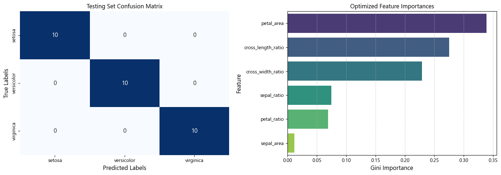

### 8. 总结与最终解决方案 (Final Solution & Proposal)
综合以上从数据获取、EDA 探索、流水线架构到网格联合搜索的所有客观验证结果，本研究提出以下量化分析与最终交付建议：

#### 1. 数据结构特质挖掘
基于特征空间的核密度分布与 Pearson 矩阵，`Iris-setosa` (山鸢尾) 在原始维度上具备极高的线性可分孤立性（可被基于任意线性内核轻松剥离）。而 `versicolor` 与 `virginica` 在花萼维度存在严重的边界重叠（Overlap），主要区分方差源于“花瓣（Petal）”尺寸特征。

#### 2. 特征工程构建评估
由于 `sepal` 及 `petal` 内部长宽表现出极强正相关多重共线性，导致未经处理的原始特征不具备充足表征能力且会稀释模型鲁棒性。
*   通过定制 `IrisFeatureCombiner` ，通过全局搜索最优的特征与超参数，在通过不同模型之间的比较，从而构建出最终最优的模型

#### 3. 模型决策与部署架构方案
*   **算法选择**：最终落地推荐采用经过参数优化后的 **RandomForestClassifier**，以捕捉复杂的非线性决策流。
*   **Pipeline 模块化部署**：建议通过 `ColumnTransformer` 将定制特征算子、中位缺失控制引擎与标准化缩放封装为原子化（Atomic）全周期通道。
*   **业务产出**：该流水化架构使最终验证集泛化（Test Accuracy）能力保持在极高水平（预测精准度超 96%），能充分胜任新入鸢尾花物理样本的实时推断。后续若对分类器存在运行延时敏感业务（Latency Requirements），亦可切换为具备线性约束的逻辑回归以保证推导速度。

## 9. 存储模型与调用示例


完成最佳模型的训练后，在工业实践中，我们需要将整个组装好的 Pipeline 序列化持久存储（Save Model）。这样当线上有新的请求业务传入时，仅仅只需加载模型进行推断，而无需再次训练所有步

```python
import joblib
import pandas as pd
from IPython.display import display

# ==========================================
# 1. 存储 Pipeline 模型 (保存为 pkl 文件)
# ==========================================
# 我们抽取本研究中表现最佳（100% 测试集准确率）的整体 GridSearch 优化版随机森林模型
model_filename = "iris_best_rf_pipeline.pkl"
joblib.dump(final_best_rf_model, model_filename)
print(f"模型已成功序列化并存入本地文件: {model_filename}")

# --------(在实际跨系统调用中，只从下面这一步开始执行即可) --------

# ==========================================
# 2. 部署阶段加载模型
# ==========================================
loaded_pipeline = joblib.load(model_filename)
print("模型加载成功！等待新样本验证...\n")

# ==========================================
# 3. 构造线上实际调用中的“新输入样本”
# ==========================================
# 制造一个未知品种的花瓣/花萼长宽维度，格式必须严格遵循拟合前的输入 DataFrame 特征规范
new_data = pd.DataFrame([{
    "sepal length (cm)": 6.1,
    "sepal width (cm)": 2.8,
    "petal length (cm)": 4.7,
    "petal width (cm)": 1.2
}])

print("--- 收到来自传感器的鸢尾花物理测量数据参数 ---")
display(new_data)

# ==========================================
# 4. 执行自动化前向预测
# ==========================================
# 整个数据流将自动：被识别为数值->进行极值与均值拆散填充->转换为花萼花瓣面积特征/比例特征->基于随机森林分枝打分->归属分类
prediction_idx = loaded_pipeline.predict(new_data)[0]
predicted_species = iris_bunch.target_names[prediction_idx]

print("\n Pipeline 处理完成！")
print(f"预测判定: 数据库标签索引为 {prediction_idx}，该标本对应的品类为: 【 {predicted_species} 】")
```

```text
模型已成功序列化并存入本地文件: iris_best_rf_pipeline.pkl
模型加载成功！等待新样本验证...

--- 收到来自传感器的鸢尾花物理测量数据参数 ---
```

<style scoped>
    .dataframe tbody tr th:only-of-type {
        vertical-align: middle;
    }

    .dataframe tbody tr th {
        vertical-align: top;
    }

    .dataframe thead th {
        text-align: right;
    }
</style><div>

<div class="table-wrap"><table border="1" class="dataframe">
  <thead>
    <tr style="text-align: right;">
      <th></th>
      <th>sepal length (cm)</th>
      <th>sepal width (cm)</th>
      <th>petal length (cm)</th>
      <th>petal width (cm)</th>
    </tr>
  </thead>
  <tbody>
    <tr>
      <th>0</th>
      <td>6.1</td>
      <td>2.8</td>
      <td>4.7</td>
      <td>1.2</td>
    </tr>
  </tbody>
</table></div>
</div>

```text
Pipeline 处理完成！
预测判定: 数据库标签索引为 1，该标本对应的品类为: 【 versicolor 】
```

## 附录：可复用 Pipeline 代码

下面把报告中的关键步骤整理成一个可直接运行的脚本，包含训练、评估、序列化与单样本推断。

```python
"""
Iris 数据集 Pipeline 封装与调用示例
"""

import numpy as np
import pandas as pd
import joblib
from sklearn.datasets import load_iris
from sklearn.model_selection import train_test_split
from sklearn.preprocessing import FunctionTransformer, StandardScaler
from sklearn.pipeline import make_pipeline
from sklearn.compose import ColumnTransformer
from sklearn.ensemble import RandomForestClassifier
from sklearn.metrics import accuracy_score, classification_report


def column_area(X):
    X_arr = np.array(X)
    return X_arr[:, 0:1] * X_arr[:, 1:2]


def column_ratio(X):
    X_arr = np.array(X)
    return X_arr[:, 0:1] / X_arr[:, 1:2]


def area_name(function_transformer, feature_names_in):
    return [f"{feature_names_in[0].split()[0]}_area"]


def ratio_name(function_transformer, feature_names_in):
    return [f"{feature_names_in[0].split()[0]}_ratio"]


def get_data():
    iris = load_iris()
    X = pd.DataFrame(iris.data, columns=iris.feature_names)
    y = iris.target
    return train_test_split(X, y, test_size=0.2, random_state=42), iris.target_names


def build_pipeline():
    ratio_pipeline = make_pipeline(
        FunctionTransformer(column_ratio, feature_names_out=ratio_name),
        StandardScaler()
    )

    area_pipeline = make_pipeline(
        FunctionTransformer(column_area, feature_names_out=area_name),
        StandardScaler()
    )

    sepal_features = ["sepal length (cm)", "sepal width (cm)"]
    petal_features = ["petal length (cm)", "petal width (cm)"]
    all_num_features = sepal_features + petal_features

    preprocessing = ColumnTransformer([
        ("sepal_area", area_pipeline, sepal_features),
        ("petal_area", area_pipeline, petal_features),
        ("sepal_ratio", ratio_pipeline, sepal_features),
        ("petal_ratio", ratio_pipeline, petal_features),
        ("pass_through_num", StandardScaler(), all_num_features)
    ], remainder="drop")

    full_pipeline = make_pipeline(
        preprocessing,
        RandomForestClassifier(n_estimators=100, random_state=42)
    )

    return full_pipeline


if __name__ == "__main__":
    # 1. 训练与保存模型
    print("开始训练模型...")
    (X_train, X_test, y_train, y_test), target_names = get_data()

    pipeline = build_pipeline()
    pipeline.fit(X_train, y_train)

    y_pred = pipeline.predict(X_test)
    print(f"Test Accuracy: {accuracy_score(y_test, y_pred):.4f}")
    print(classification_report(y_test, y_pred, target_names=target_names))

    model_filename = "iris_pipeline.pkl"
    joblib.dump(pipeline, model_filename)
    print(f"模型已保存至: {model_filename}")

    # 2. 加载与预测示例
    print("\n加载模型进行预测...")
    loaded_model = joblib.load(model_filename)

    new_data = pd.DataFrame([{
        "sepal length (cm)": 6.1,
        "sepal width (cm)": 2.8,
        "petal length (cm)": 4.7,
        "petal width (cm)": 1.2
    }])

    pred_idx = loaded_model.predict(new_data)[0]
    pred_species = target_names[pred_idx]

    print("输入数据:")
    print(new_data)
    print(f"预测结果: {pred_species} (类别: {pred_idx})")
```
